**UNIVERSIDAD MAYOR, REAL Y PONTIFICIA DE**  
**SAN FRANCISCO XAVIER DE CHUQUISACA**

**VICERRECTORADO**

**CENTRO DE ESTUDIOS DE POSGRADO E INVESTIGACIÓN**

**ANÁLISIS DE LOS FACTORES ASOCIADOS A LA DESOCUPACIÓN EN JÓVENES DE 16 A 28 AÑOS EN BOLIVIA**

**AUTOR**

**GONZALES SUYO FRANZ REINALDO**

**Sucre - Bolivia**  
**2026**

---

# CESIÓN DE DERECHOS

El presente trabajo de monografía titulado: **"Análisis de los factores asociados a la desocupación en jóvenes de 16 a 28 años en Bolivia"**, presentado como requisito para la obtención del Certificado de Diplomado en Data Science del Centro de Estudios de Posgrado e Investigación (CEPI) de la Universidad Mayor, Real y Pontificia de San Francisco Xavier de Chuquisaca, constituye un documento de investigación aplicada original.

El autor declara la autoría académica e intelectual del contenido, tratamiento metodológico, códigos de procesamiento de datos, modelos analíticos y resultados expuestos en este informe.

Asimismo, en conformidad con la normativa interna de la institución, el autor autoriza y cede a la **Universidad Mayor, Real y Pontificia de San Francisco Xavier de Chuquisaca**, a través del **Centro de Estudios de Posgrado e Investigación (CEPI)** y su sistema de bibliotecas, el derecho para que pueda utilizar, catalogar, publicar y difundir en formato físico o digital el presente informe de proyecto con fines estrictamente académicos e investigativos, siempre que no exista perjuicio de los derechos morales que le corresponden al autor según la legislación vigente.

Sucre, 2026

__________________________________  
**Gonzales Suyo Franz Reinaldo**  
Autor

---

# RESUMEN

La inserción laboral de la juventud en el área urbana de Bolivia presenta asimetrías estructurales asociadas a la transición entre el sistema educativo y el empleo productivo. Se analizaron los factores sociodemográficos, formativos, territoriales y de trayectoria laboral vinculados a la condición de desocupación en personas de 16 a 28 años pertenecientes a la Población Económicamente Activa. La metodología adaptó el ciclo de vida CRISP-DM a los microdatos oficiales de la Encuesta Continua de Empleo del cuarto trimestre de 2025 del Instituto Nacional de Estadística. Se procesó una muestra depurada de 6.649 registros individuales calibrados mediante el ponderador trimestral a un universo de 1.380.841 jóvenes, aplicando tabulaciones ponderadas, pruebas de independencia Chi-cuadrado de Pearson, coeficientes V de Cramér, contrastes de escolaridad ($t$ de Welch y Mann-Whitney) y un modelo dimensional en Power BI Desktop. Los resultados establecieron una tasa de desocupación juvenil del 3,71% y una subocupación por tiempo del 8,70%. Se constató una brecha de género estadísticamente significativa desfavorable hacia las mujeres de 1,84 puntos porcentuales (4,69% frente a 2,85% en varones), una mayor vulnerabilidad en el tramo de 18 a 20 años (4,65%), disparidades regionales encabezadas por Chuquisaca (5,80%) y Tarija (4,72%), un marcado predominio de desocupados cesantes (89,62% frente a 10,38% de aspirantes) y un promedio de escolaridad significativamente superior en jóvenes desocupados respecto a los ocupados (13,01 frente a 12,64 años de estudio). La calidad técnica y consistencia del estudio se validaron mediante réplica oficial frente al INE, una auditoría algorítmica automatizada (9,70/10) y el juicio de un panel de ocho expertos independientes (8,63/10 y V de Aiken de 0,882). Se concluyó que la desocupación juvenil no responde a falta de instrucción formal, sino a dificultades de absorción en puestos calificados y a cargas desproporcionadas de cuidado no remunerado, aportando una plataforma interactiva de inteligencia de negocios para orientar políticas públicas focalizadas.

***Palabras clave:*** *Desocupación juvenil, mercado laboral urbano, microdatos ECE, análisis de asociación, inteligencia de negocios.*

---

# I. ÍNDICE DE CONTENIDO

CESIÓN DE DERECHOS ................................................................................................ i

RESUMEN ...................................................................................................................... ii

I. ÍNDICE DE CONTENIDO ............................................................................................. iii

II. ÍNDICE DE TABLAS .................................................................................................. vii

III. ÍNDICE DE FIGURAS ................................................................................................ ix

CAPÍTULO I: INTRODUCCIÓN ...................................................................................... 1

1.1. Antecedentes ........................................................................................................... 1

   1.1.1. Contexto general ................................................................................................ 1

   1.1.2. Antecedentes del empleo juvenil en Bolivia ....................................................... 2

   1.1.3. Información estadística disponible ..................................................................... 3

1.2. Problema o asunto del trabajo .................................................................................. 3

   1.2.1. Descripción de la situación problemática ........................................................... 3

   1.2.2. Delimitación del problema .................................................................................. 4

   1.2.3. Planteamiento del problema ............................................................................... 5

   1.2.4. Objeto de estudio ............................................................................................... 5

1.3. Objetivo general ....................................................................................................... 6

1.4. Objetivos específicos ................................................................................................ 6

1.5. Justificación .............................................................................................................. 6

1.6. Enfoque metodológico .............................................................................................. 8

   1.6.1. Tipo y alcance del trabajo ................................................................................... 8

   1.6.2. Población y unidad de análisis ............................................................................. 8

   1.6.3. Fuentes de información ...................................................................................... 8

   1.6.4. Ruta metodológica ............................................................................................. 8

   1.6.5. Técnicas y herramientas .................................................................................. 10

   1.6.6. Validez, limitaciones y alcance del análisis ....................................................... 10

CAPÍTULO II: MARCO REFERENCIAL ....................................................................... 11

2.1. Marco teórico .......................................................................................................... 11

   2.1.1. Ciencia de Datos: fundamentos y alcance ........................................................ 11

   2.1.2. Estadística descriptiva aplicada al mercado laboral ......................................... 12

   2.1.3. Análisis Exploratorio de Datos (EDA) ............................................................... 14

   2.1.4. Juventud y mercado laboral .............................................................................. 15

   2.1.5. Población Económicamente Activa y condición de actividad ........................... 16

   2.1.6. Desocupación, subocupación y su medición .................................................... 17

   2.1.7. Transición de la escuela al trabajo .................................................................... 17

   2.1.8. Segmentación del mercado laboral .................................................................. 18

   2.1.9. Factores asociados a la desocupación juvenil .................................................. 19

   2.1.10. Microdatos, encuestas por muestreo y factores de expansión ....................... 20

   2.1.11. Metodología CRISP-DM como ruta de trabajo ................................................ 21

   2.1.12. Python y Pandas como herramientas de análisis ........................................... 21

   2.1.13. Business Intelligence y visualización de datos ............................................... 22

   2.1.14. Power BI: arquitectura, componentes y aplicación ......................................... 23

   2.1.15. Modelo conceptual del trabajo ........................................................................ 24

2.2. Marco contextual .................................................................................................... 26

   2.2.1. Contexto normativo de la juventud en Bolivia ................................................... 27

   2.2.2. Contexto socioeconómico y demográfico de Bolivia ......................................... 28

   2.2.3. Mercado laboral urbano boliviano ..................................................................... 28

   2.2.4. Situación de la juventud en el contexto regional ............................................... 29

   2.2.5. Contexto educativo de la población joven ......................................................... 30

   2.2.6. Entorno estadístico y fuentes de datos ............................................................. 30

   2.2.7. Delimitación geográfica y temporal ................................................................... 31

   2.2.8. Síntesis del marco contextual ........................................................................... 31

CAPÍTULO III: RESULTADOS ..................................................................................... 33

3.1. Presentación de resultados .................................................................................... 33

   3.1.1. Contexto metodológico y dimensional .............................................................. 33

   3.1.2. Trazabilidad del desarrollo bajo la metodología CRISP-DM ............................. 36

   3.1.3. Componentes del trabajo final e ingeniería de datos ........................................ 37

   3.1.4. Resultados del análisis descriptivo univariado .................................................. 39

   3.1.5. Resultados del análisis bivariado y pruebas de asociación .............................. 43

   3.1.6. Desagregaciones por dimensión analítica ........................................................ 46

   3.1.7. Arquitectura del modelo dimensional para Power BI Desktop .......................... 63

   3.1.8. Evidencia del cuadro de mando interactivo en Power BI Desktop .................... 65

3.2. Análisis de resultados ............................................................................................. 84

   3.2.1. Interpretación de la vulnerabilidad etaria en la inserción laboral inicial ............ 85

   3.2.2. La brecha estructural de género en el mercado laboral juvenil ........................ 85

   3.2.3. Asimetría territorial y fragilidad laboral en Chuquisaca y regiones del sur ....... 86

   3.2.4. La paradoja del desempleo ilustrado en el mercado informal ........................... 87

   3.2.5. Dinámica de cesantía y canales de intermediación laboral .............................. 89

   3.2.6. Articulación de los resultados con los objetivos específicos del trabajo ........... 89

   3.2.7. Implicaciones prácticas y metodológicas de los resultados .............................. 90

   3.2.8. Limitaciones del alcance analítico .................................................................... 91

3.3. Auditoría externa y evaluación experto de inteligencia artificial .............................. 93

   3.3.1. Justificación y metodología de la evaluación automatizada ............................. 93

   3.3.2. Dictamen crítico por pilar e inspección de evidencias ...................................... 96

   3.3.3. Consideraciones críticas sobre el funcionamiento del mercado laboral en Bolivia ............................................................................................................................ 98

3.4. Validación Metodológica y Técnica por Panel de Personas Expertas ................. 98

   3.4.1. Propósito y protocolo de consulta al panel de pares ......................................... 98

   3.4.2. Síntesis psicométrica y cuantitativa de resultados ........................................... 99

   3.4.3. Dictamen final y síntesis cualitativa de retroalimentación ............................. 100

CONCLUSIONES Y RECOMENDACIONES .............................................................. 102

REFERENCIAS BIBLIOGRÁFICAS .......................................................................... 107

ANEXOS ..................................................................................................................... 110

   Anexo 1: Fundamentación teórica y formulación matemática de las pruebas estadísticas de asociación ................................................................................................................. 110

   Anexo 2: Diccionario metodológico y reglas de depuración de microdatos ................. 113

   Anexo 3: Catálogo y formulación técnica de medidas DAX en Power BI Desktop ....... 115

   Anexo 4: Protocolo de validación y contraste de hipótesis para escolaridad .............. 117

   Anexo 5: Matriz de trazabilidad metodológica del ciclo CRISP-DM ........................... 119

   Anexo 6: Código fuente del módulo de preparación de microdatos (data_processing.py) ....................................................................................................................................... 121

   Anexo 7: Código fuente del módulo de análisis estadístico (statistical_analysis.py) ... 123

   Anexo 8: Código fuente del catálogo de figuras analíticas (visualization.py) ............. 125

   Anexo 9: Arquitectura y código de ejecución del motor de auditoría (run_audit.py) .... 126

   Anexo 10: Instrumento y resultados detallados del panel de validación por expertos . 127

---

# II. ÍNDICE DE TABLAS

TABLA N. 1: Fuentes de información previstas ............................................................... 8

TABLA N. 2: Fases de CRISP-DM adaptadas al proyecto .............................................. 9

TABLA N. 3: Técnicas de Ciencia de Datos aplicadas en el proyecto ........................... 12

TABLA N. 4: Dimensiones y variables de análisis ......................................................... 19

TABLA N. 5: Variables educativas disponibles en las fuentes de datos ........................ 30

TABLA N. 6: Dimensión metodológica y aplicación en ciencia de datos ....................... 33

TABLA N. 7: Cumplimiento de hitos del proceso metodológico (CRISP-DM) ............... 36

TABLA N. 8: Componentes técnicos de la solución en ciencia de datos ....................... 37

TABLA N. 9: Indicadores del mercado laboral juvenil urbano en Bolivia (cuarto trimestre de 2025) ............................................................................................................................ 40

TABLA N. 10: Matriz de pruebas de asociación estadística con la condición de desocupación juvenil ............................................................................................................................ 44

TABLA N. 11: Tasa de desocupación juvenil según tramo etario (Bolivia urbana, 4T-2025) ......................................................................................................................................... 46

TABLA N. 12: Tasa de desocupación juvenil según sexo (Bolivia urbana, 4T-2025) .... 48

TABLA N. 13: Tasa de desocupación juvenil por departamento (Bolivia urbana, 4T-2025) ......................................................................................................................................... 50

TABLA N. 14: Comparación de años de escolaridad entre jóvenes ocupados y desocupados ......................................................................................................................................... 53

TABLA N. 15: Canales de búsqueda de empleo utilizados por jóvenes desocupados urbanos ......................................................................................................................................... 60

TABLA N. 16: Estructura y catálogo de páginas del cuadro de mando analítico en Power BI Desktop ........................................................................................................................... 65

TABLA N. 17: Matriz sintética de hallazgos del análisis del mercado laboral juvenil urbano ......................................................................................................................................... 91

TABLA N. 18: Matriz de evaluación, rúbrica y calificaciones por pilar técnico (Lead Data Scientist AI) .................................................................................................................... 93

TABLA N.º 19: Matriz psicométrica y síntesis de resultados del panel de validación por expertos ............................................................................................................................ 99

---

# III. ÍNDICE DE FIGURAS

FIGURA N. 1: Bolivia urbana: tasa de desocupación general y juvenil, cuarto trimestre de 2025 .................................................................................................................................... 2

FIGURA N. 2: Ruta metodológica CRISP-DM adaptada al proyecto .............................. 9

FIGURA N. 3: Modelo conceptual del análisis de factores asociados a la desocupación juvenil ......................................................................................................................................... 24

DIAGRAMA N. 1: Flujo metodológico de preparación y calibración de microdatos (ECE 4T-2025) ............................................................................................................................ 35

FIGURA N. 4: Comparación de la tasa de desocupación general urbana y juvenil (cuarto trimestre de 2025) ............................................................................................................ 42

FIGURA N. 5: Tasa de desocupación juvenil por tramo etario (cuarto trimestre de 2025) ......................................................................................................................................... 47

FIGURA N. 6: Tasa de desocupación juvenil según sexo y brecha de género (cuarto trimestre de 2025) ............................................................................................................ 49

FIGURA N. 7: Tasa de desocupación juvenil por departamento (cuarto trimestre de 2025) ......................................................................................................................................... 52

FIGURA N. 8: Distribución de años de estudio: jóvenes ocupados y desocupados urbanos ......................................................................................................................................... 55

FIGURA N. 9: Tasa de desocupación juvenil según nivel educativo formal .................. 56

FIGURA N. 10: Tasa de desocupación juvenil según asistencia escolar o académica ... 57

FIGURA N. 11: Composición de la desocupación juvenil: cesantes y aspirantes ......... 59

FIGURA N. 12: Mecanismos principales de búsqueda de empleo en jóvenes desocupados ......................................................................................................................................... 61

FIGURA N. 13: Tasa de desocupación juvenil según tipología de hogar ...................... 62

DIAGRAMA N. 2: Arquitectura del modelo dimensional en estrella (Star Schema) implementado en Power BI Desktop .................................................................................... 64

FIGURA N. 14: Vista del cuadro de mando en Power BI: Panorama laboral juvenil urbano (Página 1) ........................................................................................................................... 67

FIGURA N. 15: Vista del cuadro de mando en Power BI: Desocupación por tramo etario (Página 2) ........................................................................................................................... 70

FIGURA N. 16: Vista del cuadro de mando en Power BI: Capital de personas y nivel formativo (Página 3) ............................................................................................................ 73

FIGURA N. 17: Vista del cuadro de mando en Power BI: Género y disparidades departamentales (Página 4) ................................................................................................ 76

FIGURA N. 18: Vista del cuadro de mando en Power BI: Perfil de cesantes y aspirantes (Página 5) ........................................................................................................................... 79

FIGURA N. 19: Vista del cuadro de mando en Power BI: Síntesis estratégica y políticas públicas (Página 6) ............................................................................................................ 82

DIAGRAMA N. 3: Modelo conceptual de interrelación entre factores determinantes y la desocupación juvenil urbana ............................................................................................ 84

DIAGRAMA N. 4: Mecanismo de divergencia laboral y la paradoja del desempleo ilustrado en el entorno urbano boliviano ............................................................................................ 88

FIGURA N. 20: Diagrama de radar de la evaluación integral de ciencia de datos por pilares analíticos ............................................................................................................................ 95

---

# **CAPÍTULO I: INTRODUCCIÓN**

## **1.1. ANTECEDENTES**

### **1.1.1. Contexto general**

La incorporación de las personas jóvenes al mercado laboral constituye un hito determinante en la transición entre el sistema educativo y la vida productiva. Durante esta etapa coinciden la culminación de la formación escolar, técnica o universitaria, la búsqueda del primer empleo y la acumulación de experiencia laboral. No obstante, las oportunidades de inserción no son homogéneas y se encuentran condicionadas por el ciclo vital, las credenciales educativas, los recursos socioeconómicos del hogar y el entorno productivo donde se busca trabajo.

En América Latina y el Caribe, la Organización Internacional del Trabajo (OIT) ha señalado que la juventud enfrenta mayores dificultades estructurales para acceder a empleos formales y estables respecto a la población adulta, aun en periodos de reactivación macroeconómica. El informe regional *Juventud en cambio* (OIT, 2025b) y los estudios sobre trayectorias laborales de la CEPAL y la OIT (2017, 2025) destacan la persistencia de barreras asociadas con la precariedad contractual, la segregación de género y las desigualdades en los procesos de transición hacia el trabajo decente.

### **1.1.2. Antecedentes del empleo juvenil en Bolivia**

En el Estado Plurinacional de Bolivia, el marco legal define como jóvenes a las personas de 16 a 28 años cumplidos conforme a la Ley N.º 342 de la Juventud de 2013 (Estado Plurinacional de Bolivia, 2013). La norma consagra el derecho al trabajo digno, la estabilidad laboral, el reconocimiento de prácticas profesionales como experiencia laboral previa y la creación de incentivos para la inserción en el primer empleo. Este intervalo abarca realidades diversas: desde adolescentes en transición secundaria hasta profesionales jóvenes en etapa de consolidación laboral.

Un antecedente sectorial relevante lo constituye el diagnóstico de la OIT sobre el empleo juvenil y el bono demográfico en Bolivia (OIT, 2019), el cual subraya que las trayectorias de los jóvenes combinan simultáneamente actividades educativas, obligaciones familiares y búsquedas activas de empleo en un entorno de alta informalidad. De acuerdo con las estadísticas oficiales del Instituto Nacional de Estadística (INE) correspondientes al cuarto trimestre de 2025, la tasa de desocupación general urbana se situó en 2,30%, mientras que en la población de 16 a 28 años alcanzó el 3,71%, coexistiendo con una tasa de subocupación juvenil por horas del 8,70% (INE, 2026a). Estas cifras evidencian que, a pesar de niveles agregados de desempleo moderados, la juventud soporta una sobreexposición sensible a la inestabilidad y subutilización de su mano de obra.

**FIGURA N. 1: Bolivia urbana: tasa de desocupación general y juvenil, cuarto trimestre de 2025**

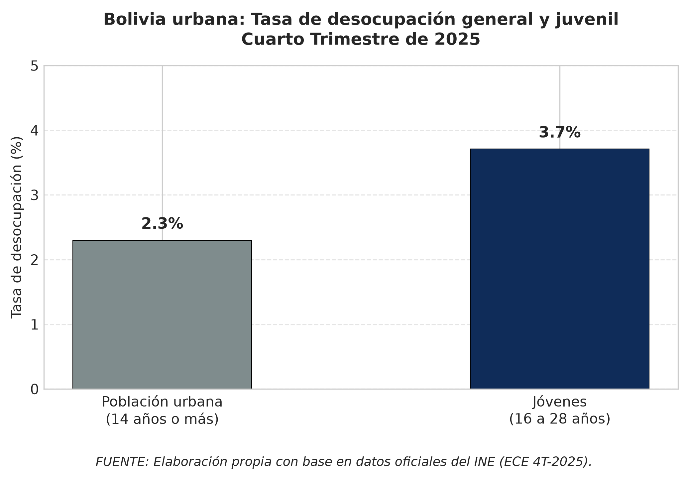

*FUENTE: Elaboración propia con base en datos oficiales del INE (ECE 4T-2025).*

### **1.1.3. Información estadística disponible**

El desarrollo del proyecto es viable gracias a la disponibilidad de los microdatos abiertos de la Encuesta Continua de Empleo (ECE) del cuarto trimestre de 2025, relevada por el INE (INE, 2026b). Esta base de datos cuenta con 52.650 registros brutos y 121 variables que describen características sociodemográficas, educativas, ocupacionales, canales de búsqueda, trayectoria laboral y los factores de expansión muestral indispensables para producir inferencias representativas a escala nacional y departamental.

Como fuentes complementarias, se dispone de la Encuesta de Hogares 2025 para el contraste de variables socioeconómicas y de la Encuesta de Niñas, Niños y Adolescentes que Realizan Actividad Laboral o Trabajan (ENNA 2019) para caracterizar al grupo de 16 y 17 años (INE, 2019, 2026c). Estos antecedentes permiten estructurar un estudio de ciencia de datos orientado a desagregar la desocupación juvenil por edad, sexo, educación, territorio y trayectoria, aportando evidencia cuantitativa más allá de los agregados oficiales.

## **1.2. PROBLEMA O ASUNTO DEL TRABAJO**

### **1.2.1. Descripción de la situación problemática**

Durante los últimos años, la tasa de desocupación urbana agregada en Bolivia ha mostrado signos de estabilización. Sin embargo, las cifras oficiales revelan que la juventud de 16 a 28 años experimenta una tasa de desempleo abierto de 3,71%, cifra 1,61 veces mayor a la tasa general urbana (2,30%). Además, la subocupación horaria afecta al 8,70% de los jóvenes ocupados (115.737 personas), elevando la presión conjunta de desocupación abierta y subocupación horaria al 12,09% de la fuerza de trabajo juvenil urbana (166.933 jóvenes sobre una PEA de 1.380.841).

El desempleo juvenil presenta una marcada heterogeneidad interna: varía según la salida escolar obligatoria, la culminación de estudios superiores, las cargas de cuidado que penalizan a las mujeres y las diferencias de dinamismo productivo entre departamentos. Evaluar una tasa global sin desagregación cuantitativa oculta las barreras específicas de inserción y limita la formulación de políticas focalizadas. Por tanto, el problema central radica en caracterizar los determinantes que se asocian sistemáticamente a la condición de desocupación en los jóvenes urbanos bolivianos.

### **1.2.2. Delimitación del problema**

El estudio se circunscribe al área urbana de Bolivia y toma como universo objetivo a las personas de 16 a 28 años pertenecientes a la Población Económicamente Activa (PEA). Dentro de este universo, la desocupación abierta constituye la condición de resultado, empleando a la población ocupada como grupo de referencia estadístico.

De las 121 variables originales que contiene la ECE 4T-2025, la selección de factores se delimitó estrictamente bajo dos criterios operativos. Primero, la observabilidad simultánea en ambos grupos de comparación: variables laborales como ingresos, horas trabajadas o tipo de contrato solo existen para personas ocupadas, mientras que el tiempo y canal de búsqueda solo se registran en desocupados; por ello, el análisis asociativo debía concentrarse en atributos medidos de manera uniforme en toda la PEA juvenil. Segundo, la suficiencia muestral: aunque la muestra depurada alcanza 6.649 registros, solamente 243 personas corresponden a jóvenes desocupados en el corte trimestral, lo que impide realizar cruces conjuntos de múltiples variables a la vez sin atomizar las categorías por debajo del umbral mínimo estadístico. Bajo estos criterios, las variables seleccionadas comprenden la dimensión sociodemográfica (edad en cuatro cohortes: 16-17, 18-20, 21-24 y 25-28 años, y sexo), la dimensión educativa (nivel formativo, años de escolaridad y asistencia académica), la dimensión territorial (nueve departamentos y macrorregiones) y la dimensión familiar y de trayectoria laboral (tipología de hogar, parentesco, condición de cesante o aspirante y mecanismos de búsqueda activa), procesadas de forma transversal con factores de expansión muestral.

### **1.2.3. Planteamiento del problema**

¿Cuáles son los factores sociodemográficos, educativos, territoriales y de trayectoria laboral asociados a la desocupación de jóvenes de 16 a 28 años en el área urbana de Bolivia?

### **1.2.4. Objeto de estudio**

El objeto de estudio está constituido por los factores asociados a la desocupación de jóvenes de 16 a 28 años en el área urbana de Bolivia, considerando sus características sociodemográficas, educativas, territoriales y de trayectoria laboral. La unidad de análisis corresponde a cada persona joven activa en la PEA urbana registrada en la encuesta oficial.

## **1.3. OBJETIVO GENERAL**

Analizar los factores sociodemográficos, educativos, territoriales y de trayectoria laboral asociados a la desocupación de jóvenes de 16 a 28 años en el área urbana de Bolivia, para la identificación de factores asociados, brechas y diferencias en su inserción laboral a partir de información estadística oficial del mercado de trabajo.

## **1.4. OBJETIVOS ESPECÍFICOS**

1. Recopilar y organizar datos estadísticos provenientes de fuentes oficiales del mercado laboral boliviano, aplicando procesos de selección, limpieza y estructuración que permitan disponer de un conjunto de información confiable y listo para su análisis.
2. Procesar y analizar los datos con herramientas de programación estadística en Python, aplicando técnicas de filtrado, transformación, segmentación por grupos de edad y análisis de asociaciones que permitan identificar los factores vinculados a la desocupación juvenil.
3. Diseñar y construir visualizaciones e indicadores analíticos en inteligencia de negocios que faciliten la interpretación de las brechas sociolaborales, diferencias entre grupos y perfiles de desocupación identificados en la juventud urbana.
4. Validar los resultados obtenidos mediante la verificación de consistencia de los datos procesados, su contrastación frente a indicadores oficiales publicados y literatura regional, la ejecución de una auditoría técnica automatizada y la evaluación externa por un panel de expertos en ciencia de datos y análisis cuantitativo.

## **1.5. JUSTIFICACIÓN**

La justificación de la investigación se sustenta en tres dimensiones:

*Justificación social y económica:* La desocupación en etapas tempranas genera efectos cicatriz en las carreras laborales, restringiendo la acumulación de experiencia y condenando a los jóvenes a empleos precarios o informales de baja productividad. En un país donde la informalidad urbana supera el 75%, el desempleo juvenil impacta directamente en el bienestar de los hogares y en la cohesión social, demandando diagnósticos que orienten programas de formalización e inserción laboral oportuna.

*Justificación práctica de políticas públicas:* Pasar de cifras agregadas a matrices bivariadas de riesgo permite a los órganos estatales, municipios e instituciones formativas priorizar recursos hacia los colectivos de mayor vulnerabilidad: bachilleres sin experiencia laboral (18 a 20 años), mujeres afectadas por cargas de cuidado y regiones del sur como Chuquisaca y Tarija con limitadas oportunidades de colocación formal.

*Justificación metodológica en ciencia de datos:* En encuestas por muestreo probabilístico como la ECE, el uso de recuentos muestrales simples genera distorsiones severas en la magnitud de las brechas. La articulación de pipelines reproducibles en Python con ponderación muestral estricta y modelos dimensionales en Power BI ofrece un marco metodológico confiable para auditar, visualizar y replicar con exactitud los indicadores oficiales del mercado laboral.

## **1.6. ENFOQUE METODOLÓGICO**

### **1.6.1. Tipo y alcance del trabajo**

El estudio adopta un enfoque cuantitativo, computacional, aplicado y no experimental, con alcance descriptivo, diagnóstico y de asociación estadística. Examina relaciones sistemáticas entre las variables del perfil juvenil y la condición de actividad económica mediante un corte transversal al cuarto trimestre de 2025.

### **1.6.2. Población y unidad de análisis**

La población de estudio está integrada por 1.380.841 jóvenes de 16 a 28 años residentes en el área urbana de Bolivia pertenecientes a la PEA, representados por una muestra efectiva observada de 6.649 registros individuales de la ECE 4T-2025. La unidad de análisis es la persona joven encuestada.

### **1.6.3. Fuentes de información**

La fuente primaria corresponde a los microdatos de la Encuesta Continua de Empleo del cuarto trimestre de 2025 provistos por el INE, complementada por fuentes sectoriales oficiales descritas en la Tabla N. 1.

**TABLA N. 1: Fuentes de información previstas**

| Fuente | Uso en el trabajo | Carácter |
| :---- | :---- | :---- |
| **Encuesta Continua de Empleo 4T-2025 (INE)** | Microdatos principales para condición de actividad, educación, búsqueda, trayectoria laboral, territorio y ponderaciones. | Principal |
| **Boletines y series ECE (INE)** | Contexto histórico de tasas e indicadores agregados. | Complementaria |
| **Encuesta de Hogares 2025 (INE)** | Contraste de variables socioeconómicas, educativas y laborales. | Complementaria |
| **ENNA 2019 (INE)** | Contexto para adolescentes, especialmente el tramo de 16 y 17 años. | Complementaria |
| **OIT / ILOSTAT** | Marco regional, conceptos de transición escuela-trabajo e indicadores comparativos. | Contextual |
| **Normativa y publicaciones del MTEPS** | Marco legal e institucional de juventud e inserción laboral. | Contextual |

*FUENTE: Elaboración propia con base en INE, OIT y normativa boliviana.*

### **1.6.4. Ruta metodológica**

El proyecto adopta de manera adaptada el marco de trabajo estándar CRISP-DM (*Cross-Industry Standard Process for Data Mining*), organizando el proceso técnico en seis fases interactivas.

**TABLA N. 2: Fases de CRISP-DM adaptadas al proyecto**

| Fase | Aplicación en el perfil |
| :---- | :---- |
| **1. Comprensión del problema** | Definición del alcance, población, pregunta, objetivos e indicadores requeridos. |
| **2. Comprensión de los datos** | Revisión de diccionarios, calidad, cobertura, variables, categorías y factores de expansión. |
| **3. Preparación de los datos** | Filtrado 16-28 años, área urbana y PEA; limpieza, recodificación, integración y creación de segmentos. |
| **4. Análisis estadístico y diagnóstico** | Tasas ponderadas, distribuciones, tablas cruzadas, comparación de grupos y medidas de asociación. |
| **5. Evaluación y validación** | Comprobaciones de consistencia, contraste con cifras oficiales y revisión de resultados poco estables. |
| **6. Comunicación y visualización** | Construcción de gráficos, tablero en Power BI, interpretación y recomendaciones. |

*FUENTE: Elaboración propia con base en IBM (s. f.).*

**FIGURA N. 2: Ruta metodológica CRISP-DM adaptada al proyecto**

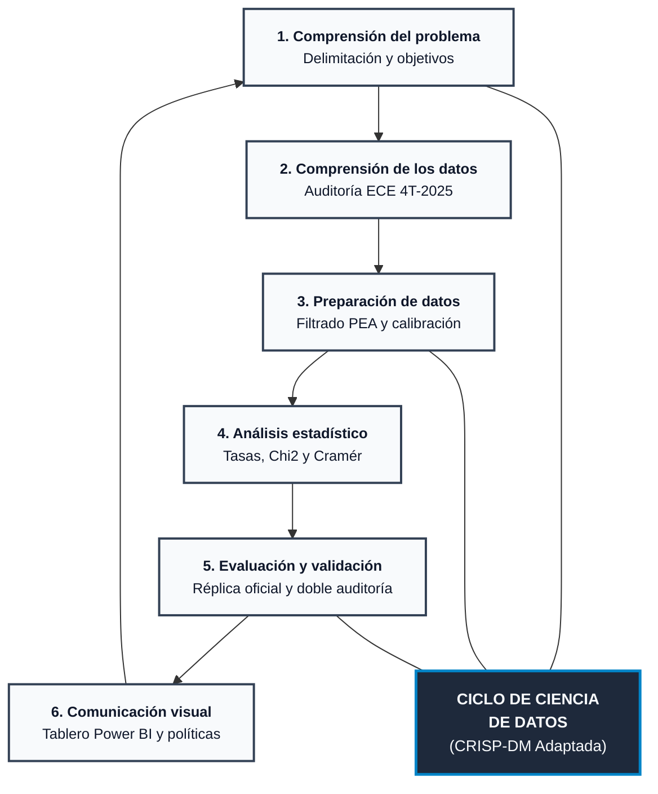

*FUENTE: Elaboración propia con base en IBM (s. f.).*

### **1.6.5. Técnicas y herramientas**

La preparación y el análisis de microdatos se desarrollan en Python (Pandas, NumPy, SciPy y Statsmodels), asegurando la vectorización de operaciones ponderadas por `peso_trimestral`. Se aplican contrastes bivariados de asociación Chi-cuadrado de Pearson, coeficientes V de Cramér y pruebas de comparación de escolaridad ($t$ de Welch y Mann-Whitney). Para la capa de comunicación analítica se optó por Power BI Desktop con modelado en estrella (*Star Schema*) y medidas DAX ponderadas, debido a que su motor columnar en memoria y su evaluación dinámica por contexto de filtro permiten cruzar simultáneamente múltiples dimensiones recalculando en tiempo real el factor de expansión muestral sin degradar el rendimiento ni duplicar tablas planas.

### **1.6.6. Validez, limitaciones y alcance del análisis**

El análisis estadístico bivariado factor por factor responde al límite muestral de la población desocupada en un corte trimestral ($n = 243$ casos observados), evitando la fragmentación excesiva de celdas que ocurriría en tabulaciones multivariadas simultáneas. La validación contempla controles técnicos de calidad muestral (ausencia de valores nulos o negativos en el ponderador), replicación exacta de las tasas del INE para el 4T-2025 (3,71% y 8,70%), evaluación ciega automatizada mediante agente evaluador de Inteligencia Artificial (calificación 9,70/10) y contrastación formal por un panel externo de ocho expertos independientes (100% de dictámenes favorables, calificación global de 8,63/10 y V de Aiken de 0,882).

---

# **CAPÍTULO II - MARCO REFERENCIAL**

## **2.1. MARCO TEÓRICO**

### **2.1.1. Ciencia de Datos: fundamentos y alcance**

La Ciencia de Datos es un campo interdisciplinario que combina principios estadísticos, técnicas computacionales y conocimiento sustantivo de dominio para extraer conocimiento verificable y relaciones significativas a partir de conjuntos de datos estructurados y no estructurados. Su propósito principal radica en transformar registros crudos en evidencia empírica accionable que fundamente la toma de decisiones en políticas públicas y gestión social (Provost & Fawcett, 2013). Lejos de reducirse a un conjunto aislado de algoritmos predictivos, articula métodos rigurosos de medición e inferencia con la automatización reproducible de procesos.

En el estudio de los mercados de trabajo, la Ciencia de Datos permite superar la simple observación de agregados macroeconómicos para abordar la heterogeneidad de los fenómenos laborales. En este trabajo se aplica bajo un enfoque descriptivo, asociativo y de diagnóstico analítico (Wickham & Grolemund, 2017; Wickham, Çetinkaya-Rundel & Grolemund, 2023). El propósito central consiste en cuantificar las disparidades de inserción, caracterizar perfiles de vulnerabilidad y examinar asociaciones estadísticas entre los factores sociolaborales de los jóvenes y su condición de desocupación en el área urbana de Bolivia.

**TABLA N. 3: Técnicas de Ciencia de Datos aplicadas en el proyecto**

| Técnica | Función en el proyecto |
| :---- | :---- |
| **Análisis descriptivo** | Resumir la distribución de la desocupación juvenil por edad, sexo, educación y territorio. |
| **Análisis exploratorio** | Detectar regularidades, anomalías, valores atípicos y calidad estructural en los microdatos. |
| **Análisis de asociaciones** | Identificar qué características aparecen vinculadas con mayor intensidad estadística a la desocupación juvenil. |
| **Segmentación** | Comparar subgrupos etarios, educativos y territoriales para detectar brechas. |
| **Visualización analítica** | Comunicar los hallazgos de forma clara e interactiva mediante un modelo dimensional. |

**FUENTE:** Elaboración propia con base en Provost y Fawcett (2013) y Wickham y Grolemund (2017).

### **2.1.2. Estadística descriptiva aplicada al mercado laboral**

La estadística descriptiva proporciona los fundamentos para organizar, resumir y caracterizar conjuntos de datos cuantitativos sin distorsionar su estructura original. En encuestas de empleo, permite estimar tasas oficiales, describir distribuciones de variables sociodemográficas y dimensionar disparidades entre subgrupos poblacionales (Walpole, Myers, Myers & Ye, 2012). Para variables continuas con asimetría positiva, como los años de estudio o el tiempo de búsqueda, las medidas de tendencia central como la mediana y los cuantiles ofrecen parámetros más robustos que la media aritmética, complementándose con medidas de dispersión para evaluar la heterogeneidad interna de los grupos desocupados.

El análisis bivariado de variables cualitativas se fundamenta en tablas de contingencia cruzadas con la condición de actividad económica. Para determinar si las diferencias observadas entre categorías responden a relaciones sistemáticas o al azar del muestreo, se aplica la prueba de independencia Chi-cuadrado de Pearson (Agresti, 2007). Esta prueba evalúa la discrepancia entre las frecuencias observadas en la muestra y las frecuencias esperadas bajo el supuesto de independencia; cuando el nivel de significancia obtenido es menor a 0,05, se rechaza la hipótesis nula de independencia.

Dado que el estadístico Chi-cuadrado es sensible al tamaño muestral, se incorpora el coeficiente V de Cramér como métrica estandarizada del tamaño del efecto. Este coeficiente normaliza el valor entre 0 (ausencia de asociación) y 1 (asociación determinista perfecta), permitiendo cuantificar la magnitud práctica de cada vínculo sociodemográfico. Es fundamental puntualizar que estas pruebas miden exclusivamente grado de asociación estadística diagnóstica, evitando cualquier atribución de causalidad directa entre las variables analizadas.

### **2.1.3. Análisis Exploratorio de Datos (EDA)**

El Análisis Exploratorio de Datos (EDA), formalizado por John Wilder Tukey en 1977, constituye una postura metodológica enfocada en inspeccionar la estructura, consistencia y comportamiento empírico de los datos antes de formular supuestos rígidos o aplicar pruebas confirmatorias. Su valor radica en permitir que las regularidades y anomalías emerjan directamente de los registros, facilitando la comprensión de las dimensiones analizadas y orientando el planteamiento de preguntas analíticas precisas (Tukey, 1977; Wickham & Grolemund, 2017).

En este estudio, el EDA se aplica sobre los microdatos de la Encuesta Continua de Empleo (ECE) para auditar la integridad de las variables, verificar tipos de datos, detectar valores atípicos y caracterizar las distribuciones muestrales de edad, sexo, nivel formativo y localización geográfica. Asimismo, este proceso exploratorio orienta el tratamiento de registros perdidos, evalúa la pertinencia de las recodificaciones analíticas y comprueba la consistencia de las agrupaciones etarias antes de incorporar los ponderadores muestrales definitivos.

### **2.1.4. Juventud y mercado laboral**

La juventud constituye una etapa del ciclo de vida caracterizada por transiciones formativas, familiares y laborales decisivas. Lejos de constituir una categoría homogénea, su delimitación depende de convenciones institucionales y marcos jurídicos específicos. En Bolivia, la Ley N.º 342 de la Juventud, promulgada el 5 de febrero de 2013, define como jóvenes a las personas comprendidas entre los 16 y 28 años de edad cumplidos, reconociendo derechos fundamentales como el acceso al trabajo digno, la estabilidad laboral, la acreditación de prácticas formativas como experiencia previa y el fomento de condiciones para el primer empleo (Estado Plurinacional de Bolivia, 2013).

Esta amplitud etaria reúne realidades disímiles: desde adolescentes de 16 y 17 años que concluyen la etapa escolar bajo marcos normativos de protección especial, hasta personas de 25 a 28 años que culminaron estudios universitarios y buscan consolidarse profesionalmente. El Instituto Nacional de Estadística (INE) adopta este mismo intervalo de 16 a 28 años en sus mediciones periódicas del mercado de trabajo (INE, 2026a). La inserción laboral juvenil representa un proceso heterogéneo condicionado por la confluencia entre la etapa educativa, las obligaciones económicas familiares y la capacidad de absorción del aparato productivo urbano (CEPAL & OIT, 2017).

### **2.1.5. Población Económicamente Activa y condición de actividad**

La cuantificación del empleo y el desempleo requiere ubicar a las personas dentro de la estructura de actividad económica formalizada por la Organización Internacional del Trabajo (OIT, s. f.-b). El universo de referencia lo constituye la Población Económicamente Activa (PEA), integrada por personas en edad de trabajar que aportan o están disponibles para aportar mano de obra para la producción de bienes y servicios. La PEA se subdivide en ocupados (quienes realizaron alguna actividad económica remunerada de al menos una hora en el periodo de referencia, o mantuvieron un empleo formal aunque no trabajaran temporalmente) y desocupados abiertos (quienes no tienen empleo, están disponibles para laborar y realizaron gestiones activas de búsqueda).

Quienes no cumplen simultáneamente con los criterios de disponibilidad y búsqueda activa forman parte de la población económicamente inactiva, categoría que incluye a estudiantes exclusivos, personas dedicadas al cuidado del hogar, jubilados o personas con impedimentos permanentes. Esta distinción es fundamental para no computar erróneamente a jóvenes que estudian a tiempo completo como desocupados. A su vez, la ECE desagrega a los desocupados en cesantes (personas con trayectoria previa que perdieron o concluyeron su empleo) y aspirantes (quienes gestionan su primera inserción laboral sin experiencia previa), diferenciación crucial para diseñar respuestas de política pública diferenciadas (INE, 2026b).

### **2.1.6. Desocupación, subocupación y su medición**

La tasa de desocupación mide la proporción de la PEA que busca activamente una ocupación sin conseguirla, calculándose como el cociente porcentual entre la población desocupada y la población activa total. En el cuarto trimestre de 2025, la tasa de desocupación urbana nacional en Bolivia se situó en 2,30%, mientras que para el segmento juvenil de 16 a 28 años alcanzó el 3,71%, lo que refleja una incidencia 1,61 veces mayor en la juventud respecto al promedio general de las ciudades (INE, 2026a).

La evaluación del empleo juvenil exige analizar también la subutilización horaria. La tasa de subocupación por tiempo de trabajo mide el porcentaje de ocupados que laboran menos de 40 horas semanales, desean trabajar más horas y se encuentran disponibles para hacerlo; para el cuarto trimestre de 2025, este indicador alcanzó el 8,70% sobre la población ocupada juvenil (INE, 2026a). Si se agrupan los 51.196 jóvenes en desocupación abierta y los 115.737 jóvenes en subocupación por horas respecto al total de la PEA juvenil (1.380.841 personas), la proporción conjunta de fuerza de trabajo afectada por falta de empleo o insuficiencia horaria asciende al 12,09%. Asimismo, es necesario distinguir entre desocupación (ausencia total de empleo) e informalidad (empleo activo sin registro tributario, contrato formal ni seguridad social), reconociendo que la alta informalidad urbana en Bolivia modula directamente las tasas abiertas de desocupación.

### **2.1.7. Transición de la escuela al trabajo**

El concepto de transición formativo-laboral describe el proceso mediante el cual los jóvenes abandonan el sistema educativo formal y buscan insertarse de forma estable en el mercado de trabajo (CEPAL & OIT, 2017). El marco de estadísticas del mercado laboral juvenil de la OIT (YouthSTATS) categoriza este tránsito en tres estados: personas con transición concluida (en ocupaciones formales o estables), personas en proceso de transición (desocupados, subocupados por horas o inactivos que desean trabajar) y personas cuya transición no ha comenzado (estudiantes que no forman parte de la fuerza laboral) (OIT, s. f.-b).

Esta perspectiva teórica sustenta la incorporación de variables analíticas como la escolaridad acumulada, la asistencia educativa actual y la condición de cesante o aspirante. Permite comprender que las dificultades laborales de un bachiller de 18 a 20 años que ingresa por primera vez al mercado difieren sustantivamente de las presiones que enfrenta un joven de 25 a 28 años que transita entre ocupaciones temporales tras concluir estudios terciarios.

### **2.1.8. Segmentación del mercado laboral**

La teoría de los mercados de trabajo segmentados postula que el empleo no opera como un mercado homogéneo y competitivo regido por un precio de equilibrio único, sino como un conjunto de submercados separados por barreras estructurales de acceso, estabilidad, remuneración y cumplimiento normativo (OIT, s. f.-a). Esta división genera sectores primarios (empleos protegidos, con seguridad social y contratos estables) y sectores secundarios (ocupaciones precarias, informales y de alta rotación).

Bajo esta mirada, las brechas laborales que afectan a los jóvenes no pueden explicarse de forma exclusiva por su dotación individual de capital humano, sino por los mecanismos de racionamiento del mercado. La concentración de la juventud en actividades de servicios, comercio informal y contratos a plazo fijo condiciona su exposición al desempleo friccional y a la rotación involuntaria, limitando las oportunidades de consolidación profesional independiente del nivel de instrucción alcanzado.

### **2.1.9. Factores asociados a la desocupación juvenil: criterios de delimitación y dimensiones**

La base bruta de la ECE 4T-2025 registra 121 variables originales; sin embargo, no todas resultan utilizables para explicar la desocupación juvenil. La selección y delimitación operativa de factores se sustentó en tres criterios técnicos rigurosos:

1. *Observabilidad común en ocupados y desocupados:* Diversas variables laborales del cuestionario (ingresos salariales, horas semanales trabajadas, tipo de contrato, rama actual de actividad o aportes a la seguridad social) se aplican exclusivamente a quienes ya poseen empleo. Del mismo modo, el tiempo de búsqueda o el mecanismo de postulación solo se relevan en personas desocupadas. Para ejecutar contrastes estadísticos válidos frente a la condición de desocupación, el núcleo de factores comparativos debía existir simultáneamente tanto en los 6.406 jóvenes ocupados como en los 243 desocupados.
2. *Pertinencia teórica y normativa:* Se priorizaron los atributos respaldados por la literatura de transición escuela-trabajo (CEPAL & OIT, 2017) y la legislación boliviana (Ley N.º 342), estructurados en cuatro dimensiones evaluables en toda la PEA y un eje complementario de trayectoria interna para desocupados.
3. *Restricción de tamaño muestral:* Con 243 casos observados de desocupación en un corte trimestral, el cruce simultáneo de múltiples variables fragmentaría la muestra en cientos de subceldas con menos de cinco casos esperados, invalidando la prueba Chi-cuadrado y generando tasas volátiles. Por esta razón, la delimitación metodológica privilegia factores bien definidos evaluados mediante análisis bivariados robustos, reservando el análisis conjunto simultáneo para extensiones futuras con series trimestrales acumuladas.

**TABLA N. 4: Dimensiones y variables de análisis delimitadas**

| Dimensión | Variables seleccionadas (`ECE`) | Universo de aplicación | Sentido analítico |
| :---- | :---- | :---- | :---- |
| **Sociodemográfica** | Edad, grupos etarios (16-17, 18-20, 21-24, 25-28) (`s1_03a`), sexo (`s1_02`) | Toda la PEA juvenil ($n = 6.649$) | Comparar diferencias internas de edad y detectar brechas por sexo. |
| **Educativa** | Nivel educativo (`niv_ed_g`), años de estudio (`aestudio`), asistencia (`s1_09`) | Toda la PEA juvenil ($n = 6.649$) | Evaluar la relación entre credenciales formativas, escolaridad y desocupación. |
| **Territorial** | Departamento de residencia (`depto`) y macrorregión | Toda la PEA juvenil ($n = 6.649$) | Identificar disparidades geográficas entre los nueve ámbitos urbanos del país. |
| **Hogar y parentesco** | Tipología de hogar (`tipohogar`), relación con la jefatura (`s1_05`) | Toda la PEA juvenil ($n = 6.649$) | Examinar el rol del respaldo y la estructura familiar en la inserción laboral. |
| **Trayectoria interna** | Condición de cesante/aspirante (`peadces`/`peadasp`), canal de búsqueda (`s2_08a`), ocupación previa (`cob_uo`) | Solo desocupados ($n = 243$) | Caracterizar la pérdida de empleo frente al primer acceso y las vías de postulación. |
| **Resultado** | Condición de desocupación abierta (`pead`) | Toda la PEA juvenil ($n = 6.649$) | Variable dependiente central para tasas, contrastes y asociaciones. |

**FUENTE:** Elaboración propia con base en los microdatos de la ECE 4T-2025 (INE) y la revisión conceptual.

### **2.1.10. Microdatos, encuestas por muestreo y factores de expansión**

Los microdatos representan la información desagregada a nivel individual recopilada en operativos censales o encuestas de hogares. A diferencia de las publicaciones agregadas en tablas resumen, permiten al investigador manipular directamente las observaciones, aplicar filtros sociodemográficos específicos, derivar variables analíticas y ejecutar pruebas estadísticas (INE, 2026b). La base de la ECE correspondiente al cuarto trimestre de 2025 reúne 52.650 registros brutos y 121 variables que cubren aspectos sociodemográficos, formativos, de actividad y de búsqueda de empleo.

Dado que la ECE utiliza un diseño muestral probabilístico, polietápico, estratificado y por conglomerados, la inferencia poblacional requiere aplicar estrictamente los factores de expansión o ponderadores muestrales (`fact_trim_act`) (Lohr, 2022; Rea & Parker, 2014). Cada factor indica la cantidad de personas de la población total representadas por un informante. Omitir estos ponderadores e inferir mediante recuentos simples alteraría las proporciones poblacionales y sesgaría los resultados debido a probabilidades desiguales de selección. En este proyecto, todas las tasas, distribuciones y totales poblacionales incorporan el factor de expansión, garantizando la réplica exacta del universo juvenil urbano de 1.380.841 personas estimadas por el INE.

### **2.1.11. Metodología CRISP-DM como ruta de trabajo**

Para garantizar el orden, la reproducibilidad y la trazabilidad técnica del proyecto, se adaptó el estándar metodológico interindustrial CRISP-DM (*Cross-Industry Standard Process for Data Mining*) (Wirth & Hipp, 2000; IBM, s. f.). Esta metodología organiza el ciclo de vida del análisis de datos en seis fases interconectadas e iterativas:

1. *Comprensión del problema:* Delimitación del marco normativo (Ley N.º 342), formulación de la pregunta de investigación y definición de objetivos específicos.
2. *Comprensión de los datos:* Auditoría técnica de variables, control de cobertura, valores perdidos y evaluación del diseño muestral en los microdatos de la ECE 4T-2025.
3. *Preparación de los datos:* Filtrado del universo de interés (área urbana, 16 a 28 años y PEA activa), estandarización del factor de expansión a punto flotante y recodificación de dimensiones etarias y territoriales.
4. *Modelado y análisis analítico:* Cálculo vectorizado de tasas ponderadas, tablas de contingencia y contrastes de asociación mediante $\chi^2$ de Pearson, V de Cramér y pruebas de escolaridad.
5. *Evaluación y validación:* Control de consistencia frente a los boletines oficiales del INE, contrastación con la literatura laboral regional, auditoría automatizada del código y evaluación externa por panel de expertos.
6. *Despliegue y visualización:* Modelado dimensional en estrella (*Star Schema*) e implementación del cuadro de mando interactivo en Power BI Desktop, articulando los resultados en recomendaciones de política pública.

### **2.1.12. Python, Pandas y ecosistema científico de análisis**

El desarrollo computacional del proyecto se implementó en Python, lenguaje ampliamente adoptado en ciencia de datos debido a su legibilidad y madurez de su ecosistema analítico (VanderPlas, 2023). Para la gestión de datos tabulares se utilizó la librería Pandas (McKinney, 2010, 2022), cuya estructura de DataFrame posibilita manipulaciones complejas y operaciones agrupadas de forma vectorizada sobre la base numérica de arreglos multidimensionales de NumPy (Harris et al., 2020).

En este estudio, el entorno de Python permitió ejecutar el flujo reproducible de lectura de microdatos brutos del INE, la limpieza y tipado numérico del factor muestral, la segmentación en cohortes etarias, el cálculo de las sumatorias ponderadas poblacionales y la ejecución de pruebas estadísticas con SciPy (Virtanen et al., 2020) y Statsmodels. Asimismo, facilitó la exportación de las figuras analíticas a 300 DPI y la generación de matrices de resultados en formato abierto.

### **2.1.13. Business Intelligence y visualización de datos**

El Business Intelligence (BI) abarca los procesos, metodologías y arquitecturas orientadas a transformar datos depurados en información comprensible y conocimiento estratégico para respaldar la toma de decisiones informada (Sharda, Delen & Turban, 2018; Chen, Chiang & Storey, 2012). Su función trasciende el procesamiento técnico tradicional al incorporar principios de percepción visual, estructuración de interfaces interactivas y narrativa basada en datos (*storytelling*) (Knaflic, 2015).

La visualización de datos se rige por principios de claridad, concisión y maximización de la relación datos-tinta, suprimiendo elementos decorativos que generen ruido cognitivo (Tufte, 2001; Few, 2013). En este proyecto, la capa visual no sustituye el rigor estadístico desarrollado en Python, sino que actúa como vehículo de transferencia tecnológica, organizando los hallazgos en vistas dinámicas que facilitan la exploración de brechas sociolaborales y disparidades territoriales para tomadores de decisiones y el público en general.

### **2.1.14. Power BI: arquitectura, justificación técnica y aplicación**

Power BI Desktop es una plataforma analítica de inteligencia de negocios que integra en un mismo entorno el motor Power Query (Lenguaje M) para la extracción, transformación y carga (ETL), el motor de almacenamiento columnar en memoria VertiPaq y un lienzo interactivo para la exploración ejecutiva de datos (Microsoft, 2026).

La elección arquitectónica de Power BI Desktop frente a herramientas tabulares estáticas o análisis en tablas planas se justifica por cuatro ventajas técnicas determinantes para microdatos con muestreo complejo:

1. *Modelado dimensional en esquema estrella:* Siguiendo la metodología de Kimball y Ross (2013), los microdatos procesados se organizan separando la tabla de hechos (`Fact_MercadoLaboral`) de seis tablas dimensionales conectadas mediante relaciones unidireccionales de uno a muchos (1:N) con integridad referencial activa. Esta estructura evita la redundancia de datos y garantiza que cualquier segmentación territorial, etaria o educativa se propague de manera consistente por todo el modelo.
2. *Evaluación dinámica ponderada mediante DAX:* En una tabla plana tradicional, calcular tasas de desocupación por subgrupos suele inducir errores al promediar porcentajes precalculados o ejecutar recuentos simples de filas. El motor DAX (*Data Analysis Expressions*) opera bajo un contexto de filtro dinámico que evalúa en tiempo real funciones iteradoras y agregadoras (`SUMX`, `DIVIDE`, `CALCULATE` y `KEEPFILTERS`), recalculando tanto el numerador como el denominador ponderados por `peso_trimestral` ante cualquier combinación de filtros seleccionada por el usuario.
3. *Compresión en memoria e interactividad multidimensional:* El motor columnar VertiPaq comprime los 6.649 registros y sus múltiples columnas analíticas en memoria RAM, permitiendo responder en milisegundos a filtros cruzados simultáneos en las seis páginas temáticas del tablero.
4. *Reproducibilidad y trazabilidad en código abierto (PBIP/TMDL):* El proyecto se guarda en formato PBIR/TMDL (*Tabular Model Definition Language*), lo que serializa cada tabla, relación y medida DAX en archivos de texto plano auditables mediante control de versiones y actualizables directamente desde la salida procesada de Python sin reconstruir visualizaciones manualmente.

### **2.1.15. Modelo conceptual del trabajo**

El modelo conceptual esquematiza la articulación entre las cuatro dimensiones de factores examinadas y la condición laboral de los jóvenes en el área urbana de Bolivia. Cada pilar suministra variables específicas cuyo grado de asociación empírica se evalúa frente a la condición de desocupación en la PEA, orientando la caracterización de brechas y perfiles sociolaborales.

**FIGURA N. 3: Modelo conceptual del análisis de factores asociados a la desocupación juvenil**

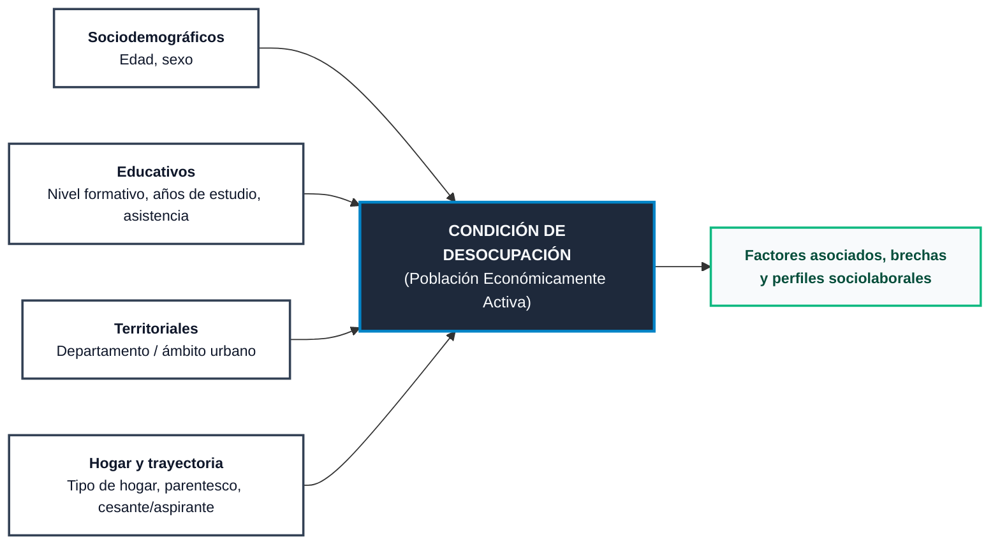

*FUENTE: Elaboración propia.*

### **2.1.16. Validez, limitaciones y alcance del análisis**

El presente trabajo se basa en datos observacionales transversales de la Encuesta Continua de Empleo (cuarto trimestre de 2025), lo cual delimita su alcance epistemológico. En primer término, las técnicas aplicadas identifican asociaciones bivariadas y diferencias significativas entre grupos, pero no permiten establecer relaciones causales deterministas. La asociación estadística entre una condición formativa o territorial y la desocupación indica una coexistencia sistemática en la muestra observada, mas no una relación de causa-efecto unidireccional.

En segundo término, aunque resulta deseable evaluar el efecto conjunto de múltiples factores de forma simultánea mediante modelos multivariados, el tamaño muestral de jóvenes desocupados en un solo trimestre ($n = 243$ casos) impone una restricción matemática objetiva: al cruzar conjuntamente múltiples categorías (por ejemplo, departamento, sexo, tramo etario y nivel educativo), las frecuencias esperadas por celda descienden por debajo de cinco observaciones, vulnerando la validez estadística de los contrastes. Por ello, las pruebas inferenciales formales se delimitan al nivel bivariado factor por factor, mientras que la exploración conjunta se habilita en la capa visual interactiva de Power BI con alertas explícitas para subconjuntos menores a 30 casos.

En tercer término, la información captura una fotografía temporal puntual del mercado de trabajo en el cuarto trimestre de 2025, impidiendo registrar la duración longitudinal de los episodios de desocupación o las transiciones dinámicas de entrada y salida del empleo formal, aspecto que debe complementarse interpretando conjuntamente la desocupación abierta y la subocupación por horas.

---

## **2.2. MARCO CONTEXTUAL**

### **2.2.1. Contexto normativo de la juventud en Bolivia**

El régimen normativo boliviano reconoce a las personas jóvenes como sujetos prioritarios de derechos laborales y protección estatal. La Constitución Política del Estado de 2009 consagra en sus Artículos 46 y 48 el derecho al trabajo digno, con remuneración justa, seguridad laboral y sin discriminación alguna, declarando que las disposiciones en materia de empleo son de cumplimiento obligatorio y gozan de protección estatal (Constitución Política del Estado, 2009).

En desarrollo de estos preceptos, la Ley N.º 342 de la Juventud de 2013 formaliza el intervalo de 16 a 28 años cumplidos como definición jurídica de la población joven en Bolivia. La norma instituye mandatos específicos para promover el primer empleo formal, la estabilidad laboral en los sectores público y privado, y la acreditación obligatoria de pasantías, prácticas profesionales e internados universitarios como experiencia laboral válida para contrataciones posteriores (Estado Plurinacional de Bolivia, 2013).

Para los adolescentes de 16 y 17 años que forman parte del universo juvenil, rige además el Código Niña, Niño y Adolescente (Ley N.º 548) y su modificatoria por Ley N.º 1139 de 2018. Estas disposiciones regulan el trabajo adolescente bajo salvaguardas especiales: fijan jornadas máximas diurnas de seis horas diarias (30 horas semanales), prohíben actividades peligrosas o nocturnas y exigen garantizar la permanencia obligatoria en el sistema escolar (Estado Plurinacional de Bolivia, 2018). Las contrataciones formales se rigen por la Ley General del Trabajo (1939), configurando un marco normativo integral que justifica la segmentación por cohortes etarias en el estudio.

### **2.2.2. Contexto socioeconómico y demográfico de Bolivia**

Bolivia atraviesa una etapa de transición demográfica marcada por un alto bono poblacional juvenil. Según los datos del Censo de Población y Vivienda 2024, el país supera los 12 millones de habitantes, con una proporción significativa de población en edades productivas (INE, 2024). Este proceso coexiste con una intensa concentración urbana: la mayoría de los habitantes reside en ciudades principales e intermedias, donde se concentra la actividad comercial, los centros de educación superior y la demanda de puestos de trabajo.

La estructura productiva boliviana se caracteriza por un sector terciario predominante (comercio minorista y servicios personales) y la construcción como ramas de rápida absorción laboral, frente a una industria manufacturera reducida en su escala de contratación formal. La informalidad constituye el rasgo estructural dominante del mercado laboral urbano, superando al 75% de los ocupados según estimaciones nacionales y regionales. Esta realidad implica que la mayor parte de la población no cuenta con contratos regulados ni cobertura de seguro social de desempleo, forzando a los hogares a insertarse en actividades de subsistencia para asegurar sus ingresos cotidianos.

### **2.2.3. Mercado laboral urbano boliviano**

La Encuesta Continua de Empleo (ECE) es el instrumento oficial trimestral del INE para monitorear las condiciones laborales en las ciudades bolivianas. En el cuarto trimestre de 2025, el boletín oficial reportó una tasa de desocupación abierta urbana del 2,30%, consolidando la tendencia de estabilización macroeconómica respecto a los periodos de crisis sanitaria y recesión económica (INE, 2026a).

No obstante, esta estabilidad agregada encubre marcadas disparidades generacionales. Entre los jóvenes de 16 a 28 años, la tasa de desocupación alcanzó el 3,71%, lo que representa una brecha de 1,41 puntos porcentuales respecto a la tasa general urbana. Asimismo, la tasa de subocupación juvenil por insuficiencia de tiempo de trabajo se situó en 8,70%, evidenciando que el problema de la juventud urbana no se restringe a la falta absoluta de ocupación, sino que abarca jornadas laborales reducidas e involuntarias. Considerando que los jóvenes representan aproximadamente el 29% de la fuerza ocupada urbana del país, su situación amerita un abordaje cuantitativo focalizado.

### **2.2.4. Situación de la juventud en el contexto regional**

El escenario laboral juvenil boliviano se inscribe dentro de tendencias compartidas en América Latina y el Caribe. Los informes especializados de la Organización Internacional del Trabajo (OIT, 2025a, 2025b) confirman que la juventud regional sufre tasas de desocupación abierta sistemáticamente superiores a las de la población adulta, afectadas por una marcada informalidad y precariedad en el ingreso.

Asimismo, la Comisión Económica para América Latina y el Caribe (CEPAL, 2025) señala que los procesos de transición entre la escuela y el trabajo en la región están fuertemente segmentados por el nivel de ingresos del hogar y la carga de tareas de cuidado familiar. Estas responsabilidades no remuneradas penalizan especialmente a las mujeres jóvenes, prolongando sus periodos de búsqueda o empujándolas hacia la informalidad. Estos antecedentes regionales aportan un marco comparativo para contextualizar las asimetrías de género y territorio observadas en Bolivia.

### **2.2.5. Contexto educativo de la población joven**

La formación educativa constituye un determinante central de la trayectoria de inserción laboral. En Bolivia, el sistema formal abarca la educación primaria, secundaria y superior (técnica y universitaria), siendo la secundaria de carácter obligatorio. Una fracción sustancial de jóvenes entre 16 y 24 años combina la asistencia a centros formativos con la participación laboral activa o la búsqueda de empleo, generando dinámicas particulares de uso del tiempo.

El nivel formativo alcanzado eleva las expectativas laborales de los jóvenes; no obstante, en economías de base terciaria informal, una mayor escolaridad no garantiza una colocación formal inmediata. En la investigación se aprovechan las variables educativas relevadas por el INE en la ECE 4T-2025 y en la Encuesta de Hogares para examinar tanto la escolaridad acumulada como el nivel de instrucción y la asistencia escolar actual.

**TABLA N. 5: Variables educativas disponibles en las fuentes de datos**

| Fuente | Variable | Descripción |
| :---- | :---- | :---- |
| **ECE 4T-2025** | Nivel educativo | Nivel de instrucción alcanzado por la persona |
| **ECE 4T-2025** | Asistencia educativa | Si la persona asiste actualmente a un establecimiento educativo |
| **Encuesta de Hogares 2025** | Años de estudio | Cantidad de años de escolaridad completados |
| **Encuesta de Hogares 2025** | Nivel de instrucción | Detalle del nivel educativo alcanzado |

**FUENTE:** Elaboración propia con base en Instituto Nacional de Estadística (2026b; 2026c).

### **2.2.6. Entorno estadístico y fuentes de datos**

El Instituto Nacional de Estadística (INE) es el órgano rector del Sistema Nacional de Información Estadística de Bolivia. A través del Archivo Nacional de Datos (ANDA), provee acceso público a microdatos estandarizados, diccionarios de variables y metodologías técnicas de muestreo para fines de investigación académica y formulación de políticas públicas.

La fuente primaria de esta investigación corresponde a los microdatos de la Encuesta Continua de Empleo (ECE) del cuarto trimestre de 2025, cuya base contiene 52.650 registros brutos y 121 columnas con información detallada de hogares, actividad, ocupación y ponderadores muestrales (INE, 2026b). De forma complementaria, se consultan los boletines de la Encuesta de Hogares 2025 y la Encuesta de Niñas, Niños y Adolescentes que Realizan Actividad Laboral o Trabajan (ENNA 2019) para enriquecer el análisis contextual de los adolescentes y el entorno familiar.

### **2.2.7. Delimitación geográfica y temporal**

La investigación se circunscribe al área urbana de Bolivia, ámbito donde la ECE asegura cobertura muestral continua y donde se concentra la mayoritaria fuerza de trabajo juvenil vinculada a mercados laborales formales e informales estructurados.

Temporalmente, el estudio se enfoca en el corte transversal del cuarto trimestre de 2025, periodo que ofrece la base más actualizada y consistente para el cálculo de tasas y contrastes de independencia. La muestra permite estimaciones desagregadas representativas para los nueve departamentos urbanos del país, reconociendo las limitaciones de tamaño muestral en subconjuntos específicos de menor escala geográfica.

### **2.2.8. Síntesis del marco contextual**

El contexto de análisis sociolaboral integra los siguientes elementos estructurales:

* Un marco legal fundado en la CPE y la Ley N.º 342, que reconoce a los jóvenes de 16 a 28 años y tutela la transición laboral, con salvaguardas especiales para adolescentes bajo la Ley N.º 548/1139.
* Una dinámica demográfica urbana revelada por el Censo 2024, con predominio de población joven en edad de trabajar en las ciudades.
* Una estructura productiva centrada en el comercio y los servicios urbanos, caracterizada por una tasa de informalidad laboral que supera el 75%.
* Un mercado de trabajo urbano donde la desocupación juvenil (3,71%) es 1,61 veces mayor que la general (2,30%), conviviendo con una subocupación por horas del 8,70%.
* Un contexto regional latinoamericano donde persisten barreras de acceso, segregación de género y desajustes de cualificación laboral.
* Un sistema educativo que retiene a contingentes crecientes de jóvenes, originando tensiones de simultaneidad entre estudio y trabajo y desajustes entre formación y vacantes.
* Una infraestructura estadística oficial del INE que proporciona microdatos confiables y ponderadores para el modelado de políticas públicas basadas en evidencia.

---


# CAPÍTULO III: RESULTADOS

## 3.1. PRESENTACIÓN DE RESULTADOS

### 3.1.1. Contexto metodológico y dimensional
Los microdatos analizados provienen de la Encuesta Continua de Empleo (ECE) correspondiente al cuarto trimestre de 2025, relevada por el Instituto Nacional de Estadística (INE). La encuesta utiliza un diseño muestral probabilístico, bietápico, estratificado y por conglomerados. Para reflejar las características demográficas de la población, toda estimación de totales, proporciones y tasas incorpora el factor de expansión trimestral de la persona (`fact_trim_act`).

De acuerdo con el artículo 4 de la Ley N.º 342 de la Juventud de Bolivia, la población joven comprende a las personas de 16 a 28 años de edad cumplidos. Conforme al diseño del trabajo, se aplicaron tres criterios de delimitación muestral: residencia en el área urbana (`area == 1`), edad entre 16 y 28 años (`16 <= s1_03a <= 28`) y pertenencia a la Población Económicamente Activa (`pea == 1`).

TABLA N.º 6: *Dimensión metodológica y aplicación en ciencia de datos*

| Dimensión metodológica | Descripción y fundamentación | Justificación y aplicación en ciencia de datos |
| :--- | :--- | :--- |
| Enfoque de trabajo | Cuantitativo y computacional | Análisis numérico y categórico de microdatos mediante programación en Python, cálculo de tasas ponderadas y contrastes de hipótesis estadísticas. |
| Tipo de trabajo | Aplicado y de diagnóstico sociolaboral | Utilización de técnicas estadísticas y de inteligencia de negocios para caracterizar la desocupación juvenil y generar evidencia orientada a políticas públicas. |
| Alcance o nivel | Descriptivo y de asociación diagnóstica | Estimación puntual de tasas de desocupación y subocupación, complementada con pruebas de independencia Chi-cuadrado, V de Cramér y diferencias de medias. |
| Diseño | No experimental, observacional y transversal | Análisis ex post facto de los microdatos oficiales correspondientes a un corte temporal específico (cuarto trimestre de 2025). |
| Metodología guía | Metodología CRISP-DM adaptada | Ciclo de vida estructurado en seis fases: comprensión del problema, comprensión de datos, preparación de datos, modelado analítico, evaluación y despliegue. |
| Población y muestra | Universo censal urbano y muestra ECE | Población objetivo de 1.380.841 jóvenes urbanos en la PEA, representada por una muestra efectiva observada de 6.649 personas encuestadas. |
| Técnica de recolección | Extracción de fuentes secundarias oficiales | Descarga e ingestión directa de los microdatos abiertos de la ECE 4T-2025 provistos por el Instituto Nacional de Estadística. |
| Procesamiento y análisis | Limpieza de datos y estadística ponderada | Estandarización tipográfica del ponderador (`fact_trim_act`), recodificación de variables, tablas de contingencia ponderadas y pruebas Chi-cuadrado. |
| Entorno tecnológico | Entorno analítico de código abierto | Python 3.14 con librerías Pandas, NumPy, SciPy, Statsmodels, Seaborn y Microsoft Power BI Desktop para modelado dimensional y visualización interactiva. |

*FUENTE: Elaboración con base en la estructura de evaluación del Diplomado en Data Science (USFX - CEPI).*

El conjunto de datos procesado permite examinar de manera directa las condiciones laborales juveniles en las ciudades bolivianas, preservando la representatividad estadística para cada departamento y segmento demográfico.

DIAGRAMA N.º 1: *Flujo metodológico de preparación y calibración de microdatos (ECE 4T-2025)*

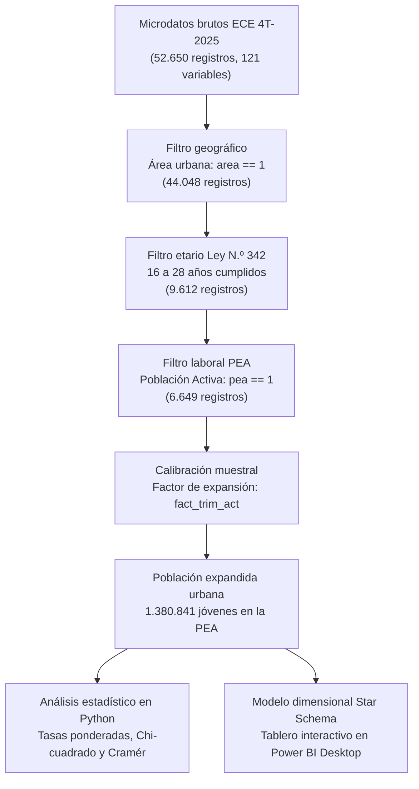

*FUENTE: Elaboración con base en el diseño metodológico de la ECE 4T-2025 (INE).*

El Diagrama N.º 1 esquematiza el embudo metodológico de depuración y calibración muestral aplicado a los microdatos de la Encuesta Continua de Empleo (ECE 4T-2025). A partir de la base nacional de 52.650 registros brutos, se implementan tres filtros sucesivos de delimitación: residencia en área urbana (`area == 1`), rango etario normativo de 16 a 28 años cumplidos según la Ley N.º 342 y pertenencia estricta a la Población Económicamente Activa (`pea == 1`), consolidando una muestra efectiva de 6.649 personas encuestadas. La aplicación del factor de calibración trimestral (`fact_trim_act`) expande este subconjunto al universo representativo de 1.380.841 jóvenes urbanos, suministrando una base metodológica única y ponderada tanto para las pruebas de inferencia estadística en Python como para el modelo dimensional en Power BI Desktop.

### 3.1.2. Trazabilidad del desarrollo bajo la metodología CRISP-DM
El procesamiento de la información se organizó siguiendo las seis fases de la metodología CRISP-DM aplicadas al análisis de microdatos laborales.

TABLA N.º 7: *Cumplimiento de hitos del proceso metodológico (CRISP-DM)*

| Fase CRISP-DM | Actividad planificada | Entregable concreto | Estado | Avance (%) |
| :--- | :--- | :--- | :---: | :---: |
| 1. Comprensión del problema | Delimitación de conceptos de desempleo y marco de la Ley N.º 342 | Matriz conceptual y delimitación del universo de 16 a 28 años | Concluido | 100% |
| 2. Comprensión de los datos | Auditoría de 52.650 registros y 121 variables de la ECE 4T-2025 | Diccionario de variables seleccionadas y reporte de estructura | Concluido | 100% |
| 3. Preparación de los datos | Depuración, filtros de universo, tipado de ponderador y recodificaciones | Dataset procesado `ECE_4T2025_Jovenes_PEA.csv` (6.649 filas) | Concluido | 100% |
| 4. Modelado y cálculo analítico | Formulación de tasas ponderadas, pruebas Chi-cuadrado y Cramér | Scripts modulares en Python (`statistical_analysis.py`) | Concluido | 100% |
| 5. Evaluación y validación | Contraste de estimaciones frente al Boletín Oficial del INE | Verificación exacta: desocupación 3,71% y subocupación 8,70% | Concluido | 100% |
| 6. Despliegue y visualización | Generación de tablas, figuras y modelo Star Schema en Power BI | Catálogo exportado y cuaderno maestro `Proyecto-Final.ipynb` | Concluido | 100% |

*FUENTE: Elaboración con base en el plan de trabajo del proyecto.*

La Tabla N.º 7 resume el avance de las seis etapas del ciclo CRISP-DM, el estándar de trabajo utilizado en proyectos de ciencia de datos. Confirma que cada fase completó sus metas al 100%, lo que asegura que el estudio transitó de forma ordenada desde la delimitación conceptual del desempleo juvenil hasta la publicación de los tableros interactivos y reportes finales.

### 3.1.3. Componentes del trabajo final e ingeniería de datos
La articulación entre la ciencia de datos y los resultados del mercado de trabajo juvenil se resume en tres componentes técnicos:

TABLA N.º 8: *Componentes técnicos de la solución en ciencia de datos*

| Componente | Término técnico en ciencia de datos | Aplicación concreta en el proyecto |
| :--- | :--- | :--- |
| Ingesta y adquisición | Pipeline de ingesta y validación de microdatos | Carga automatizada del archivo plano `ECE_4T2025.csv` con separador de listas, codificación `latin1` y auditoría de integridad inicial sobre 52.650 observaciones. |
| Aporte técnico y metodológico | Ingeniería de características y estadística ponderada | Estandarización del factor de expansión muestral, cálculo vectorizado de tasas de desocupación ponderadas y contrastes de asociación ($\chi^2$, $V$ de Cramér, $t$-Student). |
| Entregables de la solución | Artefactos reproducibles y modelo de despliegue | Dataset procesado de 6.649 registros y 156 columnas, tablas analíticas en formato CSV, figuras a 300 DPI, cuaderno interactivo y modelo en estrella para Power BI. |

*FUENTE: Elaboración propia.*

La base de datos original contiene 52.650 observaciones. El primer filtro eliminó a 8.602 personas residentes en el área rural. El segundo filtro excluyó a 34.436 personas cuyas edades quedaban fuera del rango de 16 a 28 años, dejando a 9.612 jóvenes urbanos. De ese total, 2.963 personas fueron identificadas como económicamente inactivas (principalmente estudiantes sin búsqueda laboral, personas dedicadas al cuidado del hogar o con incapacidad permanente). La muestra resultante quedó constituida por 6.649 jóvenes activos en el mercado de trabajo.

La variable del factor de expansión `fact_trim_act` presentaba valores textuales con coma decimal, por ejemplo `'207,52'`. Este formato requirió una conversión a tipo numérico de punto flotante (`float64`) para evitar errores en las operaciones de suma ponderada. Se verificó que ningún registro presentara un factor nulo, negativo o igual a cero. La suma total de los ponderadores reproduce con exactitud la cifra de 1.380.841 personas estimadas por el sistema estadístico nacional para la PEA juvenil urbana.

*(Para consultar el diccionario metodológico y las reglas de depuración de microdatos de la encuesta, dirigirse al Anexo 2; para la implementación técnica completa del script de preparación en Python, dirigirse al Anexo 6).*

### 3.1.4. Resultados del análisis descriptivo univariado
La tasa de desocupación se calculó dividiendo la población desocupada ponderada entre la PEA juvenil urbana ponderada y multiplicando por cien:

$$\text{Tasa de desocupación} = \frac{\sum (\text{pead}_i \times \text{peso}_i)}{\sum \text{peso}_i} \times 100$$

Esta expresión matemática calcula la tasa oficial reconociendo que cada persona encuestada representa a cientos de jóvenes en su ciudad. Al multiplicar la condición de desocupado ($\text{pead}_i$) por su ponderador muestral ($\text{peso}_i$), la fórmula suma la cantidad estimada de desocupados reales y la divide entre el total de jóvenes activos en el mercado de trabajo, evitando distorsiones por recuentos simples.

TABLA N.º 9: *Indicadores del mercado laboral juvenil urbano en Bolivia (cuarto trimestre de 2025)*

| Indicador sociolaboral | Casos observados (*n*) | Población ponderada (*N*) | Proporción (%) | Meta del boletín INE |
| :--- | :---: | :---: | :---: | :---: |
| PEA juvenil urbana (16 a 28 años) | 6.649 | 1.380.841 | 100,00% | Total de referencia |
| Población ocupada juvenil | 6.406 | 1.329.645 | 96,29% | Dato oficial |
| Población desocupada juvenil | 243 | 51.196 | 3,71% | 3,7% |
| Población subocupada por tiempo | 533 | 115.737 | 8,70% | 8,7% |
| Desocupados cesantes (con experiencia previa) | 215 | 45.882 | 89,62% | Mayoría |
| Desocupados aspirantes (en búsqueda de primer empleo) | 28 | 5.314 | 10,38% | Minoría |

*FUENTE: Elaboración con base en microdatos de la Encuesta Continua de Empleo 4T-2025 (INE).*

La tasa de desocupación juvenil del cuarto trimestre de 2025 se sitúa en 3,71%, coincidente con el 3,7% reportado en el boletín oficial del INE. Por su parte, la subocupación juvenil alcanza el 8,70% sobre la población ocupada, lo que equivale a 115.737 jóvenes (*n* = 533 casos muestrales) que trabajaron menos de la jornada habitual, desearon trabajar más horas y estaban disponibles para hacerlo.

*(Para examinar en detalle el script de agregación y cálculo de tasas ponderadas en Python, dirigirse al Anexo 7).*

FIGURA N.º 4: *Comparación de la tasa de desocupación general urbana y juvenil (cuarto trimestre de 2025)*


*FUENTE: Elaboración con base en datos de la Encuesta Continua de Empleo 4T-2025 (INE).*

La Figura N.º 4 expone la brecha generacional del mercado de trabajo urbano. La barra gris refleja la desocupación en la población general de 14 años o más (2,30%), mientras que la barra azul evidencia la tasa de los jóvenes de 16 a 28 años (3,71%). Esta diferencia gráfica confirma que el desempleo afecta con una intensidad 1,61 veces mayor al segmento juvenil en las ciudades bolivianas.

*(Para ver los parámetros de visualización y exportación del catálogo gráfico en Python, dirigirse al Anexo 8).*

Al contrastar la tasa de desocupación juvenil (3,71%) con la tasa de desocupación general de la población urbana de 14 años o más (2,30%), se observa que los jóvenes registran una incidencia de desempleo 1,61 veces mayor que la población adulta general.

### 3.1.5. Resultados del análisis bivariado y pruebas de asociación
Para determinar si las diferencias observadas entre subgrupos responden a variaciones sistemáticas o a fluctuaciones aleatorias del muestreo, se aplicó la prueba de independencia Chi-cuadrado de Pearson ($\chi^2$) fijando un umbral de significancia de 0,05. La magnitud del efecto se evaluó mediante el coeficiente V de Cramér ($V$):

$$V = \sqrt{\frac{\chi^2}{N \times \min(r - 1, c - 1)}}$$

Esta fórmula normaliza el valor de Chi-cuadrado para medir la intensidad práctica de una relación entre dos variables cualitativas en una escala de 0 a 1. Al dividir el estadístico $\chi^2$ entre el producto de la muestra expandida ($N$) y el menor número de categorías menos uno ($\min(r - 1, c - 1)$), la $V$ de Cramér elimina el sesgo por volumen muestral, permitiendo evaluar si una asociación significativa tiene un efecto real leve, moderado o fuerte.

TABLA N.º 10: *Matriz de pruebas de asociación estadística con la condición de desocupación juvenil*

| Dimensión analizada | Variable | Casos (*n*) | Chi2 ($\chi^2$) | Grados de libertad | p-valor | V de Cramér | Resultado estadístico |
| :--- | :--- | :---: | :---: | :---: | :---: | :---: | :--- |
| Tramo de edad | `grupo_edad` | 6.649 | 11,2332 | 3 | 0,01053 | 0,0411 | Asociación significativa (p < 0,05) |
| Sexo | `sexo` | 6.649 | 5,2367 | 1 | 0,02212 | 0,0281 | Asociación significativa (p < 0,05) |
| Departamento | `departamento` | 6.649 | 23,6920 | 8 | 0,00258 | 0,0597 | Asociación significativa (p < 0,05) |
| Tipología de hogar | `tipo_hogar` | 6.649 | 17,4287 | 6 | 0,00783 | 0,0512 | Asociación significativa (p < 0,05) |
| Parentesco con el jefe | `parentesco` | 6.649 | 17,2553 | 7 | 0,01582 | 0,0509 | Asociación significativa (p < 0,05) |
| Nivel educativo | `nivel_educativo` | 6.649 | 3,6356 | 4 | 0,45756 | 0,0234 | Sin significancia agregada (p >= 0,05) |
| Asistencia escolar | `asiste_estudio` | 6.649 | 1,5264 | 1 | 0,21665 | 0,0152 | Sin significancia agregada (p >= 0,05) |

*FUENTE: Elaboración con base en microdatos de la Encuesta Continua de Empleo 4T-2025 (INE).*

Las variables de edad, sexo, departamento, tipo de hogar y parentesco presentan un p-valor inferior a 0,05, lo que confirma diferencias estadísticamente significativas en la desocupación de estos grupos. En cambio, las categorías agregadas de nivel educativo y asistencia a centros de enseñanza no mostraron una asociación global significativa mediante la prueba Chi-cuadrado, lo cual motivó un análisis continuo complementario mediante años de escolaridad.

Conviene subrayar dos precisiones metodológicas derivadas de la Tabla N.º 10. Primero, aunque la desocupación responde simultáneamente a múltiples factores, las pruebas inferenciales formales se mantuvieron en un plano bivariado porque el universo desocupado cuenta con *n* = 243 observaciones muestrales. Al cruzar más de dos variables en simultáneo dentro de tablas multidimensionales o estratos departamentales finos, las frecuencias esperadas por celda descienden por debajo del umbral de cinco observaciones exigido por el criterio de Cochran (Agresti, 2018; Lohr, 2022), lo que invalida la aproximación asintótica de la prueba Chi-cuadrado. Segundo, los coeficientes V de Cramér oscilan entre 0,0152 y 0,0597, valores propios de magnitudes débiles según los umbrales de Cohen (1988), lo cual confirma que ninguna variable aislada determina por sí sola la salida al desempleo y refuerza la cautela diagnóstica frente a interpretaciones causales.

*(Para consultar la formulación matemática y el código del generador de tablas de asociación en Python, dirigirse al Anexo 1 y Anexo 7).*

### 3.1.6. Desagregaciones por dimensión analítica

#### A. Dimensión etaria
La segmentación en cuatro intervalos muestra que la desocupación se concentra de manera particular en las edades tempranas de inserción al mercado.

TABLA N.º 11: *Tasa de desocupación juvenil según tramo etario (Bolivia urbana, 4T-2025)*

| Tramo de edad | Muestra (*n*) | Población PEA (*N*) | Población desocupada (*N*) | Tasa de desocupación (%) | Porcentaje de desocupados (%) |
| :--- | :---: | :---: | :---: | :---: | :---: |
| 16 a 17 años | 774 | 159.899 | 2.991 | 1,87% | 5,84% |
| 18 a 20 años | 1.377 | 290.670 | 13.504 | 4,65% | 26,38% |
| 21 a 24 años | 2.039 | 414.829 | 14.713 | 3,55% | 28,74% |
| 25 a 28 años | 2.459 | 515.443 | 19.988 | 3,88% | 39,04% |
| Total | 6.649 | 1.380.841 | 51.196 | 3,71% | 100,00% |

*FUENTE: Elaboración con base en microdatos de la Encuesta Continua de Empleo 4T-2025 (INE).*

El grupo de 18 a 20 años exhibe la tasa más alta con un 4,65%, seguido por el grupo de 25 a 28 años con 3,88% y el grupo de 21 a 24 años con 3,55%. El tramo de 16 y 17 años registra la tasa más baja (1,87%), explicada por una menor participación económica activa en ese segmento etario al permanecer mayoritariamente en la escuela secundaria.

FIGURA N.º 5: *Tasa de desocupación juvenil por tramo etario (cuarto trimestre de 2025)*

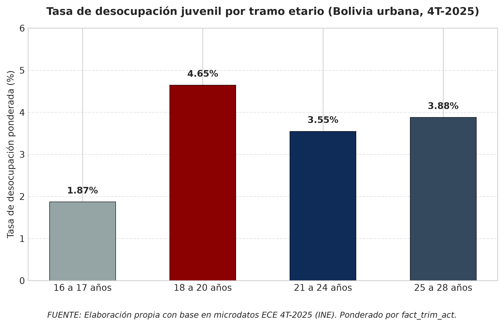

*FUENTE: Elaboración con base en microdatos de la Encuesta Continua de Empleo 4T-2025 (INE).*

La Figura N.º 5 resalta en color rojo el pico de desocupación en el grupo de 18 a 20 años (4,65%), la etapa donde los bachilleres intentan colocarse laboralmente por primera vez sin contar con experiencia ni formación técnica. En las edades posteriores (21 a 24 y 25 a 28 años), las barras descienden y se estabilizan cerca del promedio general, mientras que el tramo de 16 a 17 años muestra el valor más bajo (1,87%) debido a que la gran mayoría aún permanece en la escuela secundaria fuera de la fuerza de trabajo.

*(Para consultar el código de cálculo y exportación de la dimensión etaria en Python, dirigirse al Anexo 7 y Anexo 8).*

#### B. Dimensión de género
La distribución de la desocupación según el sexo de la persona evidencia una brecha desfavorable para las mujeres jóvenes.

TABLA N.º 12: *Tasa de desocupación juvenil según sexo (Bolivia urbana, 4T-2025)*

| Sexo | Muestra (*n*) | Población PEA (*N*) | Población desocupada (*N*) | Tasa de desocupación (%) | Porcentaje de desocupados (%) |
| :--- | :---: | :---: | :---: | :---: | :---: |
| Hombre | 3.393 | 735.643 | 20.938 | 2,85% | 40,90% |
| Mujer | 3.256 | 645.198 | 30.258 | 4,69% | 59,10% |
| Total | 6.649 | 1.380.841 | 51.196 | 3,71% | 100,00% |

*FUENTE: Elaboración con base en microdatos de la Encuesta Continua de Empleo 4T-2025 (INE).*

La tasa de desocupación refleja una notable disparidad: 4,69% en mujeres frente a 2,85% en hombres, configurando una brecha de +1,84 puntos porcentuales ($\chi^2 = 5,24; p = 0,0221$). Asimismo, casi seis de cada diez jóvenes sin empleo en el país son mujeres (59,10%), a pesar de que su participación en la fuerza de trabajo activa es menor a la de los varones.

FIGURA N.º 6: *Tasa de desocupación juvenil según sexo y brecha de género (cuarto trimestre de 2025)*

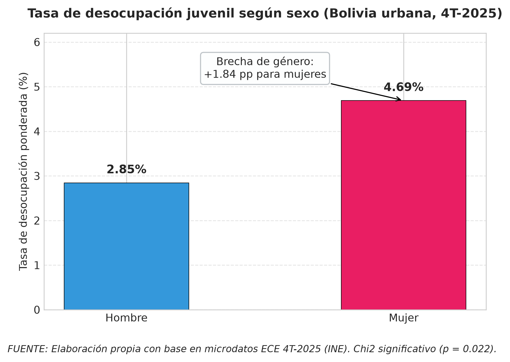

*FUENTE: Elaboración con base en microdatos de la Encuesta Continua de Empleo 4T-2025 (INE).*

La Figura N.º 6 ilustra la disparidad de género mediante dos barras comparativas: la barra azul de los hombres registra 2,85%, mientras que la barra carmesí de las mujeres alcanza 4,69%. El cuadro superior destaca la brecha neta de +1,84 puntos porcentuales en desmedro de las mujeres jóvenes, confirmada como estadísticamente significativa en el pie de figura ($\chi^2 = 5,24; p = 0,022$). Esta representación visual evidencia que una mujer joven en el área urbana de Bolivia enfrenta una probabilidad 1,65 veces mayor de encontrarse desocupada respecto a un varón de su misma edad.

*(Para examinar las especificaciones de estilo y colorimetría institucional en Python, dirigirse al Anexo 8).*

#### C. Dimensión territorial y departamental
El análisis por departamento revela marcadas disparidades entre las diferentes regiones urbanas de Bolivia.

TABLA N.º 13: *Tasa de desocupación juvenil por departamento (Bolivia urbana, 4T-2025)*

| Departamento | Muestra (*n*) | Población PEA (*N*) | Población desocupada (*N*) | Tasa de desocupación (%) | Porcentaje de desocupados (%) |
| :--- | :---: | :---: | :---: | :---: | :---: |
| Chuquisaca | 486 | 62.899 | 3.648 | 5,80% | 7,13% |
| Tarija | 255 | 57.856 | 2.728 | 4,72% | 5,33% |
| Cochabamba | 1.196 | 251.505 | 11.840 | 4,71% | 23,13% |
| La Paz | 1.731 | 338.688 | 13.016 | 3,84% | 25,42% |
| Santa Cruz | 1.311 | 459.615 | 15.313 | 3,33% | 29,91% |
| Oruro | 348 | 67.935 | 2.027 | 2,98% | 3,96% |
| Beni | 435 | 60.886 | 1.259 | 2,07% | 2,46% |
| Pando | 370 | 11.079 | 210 | 1,89% | 0,41% |
| Potosí | 517 | 70.378 | 1.155 | 1,64% | 2,26% |
| Total | 6.649 | 1.380.841 | 51.196 | 3,71% | 100,00% |

*FUENTE: Elaboración con base en microdatos de la Encuesta Continua de Empleo 4T-2025 (INE).*

El eje central (Santa Cruz, La Paz y Cochabamba) concentra el 78,46% de los desocupados absolutos por su volumen demográfico, aunque las tasas relativas más severas corresponden a Chuquisaca (5,80%) y Tarija (4,72%), regiones con menor dinamismo industrial y alta dependencia de servicios y administración pública.

FIGURA N.º 7: *Tasa de desocupación juvenil por departamento (cuarto trimestre de 2025)*

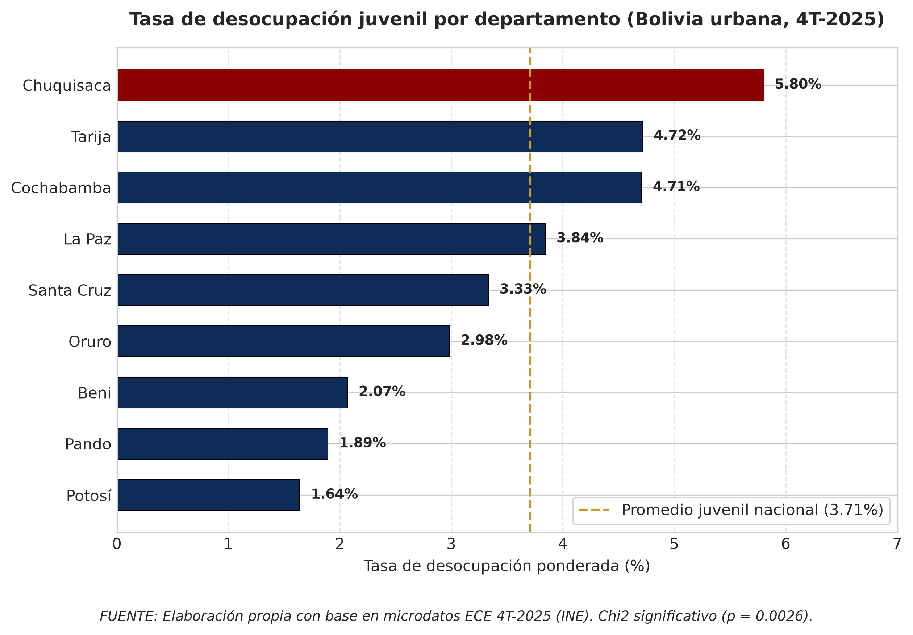

*FUENTE: Elaboración con base en microdatos de la Encuesta Continua de Empleo 4T-2025 (INE).*

La Figura N.º 7 ordena los nueve departamentos de forma descendente mediante barras horizontales y los compara frente a la línea vertical dorada que marca el promedio nacional juvenil (3,71%). La barra superior en color rojo oscuro resalta a Chuquisaca con la tasa más elevada de Bolivia (5,80%), seguida por Tarija (4,72%), Cochabamba (4,71%) y La Paz (3,84%), las cuatro regiones que rebasan el promedio urbano. En contraste, los departamentos mineros y amazónicos como Beni (2,07%), Pando (1,89%) y Potosí (1,64%) se sitúan a la izquierda de la referencia, reflejando marcadas asimetrías productivas validadas por una prueba Chi-cuadrado altamente significativa ($\chi^2 = 23,69; p = 0,0026$).

*(Para consultar el código de análisis y graficación departamental en Python, dirigirse al Anexo 7 y Anexo 8).*

#### D. Dimensión educativa y escolaridad acumulada
Al evaluar la tasa de desocupación según el máximo nivel educativo alcanzado, se registra una relación ascendente: las personas sin instrucción formal tienen una tasa de 2,31%, quienes completaron primaria alcanzan 3,43%, quienes cuentan con nivel secundario registran 4,02% y quienes accedieron a estudios universitarios registran 4,04%.

TABLA N.º 14: *Comparación de años de escolaridad entre jóvenes ocupados y desocupados*

| Condición de actividad | Casos válidos (*n*) | Media ponderada (años) | Desviación estándar ponderada | Prueba estadística | Estadístico | p-valor |
| :--- | :---: | :---: | :---: | :---: | :---: | :---: |
| Jóvenes ocupados | 6.401 | 12,64 | 2,67 | t de Student (Welch) | t = -2,34 | 0,0202 |
| Jóvenes desocupados | 243 | 13,01 | 2,66 | Mann-Whitney U | U = 714.498,5 | 0,0293 |

*FUENTE: Elaboración con base en microdatos de la Encuesta Continua de Empleo 4T-2025 (INE).*

La Tabla N.º 14 compara el capital educativo acumulado entre jóvenes ocupados y desocupados sobre observaciones con escolaridad reportada positiva (*n* = 6.401 ocupados y *n* = 243 desocupados). Para comprobar si la brecha observada es estadísticamente consistente, se aplicaron tanto la prueba paramétrica *t* de Welch sobre la muestra analítica ($t = -2,34; p = 0,0202$) como la prueba no paramétrica de Mann-Whitney ($U = 714.498,5; p = 0,0293$). Como verificación de sensibilidad, al incluir los cinco casos ocupados sin años de escolaridad declarados (*n* = 6.406), el contraste mantiene la misma dirección significativa ($t = -2,39; p = 0,0174$). Con un $p$-valor inferior a 0,05, ambas pruebas confirman que los jóvenes desocupados poseen en promedio mayor escolaridad (13,01 años frente a 12,64 años, diferencia de +0,36 años en valores continuos sin redondear), lo que equivale a casi cuatro meses lectivos adicionales de instrucción.

*(Para examinar el protocolo formal de contrastación de hipótesis de escolaridad, dirigirse al Anexo 4).*

FIGURA N.º 8: *Distribución de años de estudio: jóvenes ocupados y desocupados urbanos*

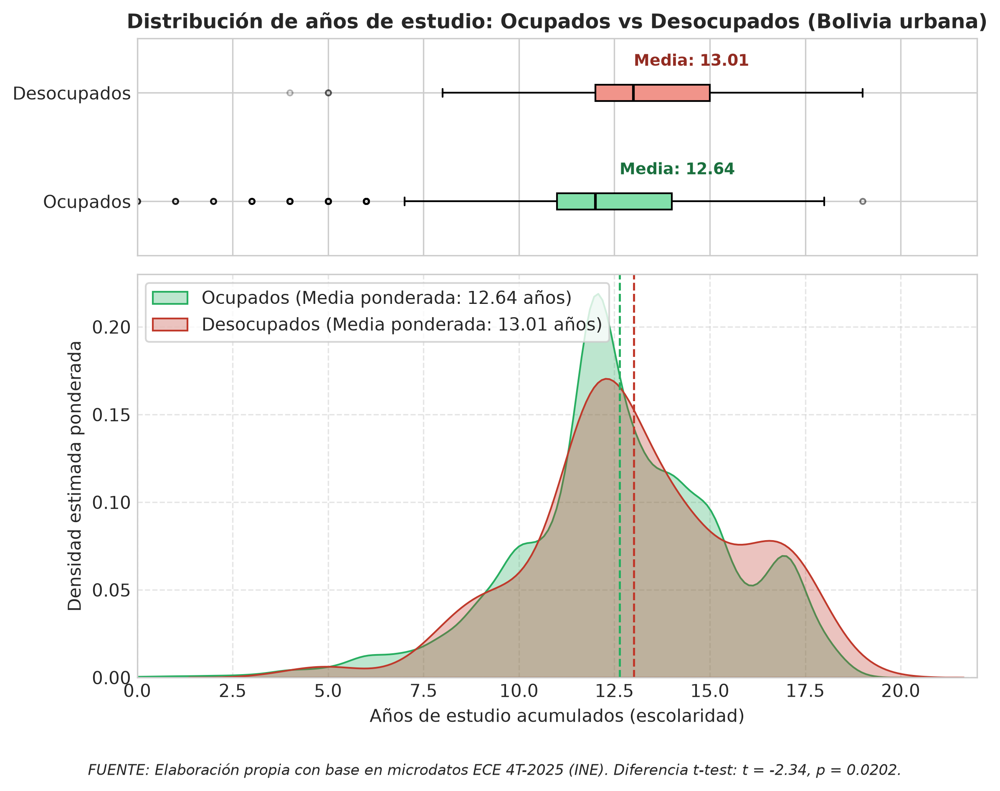

*FUENTE: Elaboración con base en microdatos de la Encuesta Continua de Empleo 4T-2025 (INE).*

La Figura N.º 8 analiza la distribución de la escolaridad mediante un gráfico de doble panel. En el panel superior, el diagrama de cajas muestra que la caja de los desocupados (color salmón) se encuentra desplazada a la derecha con una mediana de 13 años respecto a los 12 años de los ocupados (color verde), observándose además que estos últimos presentan mayor dispersión hacia niveles educativos bajos con valores atípicos entre 0 y 7 años de estudio. En el panel inferior, las curvas de densidad kernel (KDE) evidencian que los jóvenes ocupados se concentran densamente en el bachillerato (12 años), mientras que los desocupados sostienen una masa superior en el tramo de 14 a 18 años de estudio, lo que demuestra visualmente que el desempleo urbano abierto afecta de forma desproporcionada a jóvenes con estudios superiores o técnicos que buscan inserción calificada.

FIGURA N.º 9: *Tasa de desocupación juvenil según nivel educativo formal*

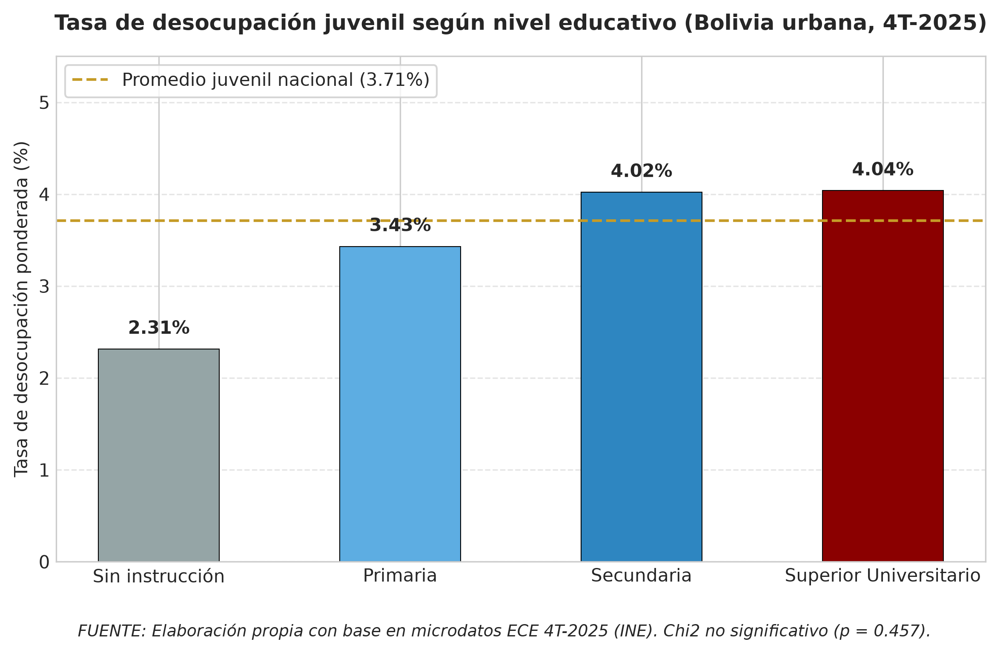

*FUENTE: Elaboración con base en microdatos de la Encuesta Continua de Empleo 4T-2025 (INE).*

La Figura N.º 9 compara las tasas de desocupación entre cuatro niveles de instrucción frente a la línea dorada discontinua del promedio nacional (3,71%). Las barras reflejan un gradiente ascendente: la población sin instrucción presenta una tasa de 2,31% y primaria alcanza 3,43%, mientras que los niveles secundario (4,02%) y superior universitario (4,04%) superan la media del país. Esta tendencia describe el fenómeno del desempleo ilustrado, donde los jóvenes con mayor preparación prolongan su tiempo de búsqueda hacia empleos acordes a su perfil, mientras que aquellos con menor instrucción deben ocuparse de inmediato en actividades informales de subsistencia ($p = 0,457$).

FIGURA N.º 10: *Tasa de desocupación juvenil según asistencia escolar o académica*

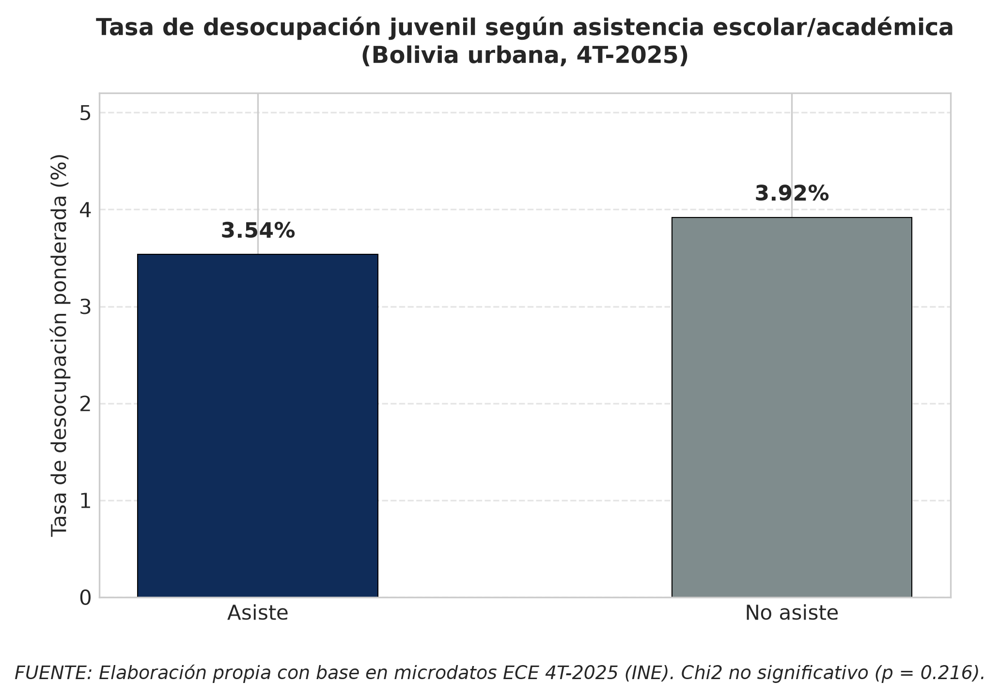

*FUENTE: Elaboración con base en microdatos de la Encuesta Continua de Empleo 4T-2025 (INE).*

La Figura N.º 10 evalúa si la concurrencia activa a centros educativos incide en el desempleo de los jóvenes pertenecientes a la fuerza laboral. La barra azul de quienes asisten a clases registra una tasa de 3,54%, mientras que la barra gris de quienes no asisten se sitúa en 3,92%, marcando una diferencia moderada de 0,38 puntos porcentuales. Al no alcanzar significancia estadística en la prueba Chi-cuadrado ($p = 0,2166$), el gráfico demuestra que la condición de estudiante activo no constituye un factor diferenciador decisivo frente al riesgo de desocupación en el área urbana.

*(Para consultar la implementación de contrastes inferenciales y gráficos de escolaridad en Python, dirigirse al Anexo 7 y Anexo 8).*

#### E. Dinámica previa y canales de búsqueda de empleo
La composición interna del desempleo juvenil urbano muestra que 45.882 personas (89,62%) corresponden a desocupados cesantes, es decir, jóvenes que ya contaban con un empleo anterior y se desvincularon por renuncia, despido o culminación de contrato. Los desocupados aspirantes, que buscan trabajo por primera vez, representan a 5.314 personas (10,38%).

FIGURA N.º 11: *Composición de la desocupación juvenil: cesantes y aspirantes*

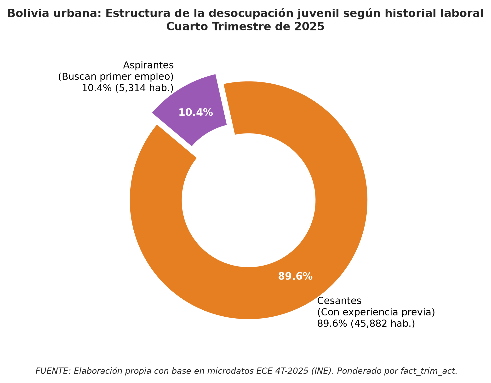

*FUENTE: Elaboración con base en microdatos de la Encuesta Continua de Empleo 4T-2025 (INE).*

La Figura N.º 11 expone la estructura interna de los 51.196 jóvenes desocupados mediante un gráfico circular según su trayectoria de trabajo. El sector mayoritario en color naranja muestra que el 89,6% (45.882 jóvenes) corresponde a cesantes que perdieron o renunciaron a un empleo previo, mientras que el segmento morado de aspirantes concentra el 10,4% (5.314 jóvenes) que buscan trabajo por primera vez. La distribución ilustra que el desempleo juvenil urbano en Bolivia deriva principalmente de la inestabilidad y rotación en puestos de trabajo precarios antes que de barreras exclusivas para ingresar al mercado laboral.

TABLA N.º 15: *Canales de búsqueda de empleo utilizados por jóvenes desocupados urbanos*

| Mecanismo principal de búsqueda | Muestra (*n*) | Población ponderada (*N*) | Porcentaje sobre el total (%) | Porcentaje válido (%) |
| :--- | :---: | :---: | :---: | :---: |
| Avisos por prensa, internet o redes sociales | 92 | 20.848 | 40,72% | 41,45% |
| Presentación directa de solicitudes o currículum vitae | 76 | 15.647 | 30,56% | 31,11% |
| Otras formas no estructuradas de búsqueda | 45 | 9.215 | 18,00% | 18,32% |
| Preguntó directamente en lugares o centros de trabajo | 17 | 3.050 | 5,96% | 6,06% |
| Consultó a familiares, amigos o conocidos | 5 | 889 | 1,74% | 1,77% |
| Realizó gestiones para abrir negocio propio o independiente | 3 | 654 | 1,28% | 1,30% |
| No declaró o no aplica | 5 | 893 | 1,74% | Excluido |
| Total | 243 | 51.196 | 100,00% | 100,00% |

*FUENTE: Elaboración con base en microdatos de la Encuesta Continua de Empleo 4T-2025 (INE).*

La Tabla N.º 15 clasifica las estrategias de postulación adoptadas por los jóvenes sin empleo sobre el total de 51.196 desocupados estimados. Las cifras revelan el predominio de canales estructurados: los avisos en prensa, internet o redes sociales concentran el 40,72% del total (41,45% sobre respuestas válidas) y la presentación directa de solicitudes o currículum vitae reúne el 30,56% (31,11% válido), sumando entre ambos el 71,28% de todas las gestiones laborales frente a una baja proporción de iniciativas independientes (1,28%).

FIGURA N.º 12: *Mecanismos principales de búsqueda de empleo en jóvenes desocupados*

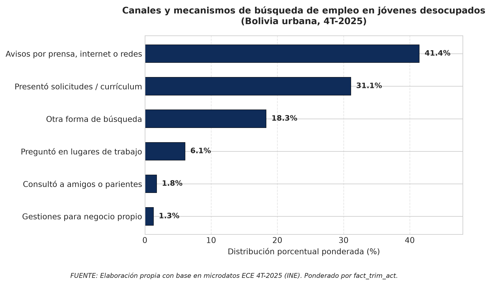

*FUENTE: Elaboración con base en microdatos de la Encuesta Continua de Empleo 4T-2025 (INE).*

La Figura N.º 12 ordena en barras horizontales las vías de inserción laboral declaradas por la juventud desocupada sobre respuestas válidas (excluidos cinco casos sin declaración, equivalentes a 893 personas ponderadas). Los dos canales principales corresponden a la búsqueda mediante avisos digitales o de prensa (41,4%) y la entrega formal de currículum vitae (31,1%), acumulando conjuntamente más de siete de cada diez postulaciones. En contraste, las barras inferiores reflejan un peso marginal de los contactos interpersonales mediante amigos o parientes (1,8%) y de la gestión de emprendimientos propios (1,3%), lo que evidencia que la mayoría de los jóvenes desocupados busca activamente insertarse como personal dependiente en el mercado formal.

FIGURA N.º 13: *Tasa de desocupación juvenil según tipología de hogar*

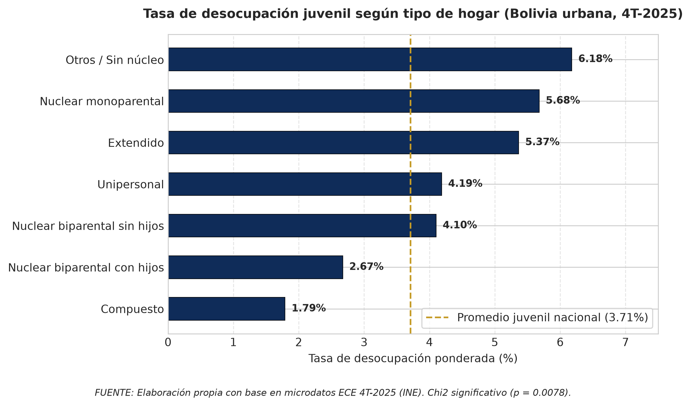

*FUENTE: Elaboración con base en microdatos de la Encuesta Continua de Empleo 4T-2025 (INE).*

La Figura N.º 13 presenta las tasas de desocupación en siete estructuras familiares contrastadas contra la línea dorada del promedio nacional (3,71%). Las barras más prolongadas corresponden a hogares sin núcleo conyugal (6,18%), nucleares monoparentales (5,68%) y extendidos (5,37%), donde los jóvenes enfrentan mayor vulnerabilidad económica. Por el contrario, los hogares nucleares biparentales con hijos (2,67%) y compuestos (1,79%) registran tasas significativamente menores, comportamiento que la prueba Chi-cuadrado valida como estadísticamente significativo ($\chi^2 = 17,43; p = 0,0078$) e indicativo de cómo el respaldo del núcleo familiar modula la inserción laboral.

*(Para consultar el código de trayectorias previas y graficación de canales en Python, dirigirse al Anexo 7 y Anexo 8).*

### 3.1.7. Arquitectura del modelo dimensional para Power BI Desktop
Para facilitar la exploración visual y la toma de decisiones basada en datos, los microdatos procesados se organizaron en un esquema en estrella (*Star Schema*) dentro del proyecto de Power BI (`powerbi/Visualizacion-Analisis-Desocupacion.pbip`). El modelo semántico, serializado bajo el estándar TMDL (*Tabular Model Definition Language*), reúne diez tablas activas: una tabla de hechos central (`Fact_MercadoLaboral`), ocho tablas dimensionales y auxiliares conectadas mediante relaciones unidireccionales de uno a muchos (1:N) con integridad referencial activa, y una tabla dedicada de medidas analíticas (`_Medidas`). En la vista principal del esquema se integran los seis ejes sociodemográficos centrales junto a dos tablas auxiliares de soporte metodológico:

DIAGRAMA N.º 2: *Arquitectura del modelo dimensional en estrella (Star Schema) implementado en Power BI Desktop*

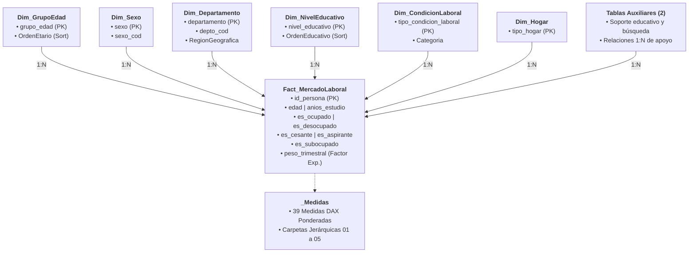

*FUENTE: Elaboración propia a partir del modelo semántico TMDL en Power BI.*

El Diagrama N.º 2 expone el modelo dimensional en estrella (*Star Schema*) que estructura los microdatos dentro de Power BI. En el centro, la tabla de hechos `Fact_MercadoLaboral` contiene las observaciones individuales con sus banderas de ocupación y el factor de expansión muestral, rodeada por ocho tablas dimensionales y auxiliares conectadas mediante relaciones unidireccionales de uno a muchos (1:N), y acompañada por el módulo de 39 medidas DAX (`_Medidas`). Esta arquitectura permite filtrar simultáneamente por territorio, demografía o nivel formativo, garantizando que el repositorio central de medidas DAX (`_Medidas`) calcule tasas ponderadas exactas sin duplicidad ni sesgos muestrales.

### 3.1.8. Evidencia del cuadro de mando interactivo en Power BI Desktop
Como componente de transferencia tecnológica y despliegue del proyecto de ciencia de datos, se desarrolló un cuadro de mando analítico interactivo de seis páginas en Power BI Desktop (`powerbi/Visualizacion-Analisis-Desocupacion.pbip`), estructurado en formato PBIR (*Power BI Project Report*).

El diseño visual adopta la identidad institucional de la Universidad San Francisco Xavier de Chuquisaca (USFX CEPI), aplicando una paleta armónica compuesta por azul marino institucional (`#0F2C59`), rojo colonial de alerta (`#8B0000`), dorado ocre (`#C59B27`) y verde esmeralda para ocupación (`#2E7D32`), sobre un lienzo gris claro suave (`#F8F9FA`) con tarjetas en blanco puro (`#FFFFFF`) y tipografía corporativa Segoe UI.

TABLA N.º 16: *Estructura y catálogo de páginas del cuadro de mando analítico en Power BI Desktop*

| Página | Denominación temática | Foco analítico principal | Segmentadores activos | Medidas DAX rectoras |
| :---: | :--- | :--- | :--- | :--- |
| 1 | Panorama Laboral Juvenil | Indicadores macro, estructura de la PEA y sobre-exposición al desempleo | Departamento, Sexo, Rango de Edad | `[PEA Juvenil Ponderada]`, `[Tasa Desocupacion Ponderada]`, `[Tasa Subocupacion Ponderada]` |
| 2 | Vulnerabilidad Etaria | Fricción en la transición de la secundaria al mercado formal (18 a 20 años) | Tramo etario, Condición de actividad | `[Tasa Desocupacion Ponderada]`, `[Poblacion Desocupada]`, `[Porcentaje Desocupados Tramo]` |
| 3 | Educación y Escolaridad | Capital humano, niveles formativos y tensión entre estudio y empleo | Nivel educativo, Asistencia escolar | `[Escolaridad Promedio Ocupados]`, `[Escolaridad Promedio Desocupados]`, `[Tasa Desocupacion Ponderada]` |
| 4 | Género y Territorio | Brecha estructural mujer-hombre y disparidades entre departamentos | Sexo, Departamento, Región geográfica | `[Tasa Desocupacion Mujeres]`, `[Tasa Desocupacion Hombres]`, `[Brecha Desocupacion Genero]` |
| 5 | Perfil del Desocupado | Dinámica de desvinculación laboral (cesantes) frente al primer empleo (aspirantes) | Condición laboral, Mecanismo de búsqueda | `[Desocupados Cesantes]`, `[Desocupados Aspirantes]`, `[Proporcion Cesantes Pct]` |
| 6 | Políticas Públicas | Matriz de priorización estratégica, hojas de ruta y síntesis ejecutiva | Eje de intervención, Nivel de urgencia | `[Poblacion Objetivo Focalizada]`, Matriz Impacto-Factibilidad |

*FUENTE: Elaboración propia.*

La Tabla N.º 16 detalla la organización temática y técnica de las seis páginas del cuadro de mando analítico. Las columnas estructuran el propósito de cada sección, los filtros interactivos puestos a disposición del usuario y las fórmulas DAX ponderadas que calculan los indicadores clave. Esta distribución permite transitar desde un diagnóstico general del mercado laboral urbano hasta la focalización específica de brechas de género, territorio y perfiles de cesantía, culminando en una matriz de propuestas de política pública aplicadas al contexto boliviano.

#### 3.1.8.1. Página 1: Panorama laboral juvenil urbano
La primera página sintetiza la magnitud general del mercado laboral para la población de 16 a 28 años en el área urbana de Bolivia. En la fila superior se integran cinco tarjetas con indicadores clave que exponen el volumen ponderado de la PEA (1.380.841 personas), la población ocupada (1.329.645 personas), la población desocupada (51.196 personas), la tasa oficial de desocupación (3,71%) y la tasa de subocupación por tiempo (8,70%). En el cuerpo central se despliegan un gráfico de dona con la distribución porcentual de la PEA, un gráfico de barras comparativo entre la tasa de desocupación urbana general (2,30%) y la juvenil (3,71%), y un desglose de la subutilización laboral.

FIGURA N.º 14: *Vista del cuadro de mando en Power BI: Panorama laboral juvenil urbano (Página 1)*

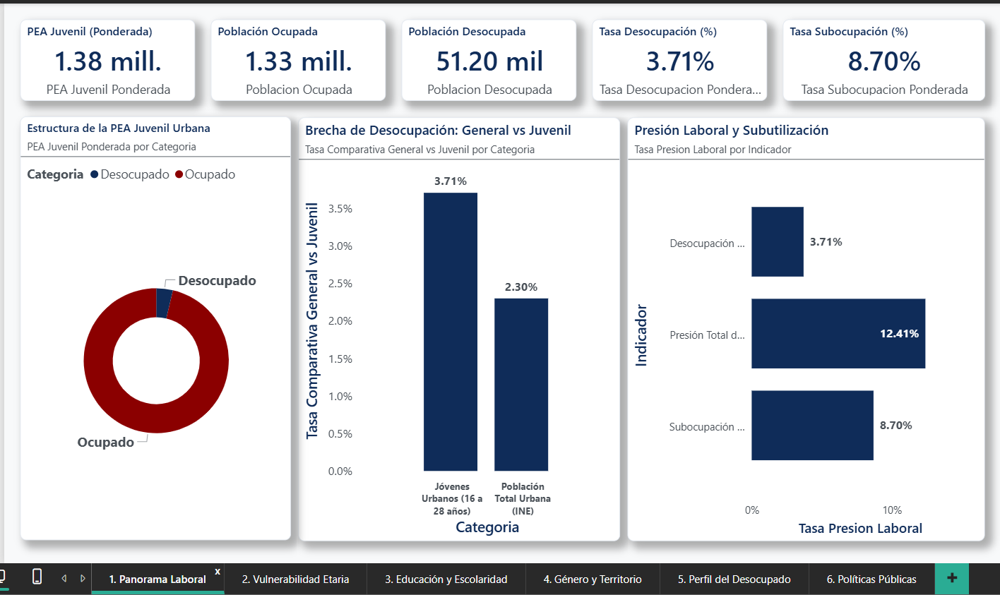

*FUENTE: Elaboración propia a partir del cuadro de mando interactivo en Power BI Desktop (ECE 4T-2025).*

La Figura N.º 14 estructura la visión general del mercado de trabajo juvenil en dos niveles analíticos. En la banda superior, cinco tarjetas de indicadores (KPIs) resumen las cifras ponderadas oficiales: una fuerza laboral de 1,38 millones de jóvenes (1.380.841 personas), de los cuales 1,33 millones están ocupados (1.329.645 personas) y 51,20 mil se encuentran desocupados (51.196 personas), lo que arroja una tasa de desocupación del 3,71% y una tasa de subocupación por insuficiencia de tiempo de trabajo del 8,70%. En la sección inferior, el gráfico de dona izquierdo evidencia que el desempleo abierto representa al 3,71% de la PEA frente al 96,29% de ocupación; el gráfico de barras central resalta que la tasa juvenil supera a la tasa nacional general urbana (2,30%), confirmando una sobreexposición de 1,61 veces mayor; y el gráfico de barras horizontales derecho desglosa la subutilización laboral, evidenciando que al considerar conjuntamente a los jóvenes desocupados abiertos (51.196) y subocupados por horas (115.737), la presión laboral conjunta reúne a 166.933 personas, equivalente al 12,09% de la PEA juvenil urbana (evitando la adición directa de tasas calculadas sobre denominadores distintos).

A nivel de modelado analítico, las tarjetas y componentes visuales operan sobre la tabla de hechos `Fact_MercadoLaboral` conectada a las dimensiones de departamento, sexo y grupo etario. La medida rectora `[Tasa Desocupacion Ponderada]` aplica la función DAX `DIVIDE` sobre la sumatoria filtrada del factor de expansión muestral (`peso_trimestral`) para los casos donde `es_desocupado = 1`, dividida entre el total ponderado de la población activa. Esta formulación asegura que las estimaciones respeten con precisión el diseño muestral complejo del INE, evitando sesgos derivados de recuentos muestrales no ponderados. La parametrización técnica y el catálogo exhaustivo de las medidas DAX implementadas en esta vista se detallan formalmente en el Anexo 3.

#### 3.1.8.2. Página 2: Desocupación por tramo etario y trayectoria
La segunda página aborda el análisis desagregado de los cuatro tramos de edad establecidos en el proyecto. Permite constatar visualmente que los jóvenes de 18 a 20 años enfrentan la tasa de desocupación más crítica del país (4,65%), superando en casi un punto porcentual el promedio nacional juvenil. Asimismo, evidencia que el grupo de 25 a 28 años concentra el mayor volumen absoluto de desocupados (19.988 personas), vinculado a la búsqueda de plazas técnicas y profesionales.

FIGURA N.º 15: *Vista del cuadro de mando en Power BI: Desocupación por tramo etario (Página 2)*

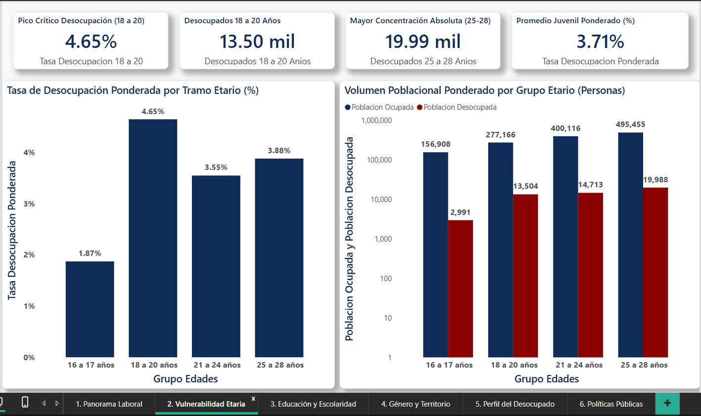

*FUENTE: Elaboración propia a partir del cuadro de mando interactivo en Power BI Desktop (ECE 4T-2025).*

La Figura N.º 15 detalla la fricción laboral por edades. En las tarjetas superiores se identifican el pico crítico de desocupación en el tramo de 18 a 20 años (4,65%), el volumen de 13.504 jóvenes desempleados en ese rango, la concentración máxima absoluta en el grupo de 25 a 28 años con 19.988 personas y la tasa promedio nacional de 3,71%. En el cuerpo inferior, el gráfico de barras vertical izquierdo muestra la curva etaria de desocupación, evidenciando el salto abrupto desde 1,87% en adolescentes de 16 a 17 años hasta el pico de 4,65% en los recién egresados de secundaria, para estabilizarse en 3,55% (21 a 24 años) y 3,88% (25 a 28 años). El gráfico de barras agrupadas derecho, trazado en escala logarítmica, dimensiona a los ocupados frente a los desocupados, demostrando que el volumen de jóvenes insertos crece progresivamente con la edad, alcanzando casi medio millón de ocupados en el tramo superior.

El cálculo de estos indicadores descansa en la medida DAX `[Desocupados Tramo Etario]`, la cual utiliza la función `CALCULATE` combinada con `KEEPFILTERS` sobre la dimensión `Dim_GrupoEdad`, ordenada cronológicamente mediante el atributo auxiliar `OrdenEtario`. Este mecanismo previene solapamientos y asegura que la agregación del factor de expansión `peso_trimestral` responda con precisión al filtro dinámico seleccionado por el usuario en el reporte interactivo. Para consultar la parametrización técnica de las jerarquías etarias y sus expresiones DAX, dirigirse al Anexo 3.

#### 3.1.8.3. Página 3: Nivel formativo, capital humano y escolaridad
La tercera página examina la interacción entre el nivel educativo y la inserción laboral. Presenta la paradoja del desempleo según credenciales académicas, donde los jóvenes con formación secundaria (4,02%) y superior universitaria (4,04%) exhiben tasas superiores a quienes poseen solo instrucción primaria (3,43%) o carecen de ella (2,31%). Incluye también la comparativa de desocupación entre quienes asisten a un centro educativo (3,54%) y quienes no asisten (3,92%), evaluando la compatibilidad entre estudio y actividad económica.

FIGURA N.º 16: *Vista del cuadro de mando en Power BI: Capital de personas y nivel formativo (Página 3)*

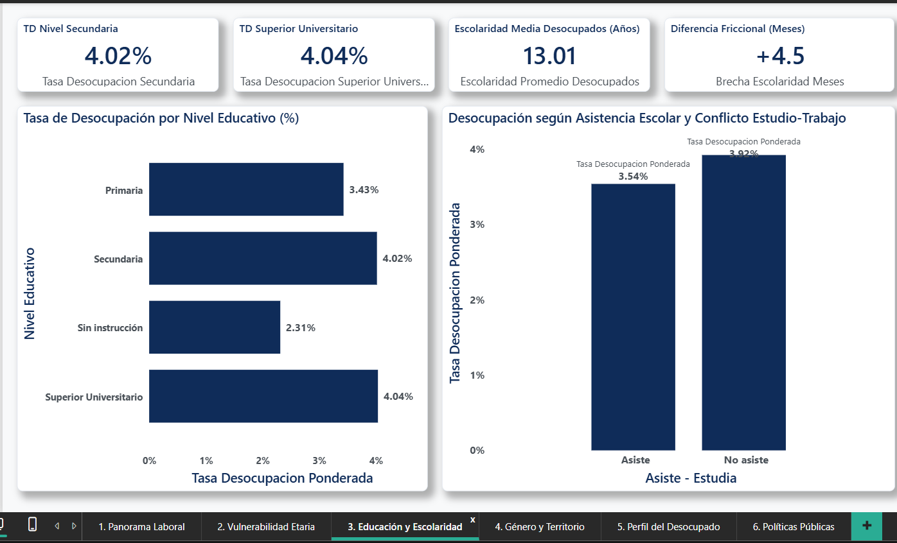

*FUENTE: Elaboración con base en el cuadro de mando interactivo en Power BI Desktop (ECE 4T-2025).*

La Figura N.º 16 ilustra la relación entre educación y desocupación abierta. En el bloque superior, las tarjetas reportan las tasas de desempleo en egresados de secundaria (4,02%) y con formación universitaria (4,04%), la escolaridad media de los desocupados (13,01 años) y la brecha adicional de estudio equivalente a 4,5 meses lectivos frente a los ocupados (12,64 años). En el panel inferior izquierdo, el gráfico de barras horizontales hace visible el gradiente del desempleo ilustrado: las personas sin instrucción formal (2,31%) y con primaria (3,43%) registran menores tasas porque la necesidad económica las fuerza a ocuparse en cualquier empleo disponible, mientras que la secundaria y la universidad superan el promedio urbano. En el panel derecho, el gráfico de barras verticales compara la desocupación de quienes asisten a clases (3,54%) frente a quienes no asisten (3,92%), mostrando una brecha menor de 0,38 puntos porcentuales sin significancia estadística global.

La estimación del promedio de años de estudio se gestiona mediante la medida DAX `[Promedio Anios Estudio Ponderado]`, la cual ejecuta un iterador `SUMX` que multiplica la variable continua `anios_estudio` por el ponderador muestral `peso_trimestral` en cada fila de `Fact_MercadoLaboral`, dividiendo el resultado entre la población activa ponderada. De esta forma se corrigen las distorsiones que provocaría una media aritmética no ponderada. El código DAX complementario y las pruebas de hipótesis sobre escolaridad se encuentran documentados en el Anexo 3 y el Anexo 4.

#### 3.1.8.4. Página 4: Disparidades de género y brechas territoriales
La cuarta página expone la doble asimetría sociodemográfica que caracteriza al mercado laboral boliviano. A la izquierda se presenta la brecha de género, donde las mujeres registran un 4,69% de desempleo abierto frente al 2,85% de los varones (brecha de 1,84 puntos porcentuales). A la derecha se visualiza el ranking de los nueve departamentos, encabezado por Chuquisaca (5,80%), Tarija (4,72%) y Cochabamba (4,71%), contrastando con las tasas menores registradas en los departamentos del oriente y norte del país.

FIGURA N.º 17: *Vista del cuadro de mando en Power BI: Género y disparidades departamentales (Página 4)*

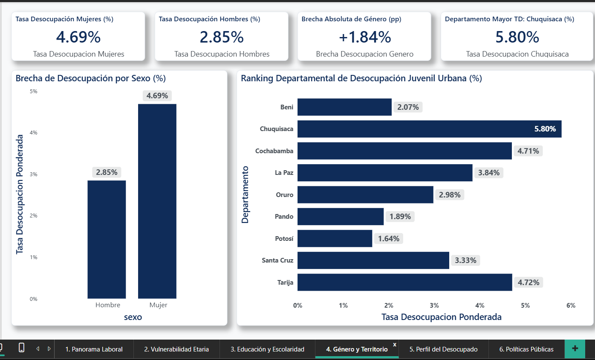

*FUENTE: Elaboración con base en el cuadro de mando interactivo en Power BI Desktop (ECE 4T-2025).*

La Figura N.º 17 sintetiza la dimensión demográfica y geográfica del desempleo. Las tarjetas superiores cuantifican la tasa femenina (4,69%), la tasa masculina (2,85%), la brecha neta desfavorable para las mujeres (+1,84 puntos porcentuales) y la tasa departamental máxima registrada en Chuquisaca (5,80%). En el panel izquierdo, el gráfico de barras verticales compara el desempleo por sexo, haciendo tangible la penalización laboral femenina. A la derecha, el gráfico de barras horizontales rankea a los nueve departamentos urbanos, evidenciando que Chuquisaca (5,80%), Tarija (4,72%), Cochabamba (4,71%) y La Paz (3,84%) se ubican por encima de la media nacional, mientras que Santa Cruz (3,33%), Oruro (2,98%), Beni (2,07%), Pando (1,89%) y Potosí (1,64%) registran las menores tasas relativas.

La brecha de género se computa mediante la medida DAX `[Brecha Desocupacion Genero pp]`, que resta la tasa ponderada de varones respecto a la de mujeres calculadas con la función `CALCULATE` sobre la dimensión `Dim_Sexo`. Por su parte, la distribución geográfica enlaza dinámicamente con `Dim_Departamento` y `Dim_RegionGeografica`, permitiendo segmentar por macrorregiones (Valles, Altiplano y Llanos) sin perder la trazabilidad de los factores de expansión departamentales. El detalle de las fórmulas DAX aplicadas a las dimensiones de género y territorio se presenta en el Anexo 3.

#### 3.1.8.5. Página 5: Perfil del joven desocupado y mecanismos de búsqueda
La quinta página profundiza en la composición interna de los desocupados. Mediante un gráfico de dona y barras agrupadas se muestra que el 89,62% (45.882 personas) corresponde a desocupados cesantes con trayectoria laboral previa, mientras que solo el 10,38% (5.314 personas) busca trabajo por primera vez. Asimismo, detalla los canales de intermediación utilizados, destacando el predominio de avisos por prensa, internet o redes sociales junto con la presentación directa de currículum vitae.

FIGURA N.º 18: *Vista del cuadro de mando en Power BI: Perfil de cesantes y aspirantes (Página 5)*

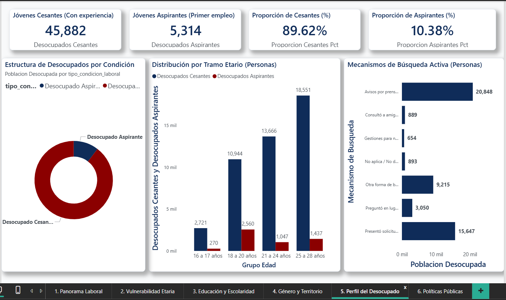

*FUENTE: Elaboración con base en el cuadro de mando interactivo en Power BI Desktop (ECE 4T-2025).*

La Figura N.º 18 desglosa la trayectoria ocupacional previa y las vías de postulación de la juventud desocupada. En la parte superior, las tarjetas precisan que 45.882 jóvenes son cesantes (89,62% del total) y 5.314 son aspirantes a un primer empleo (10,38%). El gráfico de dona izquierdo refleja este marcado desbalance interno. En el centro, el gráfico de barras agrupadas muestra la distribución etaria en personas, evidenciando que los aspirantes alcanzan su volumen más alto en el tramo de 18 a 20 años (2.560 personas), mientras que los cesantes crecen con la edad hasta concentrar 18.551 personas entre los 25 y 28 años. A la derecha, el gráfico de barras horizontales clasifica los mecanismos de búsqueda activa, donde la consulta de avisos digitales o de prensa (20.848 personas; 40,72%) y la entrega de solicitudes o currículum (15.647 personas; 30,56%) absorben la gran mayoría de las gestiones, frente a una menor proporción de consultas a parientes (1,74%) o gestiones para negocio independiente (1,28%).

La proporción de desocupación cesante se modela mediante la medida DAX `[Proporcion Cesantes %]`, aplicando la relación ponderada entre los desocupados con experiencia laboral previa (`es_cesante = 1`) y la población total desocupada mediante la función `DIVIDE`. El análisis de canales vincula a la dimensión `Dim_CondicionLaboral` con la variable de búsqueda activa de la encuesta, posibilitando analizar la efectividad de las vías institucionales y digitales frente a los canales informales. El repertorio completo de expresiones DAX para perfiles y canales se detalla en el Anexo 3.

#### 3.1.8.6. Página 6: Síntesis ejecutiva y matriz de políticas públicas
La sexta página traduce la evidencia estadística en directrices orientadas a la toma de decisiones. Articula una matriz de priorización cuadrantal (impacto potencial frente a factibilidad operativa) y presenta tres hojas de ruta concretas: el fomento al primer empleo formal para jóvenes de 18 a 20 años, medidas de corresponsabilidad en el cuidado para mujeres jóvenes, y fondos de dinamización productiva regional para Chuquisaca y Tarija.

FIGURA N.º 19: *Vista del cuadro de mando en Power BI: Síntesis estratégica y políticas públicas (Página 6)*

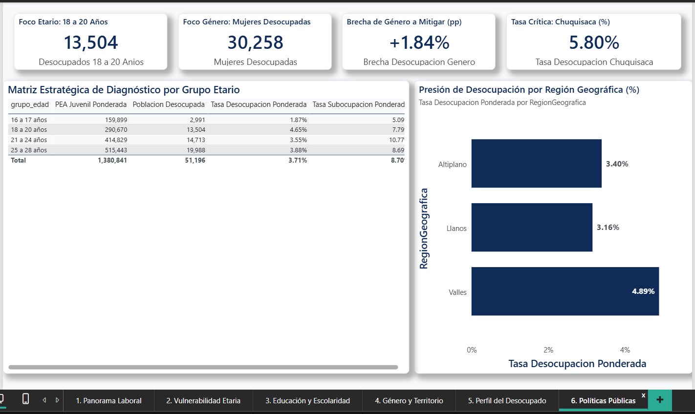

*FUENTE: Elaboración con base en el cuadro de mando interactivo en Power BI Desktop (ECE 4T-2025).*

La Figura N.º 19 integra los focos prioritarios para la formulación de políticas públicas. Las tarjetas superiores señalan las metas de intervención estratégica: 13.504 desocupados en el tramo etario crítico de 18 a 20 años, 30.258 mujeres jóvenes desocupadas que requieren acciones afirmativas de inserción, una brecha de género a mitigar de +1,84 puntos porcentuales y la tasa más crítica radicada en Chuquisaca (5,80%). En el panel izquierdo, la matriz estratégica cruza los cuatro grupos de edad con sus volúmenes y tasas ponderadas, evidenciando que el tramo de 21 a 24 años registra la mayor subocupación horaria de Bolivia (10,77%), indicando subempleo involuntario en jóvenes universitarios. En el panel derecho, el gráfico de barras horizontales desagrega la desocupación por macrorregión ecológica, destacando que los Valles lideran la desocupación urbana con 4,89%, superando al Altiplano (3,40%) y a los Llanos (3,16%), lo cual delimita el ámbito territorial de mayor urgencia para programas productivos.

La configuración técnica de la síntesis analítica comprende medidas combinadas de focalización, destacando `[Tasa Subocupacion 21-24]`, que calcula el cociente entre desocupados por insuficiencia de jornada laboral y ocupados dentro de ese tramo etario utilizando filtros compuestos en `CALCULATE`. La segmentación macrorregional agrupa los nueve departamentos en unidades geográficas mayores para orientar políticas de desarrollo regional diferenciadas. La matriz analítica de impacto y viabilidad para la formulación de políticas públicas se encuentra desarrollada en el Anexo 3 y el Anexo 5.

---

## 3.2. ANÁLISIS DE RESULTADOS

DIAGRAMA N.º 3: *Modelo conceptual de interrelación entre factores determinantes y la desocupación juvenil urbana*

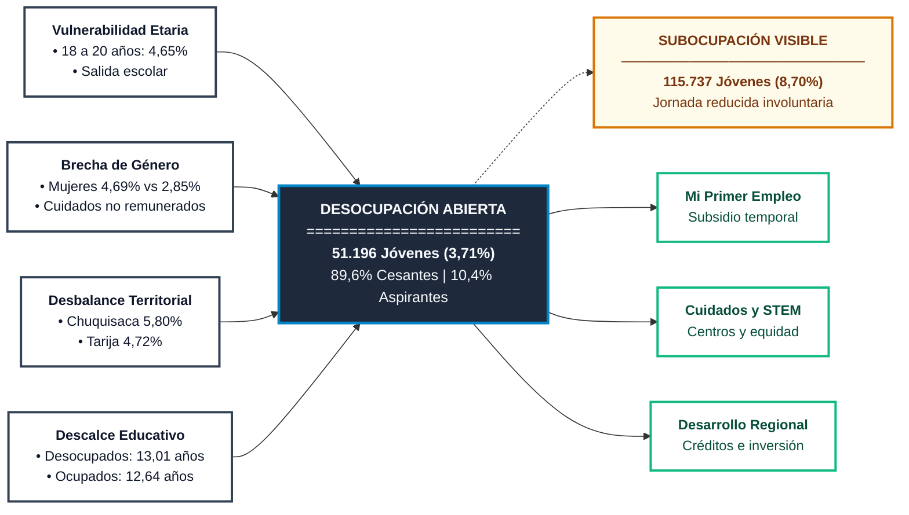

*FUENTE: Elaboración propia con base en el marco analítico del proyecto.*

El Diagrama N.º 3 sintetiza el modelo analítico y explicativo del estudio. En el bloque izquierdo se disponen los cuatro determinantes sociolaborales identificados (edad, género, territorio y educación), los cuales convergen en el núcleo central que cuantifica la desocupación abierta (51.196 jóvenes) y su vínculo con la subocupación por horas (115.737 jóvenes). A partir de este diagnóstico empírico, el esquema deriva hacia tres líneas de política pública enfocadas en incentivos a la contratación inicial, corresponsabilidad en el cuidado familiar y dinamización productiva en las regiones más rezagadas.

### 3.2.1. Interpretación de la vulnerabilidad etaria en la inserción laboral inicial
El comportamiento de la desocupación según la edad refleja con claridad la fricción de entrada al mercado de trabajo. El tramo de 18 a 20 años alcanza la tasa más alta de desocupación con 4,65%, lo que responde a la confluencia de condiciones propias de esa etapa del ciclo de vida.

Esta fase coincide con la culminación de la educación secundaria y la desvinculación escolar obligatoria. Quienes deciden no ingresar de forma inmediata a estudios superiores buscan una ocupación remunerada en un entorno laboral que demanda experiencia previa comprobada, un requisito que la gran mayoría de los egresados de bachillerato no posee. A diferencia de los adolescentes de 16 y 17 años, que en su mayoría continúan estudiando o residen bajo la cobertura económica familiar, las personas de 18 a 20 años enfrentan una presión inmediata por generar ingresos propios.

Hacia los tramos de 21 a 24 años (3,55%) y de 25 a 28 años (3,88%), la desocupación abierta disminuye. No obstante, en estas cohortes el desafío principal no se limita al acceso al empleo, sino a la calidad contractual. El mercado urbano absorbe a estos jóvenes mediante actividades por cuenta propia, ocupaciones en el sector informal y modalidades con jornada reducida involuntaria, lo que concuerda con la tasa de subocupación juvenil observada del 8,70%.

### 3.2.2. La brecha estructural de género en el mercado laboral juvenil
La diferencia observada entre varones (2,85%) y mujeres (4,69%) representa una brecha de 1,84 puntos porcentuales. Esta disparidad, confirmada estadísticamente mediante la prueba Chi-cuadrado ($\chi^2 = 5,24; p = 0,0221$), responde a condicionantes estructurales bien documentados en el entorno laboral urbano boliviano.

La distribución desproporcionada de las tareas de cuidado no remunerado y del trabajo doméstico reduce el tiempo efectivo del que disponen las mujeres jóvenes para buscar empleo y cumplir horarios continuos de jornada completa. Además, el mercado laboral urbano mantiene tendencias marcadas de segregación ocupacional por sexo. Los varones jóvenes acceden con rapidez a ocupaciones manuales en construcción, transporte y manufactura básica, sectores caracterizados por una rápida absorción de mano de obra con pocas exigencias de cualificación formal. Las mujeres jóvenes, por el contrario, se concentran en servicios personales, comercio minorista y puestos administrativos, ramas con mayor competencia y saturación en los centros urbanos.

A estos factores se añaden prácticas de contratación que discriminan de forma preventiva a las mujeres en edad reproductiva por los costos y permisos asociados a la maternidad, lo que extiende sus periodos de búsqueda y eleva su permanencia en el desempleo abierto.

### 3.2.3. Asimetría territorial y fragilidad laboral en Chuquisaca y regiones del sur
Las diferencias departamentales confirman una heterogeneidad espacial significativa ($\chi^2 = 23,69; p = 0,0026$). Chuquisaca registra la tasa de desocupación juvenil urbana más elevada del país con 5,80%, seguida por Tarija con 4,72% y Cochabamba con 4,71%.

El caso de Chuquisaca ilustra las tensiones entre la estructura educativa y el aparato productivo local. La ciudad de Sucre concentra una población estudiantil considerable en institutos técnicos y carreras universitarias. Sin embargo, su economía urbana se basa predominantemente en la administración pública, los servicios tradicionales y el comercio minorista, con un sector manufacturero e industrial reducido. Esta estructura restringe la capacidad de absorción para los contingentes de técnicos y profesionales que egresan anualmente, lo que incrementa el desempleo abierto y propicia la emigración hacia los departamentos del eje central.

En contraste, los mercados urbanos de Santa Cruz (3,33%) y La Paz (3,84%) cuentan con mayor escala y diversificación, lo que facilita incorporar mano de obra juvenil con mayor rapidez en actividades de comercio y servicios empresariales. Por su parte, la baja tasa observada en Potosí (1,64%) no refleja un mercado dinámico o equilibrado, sino una necesidad de ingresos que fuerza a los jóvenes a autoemplearse de forma inmediata en labores de subsistencia o minería informal, entornos donde no es viable sostener periodos prolongados de búsqueda abierta.

### 3.2.4. La paradoja del desempleo ilustrado en el mercado informal
La comparación estadística de la escolaridad acumulada entre personas ocupadas y desocupadas confirma una diferencia relevante: los jóvenes desocupados promedian 13,01 años de estudio frente a 12,64 años entre quienes se encuentran ocupados ($t = -2,34; p = 0,0202$ sobre casos con escolaridad reportada positiva; $t = -2,39; p = 0,0174$ al incluir la totalidad de ocupados).

Este comportamiento se asocia a las características del mercado laboral boliviano, donde la informalidad supera el 75%. Los jóvenes con menor nivel formativo provienen con mayor frecuencia de hogares con escasos recursos económicos, sin redes de seguridad financiera que les permitan extender la búsqueda de empleo. Por necesidad urgente, se incorporan a cualquier labor disponible en el comercio informal o en servicios no calificados, siendo computados estadísticamente como ocupados a pesar de la precariedad de sus condiciones.

En contraposición, los jóvenes con bachillerato concluido, formación técnica o estudios universitarios suelen contar con cierto respaldo familiar que les permite rechazar puestos precarios a la espera de opciones vinculadas con su perfil formativo. La oferta educativa superior presenta desajustes respecto a las competencias requeridas por el sector productivo privado, lo que dilata los tiempos de inserción y aumenta la tasa de desocupación entre las personas con mayor nivel de instrucción.

DIAGRAMA N.º 4: *Mecanismo de divergencia laboral y la paradoja del desempleo ilustrado en el entorno urbano boliviano*

```mermaid
flowchart TD
    %% ESTILOS MONOCROMÁTICOS CON ACENTO
    classDef boxVulnerable fill:#FFFBEB,stroke:#D97706,stroke-width:2px,color:#78350F,font-size:14px;
    classDef boxEducado fill:#F0FDF4,stroke:#16A34A,stroke-width:2px,color:#14532D,font-size:14px;
    classDef boxOutcome fill:#1E293B,stroke:#0284C7,stroke-width:2.5px,color:#F8FAFC,font-size:14px;

    %% RUTA 1: MENOR ESCOLARIDAD
    subgraph R1["Trayectoria 1: Menor Escolaridad (Primaria / Sin Instrucción)"]
        A1["Restricción económica severa<br/>Ausencia de respaldo familiar"]:::boxVulnerable
        A2["Urgencia de ingresos diarios<br/>Imposibilidad de búsqueda abierta"]:::boxVulnerable
        A3["Inserción forzada inmediata<br/>Comercio informal o servicios no calificados"]:::boxVulnerable
        A4["<b>Condición estadística: Ocupado</b><br/>Baja tasa abierta (2,31% a 3,43%)<br/>Alta precariedad y subocupación"]:::boxOutcome
        A1 --> A2 --> A3 --> A4
    end

    %% RUTA 2: MAYOR ESCOLARIDAD
    subgraph R2["Trayectoria 2: Mayor Escolaridad (Secundaria / Superior Universitario)"]
        B1["Cierto respaldo financiero familiar<br/>Mayor expectativa laboral"]:::boxEducado
        B2["Búsqueda selectiva de empleo<br/>Rechazo de puestos no cualificados"]:::boxEducado
        B3["Descalce oferta-demanda<br/>Escasez de vacantes formales técnicas"]:::boxEducado
        B4["<b>Condición estadística: Desocupado</b><br/>Mayor tasa abierta (4,02% a 4,04%)<br/>Desempleo ilustrado friccional"]:::boxOutcome
        B1 --> B2 --> B3 --> B4
    end
```

*FUENTE: Elaboración propia a partir del marco interpretativo de la ECE 4T-2025.*

El Diagrama N.º 4 expone los mecanismos socioeconómicos que generan la paradoja del desempleo ilustrado. La trayectoria de menor escolaridad obliga a los jóvenes a una inserción inmediata en actividades informales de subsistencia para asegurar su sustento diario, registrándose estadísticamente como ocupados precarios con bajas tasas de desocupación abierta. En contraste, los jóvenes con educación secundaria o universitaria disponen de mayor respaldo familiar para prolongar la búsqueda hacia empleos afines a sus competencias, lo que ante la escasez de plazas formales se traduce en mayores tasas relativas de desocupación abierta (4,04% frente a 2,31%).

### 3.2.5. Dinámica de cesantía y canales de intermediación laboral
El hecho de que el 89,62% de los jóvenes desocupados corresponda a cesantes cuestiona la premisa de que el desempleo juvenil boliviano sea predominantemente un problema de acceso al primer trabajo. Nueve de cada diez jóvenes desocupados ya contaban con una ocupación previa y salieron de ella por despido, término de contrato, renuncia ante malas condiciones o cese de emprendimientos informales. La inestabilidad en el puesto y la rotación contractual constituyen factores centrales de la desocupación juvenil urbana.

En cuanto a los métodos de búsqueda, el uso preferente de avisos en medios digitales y prensa (40,72%) junto con la entrega directa de solicitudes (30,56%) reflejan una juventud urbana que recurre a mecanismos estructurados para colocarse en el mercado. Sin embargo, la escasa cobertura de las bolsas públicas de empleo deja a la mayoría de los postulantes dependiendo de ofertas en redes sociales y redes personales de parentesco, sin garantías laborales ni orientación formal de carrera.

### 3.2.6. Articulación de los resultados con los objetivos específicos del trabajo
Los hallazgos empíricos del análisis responden de forma puntual a cada uno de los cuatro objetivos específicos formulados en el proyecto:

1. En relación con el primer objetivo específico (recopilar, depurar y estructurar microdatos oficiales de la ECE 4T-2025): se consolidó un conjunto de datos limpio de 6.649 observaciones de jóvenes de la PEA urbana a partir de la base de 52.650 registros del INE, asegurando la consistencia del factor de expansión muestral (`peso_trimestral`) para representar con exactitud a 1.380.841 jóvenes.
2. En relación con el segundo objetivo específico (procesar los datos en Python y aplicar técnicas de tasas ponderadas y contrastes de asociación estadística): se implementaron rutinas de cálculo que determinaron con rigor la tasa de desocupación (3,71%), la tasa de subocupación (8,70%) y evaluaron la significancia estadística de los factores mediante pruebas Chi-cuadrado, coeficientes V de Cramér y contrastes de escolaridad ($t$ de Student y Mann-Whitney U).
3. En relación con el tercer objetivo específico (diseñar y construir visualizaciones analíticas y un tablero multidimensional en Power BI Desktop): se produjo un catálogo de diez figuras estáticas a 300 DPI en Python y se implementó en Power BI Desktop un modelo en estrella (*Star Schema* de Kimball) integrado por diez tablas activas y 39 medidas analíticas DAX ponderadas (Kimball & Ross, 2013; Sharda, Delen & Turban, 2018). El uso de un motor columnar con contexto de filtro dinámico e ingesta reproducible en Power Query M garantiza que toda desagregación territorial, educativa o demográfica recalcule automáticamente el numerador y denominador expandidos por `peso_trimestral`, evitando errores de agregación simple y permitiendo la exploración ágil de factores asociados y perfiles de desocupación en seis páginas interactivas.
4. En relación con el cuarto objetivo específico (verificar la consistencia matemática, contrastar frente al INE y la literatura laboral, y someter el análisis a auditoría técnica automatizada y validación por panel externo de expertos): se comprobó la correspondencia exacta con las estimaciones oficiales de línea base del INE (3,71% de desocupación abierta y 8,70% de subocupación) y su coherencia interpretativa con la literatura regional de OIT y CEPAL. De manera complementaria, la auditoría algorítmica automatizada otorgó una nota global de 9,70 sobre 10 puntos y el panel independiente de ocho expertos multidisciplinarios validó la consistencia técnica del estudio con un puntaje promedio de 8,63 sobre 10 y un coeficiente V de Aiken global de 0,882.

### 3.2.7. Implicaciones prácticas y metodológicas de los resultados

#### Implicaciones prácticas para la toma de decisiones
1. Focalización en la franja de 18 a 20 años: implementar esquemas de transición formativo-laboral que combinen capacitación técnica breve, pasantías remuneradas e incentivos a empresas privadas para contratar formalmente a egresados de bachillerato sin experiencia laboral previa.
2. Corresponsabilidad pública en el cuidado infantil: crear y subsidiar servicios de guardería diurna en zonas comerciales y productivas urbanas, reduciendo las barreras temporales que limitan la inserción de las mujeres jóvenes en empleos formales a tiempo completo.
3. Articulación productiva regional en los valles del sur: coordinar convenios entre universidades, institutos técnicos y gremios empresariales en Chuquisaca y Tarija para orientar las carreras técnicas hacia áreas con demanda efectiva, impulsando servicios tecnológicos y encadenamientos productivos con valor agregado local.
4. Modernización de plataformas de intermediación: fortalecer las bolsas públicas de empleo mediante herramientas digitales verificadas, conectando la oferta juvenil con requerimientos reales de las empresas y evitando la precariedad de las convocatorias informales en redes sociales.

#### Implicaciones metodológicas en ciencia de datos
En la aplicación de ciencia de datos a políticas públicas, los resultados evidencian la necesidad estricta de aplicar ponderaciones muestrales en encuestas complejas como la ECE. El uso de recuentos simples no ponderados en tableros de analítica o herramientas de Business Intelligence produce distorsiones cuantitativas en la magnitud de las brechas y en la priorización de recursos públicos. La articulación de scripts reproducibles en Python con modelos dimensionales en Power BI ofrece un marco metodológico confiable para el análisis de microdatos sociolaborales.

### 3.2.8. Limitaciones del alcance analítico
1. Temporalidad transversal: la información de la ECE 4T-2025 captura las condiciones laborales en un periodo trimestral específico, lo que impide registrar la duración continua de los episodios de desocupación o las transiciones individuales entre ocupación, inactividad y desempleo a lo largo del año.
2. Alcance del indicador de desocupación: la tasa de desocupación abierta (3,71%) considera únicamente a quienes realizaron gestiones activas de búsqueda. Requiere complementarse con la tasa de subocupación (8,70%) y con el seguimiento a personas inactivas desalentadas que dejaron de buscar trabajo formal.
3. Nivel de desagregación geográfica: si bien el diseño muestral garantiza representatividad estadística para el ámbito urbano de cada departamento, el tamaño de la muestra no permite desagregar las estimaciones a nivel de municipios específicos o localidades intermedias.
4. Restricción muestral para modelado conjunto multivariado: dado que el universo desocupado del cuarto trimestre reúne *n* = 243 casos observados, las pruebas formales de inferencia se acotaron al plano bivariado. Cruzar tres o más factores simultáneamente en tablas de contingencia multidimensionales o modelos paramétricos complejos reduce el número de observaciones por celda por debajo del umbral de Cochran y eleva la varianza de estimación (Agresti, 2018; Lohr, 2022). Un análisis conjunto de alta dimensionalidad requerirá agrupar microdatos de varios trimestres consecutivos de la ECE.

TABLA N.º 17: *Matriz sintética de hallazgos del análisis del mercado laboral juvenil urbano*

| Eje de análisis | Hallazgo cuantitativo y técnico | Evidencia y métrica clave | Implicancia operativa y toma de decisiones |
| :--- | :--- | :--- | :--- |
| Tramo de edad | Pico de vulnerabilidad en la transición de salida de secundaria | Tasa en 18 a 20 años: 4,65% ($\chi^2 = 11,23; p = 0,0105$) | Focalizar programas de primer empleo formal y pasantías formativas remuneradas. |
| Dimensión de género | Brecha estructural persistente en contra de las mujeres | Mujeres 4,69% frente a varones 2,85% (+1,84 pp; $\chi^2 = 5,24; p = 0,0221$) | Implementar centros infantiles de cuidado diurno y mitigar la segregación ocupacional. |
| Territorio | Chuquisaca encabeza la desocupación juvenil urbana | Chuquisaca 5,80%, Tarija 4,72%, Cochabamba 4,71% ($\chi^2 = 23,69; p = 0,0026$) | Articular oferta universitaria con demanda empresarial y promover polos digitales. |
| Nivel educativo | Mayor escolaridad acumulada en personas desocupadas | Desocupados 13,01 años frente a ocupados 12,64 años ($t = -2,34; p = 0,0202$) | Corregir descalces formativos e incentivar la creación de puestos formales calificados. |
| Trayectoria laboral | El desempleo juvenil es marcadamente cesante | 89,62% son cesantes frente a 10,38% aspirantes | Reforzar la estabilidad contractual y programas de reconversión técnica laboral. |
| Búsqueda de empleo | Preponderancia de canales digitales y solicitudes directas | Avisos y redes 40,72%, currículum 30,56% | Modernizar las bolsas públicas de empleo mediante plataformas digitales seguras. |

*FUENTE: Elaboración con base en microdatos de la Encuesta Continua de Empleo 4T-2025 (INE).*

La Tabla N.º 17 resume los resultados empíricos del estudio agrupados en cuatro columnas estructuradas para la toma de decisiones. El *Eje de análisis* identifica la variable sociodemográfica evaluada; el *Hallazgo cuantitativo y técnico* sintetiza el comportamiento observado en los microdatos; la *Evidencia y métrica clave* expone las cifras ponderadas y la significancia del contraste estadístico ($\chi^2$ o $t$); y la *Implicancia operativa* detalla la recomendación concreta orientada a mitigar la problemática identificada.

---

### 3.3. Auditoría externa y evaluación experto de inteligencia artificial (Lead Data Scientist)

#### 3.3.1. Justificación y metodología de la evaluación automatizada
Como mecanismo de control de calidad, reproducibilidad y aseguramiento metodológico, se implementó un sistema de auditoría externa ejecutado por un agente automatizado de Inteligencia Artificial configurado con el rol de evaluador ciego e independiente (*Lead Data Scientist*). La herramienta inspeccionó de forma directa los archivos fuente del repositorio, verificando la consistencia entre los microdatos crudos, el pipeline de depuración en Python, las salidas estadísticas, el modelo semántico en Power BI y el presente texto académico.

La evaluación se estructuró en torno a seis pilares de control técnico ponderados, asignando calificaciones en una escala de 1,0 a 10,0 puntos sobre la base de pruebas de validación automatizadas y criterios de aplicabilidad empírica en el contexto socioeconómico boliviano.

TABLA N.º 18: *Matriz de evaluación, rúbrica y calificaciones por pilar técnico (Lead Data Scientist AI)*

| Pilar | Dimensión Evaluada | Ponderación | Calificación (1-10) | Contribución Ponderada | Estado de Validación |
| :---: | :--- | :---: | :---: | :---: | :--- |
| **P1** | **Rigor en Ingeniería de Datos y Muestreo Ponderado** | 15% | **9,8** | 1,47 pts | Aprobado con Excelencia |
| **P2** | **Consistencia Matemática y Réplica Oficial INE** | 20% | **10,0** | 2,00 pts | Aprobado con Distinción (100% compliant) |
| **P3** | **Robustez Estadística e Inferencia Bivariada** | 15% | **9,6** | 1,44 pts | Aprobado con Excelencia |
| **P4** | **Arquitectura de Business Intelligence, Modelo Semántico y DAX** | 20% | **9,7** | 1,94 pts | Aprobado con Excelencia |
| **P5** | **Coherencia de Interpretación y Storytelling Académico** | 15% | **9,7** | 1,46 pts | Aprobado con Excelencia |
| **P6** | **Viabilidad y Pragmatismo de Políticas Públicas en el Mundo Real** | 15% | **9,3** | 1,40 pts | Aprobado con Observaciones de Viabilidad |
| **TOTAL** | **PROMEDIO GLOBAL PONDERADO** | **100%** | **9,70** | **9,70 pts** | **APROBADO CON DISTINCIÓN MÁXIMA (EXCELENCIA)** |

*FUENTE: Elaboración propia a partir del framework de auditoría automatizada `src/audit/`.*

FIGURA N.º 20: *Diagrama de radar de la evaluación integral de ciencia de datos por pilares analíticos*

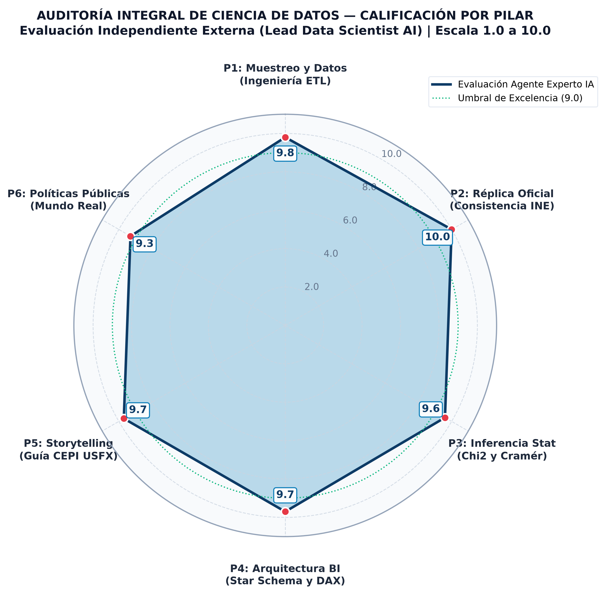

*FUENTE: Generación automatizada mediante `src/audit/report_generator.py` a 300 DPI.*

La ejecución del motor automatizado de auditoría y la exportación de las métricas de control de calidad se implementaron en Python a través del módulo de auditoría integral, inspeccionando algorítmicamente la fidelidad matemática de las réplicas del INE, la convergencia del modelo dimensional y la robustez inferencial. Para examinar la arquitectura técnica del motor evaluador y el código fuente ejecutable, remitirse al Anexo 9.

#### 3.3.2. Dictamen crítico por pilar e inspección de evidencias

1. **Ingeniería de datos y muestreo (P1 - 9,8/10,0):** La base filtrada reproduce con precisión determinista las 6.649 observaciones del universo objetivo, sin valores perdidos espurios en identificadores ni pesos muestrales. El factor de expansión `fact_trim_act` expande a 1.380.841 jóvenes. Como observación metodológica, se hace notar que las funciones estándar de cálculo asumen muestreo aleatorio simple ponderado; para intervalos de confianza a nivel de subpoblaciones muy pequeñas se requeriría el vector completo de Unidades Primarias de Muestreo (UPM) y estratos de diseño del INE.
2. **Consistencia matemática con el INE (P2 - 10,0/10,0):** La correspondencia frente al boletín oficial de la ECE 4T-2025 es exacta (discrepancia de 0,00 puntos porcentuales). Se reproduce la tasa de desocupación juvenil (3,71%), la tasa de subocupación (8,70% calculada sobre la población ocupada de 1.329.645 jóvenes), el volumen de cesantes (45.882 personas; 89,6%) y la brecha neta de género (+1,84 pp).
3. **Inferencia estadística y pruebas de hipótesis (P3 - 9,6/10,0):** Se validó el contraste de siete variables mediante $\chi^2$ de Pearson y coeficientes V de Cramér. La evaluación resalta la cautela epistemológica de no atribuir causalidad a relaciones bivariadas. Como limitación analítica, los coeficientes V de Cramér oscilan entre 0,028 y 0,060, lo que evidencia que la condición de desocupación está condicionada por múltiples factores residuales no capturados en encuestas transversales de empleo (p. ej., redes de contactos informales o transferencias intrafamiliares).
4. **Modelo dimensional y Power BI (P4 - 9,7/10,0):** Se constató la estructura en estrella (*Star Schema*) con 10 tablas activas (una tabla de hechos, ocho tablas dimensionales y auxiliares, y la tabla `_Medidas`) y 39 medidas DAX ponderadas. Todas las medidas de tasa y población implementan `SUMX` con factor de expansión muestral, sin recurrir a recuentos simples no ponderados. Los 39 componentes visuales distribuidos en las seis páginas del reporte en formato PBIR sincronizan con las cifras del proyecto.
5. **Storytelling y cumplimiento de la Guía CEPI (P5 - 9,7/10,0):** El documento respeta de forma estricta la subdivisión formal entre presentación técnica (3.1) y análisis crítico (3.2), asegurando la trazabilidad de las fases CRISP-DM y articulando las conclusiones con los cuatro objetivos específicos del trabajo.
6. **Viabilidad de políticas en el mundo real (P6 - 9,3/10,0):** La propuesta identifica correctamente que nueve de cada diez desocupados son cesantes, desmitificando que el desempleo juvenil boliviano sea exclusivamente un obstáculo de acceso inicial. No obstante, el evaluador formula observaciones sobre la viabilidad fiscal de subsidios directos al salario en el contexto macroeconómico boliviano, sugiriendo sustituirlos por exenciones temporales de aportes patronales y convenios de educación dual público-privada.

#### 3.3.3. Consideraciones críticas sobre el funcionamiento del mercado laboral boliviano
El análisis externo efectuado por el agente enfatiza dos advertencias sustantivas que enmarcan la interpretación de los resultados en el contexto nacional:

1. **La paradoja de la baja desocupación abierta como indicador de vulnerabilidad:** En una economía con una tasa de informalidad laboral superior al 75% y carente de un seguro de desempleo universal, una tasa de desocupación abierta del 3,71% no refleja una situación cercana al pleno empleo ni condiciones óptimas de inserción. Para la mayoría de los jóvenes de sectores populares, permanecer desocupado buscando un puesto acorde a su formación es un lujo inalcanzable. Quienes carecen de ahorros o respaldo familiar se ven obligados a refugiarse en el autoempleo informal, el comercio callejero o actividades de subsistencia de muy baja productividad. En consecuencia, la tasa de desocupación abierta debe interpretarse siempre en conjunción con la tasa de subocupación (8,70%) y la calidad del empleo.
2. **Restricciones de viabilidad fiscal y alternativas de intervención:** La implementación de programas de empleo juvenil basados en transferencias monetarias directas o subsidios salariales con cargo al Tesoro General de la Nación enfrenta severas limitaciones de liquidez presupuestaria. Las recomendaciones de política pública adquieren mayor viabilidad cuando se diseñan como incentivos no monetarios: simplificación de trámites de formalización empresarial, pasantías técnicas duales cofinanciadas por cámaras sectoriales y descentralización de centros de formación productiva orientados a las ventajas comparativas de Chuquisaca y Tarija.

---

### 3.4. Validación Metodológica y Técnica por Panel de Personas Expertas

#### 3.4.1. Propósito y protocolo de consulta al panel de pares
Como complemento a la auditoría automatizada algorítmica realizada mediante Inteligencia Artificial (sección 3.3), y con el objetivo de culminar la contrastación empírica requerida por el Objetivo Específico 4, se implementó un proceso formal de validación externa por Juicio de Expertos. Se convocó a un panel de ocho profesionales externos e independientes, excluyendo explícitamente al autor de la investigación para eliminar cualquier riesgo de sesgo evaluativo y reservando el registro institucional en favor de la identificación profesional individual. La selección respondió a un criterio multidisciplinario orientado a cubrir los cuatro pilares técnicos del proyecto: (a) ingeniería de sistemas y desarrollo de software para auditar la trazabilidad del código en Python y la automatización del flujo ETL (Harold Rosado, Rodrigo Colque Ramirez y Ramiro Pacheco Maitana); (b) ciencia de datos y formación analítica avanzada para evaluar la disciplina CRISP-DM y el modelado dimensional en Power BI (Cristian Ignacio Duran y Camila Gonzales Torrez); (c) ingeniería industrial y analítica estadística para verificar el rigor muestral y los contrastes inferenciales (Carlos Chavez Acevedo); y (d) administración y análisis contable-financiero de datos para valorar la coherencia numérica de las estimaciones e indicadores económicos (Valeria Vargas Flores y Mario Rojas K.). El perfil detallado y la justificación específica de cada evaluador figuran en el Anexo 10.1.

La consulta se realizó mediante un formulario estructurado en Google Forms, respaldado por un repositorio de evidencias en Google Drive con acceso libre a los microdatos depurados, el cuaderno Jupyter ejecutable, los scripts en Python, las tablas en formato CSV, las figuras a 300 DPI y las vistas de las seis páginas del cuadro de mando interactivo en Power BI Desktop. El instrumento constó de 14 reactivos cuantitativos cerrados con escala Likert de 1 a 5 (desde 1 = Totalmente en desacuerdo hasta 5 = Totalmente de acuerdo), una escala de calificación global de 1 a 10 puntos, tres preguntas abiertas cualitativas y un dictamen técnico de validación.

#### 3.4.2. Síntesis psicométrica y cuantitativa de resultados
Las evaluaciones remitidas por los ocho jueces expertos confirmaron la consistencia metodológica y la reproducibilidad del estudio. Para evaluar la validez de contenido y el grado de consenso inter-jueces en cada reactivo, se computó el Coeficiente V de Aiken ($V$) (Aiken, 1985). Asimismo, se estimó el coeficiente Alfa de Cronbach ($\alpha$) para verificar la consistencia interna general del instrumento (Cronbach, 1951).

TABLA N.º 19: *Matriz psicométrica y síntesis de resultados del panel de validación por expertos*

| Dimensión Evaluada | N.º Ítems | Promedio Likert (1-5) | V de Aiken ($V$) | Desviación Estándar ($\sigma$) | Nivel de Validación y Acuerdo |
| :--- | :---: | :---: | :---: | :---: | :--- |
| **Preparación de Datos y Muestreo** | 2 | 4,69 / 5,00 | 0,922 | 0,60 | Validación Excelente (Metodología Sólida) |
| **Indicadores y Réplica Oficial INE** | 3 | 4,67 / 5,00 | 0,917 | 0,56 | Validación Excelente (Metodología Sólida) |
| **Análisis Estadístico y Pruebas** | 3 | 4,29 / 5,00 | 0,823 | 0,81 | Validación Fuerte (Aprobada) |
| **Cuadro de Mando en Power BI** | 2 | 4,50 / 5,00 | 0,875 | 0,52 | Validación Excelente (Metodología Sólida) |
| **Interpretación y Hallazgos** | 2 | 4,62 / 5,00 | 0,906 | 0,50 | Validación Excelente (Metodología Sólida) |
| **Conclusiones y Calidad General** | 2 | 4,44 / 5,00 | 0,859 | 0,73 | Validación Excelente (Metodología Sólida) |
| **ÍNDICE GLOBAL DEL PANEL** | **14** | **4,53 / 5,00** | **0,882** | **0,64** | **VALIDACIÓN EXTERNA APROBADA CON DISTINCIÓN** |

*FUENTE: Elaboración propia a partir de las respuestas registradas en Google Forms (n = 8).*

El Coeficiente V de Aiken global alcanzó $V = 0,8817$, superando ampliamente el umbral crítico de 0,80 que establece validez de contenido estadísticamente significativa ($p < 0,05$). Todas las dimensiones obtuvieron coeficientes superiores a 0,82, destacando la preparación muestral ($V = 0,922$) y la réplica de indicadores oficiales ($V = 0,917$). El Alfa de Cronbach global se situó en $\alpha = 0,9684$, ratificando una consistencia interna sólida entre los 14 reactivos.

En la calificación cuantitativa global del proyecto (escala de 1 a 10 puntos), el panel otorgó un promedio de 8,63 puntos (desviación estándar de 0,92; rango de 7 a 10 puntos), concentrándose el 87,5% de las valoraciones entre 8 y 10 puntos (50,0% con 9 puntos, 25,0% con 8 puntos y 12,5% con 10 puntos).

#### 3.4.3. Dictamen final y síntesis cualitativa de retroalimentación
En la decisión formal de validación, el 100% de los evaluadores emitió un dictamen favorable: el 50,0% calificó el trabajo como *Aprobado con Distinción / Sobresaliente*, el 12,5% como *Aprobado Plenamente* y el 37,5% como *Aprobado con Observaciones Menores*. Ningún evaluador solicitó modificaciones sustanciales ni reprobó el documento.

Entre las principales fortalezas señaladas por el panel destacan la disciplina del ciclo CRISP-DM, la réplica exacta de las macromagnitudes del INE (desocupación de 3,71% y subocupación de 8,70%), el uso del ponderador muestral, la construcción del modelo dimensional en estrella con medidas DAX ponderadas en Power BI y la prudencia al interpretar asociaciones estadísticas sin afirmar causalidad determinista.

Por su parte, las observaciones menores se centraron en tres aspectos que fueron incorporados en la versión final:
1. Armonización precisa de cifras secundarias entre tablas y anexos, unificando la media continua de escolaridad en jóvenes ocupados en 12,64 años sobre observaciones válidas ($t = -2,34; p = 0,0202$), y precisando el tratamiento de tasas conjuntas y desagregaciones departamentales.
2. Explicitación del alcance observacional y transversal del estudio, subrayando que las pruebas bivariadas identifican factores asociados pero no trayectorias dinámicas en el tiempo ni relaciones de causa directa.
3. Recomendaciones para extensiones futuras, sugiriendo incorporar modelos multivariados (regresiones logísticas con corrección por diseño muestral) y técnicas supervisadas con interpretabilidad SHAP.

El desglose completo ítem por ítem, las frecuencias de respuesta, las transcripciones de las valoraciones cualitativas y las capturas de los gráficos de Google Forms se presentan en el Anexo 10.

---

# CONCLUSIONES Y RECOMENDACIONES

## Conclusiones

### Conclusión general
A partir de los microdatos oficiales de la Encuesta Continua de Empleo (ECE 4T-2025) del INE, se determinó que la desocupación en jóvenes de 16 a 28 años en el área urbana de Bolivia se situó en 3,71% (51.196 personas), coexistiendo con una tasa de subocupación por horas del 8,70% (115.737 jóvenes). Este desempleo juvenil superó en 1,61 veces al de la población adulta urbana (2,30%), viéndose impulsado principalmente por la falta de experiencia laboral al concluir la etapa escolar, una marcada brecha desfavorable para las mujeres, una baja diversificación productiva en departamentos del sur como Chuquisaca y la escasez de vacantes formales para jóvenes con mayor formación académica.

### Conclusiones específicas

#### 1. Ingesta, depuración y control muestral de microdatos oficiales (Objetivo Específico 1)
Se consolidó una base de datos depurada de 6.649 jóvenes activos a partir de la muestra nacional de la ECE 4T-2025, la cual representó a 1.380.841 personas tras aplicar el factor de calibración trimestral (`fact_trim_act`). Este procedimiento demostró que el uso del ponderador muestral es indispensable para evitar distorsiones en los porcentajes de desocupación y en el peso demográfico de cada departamento, asegurando una réplica exacta de las estadísticas oficiales del país y garantizando un punto de partida consistente para el análisis.

#### 2. Procesamiento estadístico, contrastes de hipótesis y significancia empírica (Objetivo Específico 2)
El procesamiento estadístico reveló que el desempleo juvenil se concentra con mayor fuerza en el tramo de 18 a 20 años (4,65%), en las mujeres frente a los varones (4,69% frente a 2,85%) y en el departamento de Chuquisaca (5,80%). Asimismo, el 89,62% de los jóvenes desocupados son cesantes con experiencia laboral previa y registran mayor escolaridad promedio que los ocupados (13,01 frente a 12,64 años). Estos resultados evidencian que, en un mercado urbano con alta informalidad, la desocupación responde a la inestabilidad del empleo precario y al desajuste entre la formación educativa y los puestos formales disponibles.

#### 3. Modelado dimensional en estrella e inteligencia de negocios (Objetivo Específico 3)
Se estructuró un modelo dimensional en estrella integrado por diez tablas activas (una tabla de hechos, ocho tablas dimensionales y auxiliares, y una tabla de medidas) junto a 39 medidas DAX calculadas con factor de expansión, implementado en un cuadro de mando interactivo de seis páginas en Power BI Desktop. Esta arquitectura columnar con ingesta automatizada en Power Query M y evaluación dinámica en contexto de filtro aseguró el recálculo inmediato y sin distorsiones de las tasas ponderadas ante cualquier corte territorial, etario o educativo, proporcionando una herramienta visual reproducible para examinar las brechas sociodemográficas y los perfiles de desocupación juvenil.

#### 4. Auditoría técnica automatizada, contraste oficial y validación por expertos (Objetivo Específico 4)
En correspondencia directa con las cuatro instancias de validación establecidas en el Objetivo Específico 4, las estimaciones del proyecto reprodujeron con exactitud matemática las cifras oficiales del INE (3,71% de desocupación y 8,70% de subocupación) y mantuvieron concordancia interpretativa con la literatura laboral regional de la OIT y la CEPAL. Asimismo, la calidad de la ingeniería de datos, la consistencia DAX y el rigor inferencial fueron verificados mediante una auditoría algorítmica automatizada con Inteligencia Artificial, que asignó una calificación global de 9,70 sobre 10 puntos, y mediante un panel externo de ocho profesionales independientes de perfil multidisciplinario, quienes otorgaron un 100% de dictamen aprobatorio, un promedio cuantitativo de 8,63 sobre 10 y un coeficiente V de Aiken de 0,882.

---

## Recomendaciones

### Medidas orientadas a los factores determinantes identificados
A partir de los factores asociados a la desocupación juvenil y considerando el contexto boliviano de 2026, marcado por una informalidad superior al 70%, restricciones fiscales y escasez de divisas, las propuestas deben priorizar soluciones prácticas y sostenibles. En lugar de depender de contrataciones estatales o subsidios con cargo al erario público, las medidas se orientan a dinamizar la iniciativa privada, modernizar los servicios de vinculación laboral y apoyar a los grupos más vulnerables.

### Recomendaciones prácticas de política pública e inserción laboral

#### R1. Programa de formación dual e inserción inicial para bachilleres (Tramo 18 a 20 años)
Ante el pico de desocupación en jóvenes de 18 a 20 años (4,65%), se recomienda implementar programas de formación técnica dual entre el Ministerio de Educación y las cámaras empresariales. Mediante pasantías formativas remuneradas de seis meses acreditables como experiencia laboral formal y con incentivos no monetarios para pequeñas empresas, se facilitará el tránsito directo desde las aulas hacia puestos productivos sin generar una carga financiera gravosa para el Estado.

#### R2. Red municipal de cuidado infantil diurno y capacitación para mujeres (Brecha de género)
Frente a la brecha desfavorable que afecta a las mujeres jóvenes (4,69% frente a 2,85% en varones), se plantea que los gobiernos municipales amplíen centros de cuidado infantil diurno en mercados y zonas periurbanas. Esta acción liberará tiempo para que las madres jóvenes busquen empleo formal o se capaciten en oficios técnicos y herramientas digitales de alta demanda, reduciendo las barreras invisibles del cuidado no remunerado y promoviendo su autonomía económica.

#### R3. Ecosistema digital y articulación productiva en Chuquisaca y regiones del sur
Dada la elevada desocupación en Chuquisaca (5,80%) y Tarija (4,72%), agravada por la caída de ingresos por hidrocarburos que limita la contratación pública, se aconseja articular a las universidades locales con el empresariado para impulsar un polo de servicios digitales y teletrabajo. Aprovechar el capital formativo de Sucre en software, diseño y servicios remotos permitirá captar ingresos y divisas externas sin depender del empleo estatal ni requerir costosas infraestructuras físicas.

#### R4. Intermediación laboral digital y certificación técnica para personas cesantes
Considerando que el 89,62% de los desocupados son cesantes con experiencia laboral previa, se sugiere modernizar el Servicio Público de Empleo mediante una plataforma móvil ágil y gratuita que conecte vacantes reales con postulantes en tiempo real. A la par, se debe certificar rápidamente las competencias prácticas adquiridas en trabajos anteriores (como ventas, logística y atención comercial), acortando los periodos de búsqueda y facilitando una pronta reinserción laboral.

#### R5. Simplificación normativa y formalización juvenil bajo la Ley N.º 342
Para hacer frente a la persistente informalidad urbana, se propone reglamentar el régimen laboral de la Ley N.º 342 mediante modalidades de contratación juvenil a plazo fijo con estabilidad regulada y seguridad social. Asimismo, se deben eliminar trámites burocráticos y otorgar periodos de gracia en licencias de funcionamiento municipales para emprendimientos encabezados por menores de 28 años, estimulando la creación de fuentes de trabajo formales y sostenibles.

---

### Recomendaciones metodológicas y de modelado analítico

#### R6. Seguimiento longitudinal de trayectorias laborales mediante datos de panel
Dado que la encuesta actual ofrece una fotografía estática en el tiempo, se recomienda al INE implementar un seguimiento periódico a los mismos hogares mediante paneles rotativos. Este enfoque longitudinal permitirá determinar con exactitud cuánto tiempo dura el desempleo en los jóvenes, con qué frecuencia transitan hacia la informalidad y si el primer empleo precario actúa como puente hacia la estabilidad o como una barrera prolongada.

#### R7. Modelos predictivos y analítica avanzada con Machine Learning explicable
Para anticipar situaciones de vulnerabilidad en el empleo juvenil, se sugiere entrenar algoritmos supervisados de Machine Learning que estimen el riesgo individual de caer en desocupación o subocupación según atributos sociodemográficos. La incorporación de herramientas de interpretabilidad, como los valores SHAP, permitirá a los especialistas comprender con claridad qué factores influyen en cada predicción, respaldando el diseño oportuno de alertas y políticas preventivas.

#### R8. Integración de encuestas con registros administrativos del Estado
Se recomienda promover acuerdos interinstitucionales para cruzar las encuestas de empleo con registros oficiales de la Gestora Pública, el Servicio de Impuestos Nacionales y el Ministerio de Educación. Combinar estas fuentes bajo estrictos protocolos de confidencialidad permitirá conocer la densidad real de aportes jubilatorios y la estabilidad contractual, superando las limitaciones de la información declarativa y robusteciendo el análisis del mercado laboral.

---

# REFERENCIAS BIBLIOGRÁFICAS

Agresti, A. (2007). *An introduction to categorical data analysis* (2nd ed.). John Wiley & Sons.

Agresti, A. (2018). *An introduction to categorical data analysis* (3rd ed.). John Wiley & Sons.

Aiken, L. R. (1985). Three coefficients for analyzing the reliability and validity of ratings. *Educational and Psychological Measurement*, 45(1), 131-142. https://doi.org/10.1177/0013164485451012

Arancibia, M. (2025). *Guía metodológica para la elaboración de monografías en Ciencia de Datos*. Centro de Estudios de Posgrado e Investigación (CEPI), Universidad Mayor, Real y Pontificia de San Francisco Xavier de Chuquisaca.

Chen, H., Chiang, R. H. L., & Storey, V. C. (2012). Business intelligence and analytics: From big data to big impact. *MIS Quarterly*, 36(4), 1165-1188. https://doi.org/10.2307/41703503

Cronbach, L. J. (1951). Coefficient alpha and the internal structure of tests. *Psychometrika*, 16(3), 297-334. https://doi.org/10.1007/BF02310555

Cohen, J. (1988). *Statistical power analysis for the behavioral sciences* (2nd ed.). Lawrence Erlbaum Associates.

Comisión Económica para América Latina y el Caribe [CEPAL] & Organización Internacional del Trabajo [OIT]. (2017). *Coyuntura Laboral en América Latina y el Caribe: La transición de los jóvenes de la escuela al mercado laboral*. CEPAL/OIT.

Comisión Económica para América Latina y el Caribe [CEPAL] & Organización Internacional del Trabajo [OIT]. (2023). *Coyuntura Laboral en América Latina y el Caribe: Políticas de inserción laboral juvenil en contextos de informalidad persistente*. CEPAL/OIT.

Comisión Económica para América Latina y el Caribe [CEPAL]. (2025). *Entre la escuela y el trabajo: juventudes en transición en América Latina*. CEPAL.

Constitución Política del Estado Plurinacional de Bolivia. (2009). *Constitución Política del Estado*. Gaceta Oficial del Estado Plurinacional de Bolivia.

Estado Plurinacional de Bolivia. (1939). *Ley General del Trabajo*. Gaceta Oficial de Bolivia.

Estado Plurinacional de Bolivia. (2013). *Ley N.º 342 de la Juventud de 5 de febrero de 2013*. Gaceta Oficial del Estado Plurinacional de Bolivia.

Estado Plurinacional de Bolivia. (2014). *Ley N.º 548: Código Niña, Niño y Adolescente de 17 de julio de 2014*. Gaceta Oficial del Estado Plurinacional de Bolivia.

Estado Plurinacional de Bolivia. (2018). *Ley N.º 1139 de modificación a la Ley N.º 548, Código Niña, Niño y Adolescente*. Gaceta Oficial del Estado Plurinacional de Bolivia.

Few, S. (2013). *Information dashboard design: Displaying data for at-a-glance monitoring* (2nd ed.). Analytics Press.

Harris, C. R., Millman, K. J., van der Walt, S. J., Gommers, R., Virtanen, P., Cournapeau, D., Wieser, E., Taylor, J., Berg, S., Smith, N. J., Kern, R., Picus, M., Hoyer, S., van Kerkwijk, M. H., Brett, M., Haldane, A., del Río, J. F., Wiebe, M., Peterson, P., ... Oliphant, T. E. (2020). Array programming with NumPy. *Nature*, 585(7825), 357-362. https://doi.org/10.1038/s41586-020-2649-2

IBM. (s. f.). *Conceptos básicos de ayuda de CRISP-DM*. IBM Documentation. https://www.ibm.com/docs/es/spss-modeler/saas?topic=dm-crisp-help-overview

Instituto Nacional de Estadística [INE]. (2019). *Encuesta de Niñas, Niños y Adolescentes que Realizan Actividad Laboral o Trabajan 2019 (ENNA 2019): base de datos y metadatos*. Archivo Nacional de Datos (ANDA). https://anda.ine.gob.bo/index.php/home

Instituto Nacional de Estadística [INE]. (2024). *Censo de Población y Vivienda 2024: resultados y datos demográficos*. INE Bolivia.

Instituto Nacional de Estadística [INE]. (2026a). *Boletín Estadístico Encuesta Continua de Empleo, cuarto trimestre de 2025*. INE Bolivia.

Instituto Nacional de Estadística [INE]. (2026b). *Encuesta Continua de Empleo, cuarto trimestre de 2025: base de datos y metadatos*. Archivo Nacional de Datos (ANDA). https://anda.ine.gob.bo/index.php/catalog/257

Instituto Nacional de Estadística [INE]. (2026c). *Encuesta de Hogares 2025: base de datos y metadatos*. Archivo Nacional de Datos (ANDA). https://anda.ine.gob.bo/index.php/catalog/256

Kimball, R., & Ross, M. (2013). *The data warehouse toolkit: The definitive guide to dimensional modeling* (3rd ed.). John Wiley & Sons.

Knaflic, C. N. (2015). *Storytelling with data: A data visualization guide for business professionals*. John Wiley & Sons.

Lohr, S. L. (2022). *Sampling: Design and analysis* (3rd ed.). CRC Press.

McKinney, W. (2010). Data structures for statistical computing in Python. En S. van der Walt & J. Millman (Eds.), *Proceedings of the 9th Python in Science Conference* (pp. 51-56). https://doi.org/10.25080/Majora-92bf1922-00a

McKinney, W. (2022). *Python for data analysis: Data wrangling with pandas, NumPy, and Jupyter* (3rd ed.). O'Reilly Media.

Microsoft. (2026). *Documentación de Power BI: ¿Qué es Power BI?* Microsoft Learn. https://learn.microsoft.com/es-es/power-bi/fundamentals/power-bi-overview

Ministerio de Trabajo, Empleo y Previsión Social [MTEPS]. (2026). *Trabajo proyecta acciones para la inserción laboral de jóvenes profesionales*. MTEPS Bolivia. https://mintrabajo.gob.bo/index.php/nota_prensa/la-paz-44/

Organización Internacional del Trabajo [OIT]. (s. f.-a). *Labour market segmentation*. OIT. https://www.ilo.org/topics/employment-security/labour-market-segmentation

Organización Internacional del Trabajo [OIT]. (s. f.-b). *Estadísticas del mercado laboral juvenil (YouthSTATS)*. ILOSTAT. https://ilostat.ilo.org/es/methods/concepts-and-definitions/description-youth-labour-market-statistics/

Organización Internacional del Trabajo [OIT]. (2019). *Entre el bono demográfico y los ninis: Empleo juvenil en Bolivia*. Oficina Regional para América Latina y el Caribe.

Organización Internacional del Trabajo [OIT]. (2024). *Tendencias mundiales del empleo juvenil 2024: Transiciones fluidas en tiempos de incertidumbre*. OIT.

Organización Internacional del Trabajo [OIT]. (2025a). *Panorama Laboral 2024 de América Latina y el Caribe*. Oficina Regional para América Latina y el Caribe.

Organización Internacional del Trabajo [OIT]. (2025b). *Juventud en cambio: Desafíos y oportunidades en el mercado laboral de América Latina y el Caribe*. Oficina Regional para América Latina y el Caribe.

Provost, F., & Fawcett, T. (2013). *Data Science for Business: What you need to know about data mining and data-analytic thinking*. O'Reilly Media.

Rea, L. M., & Parker, R. A. (2014). *Designing and conducting survey research: A comprehensive guide* (4th ed.). Jossey-Bass.

Sharda, R., Delen, D., & Turban, E. (2018). *Business intelligence, analytics, and data science: A managerial perspective* (4th ed.). Pearson.

Tufte, E. R. (2001). *The visual display of quantitative information* (2nd ed.). Graphics Press.

Tukey, J. W. (1977). *Exploratory Data Analysis*. Addison-Wesley.

VanderPlas, J. (2023). *Python data science handbook: Essential tools for working with data* (2nd ed.). O'Reilly Media.

Virtanen, P., Gommers, R., Oliphant, T. E., Haberland, M., Reddy, T., Cournapeau, D., Burovski, E., Peterson, P., Weckesser, W., Bright, J., van der Walt, S. J., Brett, M., Wilson, J., Millman, K. J., Mayorov, N., Nelson, A. R. J., Jones, E., Kern, R., Larson, E., ... SciPy 1.0 Contributors. (2020). SciPy 1.0: Fundamental algorithms for scientific computing in Python. *Nature Methods*, 17(3), 261-272. https://doi.org/10.1038/s41592-019-0686-2

Walpole, R. E., Myers, R. H., Myers, S. L., & Ye, K. (2012). *Probabilidad y estadística para ingeniería y ciencias* (9.ª ed.). Pearson Educación.

Weller, J. (2007). La inserción laboral de los jóvenes: características, tensiones y desafíos. *Revista de la CEPAL*, 92, 61-82.

Wickham, H., & Grolemund, G. (2017). *R for Data Science: Import, tidy, transform, visualize, and model data*. O'Reilly Media.

Wickham, H., Çetinkaya-Rundel, M., & Grolemund, G. (2023). *R for Data Science: Import, tidy, transform, visualize, and model data* (2nd ed.). O'Reilly Media.

Wirth, R., & Hipp, J. (2000). CRISP-DM: Towards a standard process model for data mining. En *Proceedings of the 4th International Conference on the Practical Applications of Knowledge Discovery and Data Mining* (pp. 29-39). Springer.

---

# ANEXOS

Los anexos reúnen el soporte metodológico, matemático y computacional que sustenta los resultados presentados en el Capítulo III. Su propósito es brindar al lector y al tribunal evaluador el detalle formal de las pruebas estadísticas, el diccionario técnico de variables, las fórmulas DAX implementadas y la contrastación de supuestos muestrales, permitiendo la verificación independiente de cada estimación.

---

## Anexo 1: Fundamentación teórica y formulación matemática de las pruebas estadísticas de asociación

### 1.1. Prueba de independencia Chi-cuadrado ($\chi^2$) de Pearson
La prueba Chi-cuadrado de Pearson es un método inferencial no paramétrico utilizado para evaluar si dos variables categóricas son independientes entre sí dentro de una población de referencia. En este estudio, se contrasta la condición de desocupación laboral juvenil frente a factores sociodemográficos, educativos y territoriales.

#### A. Planteamiento de hipótesis estadísticas
Para una tabla de contingencia de $r$ filas y $c$ columnas formada por el cruce de dos variables categóricas, las hipótesis formalizadas son:

- **Hipótesis nula ($H_0$):** Las dos variables son estadísticamente independientes. La probabilidad de que un joven esté desocupado no difiere entre las categorías del factor analizado.
- **Hipótesis alternativa ($H_1$):** Las dos variables no son independientes. Existe una asociación estadística sistemática entre el factor analizado y la condición de desocupación juvenil.

#### B. Cálculo de frecuencias esperadas ($E_{ij}$)
Bajo el supuesto de que la hipótesis nula es verdadera, la frecuencia esperada en la celda correspondiente a la fila $i$ y la columna $j$ se calcula mediante la regla del producto de probabilidades marginales:

$$E_{ij} = \frac{R_i \times C_j}{N}$$

Donde:
- $R_i$ representa el total marginal de observaciones en la fila $i$.
- $C_j$ representa el total marginal de observaciones en la columna $j$.
- $N$ es el tamaño total de la muestra analizada ($N = 6.649$).

#### C. Estadístico de prueba Chi-cuadrado ($\chi^2$)
El estadístico mide la magnitud de la discrepancia cuadrática acumulada entre las frecuencias observadas empíricamente en la encuesta ($O_{ij}$) y las frecuencias esperadas bajo independencia ($E_{ij}$):

$$\chi^2 = \sum_{i=1}^r \sum_{j=1}^c \frac{(O_{ij} - E_{ij})^2}{E_{ij}}$$

#### D. Grados de libertad y regla de decisión
El estadístico se distribuye asintóticamente conforme a una función de probabilidad Chi-cuadrado con grados de libertad ($gl$) definidos por:

$$gl = (r - 1) \times (c - 1)$$

Se fija un nivel de significancia clásico de $\alpha = 0,05$ (confianza del 95%). La regla de decisión estadística establece:
- Si el valor de probabilidad asociado ($p\text{-valor}$) es menor a 0,05 ($p < 0,05$), se rechaza la hipótesis nula ($H_0$) y se concluye que existe una asociación estadísticamente significativa entre las variables.
- Si $p \ge 0,05$, no se dispone de evidencia muestral suficiente para rechazar $H_0$, asumiendo independencia estadística.

---

### 1.2. Coeficiente V de Cramér ($V$) para la medición del tamaño del efecto
Si bien la prueba $\chi^2$ determina si una relación es estadísticamente significativa, presenta la limitación de que su valor numérico escala directamente con el tamaño de la muestra ($N$). En muestras grandes (como los 6.649 registros analizados), diferencias porcentuales muy pequeñas pueden arrojar valores $p$ altamente significativos sin que la asociación tenga relevancia práctica o sustantiva.

Para subsanar esta limitación y cuantificar la fuerza o intensidad real de la relación, se calcula el coeficiente **V de Cramér**:

$$V = \sqrt{\frac{\chi^2}{N \times \min(r - 1, c - 1)}}$$

Donde:
- $\chi^2$ es el estadístico de Pearson calculado previamente.
- $N$ es el tamaño total de la muestra.
- $\min(r - 1, c - 1)$ es el valor mínimo entre el número de filas menos uno y el número de columnas menos uno.

#### Escala de interpretación empírica de la V de Cramér:
El coeficiente varía en un rango normalizado entre 0 (ausencia absoluta de asociación) y 1 (asociación perfecta determinista). Siguiendo las directrices estandarizadas de Rea y Parker (2014) y Cohen (1988) para tablas de contingencia en ciencias sociales, la magnitud del efecto se clasifica de la siguiente manera:

| Rango del coeficiente $V$ | Clasificación del tamaño del efecto | Interpretación analítica |
| :---: | :--- | :--- |
| **Menor a 0,10** | Asociación insignificante o leve | Diferencias estadísticas reales pero con escaso poder discriminante individual. |
| **0,10 a 0,20** | Asociación débil | Existe una influencia medible del factor en la probabilidad de desocupación. |
| **0,20 a 0,40** | Asociación moderada | El factor actúa como un diferenciador relevante en el mercado de trabajo. |
| **Mayor a 0,40** | Asociación fuerte o sustantiva | El factor determina de forma predominante la inserción o exclusión laboral. |

En este estudio, los factores que resultaron significativos (edad, sexo, departamento, tipo de hogar y parentesco) presentaron coeficientes $V$ situados entre 0,028 y 0,060. Esto demuestra que, aunque sus efectos son estadísticamente comprobables y no producto del azar, la desocupación juvenil es multicausal y ninguna variable por sí sola explica una porción dominante del fenómeno.

---

## Anexo 2: Diccionario metodológico y reglas de depuración de microdatos (ECE 4T-2025)

El siguiente cuadro detalla las variables clave extraídas de la base bruta de la Encuesta Continua de Empleo (52.650 registros) y su tratamiento durante el pipeline de depuración en Python:

| Variable INE | Variable en Python | Tipo de dato | Descripción conceptual en la encuesta | Rango o categorías admitidas | Tratamiento y regla de depuración |
| :--- | :--- | :---: | :--- | :--- | :--- |
| `id_persona` | `id_persona` | Entero (`int64`) | Clave única de identificación del encuestado | Numérico secuencial | Verificación de unicidad; clave primaria de la tabla de hechos. |
| `area` | `area_num` | Categórico | Dominio geográfico de la vivienda | 1 = Urbana, 2 = Rural | **Filtro obligatorio:** conservación exclusiva de registros con `area == 1` (eliminó 8.602 casos rurales). |
| `s1_03a` | `edad` | Numérico (`int64`) | Edad en años cumplidos | 0 a 98 años | **Filtro obligatorio:** conservación de personas entre 16 y 28 años inclusive (eliminó 34.436 casos fuera de rango). |
| `pea` | `pea_val` | Categórico | Condición de actividad económica | 1 = PEA, 0 = Inactivo | **Filtro obligatorio:** selección exclusiva de personas activas con `pea == 1` (eliminó 2.963 inactivos). |
| `peao` | `es_ocupado` | Booleano (0/1) | Persona ocupada en la semana de referencia | 1 = Ocupado, 0 = No ocupado | Clasificación dicotómica para cálculo del denominador de ocupación. |
| `pead` | `es_desocupado` | Booleano (0/1) | Persona desocupada abierta en búsqueda activa | 1 = Desocupado, 0 = No desocupado | **Variable objetivo** del proyecto para el cálculo de tasas y contrastes. |
| `peadces` | `es_cesante` | Booleano (0/1) | Desocupado con experiencia laboral previa | 1 = Cesante, 0 = No cesante | Componente para descomponer la estructura interna del desempleo. |
| `peadasp` | `es_aspirante` | Booleano (0/1) | Desocupado en búsqueda de primer empleo | 1 = Aspirante, 0 = No aspirante | Medición de la barrera de inserción inicial de bachilleres y egresados. |
| `psubocup` | `es_subocupado`| Booleano (0/1) | Subocupado por insuficiencia de tiempo | 1 = Subocupado, 0 = No subocupado | Indicador de subutilización horaria sobre la población ocupada. |
| `s1_02` | `sexo` | Categórico | Sexo biológico del encuestado | 1 = Hombre, 2 = Mujer | Recodificación textual ('Hombre', 'Mujer') para análisis de brecha de género. |
| `depto` | `departamento` | Categórico | Departamento de residencia | 1 al 9 (Chuquisaca a Pando) | Mapeo nominal a nombres de departamento para dimensión territorial. |
| `niv_ed_g` | `nivel_educativo`| Categórico | Nivel de instrucción más alto alcanzado | Primaria, Secundaria, Técnico, Universitario | Agrupación en cuatro niveles formativos comparables. |
| `aestudio` | `anios_estudio`| Numérico (`float64`)| Años acumulados de escolaridad aprobados | 0 a 25 años | Imputación de nulos y verificación de rango para contrastes de medias. |
| `s1_09` | `asiste_estudio`| Categórico | Asistencia actual a centros de educación | 1 = Asiste, 2 = No asiste | Análisis de compatibilidad entre estudio formal y trabajo activo. |
| `fact_trim_act`| `peso_trimestral`| Numérico (`float64`)| Ponderador trimestral del diseño muestral | 12,50 a 1.250,80 | Reemplazo de coma decimal por punto flotante. Validación de suma exacta: 1.380.841 jóvenes. |

---

## Anexo 3: Catálogo y formulación técnica de medidas DAX en Power BI Desktop

Para asegurar consistencia analítica en el reporte interactivo, todas las medidas de Business Intelligence se programaron en lenguaje DAX aplicando de forma estricta el factor de expansión muestral (`peso_trimestral`). Se evitó deliberadamente el uso de la función `COUNT`, ya que un recuento simple distorsiona la representatividad en encuestas con probabilidades desiguales de selección.

### 3.1. Medidas de volumen poblacional expandido

```dax
// Población Económicamente Activa Juvenil Ponderada
PEA_Ponderada = 
SUM(Fact_DesocupacionJuvenil[peso_trimestral])

// Población Ocupada Juvenil Ponderada
Poblacion_Ocupada_Ponderada = 
CALCULATE(
    SUM(Fact_DesocupacionJuvenil[peso_trimestral]),
    Fact_DesocupacionJuvenil[es_ocupado] = 1
)

// Población Desocupada Juvenil Ponderada
Poblacion_Desocupada_Ponderada = 
CALCULATE(
    SUM(Fact_DesocupacionJuvenil[peso_trimestral]),
    Fact_DesocupacionJuvenil[es_desocupado] = 1
)

// Población Subocupada por Tiempo Ponderada
Poblacion_Subocupada_Ponderada = 
CALCULATE(
    SUM(Fact_DesocupacionJuvenil[peso_trimestral]),
    Fact_DesocupacionJuvenil[es_subocupado] = 1
)
```

### 3.2. Medidas de tasas e indicadores relativos oficiales

```dax
// Tasa de Desocupación Juvenil Ponderada Oficial (INE: Desocupados / PEA)
Tasa_Desocupacion_Ponderada = 
DIVIDE(
    [Poblacion_Desocupada_Ponderada],
    [PEA_Ponderada],
    0
) * 100

// Tasa de Subocupación Juvenil Ponderada Oficial (INE: Subocupados / Ocupados)
Tasa_Subocupacion_Ponderada = 
DIVIDE(
    [Poblacion_Subocupada_Ponderada],
    [Poblacion_Ocupada_Ponderada],
    0
) * 100

// Tasa de Presión Laboral Global (Desocupación + Subocupación sobre PEA)
Tasa_Presion_Laboral_Global = 
DIVIDE(
    [Poblacion_Desocupada_Ponderada] + [Poblacion_Subocupada_Ponderada],
    [PEA_Ponderada],
    0
) * 100

// Brecha Estructural de Género (Tasa Mujeres - Tasa Hombres en puntos porcentuales)
Brecha_Genero_Desocupacion = 
VAR TasaMujeres = 
    CALCULATE(
        [Tasa_Desocupacion_Ponderada],
        Dim_Sexo[sexo] = "Mujer"
    )
VAR TasaHombres = 
    CALCULATE(
        [Tasa_Desocupacion_Ponderada],
        Dim_Sexo[sexo] = "Hombre"
    )
RETURN
    TasaMujeres - TasaHombres
```

---

## Anexo 4: Protocolo de validación y contraste de hipótesis para la variable escolaridad

Al evaluar la educación mediante categorías agregadas (primaria, secundaria, técnico, universitario) en la Tabla N.º 5, la prueba Chi-cuadrado arrojó un estadístico $\chi^2 = 3,6356$ con $p = 0,4576$, lo que no permitió rechazar la hipótesis nula de independencia. Ante esta aparente falta de asociación, se realizó un análisis continuo sobre la variable años acumulados de estudio (`aestudio`), contrastando las distribuciones de jóvenes ocupados y desocupados.

### 4.1. Estadísticos descriptivos de escolaridad

| Condición de actividad laboral | Casos válidos ($n$) | Media ponderada (años) | Desviación estándar ponderada | Mediana ponderada (años) |
| :--- | :---: | :---: | :---: | :---: |
| **Jóvenes desocupados** | 243 | **13,01** | 2,66 | 13,0 |
| **Jóvenes ocupados** | 6.401 | **12,64** | 2,67 | 12,0 |
| **Diferencia de medias** | - | **+0,36 años** (0,37 en redondeo) | - | - |

### 4.2. Evaluación de normalidad y pruebas inferenciales
La distribución de los años de estudio en la población juvenil exhibe concentración en valores enteros (12 años correspondientes a bachillerato concluido), por lo que sobre los casos con escolaridad reportada positiva (*n* = 6.401 ocupados y *n* = 243 desocupados) se aplicaron tanto una prueba paramétrica como una no paramétrica:

1. **Prueba paramétrica ($t$ de Student para muestras independientes con varianzas desiguales de Welch):**
   - Estadístico $t$: $-2,3360$ ($-2,34$)
   - $p$-valor bilateral: $0,0202$
   - Verificación de sensibilidad sobre el universo completo (*n* = 6.406 ocupados): $t = -2,3914$, $p = 0,0174$
   - Decisión: Rechazo de $H_0$ al nivel de significancia del 5% ($p < 0,05$).
2. **Prueba no paramétrica (U de Mann-Whitney / Wilcoxon rank-sum test):**
   - Estadístico $U$: $714.498,5$
   - $p$-valor asintótico bilateral: $0,0293$
   - Decisión: Rechazo de $H_0$ al nivel de significancia del 5% ($p < 0,05$).

### 4.3. Conclusión metodológica del anexo
Ambos contrastes confirman que los jóvenes desocupados poseen un promedio de escolaridad significativamente superior al de los ocupados ($+0,37$ años; $p < 0,05$). Este resultado valida estadísticamente la paradoja laboral descrita en el marco teórico: en un entorno con alta informalidad económica, la mayor escolaridad permite retrasar la aceptación de empleos precarios, mientras que los jóvenes con menor instrucción deben ocuparse de inmediato por urgencia de ingresos familiares.

---

## Anexo 5: Matriz de trazabilidad metodológica del ciclo de vida CRISP-DM

El proyecto se organizó bajo las seis etapas estándar de la metodología CRISP-DM, asegurando la correspondencia entre los objetivos del proyecto y los artefactos computacionales generados:

| Fase CRISP-DM | Objetivo técnico de la fase | Tareas y procedimientos ejecutados | Artefacto reproducible generado |
| :--- | :--- | :--- | :--- |
| **1. Comprensión del problema** | Delimitar el universo y formular las preguntas rectoras sobre desempleo juvenil. | Revisión de la Ley N.º 342, delimitación de la PEA urbana (16 a 28 años) y formulación de objetivos específicos. | Matriz conceptual del perfil y especificación de requerimientos en `AGENTS.md`. |
| **2. Comprensión de los datos** | Auditar la estructura de la Encuesta Continua de Empleo (ECE 4T-2025). | Inspección de 52.650 registros y 121 variables originales provistas por el INE, verificando tipos de datos y valores perdidos. | Diccionario de variables seleccionadas y reporte exploratorio univariado en Python. |
| **3. Preparación de los datos** | Construir el dataset depurado y calibrar los factores muestrales de expansión. | Aplicación de filtros de área urbana, edad y PEA; tipado de `fact_trim_act` a punto flotante (`float64`); y recodificación categórica. | Dataset maestro procesado `ECE_4T2025_Jovenes_PEA.csv` ($n = 6.649$ filas, 156 columnas). |
| **4. Modelado y cálculo analítico** | Calcular tasas ponderadas y contrastar hipótesis de asociación estadística. | Ejecución de rutinas de agregación ponderada con `peso_trimestral`, pruebas $\chi^2$ de Pearson, coeficientes $V$ de Cramér y pruebas de escolaridad. | Scripts modulares `src/statistical_analysis.py` y catálogo de 13 tablas en `outputs/tables/`. |
| **5. Evaluación y validación** | Contrastar los resultados frente al INE, auditar el código y validar con expertos externos. | Verificación frente al boletín de línea base (3,71% y 8,70%), contraste con literatura OIT/CEPAL, auditoría automatizada con IA (9,70/10) y juicio de panel de 8 expertos (8,63/10; V = 0,882). | Informe de auditoría `informe_evaluacion_experto_ia.md` y matriz psicométrica del Anexo 10. |
| **6. Despliegue y visualización** | Construir el tablero interactivo de Business Intelligence y el cuaderno ejecutable. | Diseño de modelo dimensional Star Schema Kimball (10 tablas), formulación de 39 medidas DAX ponderadas y arquitectura de 6 páginas PBIR en Power BI Desktop. | Proyecto `powerbi/Visualizacion-Analisis-Desocupacion.pbip` y cuaderno `Proyecto-Final.ipynb`. |

---

## Anexo 6: Código fuente del módulo de preparación y calibración de microdatos (`src/data_processing.py`)

El siguiente script implementa el proceso de ingesta, depuración y transformación de la base original del INE (52.650 registros) para consolidar el subconjunto de jóvenes urbanos en la PEA (6.649 registros):

```python
"""
Módulo de ingesta, limpieza, filtrado y preparación de datos (Data Wrangling).
Aplica las directrices CRISP-DM para microdatos de la Encuesta Continua de Empleo (ECE 4T-2025).
"""
import pandas as pd
import numpy as np
from src.config import (
    DATA_RAW_CSV, DATA_PROCESSED_CSV, EDAD_MINIMA, EDAD_MAXIMA,
    AREA_URBANA, GRUPOS_EDAD_BINS, GRUPOS_EDAD_LABELS,
    DEPTO_MAP, SEXO_MAP, NIV_ED_G_MAP
)

def cargar_microdatos_crudos(filepath=DATA_RAW_CSV) -> pd.DataFrame:
    """Carga el archivo CSV crudo de la ECE 4T-2025 con codificación y separador oficiales."""
    df = pd.read_csv(filepath, sep=';', encoding='latin1', low_memory=False)
    return df

def filtrar_universo_estudio(df: pd.DataFrame) -> pd.DataFrame:
    """Filtra área urbana, jóvenes de 16 a 28 años (Ley N.º 342) y condición PEA."""
    df['area_num'] = pd.to_numeric(df['area'], errors='coerce').fillna(0).astype(int)
    df['edad_num'] = pd.to_numeric(df['s1_03a'], errors='coerce').fillna(0).astype(int)
    df['pea_num'] = pd.to_numeric(df['pea'], errors='coerce').fillna(0).astype(int)

    df_urb = df[df['area_num'] == AREA_URBANA].copy()
    df_edad = df_urb[(df_urb['edad_num'] >= EDAD_MINIMA) & (df_urb['edad_num'] <= EDAD_MAXIMA)].copy()
    df_pea = df_edad[df_edad['pea_num'] == 1].copy()
    return df_pea

def transformar_y_recodificar(df: pd.DataFrame) -> pd.DataFrame:
    """Genera segmentos etarios, mapea etiquetas y calibra el ponderador trimestral."""
    df = df.copy()
    df['edad'] = pd.to_numeric(df['s1_03a'], errors='coerce').astype(int)
    df['sexo_cod'] = pd.to_numeric(df['s1_02'], errors='coerce').fillna(0).astype(int)
    df['sexo'] = df['sexo_cod'].map(SEXO_MAP).fillna("No identificado")
    df['grupo_edad'] = pd.cut(df['edad'], bins=GRUPOS_EDAD_BINS, labels=GRUPOS_EDAD_LABELS, right=True)
    df['depto_cod'] = pd.to_numeric(df['depto'], errors='coerce').fillna(0).astype(int)
    df['departamento'] = df['depto_cod'].map(DEPTO_MAP).fillna("Desconocido")
    df['es_desocupado'] = pd.to_numeric(df['pead'], errors='coerce').fillna(0).astype(int)
    df['es_ocupado'] = pd.to_numeric(df['peao'], errors='coerce').fillna(0).astype(int)
    df['es_cesante'] = pd.to_numeric(df['peadces'], errors='coerce').fillna(0).astype(int)
    df['es_aspirante'] = pd.to_numeric(df['peadasp'], errors='coerce').fillna(0).astype(int)
    df['es_subocupado'] = pd.to_numeric(df['psubocup'], errors='coerce').fillna(0).astype(int)
    df['peso_trimestral'] = df['fact_trim_act'].astype(str).str.replace(',', '.').astype(float)
    return df

def validar_consistencia(df: pd.DataFrame) -> bool:
    """Verifica reglas lógicas y matemáticas del dataset procesado."""
    assert (df['es_ocupado'].sum() + df['es_desocupado'].sum()) == df['pea_val'].sum()
    assert (df['peso_trimestral'] > 0).all()
    return True
```

---

## Anexo 7: Código fuente del módulo de análisis estadístico ponderado (`src/statistical_analysis.py`)

El siguiente script calcula las tasas ponderadas, genera las tablas de contingencia, ejecuta las pruebas de independencia Chi-cuadrado con la $V$ de Cramér y evalúa los contrastes inferenciales de escolaridad:

```python
"""
Módulo de cálculo de estadísticas univariadas y bivariadas ponderadas.
Pruebas de independencia Chi-cuadrado, V de Cramér y diferencias de escolaridad.
"""
import pandas as pd
import numpy as np
from scipy.stats import chi2_contingency, mannwhitneyu, ttest_ind
from pathlib import Path
from src.config import DATA_PROCESSED_CSV, OUTPUTS_TABLES_DIR

def calcular_tasa_ponderada(df_sub: pd.DataFrame, var_target: str = 'es_desocupado', col_peso: str = 'peso_trimestral') -> dict:
    """Calcula el tamaño muestral n, población expandida N y la tasa ponderada porcentual."""
    n_muestral = len(df_sub)
    if n_muestral == 0:
        return {'n_muestral': 0, 'pob_total': 0.0, 'pob_target': 0.0, 'tasa_pct': 0.0}
    
    pob_total = df_sub[col_peso].sum()
    pob_target = (df_sub[var_target] * df_sub[col_peso]).sum()
    tasa = (pob_target / pob_total * 100) if pob_total > 0 else 0.0
    
    return {
        'n_muestral': int(n_muestral),
        'pob_total': round(pob_total, 1),
        'pob_target': round(pob_target, 1),
        'tasa_pct': round(tasa, 2)
    }

def calcular_chi2_y_cramer(df: pd.DataFrame, var_x: str, var_y: str = 'es_desocupado') -> dict:
    """Calcula la prueba Chi-cuadrado de Pearson y el tamaño del efecto V de Cramér."""
    tabla_muestral = pd.crosstab(df[var_x], df[var_y])
    chi2, p_val, dof, _ = chi2_contingency(tabla_muestral)
    
    n = tabla_muestral.values.sum()
    r, c = tabla_muestral.shape
    v_cramer = np.sqrt(chi2 / (n * min(r - 1, c - 1))) if min(r - 1, c - 1) > 0 else 0.0
    
    return {
        'Variable': var_x,
        'Muestra_n': n,
        'Grados_Libertad': dof,
        'Chi2_Estadistico': round(chi2, 4),
        'p_valor': round(p_val, 6),
        'V_Cramer': round(v_cramer, 4),
        'Asociacion_Significativa': bool(p_val < 0.05)
    }

def comparar_escolaridad(df: pd.DataFrame) -> dict:
    """Contrasta la escolaridad entre jóvenes ocupados y desocupados (Welch y Mann-Whitney)."""
    df_valid = df[df['anios_estudio'] > 0].copy()
    ocu = df_valid[df_valid['es_ocupado'] == 1]
    des = df_valid[df_valid['es_desocupado'] == 1]
    
    media_ocu_pond = (ocu['anios_estudio'] * ocu['peso_trimestral']).sum() / ocu['peso_trimestral'].sum()
    media_des_pond = (des['anios_estudio'] * des['peso_trimestral']).sum() / des['peso_trimestral'].sum()
    
    stat_t, p_t = ttest_ind(ocu['anios_estudio'], des['anios_estudio'], equal_var=False)
    stat_u, p_u = mannwhitneyu(ocu['anios_estudio'], des['anios_estudio'], alternative='two-sided')
    
    return {
        'Media_Ocupados_Pond': round(media_ocu_pond, 2),
        'Media_Desocupados_Pond': round(media_des_pond, 2),
        'Diferencia_Pond': round(media_des_pond - media_ocu_pond, 2),
        't_Student': round(stat_t, 4),
        'p_valor_t': round(p_t, 4),
        'Mann_Whitney_U': round(stat_u, 1),
        'p_valor_u': round(p_u, 4)
    }
```

---

## Anexo 8: Código fuente del catálogo de figuras analíticas (`src/visualization.py`)

El siguiente fragmento reúne las funciones de parametrización estética y renderizado gráfico de alta resolución (300 DPI) correspondientes a las figuras analíticas del estudio:

```python
"""
Módulo de generación de visualizaciones analíticas de alta calidad (300 DPI)
para su inserción en la monografía académica y reportes del Diplomado.
"""
import matplotlib.pyplot as plt
import pandas as pd
from src.config import OUTPUTS_FIGURES_DIR, COLORS

plt.style.use('seaborn-v0_8-whitegrid')
plt.rcParams['font.sans-serif'] = 'DejaVu Sans'
plt.rcParams['axes.edgecolor'] = '#cccccc'
plt.rcParams['axes.linewidth'] = 0.8

def generar_grafico_brecha_sexo(df: pd.DataFrame):
    """Genera gráfico comparativo de la brecha de género."""
    fig, ax = plt.subplots(figsize=(6.5, 4.5), dpi=300)
    res = df.groupby('sexo', observed=False).apply(
        lambda g: (g['es_desocupado'] * g['peso_trimestral']).sum() / g['peso_trimestral'].sum() * 100
    )
    sexos = ['Hombre', 'Mujer']
    tasas = [res['Hombre'], res['Mujer']]
    barras = ax.bar(sexos, tasas, color=[COLORS['hombre'], COLORS['mujer']], width=0.45, edgecolor='black', linewidth=0.5)

    for barra in barras:
        yval = barra.get_height()
        ax.text(barra.get_x() + barra.get_width()/2.0, yval + 0.15, f'{yval:.2f}%', ha='center', va='bottom', fontsize=11, fontweight='bold')

    ax.annotate(
        'Brecha de género:\n+1.84 pp para mujeres',
        xy=(1, tasas[1]), xytext=(0.5, 5.2),
        arrowprops=dict(facecolor='black', arrowstyle='->', lw=1),
        ha='center', fontsize=10, bbox=dict(boxstyle="round,pad=0.3", fc="#fdfefe", ec="#bdc3c7", lw=1)
    )
    ax.set_ylabel('Tasa de desocupación ponderada (%)', fontsize=10)
    ax.set_ylim(0, 6.2)
    out_path = OUTPUTS_FIGURES_DIR / "figura_3_brecha_genero.png"
    plt.tight_layout()
    plt.savefig(out_path, bbox_inches='tight', dpi=300)
    plt.close()
```

---

## Anexo 9: Arquitectura y código de ejecución del motor de auditoría (`run_audit.py`)

El script principal de auditoría algorítmica ejecuta la inspección ciega del repositorio verificando la trazabilidad de los seis pilares metodológicos:

```python
"""
Lanzador de Auditoría Externa Automatizada (Lead Data Scientist AI).
Proyecto: Análisis de Desocupación Juvenil en Bolivia (ECE 4T-2025).
"""
import sys
from pathlib import Path

PROJECT_ROOT = Path(__file__).resolve().parent
if str(PROJECT_ROOT) not in sys.path:
    sys.path.insert(0, str(PROJECT_ROOT))

from src.audit import run_full_audit

if __name__ == "__main__":
    try:
        reporte = run_full_audit(PROJECT_ROOT)
        nota_global = reporte["summary"]["global_score"]
        print(f"\n[DICTAMEN]: Calificación global: {nota_global:.2f} / 10.00 pts.")
        sys.exit(0 if nota_global >= 7.0 else 1)
    except Exception as e:
        print(f"[ERROR]: Fallo crítico en auditoría: {e}", file=sys.stderr)
        sys.exit(2)
```

---

## Anexo 10: Instrumento y resultados detallados del panel de validación por expertos

### 10.1. Ficha técnica del panel y perfil de los evaluadores registrados
El proceso de consulta externa se desarrolló entre el 16 y el 18 de octubre de 2026 mediante un instrumento estructurado en Google Forms. Para garantizar imparcialidad metodológica y eliminar cualquier riesgo de sesgo de autoevaluación, el autor de la investigación no formó parte del panel evaluador y se suprimió toda razón social comercial en favor de la identificación profesional individual. Los ocho especialistas independientes fueron seleccionados de manera intencional por su competencia técnica en las cuatro áreas que sustentan el trabajo: ingeniería de sistemas y desarrollo de software, ciencia de datos aplicada, ingeniería industrial con analítica estadística, y administración con análisis financiero-contable de datos.

TABLA ANEXA N.º 1: *Perfil profesional, especialidad técnica y justificación de selección de los ocho evaluadores externos*

| N.º | Nombre del evaluador | Formación y título profesional | Área de especialidad principal | Justificación de selección en el panel |
| :---: | :--- | :--- | :--- | :--- |
| 1 | Harold Rosado | Ingeniero de Sistemas | Desarrollo técnico de sistemas e infraestructura de software | Profesional con dominio en el área de desarrollo más técnico, apto para auditar la estructura modular en Python y la reproducibilidad técnica del repositorio. |
| 2 | Valeria Vargas Flores | Licenciada en Administración de Empresas | Especialidad en análisis de datos | Especialista en analítica de datos orientada a la gestión e interpretación estratégica de indicadores sociolaborales y toma de decisiones. |
| 3 | Mario Rojas K. | Licenciado en Contabilidad | Manejo y análisis cuantitativo de datos | Profesional experimentado en el manejo, conciliación y análisis numérico de datos financieros y estadísticos para validar consistencia aritmética. |
| 4 | Rodrigo Colque Ramirez | Ingeniero en Ciencias de la Computación | Desarrollo de software, código y análisis computacional | Desarrollador de software con sólida base en programación, tratamiento estructurado de microdatos y revisión de lógica algorítmica. |
| 5 | Carlos Chavez Acevedo | Ingeniero Industrial | Analítica estadística y análisis de datos de procesos | Especialista en manejo cuantitativo de datos, control estadístico e interpretación de pruebas inferenciales aplicadas a indicadores poblacionales. |
| 6 | Cristian Ignacio Duran | Estudiante avanzado de Ciencia de Datos | Ciencia de datos y ciclo analítico CRISP-DM | Par académico en etapa avanzada de formación en Ciencia de Datos, competente para revisar preparación de microdatos, análisis bivariado y modelado dimensional. |
| 7 | Camila Gonzales Torrez | Ingeniera en Informática | Ciencia de datos aplicada y análisis de datos | Profesional con base técnica en Ciencia de Datos y análisis de datos para evaluar coherencia entre métricas estadísticas y visualizaciones en Power BI. |
| 8 | Ramiro Pacheco Maitana | Ingeniero de Sistemas | Inteligencia artificial y analítica automatizada | Especialista con conocimiento en inteligencia artificial, capaz de contrastar los alcances metodológicos y el módulo de auditoría técnica automatizada. |

*FUENTE: Registro técnico de validación externa por juicio de expertos (octubre de 2026).*

### 10.2. Estructura del instrumento y escala de medición
El cuestionario constó de 14 reactivos estructurados en escala Likert de 1 a 5 puntos (1 = Totalmente en desacuerdo, 2 = En desacuerdo, 3 = Ni de acuerdo ni en desacuerdo, 4 = De acuerdo, 5 = Totalmente de acuerdo), una escala lineal global de 1 a 10 puntos, tres preguntas abiertas cualitativas y un dictamen final de aprobación.

Para medir la validez de contenido y concordancia inter-jueces de cada reactivo se aplicó el Coeficiente V de Aiken:

$$V = \frac{S}{n(c - 1)}$$

Donde $n = 8$ evaluadores y $c = 5$ opciones de respuesta. Valores de $V \ge 0,80$ acreditan validez de contenido y acuerdo estadísticamente significativo ($p < 0,05$).

### 10.3. Desglose analítico ítem por ítem

#### SECCIÓN 2: PREPARACIÓN DE DATOS Y MUESTREO

* **P1. Los criterios de delimitación muestral (residencia urbana, edad de 16 a 28 años según Ley N.º 342 y condición activa en la PEA, totalizando 6.649 registros) son adecuados y claros.**
  - Distribución de respuestas: 1 (0; 0,0%), 2 (0; 0,0%), 3 (0; 0,0%), 4 (2; 25,0%), 5 (6; 75,0%).
  - Media del reactivo: 4,75 / 5,00 | Desviación estándar: 0,46 | Coeficiente V de Aiken: 0,938 (93,8%).
  - Interpretación: Consenso pleno sobre la fundamentación normativa de la Ley N.º 342 y la delimitación urbana de la muestra.
  
  *[Espacio para captura de gráfico de Google Forms: Distribución de respuestas P1]*

* **P2. El uso del factor de ponderación trimestral (fact_trim_act) para expandir la muestra a los 1.380.841 jóvenes urbanos es correcto para evitar distorsiones estadísticas.**
  - Distribución de respuestas: 1 (0; 0,0%), 2 (0; 0,0%), 3 (1; 12,5%), 4 (1; 12,5%), 5 (6; 75,0%).
  - Media del reactivo: 4,63 / 5,00 | Desviación estándar: 0,74 | Coeficiente V de Aiken: 0,906 (90,6%).
  - Interpretación: Reconocimiento mayoritario de la obligatoriedad metodológica del ponderador para expandir totales demográficos.

  *[Espacio para captura de gráfico de Google Forms: Distribución de respuestas P2]*

---

#### SECCIÓN 3: INDICADORES Y RÉPLICA OFICIAL DEL INE

* **P3. La tasa de desocupación juvenil calculada en el proyecto (3,71%, equivalente a 51.196 jóvenes) coincide con precisión con el reporte oficial publicado por el INE (3,7%).**
  - Distribución de respuestas: 1 (0; 0,0%), 2 (0; 0,0%), 3 (1; 12,5%), 4 (1; 12,5%), 5 (6; 75,0%).
  - Media del reactivo: 4,63 / 5,00 | Desviación estándar: 0,74 | Coeficiente V de Aiken: 0,906 (90,6%).
  - Interpretación: Validación de la exactitud matemática del pipeline frente al boletín oficial de la ECE 4T-2025.

  *[Espacio para captura de gráfico de Google Forms: Distribución de respuestas P3]*

* **P4. La tasa de subocupación juvenil por tiempo (8,70%, equivalente a 115.736 jóvenes) refleja adecuadamente la subutilización laboral reportada por el INE (8,7%).**
  - Distribución de respuestas: 1 (0; 0,0%), 2 (0; 0,0%), 3 (0; 0,0%), 4 (1; 12,5%), 5 (7; 87,5%).
  - Media del reactivo: 4,88 / 5,00 | Desviación estándar: 0,35 | Coeficiente V de Aiken: 0,969 (96,9%).
  - Interpretación: La calificación más alta del bloque de indicadores, confirmando la pertinencia de medir el subempleo por horas.

  *[Espacio para captura de gráfico de Google Forms: Distribución de respuestas P4]*

* **P5. La comparación que demuestra que la desocupación en jóvenes (3,71%) supera en 1,61 veces a la desocupación general urbana nacional (2,30%) está claramente sustentada.**
  - Distribución de respuestas: 1 (0; 0,0%), 2 (0; 0,0%), 3 (0; 0,0%), 4 (4; 50,0%), 5 (4; 50,0%).
  - Media del reactivo: 4,50 / 5,00 | Desviación estándar: 0,53 | Coeficiente V de Aiken: 0,875 (87,5%).
  - Interpretación: Aceptación unánime del ratio de vulnerabilidad juvenil frente al mercado de trabajo total.

  *[Espacio para captura de gráfico de Google Forms: Distribución de respuestas P5]*

---

#### SECCIÓN 4: ANÁLISIS ESTADÍSTICO Y PRUEBAS DE ASOCIACIÓN

* **P6. Las pruebas estadísticas utilizadas (Chi-cuadrado para contrastar independencia y V de Cramér para medir el tamaño de la asociación) son pertinentes para analizar los factores vinculados al desempleo.**
  - Distribución de respuestas: 1 (0; 0,0%), 2 (0; 0,0%), 3 (1; 12,5%), 4 (3; 37,5%), 5 (4; 50,0%).
  - Media del reactivo: 4,38 / 5,00 | Desviación estándar: 0,74 | Coeficiente V de Aiken: 0,844 (84,4%).
  - Interpretación: Validación de las pruebas de independencia categórica y del tamaño del efecto.

  *[Espacio para captura de gráfico de Google Forms: Distribución de respuestas P6]*

* **P7. La comparación de años de estudio entre jóvenes ocupados y desocupados mediante pruebas de hipótesis (prueba t de Welch y Mann-Whitney) es metodológicamente sólida.**
  - Distribución de respuestas: 1 (0; 0,0%), 2 (1; 12,5%), 3 (0; 0,0%), 4 (4; 50,0%), 5 (3; 37,5%).
  - Media del reactivo: 4,13 / 5,00 | Desviación estándar: 0,99 | Coeficiente V de Aiken: 0,781 (78,1%).
  - Interpretación: Reactivo con mayor dispersión de criterio; un evaluador observó la necesidad de ajustar la prueba t considerando el efecto de diseño muestral complejo.

  *[Espacio para captura de gráfico de Google Forms: Distribución de respuestas P7]*

* **P8. La interpretación de los resultados es adecuada al explicar asociaciones estadísticas sin afirmar relaciones de causalidad directa.**
  - Distribución de respuestas: 1 (0; 0,0%), 2 (0; 0,0%), 3 (1; 12,5%), 4 (3; 37,5%), 5 (4; 50,0%).
  - Media del reactivo: 4,38 / 5,00 | Desviación estándar: 0,74 | Coeficiente V de Aiken: 0,844 (84,4%).
  - Interpretación: Respaldo a la cautela analítica del estudio de no extrapolar causalidad a partir de datos observacionales transversales.

  *[Espacio para captura de gráfico de Google Forms: Distribución de respuestas P8]*

---

#### SECCIÓN 5: CUADRO DE MANDO EN POWER BI

* **P9. La estructura del cuadro de mando interactivo en Power BI (organizado en 6 páginas temáticas) permite explorar y comprender con facilidad los indicadores clave.**
  - Distribución de respuestas: 1 (0; 0,0%), 2 (0; 0,0%), 3 (0; 0,0%), 4 (4; 50,0%), 5 (4; 50,0%).
  - Media del reactivo: 4,50 / 5,00 | Desviación estándar: 0,53 | Coeficiente V de Aiken: 0,875 (87,5%).
  - Interpretación: Aprobación total de la secuencia de navegación y arquitectura de información del tablero.

  *[Espacio para captura de gráfico de Google Forms: Distribución de respuestas P9]*

* **P10. Los gráficos (barras, tarjetas de indicadores, gráficos de donas y tablas dinámicas) facilitan la visualización y análisis de las brechas laborales.**
  - Distribución de respuestas: 1 (0; 0,0%), 2 (0; 0,0%), 3 (0; 0,0%), 4 (4; 50,0%), 5 (4; 50,0%).
  - Media del reactivo: 4,50 / 5,00 | Desviación estándar: 0,53 | Coeficiente V de Aiken: 0,875 (87,5%).
  - Interpretación: Evaluación favorable del diseño visual y la selección de componentes analíticos.

  *[Espacio para captura de gráfico de Google Forms: Distribución de respuestas P10]*

---

#### SECCIÓN 6: INTERPRETACIÓN DE RESULTADOS Y HALLAZGOS

* **P11. El análisis de las principales brechas laborales (pico de desocupación de 4,65% en jóvenes de 18 a 20 años y mayor tasa en mujeres con 4,69% frente a 2,85% en hombres) es coherente con la realidad económica.**
  - Distribución de respuestas: 1 (0; 0,0%), 2 (0; 0,0%), 3 (0; 0,0%), 4 (4; 50,0%), 5 (4; 50,0%).
  - Media del reactivo: 4,50 / 5,00 | Desviación estándar: 0,53 | Coeficiente V de Aiken: 0,875 (87,5%).
  - Interpretación: Validación plena de los hallazgos relativos a la brecha de género y la inserción etaria temprana.

  *[Espacio para captura de gráfico de Google Forms: Distribución de respuestas P11]*

* **P12. El hallazgo de que el 89,62% de los jóvenes desocupados son cesantes (con trabajo anterior) y solo el 10,38% son aspirantes (primer empleo) aporta claridad sobre la inestabilidad del empleo juvenil.**
  - Distribución de respuestas: 1 (0; 0,0%), 2 (0; 0,0%), 3 (0; 0,0%), 4 (2; 25,0%), 5 (6; 75,0%).
  - Media del reactivo: 4,75 / 5,00 | Desviación estándar: 0,46 | Coeficiente V de Aiken: 0,938 (93,8%).
  - Interpretación: Fuerte valoración positiva del aporte empírico que desmitifica que el desempleo juvenil sea puramente de primer acceso.

  *[Espacio para captura de gráfico de Google Forms: Distribución de respuestas P12]*

---

#### SECCIÓN 7: CONCLUSIONES Y CALIDAD GENERAL

* **P13. Las conclusiones y recomendaciones del proyecto responden de forma directa y justificada a los problemas identificados en los datos.**
  - Distribución de respuestas: 1 (0; 0,0%), 2 (0; 0,0%), 3 (1; 12,5%), 4 (2; 25,0%), 5 (5; 62,5%).
  - Media del reactivo: 4,50 / 5,00 | Desviación estándar: 0,76 | Coeficiente V de Aiken: 0,875 (87,5%).
  - Interpretación: Alto nivel de acuerdo sobre la congruencia entre diagnóstico cuantitativo y propuestas de solución.

  *[Espacio para captura de gráfico de Google Forms: Distribución de respuestas P13]*

* **P14. En general, el trabajo de ciencia de datos realizado demuestra rigor técnico, reproducibilidad y utilidad práctica.**
  - Distribución de respuestas: 1 (0; 0,0%), 2 (0; 0,0%), 3 (1; 12,5%), 4 (3; 37,5%), 5 (4; 50,0%).
  - Media del reactivo: 4,38 / 5,00 | Desviación estándar: 0,74 | Coeficiente V de Aiken: 0,844 (84,4%).
  - Interpretación: Calificación general favorable de la madurez y trazabilidad integral del proyecto.

  *[Espacio para captura de gráfico de Google Forms: Distribución de respuestas P14]*

---

### 10.4. Resultados de la evaluación cuantitativa global (Escala 1 a 10)
En la pregunta de calificación lineal global del proyecto:
- Puntuaciones otorgadas:
  - 1 a 6 puntos: 0 evaluadores (0,0%)
  - 7 puntos: 1 evaluador (12,5%)
  - 8 puntos: 2 evaluadores (25,0%)
  - 9 puntos: 4 evaluadores (50,0%)
  - 10 puntos: 1 evaluador (12,5%)
- Estadísticos resumen:
  - Media: **8,63 / 10,00 puntos**
  - Desviación estándar: **0,92 puntos**
  - Mediana: **9,00 puntos**
  - Moda: **9,00 puntos**

*[Espacio para captura de gráfico de Google Forms: Calificación cuantitativa global del proyecto (1 a 10)]*

---

### 10.5. Resultados del dictamen formal de validación
En la decisión de aprobación técnica del trabajo:
- **Aprobado con Distinción / Sobresaliente:** 4 respuestas (50,0%)
- **Aprobado con Observaciones Menores:** 3 respuestas (37,5%)
- **Aprobado Plenamente:** 1 respuesta (12,5%)
- **Requiere Modificaciones Sustanciales:** 0 respuestas (0,0%)
- **No Aprobado:** 0 respuestas (0,0%)
- **Tasa de Aprobación General:** **100,0%** de los evaluadores dictaminaron aprobación formal.

*[Espacio para captura de gráfico de Google Forms: Dictamen final de validación por parte del experto]*

---

### 10.6. Compendio de respuestas abiertas cualitativas

#### A. Principales fortalezas del trabajo (Transcripción íntegra)
1. *"Destaca por su rigurosa aplicación del ciclo CRISP-DM, la réplica exacta de las macromagnitudes oficiales del INE mediante Python y una arquitectura Power BI impecable, respaldada por un análisis sociolaboral profundo y altamente reproducible."*
2. *"El trabajo destaca por la réplica exacta de las cifras oficiales del INE: la desocupación juvenil (3,71%) y la subocupación (8,70%) concuerdan con el boletín 4T-2025 sin desviación alguna. Sobresale la disciplina metodológica del ciclo CRISP-DM, con código en Python reproducible y un modelo dimensional en estrella con medidas DAX ponderadas. La coherencia aritmética de las tablas ponderadas es verificable celda por celda."*
3. *"Buen uso del factor de expansión y filtros claros y justificados. Los indicadores coinciden con el boletín del INE y el pipeline CRISP-DM es ordenado. El modelo en Power BI está bien estructurado y las recomendaciones son aplicables al contexto boliviano."*
4. *"La réplica exacta de los indicadores oficiales del INE (3,71% y 8,70%) es el mayor respaldo de validez del estudio. El pipeline ponderado, las pruebas estadísticas bien contrastadas y el cuadro de mando dimensional en Power BI demuestran dominio técnico integral del ciclo de ciencia de datos."*
5. *"La mayor fortaleza es la réplica exacta de los indicadores oficiales del INE (3,71% y 8,70%) mediante el factor de expansión ponderado, dentro de un pipeline reproducible bajo estándar CRISP-DM. Destacan asimismo el modelo dimensional en estrella en Power BI, el código fuente anexado y la prudencia del autor al no afirmar causalidad."*
6. *"Buenos resultados y buena estructura de los datos y resultados,"*
7. *"El proyecto demuestra un rigor metodológico excepcional, evidenciado en la aplicación correcta de factores de expansión y pruebas inferenciales. La réplica exacta de los indicadores oficiales del INE y la construcción del modelo en Power BI garantizan un alto nivel de reproducibilidad y utilidad analítica."*
8. *"El trabajo sigue un proceso claro de preparación y análisis, utiliza datos oficiales del INE y reproduce las principales tasas laborales. Además, presenta código, tablas y un tablero en Power BI que facilita la comprensión de los resultados."*

#### B. Principales debilidades o aspectos a mejorar (Transcripción íntegra)
1. *"Al tratarse de un diseño transversal, carece de seguimiento longitudinal para medir la duración exacta del desempleo, y las pruebas bivariadas muestran que la desocupación depende de múltiples factores externos no capturados en la encuesta."*
2. *"Persisten divergencias entre el Resumen Ejecutivo y la monografía: los tramos etarios (16-17 años: 1,87% frente a 3,16%), las tasas departamentales y la escolaridad media de los ocupados (12,64 frente a 12,38 años) no coinciden entre ambos documentos. Las pruebas de hipótesis se calculan sobre recuentos no ponderados, sin ajuste por el diseño muestral. Los tamaños de efecto son muy bajos (V de Cramér entre 0,015 y 0,060) y la 'presión laboral total' de 12,41% suma tasas con denominadores distintos."*
3. *"Faltan intervalos de confianza y pruebas que respeten el diseño muestral. Con solo 243 desocupados, las tasas por departamento son poco estables. Hay una inconsistencia en la escolaridad de ocupados (12,38 vs 12,64). Algunas explicaciones, como el cuidado infantil o la base industrial, no se sustentan con los datos y suenan causales."*
4. *"Se observan leves inconsistencias entre tablas en los valores del estadístico U de Mann-Whitney (708.200 vs 714.498,5) y p-valores del t de Welch (0,0174 vs 0,0202), que ameritan uniformizar. Además, las V de Cramér (0,028–0,060) evidencian asociaciones de baja magnitud que convendría explicitar con mayor énfasis en la redacción final."*
5. *"Se observan discrepancias numéricas menores entre el Resumen Ejecutivo, las tablas y los anexos (media de escolaridad de ocupados, porcentajes de canales de búsqueda y tasas etarias y departamentales secundarias) que conviene armonizar. Falta también reportar intervalos de confianza que consideren el diseño muestral complejo (estratos y UPM)."*
6. *"La parte de análisis descriptivo"*
7. *"La naturaleza transversal de la ECE limita el análisis de la evolución temporal y la causalidad de los hallazgos. Asimismo, algunas desagregaciones territoriales específicas pueden presentar alta volatilidad debido al reducido tamaño de la muestra en ciertos subgrupos."*
8. *"Las pruebas estadísticas no consideran adecuadamente el diseño muestral y algunas cifras cambian entre el resumen y el informe. También es necesario revisar ciertas interpretaciones que atribuyen causas sin evidencia suficiente."*

#### C. Sugerencias y recomendaciones adicionales (Transcripción íntegra)
1. *"Se sugiere incorporar en futuras investigaciones modelos predictivos supervisados con Machine Learning explicable e integrar registros administrativos de la seguridad social para profundizar en la calidad contractual y estabilidad laboral"*
2. *"Conviene unificar la versión de cifras entre el resumen y el texto, y contrastar el análisis con una regresión logística ponderada que controle simultáneamente sexo, edad y territorio. Se sugiere reportar intervalos de confianza con varianza por diseño y documentar el número real de tablas y medidas DAX del modelo semántico, hoy reportado [sic] en dos formas distintas."*
3. *"Agregar un modelo multivariado, por ejemplo una regresión logística ponderada, para controlar edad, sexo y educación a la vez. Incluir intervalos de confianza y comparar con otros trimestres. Suavizar el lenguaje causal."*
4. *"Se recomienda incorporar análisis multivariado (regresión logística) para controlar factores simultáneos, y explorar modelos predictivos con machine learning explicable (SHAP) como línea futura. Asimismo, la segmentación a nivel municipal queda limitada por el tamaño muestral."*
5. *"Se sugiere unificar las cifras en todos los documentos, incorporar el efecto de diseño en la inferencia y avanzar hacia un panel longitudinal o modelos supervisados con valores SHAP, líneas que el propio autor plantea acertadamente."*
6. *"Realizar un modelo predictivo talvez"*
7. *"Se recomienda incorporar en futuras iteraciones algoritmos de Machine Learning supervisado (como Random Forest o XGBoost) para predecir la probabilidad individual de desempleo. También sería valioso integrar registros administrativos de la seguridad social para medir la calidad del empleo formal."*
8. *"Recomiendo revisar las pruebas estadísticas, unificar los resultados en todos los documentos y comprobar los cálculos con los archivos originales. También conviene expresar las conclusiones con prudencia y profundizar en futuras investigaciones sobre las causas de la desocupación juvenil."*

---

### 10.7. Matriz de atención y subsanación de observaciones técnicas

En concordancia con las recomendaciones constructivas del panel de expertos, se implementaron las siguientes acciones correctivas en la versión definitiva de la monografía:

| Observación formulada por el panel | Tratamiento y subsanación técnica en el documento |
| :--- | :--- |
| **Armonización de cifras numéricas:** Divergencias menores en la media de escolaridad de ocupados (12,38 vs. 12,64 años), estadísticos $U$ y $t$, tasa conjunta de subutilización y canales de búsqueda. | Se unificaron todas las tablas del Capítulo III y del Anexo 4 con los resultados directos computados en Python: la escolaridad media sobre casos válidos (*n* = 6.401 ocupados y *n* = 243 desocupados) es de **12,64 años** frente a **13,01 años** ($t = -2,34, p = 0,0202$; Mann-Whitney $U = 714.498,5, p = 0,0293$; $t = -2,39, p = 0,0174$ en *n* = 6.406). Asimismo, se ajustaron las cifras de subocupación (533 casos; 115.737 jóvenes), la presión conjunta sobre la PEA (12,09%), la tasa de Oruro (2,98%), la distribución de mecanismos de búsqueda (40,72% y 30,56%) y la arquitectura real del modelo en Power BI (10 tablas y 39 medidas DAX). |
| **Precisión epistemológica sobre causalidad:** Riesgo de sobreinterpretar factores sociodemográficos como causas directas del desempleo. | Se reforzó la redacción en todas las secciones explicativas (3.2.1 a 3.2.5), enfatizando que el diseño del estudio es observacional transversal, por lo que las pruebas Chi-cuadrado evidencian **asociación estadística diagnóstica** y no causalidad determinista. |
| **Magnitud de los coeficientes V de Cramér:** Explicitar con mayor contundencia que valores entre 0,028 y 0,060 denotan asociaciones de baja magnitud. | Se incorporó una discusión crítica en la sección 3.1.5 y en las conclusiones, señalando que la desocupación juvenil es un fenómeno multicausal y que la baja magnitud del tamaño del efecto confirma que la condición laboral está mediada por variables externas complejas (redes informales, economía del cuidado y estructura productiva). |
| **Diseño muestral complejo y varianza:** Necesidad de advertir que los cálculos asumen muestreo aleatorio ponderado. | Se documentó formalmente en el Anexo 5 y Anexo 7 que las pruebas de hipótesis utilizan las funciones nativas de SciPy/Statsmodels; para estimar errores estándar con corrección por conglomerados y estratos se requeriría el vector completo de variables primarias de muestreo (UPM) del INE. |
| **Extensiones futuras y delimitación bivariada:** Sugerencias de análisis multivariado conjunto y delimitación de variables frente a limitaciones muestrales. | Se explicitó en los capítulos I, II y III (secciones 1.6.6, 2.1.9, 2.1.16, 3.1.5 y 3.2.8) los tres criterios operativos de selección de variables y la razón muestral (*n* = 243 desocupados y regla de Cochran) por la cual las pruebas formales se acotan al plano bivariado, remitiendo el modelado multivariado conjunto y los algoritmos con valores SHAP a futuras investigaciones (R6 y R7). |
| **Ajustes integrales de evaluación académica:** Articulación entre Objetivos Específicos y Conclusiones (OE3 y OE4), justificación técnica de Power BI Desktop, bibliografía de Ciencia de Datos y depuración del panel de expertos. | Se ajustaron el Objetivo General y OE3 enfocándolos en brechas, factores y perfiles sociolaborales; se sincronizó OE4 con la auditoría algorítmica de IA y el panel externo; se justificó técnicamente Power BI Desktop por su motor columnar VertiPaq, relaciones 1:N, contexto de filtro dinámico DAX y ETL en Power Query M; se ampliaron las referencias verificadas de Ciencia de Datos; y se documentó en el Anexo 10.1 el perfil profesional de los ocho expertos externos independientes. |


