**UNIVERSIDAD MAYOR, REAL Y PONTIFICIA DE**  
**SAN FRANCISCO XAVIER DE CHUQUISACA**

**VICERRECTORADO**

**CENTRO DE ESTUDIOS DE POSGRADO E INVESTIGACIÓN**

**ANÁLISIS DE LOS FACTORES ASOCIADOS A LA DESOCUPACIÓN EN JÓVENES DE 16 A 28 AÑOS EN BOLIVIA**

**AUTOR**

**GONZALES SUYO FRANZ REINALDO**

**Sucre - Bolivia**  
**2026**

---

# CESIÓN DE DERECHOS

El presente trabajo de monografía titulado: **"Análisis de los factores asociados a la desocupación en jóvenes de 16 a 28 años en Bolivia"**, presentado como requisito para la obtención del Certificado de Diplomado en Data Science del Centro de Estudios de Posgrado e Investigación (CEPI) de la Universidad Mayor, Real y Pontificia de San Francisco Xavier de Chuquisaca, constituye un documento de investigación aplicada original.

El autor declara la autoría académica e intelectual del contenido, tratamiento metodológico, códigos de procesamiento de datos, modelos analíticos y resultados expuestos en este informe.

Asimismo, en conformidad con la normativa interna de la institución, el autor autoriza y cede a la **Universidad Mayor, Real y Pontificia de San Francisco Xavier de Chuquisaca**, a través del **Centro de Estudios de Posgrado e Investigación (CEPI)** y su sistema de bibliotecas, el derecho para que pueda utilizar, catalogar, publicar y difundir en formato físico o digital el presente informe de proyecto con fines estrictamente académicos e investigativos, siempre que no exista perjuicio de los derechos morales que le corresponden al autor según la legislación vigente.

Sucre, 2026

__________________________________  
**Gonzales Suyo Franz Reinaldo**  
Autor

---

# RESUMEN

La inserción laboral de la juventud en el área urbana de Bolivia presenta asimetrías estructurales asociadas a la transición entre el sistema educativo y el empleo productivo. Se analizaron los factores sociodemográficos, formativos, territoriales y de trayectoria laboral vinculados a la condición de desocupación en personas de 16 a 28 años pertenecientes a la Población Económicamente Activa. La metodología adaptó el ciclo de vida CRISP-DM a los microdatos oficiales de la Encuesta Continua de Empleo del cuarto trimestre de 2025 del Instituto Nacional de Estadística. Se procesó una muestra depurada de 6.649 registros individuales calibrados mediante el ponderador trimestral a un universo de 1.380.841 jóvenes, aplicando tabulaciones ponderadas, pruebas de independencia Chi-cuadrado de Pearson, coeficientes V de Cramér, contrastes paramétricos t de Student y un modelo dimensional en Power BI Desktop. Los resultados establecieron una tasa de desocupación juvenil del 3,71% y una subocupación por tiempo del 8,70%. Se constató una brecha de género estadísticamente significativa desfavorable hacia las mujeres de 1,84 puntos porcentuales (4,69% frente a 2,85% en varones), una mayor vulnerabilidad en el tramo de 18 a 20 años (4,65%), disparidades regionales encabezadas por Chuquisaca (5,80%) y Tarija (4,72%), un marcado predominio de desocupados cesantes (89,62% frente a 10,38% de aspirantes) y un promedio de escolaridad significativamente superior en jóvenes desocupados respecto a los ocupados (13,01 frente a 12,38 años de estudio). Se determinó que la desocupación juvenil no se origina en un déficit de instrucción formal, sino en dificultades de absorción en puestos calificados y cargas desproporcionadas de cuidado no remunerado, aportando una plataforma interactiva de inteligencia de negocios para orientar políticas públicas focalizadas en inserción temprana y formalización laboral.

***Palabras clave:*** *Desocupación juvenil, mercado laboral urbano, microdatos ECE, análisis de asociación, inteligencia de negocios.*

---

# I. ÍNDICE DE CONTENIDO

CESIÓN DE DERECHOS ................................................................................................. i

RESUMEN ....................................................................................................................... ii

I. ÍNDICE DE CONTENIDO ............................................................................................. iii

II. ÍNDICE DE TABLAS ................................................................................................... iv

III. ÍNDICE DE FIGURAS ................................................................................................. v

**CAPÍTULO III: RESULTADOS** ...................................................................................... 1

3.1. Presentación de resultados ......................................................................................... 1

   3.1.1. Contexto metodológico y dimensional ................................................................ 1

   3.1.2. Trazabilidad del desarrollo bajo la metodología CRISP-DM ............................... 3

   3.1.3. Componentes del trabajo final e ingeniería de datos ........................................... 4

   3.1.4. Caracterización sociodemográfica y laboral de la muestra ................................. 5

   3.1.5. Contrastes estadísticos de asociación e independencia ..................................... 7

   3.1.6. Paradoja formativa y brecha de capital humano ................................................. 9

   3.1.7. Mecanismos de intermediación y búsqueda de empleo ..................................... 11

   3.1.8. Despliegue interactivo del cuadro de mando en Power BI ................................. 13

3.2. Análisis de Resultados ................................................................................................ 19

   3.2.1. Interpretación de la vulnerabilidad etaria en la inserción inicial ........................... 19

   3.2.2. La brecha estructural de género y la economía del cuidado .............................. 21

   3.2.3. Asimetrías productivas departamentales y absorción terciaria ............................ 22

   3.2.4. La paradoja del desempleo ilustrado en mercados informales ............................ 24

   3.2.5. La desocupación cesante como problema de retención laboral ........................... 26

3.3. Auditoría externa y evaluación crítica mediante agente de IA (Lead Data Scientist) ....... 27

3.4. Validación metodológica y técnica por panel de expertos externos ................................. 28

**CONCLUSIONES Y RECOMENDACIONES** ................................................................. 30

Conclusiones .................................................................................................................... 30

Recomendaciones ............................................................................................................. 32

**REFERENCIAS BIBLIOGRÁFICAS** ............................................................................ 35

**ANEXOS** ....................................................................................................................... 37

   Anexo 1: Pruebas de bondad de ajuste e independencia Chi-cuadrado ........................... 37

   Anexo 2: Modelo conceptual y fórmulas de asociación estadística ................................. 39

   Anexo 3: Catálogo de medidas DAX implementadas en Power BI .................................... 41

   Anexo 4: Protocolo de validación y contraste de escolaridad ............................................ 43

   Anexo 5: Trazabilidad del pipeline CRISP-DM en Python ................................................. 45

   Anexo 6: Código de preparación y depuración de datos (data_processing.py) ................... 47

   Anexo 7: Código de análisis estadístico ponderado (statistical_analysis.py) ..................... 49

   Anexo 8: Código de catálogo de figuras analíticas (visualization.py) ................................. 51

   Anexo 9: Arquitectura del motor de auditoría algorítmica (run_audit.py) .......................... 53

   Anexo 10: Instrumento y resultados detallados del panel de validación por expertos ........ 55

---

# II. ÍNDICE DE TABLAS

TABLA N.º 1: Dimensión metodológica y aplicación en ciencia de datos ........................ 1

TABLA N.º 2: Cumplimiento de hitos del proceso metodológico (CRISP-DM) ................. 3

TABLA N.º 3: Componentes técnicos de la solución en ciencia de datos ......................... 4

TABLA N.º 4: Estimaciones puntuales de desocupación y subocupación ......................... 5

TABLA N.º 5: Distribución de la población juvenil urbana por tramo etario ..................... 6

TABLA N.º 6: Desocupación juvenil según sexo ............................................................... 6

TABLA N.º 7: Desocupación juvenil urbana según departamento ................................... 7

TABLA N.º 8: Matriz sintética de contrastes Chi-cuadrado y V de Cramér ...................... 8

TABLA N.º 9: Desocupación según condición de asistencia escolar ................................ 9

TABLA N.º 10: Comparativa de años de escolaridad entre ocupados y desocupados ..... 10

TABLA N.º 11: Estructura y catálogo de páginas del cuadro de mando en Power BI ...... 14

TABLA N.º 12: Matriz sintética de hallazgos del análisis del mercado laboral juvenil ..... 19

TABLA N.º 13: Matriz de consistencia entre objetivos, hallazgos y recomendaciones ... 31

TABLA N.º 14: Matriz psicométrica y síntesis de resultados del panel de validación por expertos ... 29

---

# III. ÍNDICE DE FIGURAS

FIGURA N.º 1: Desocupación general urbana frente a desocupación juvenil ................. 2

FIGURA N.º 2: Tasa de desocupación juvenil según tramo etario .................................... 5

FIGURA N.º 3: Comparativa de tasas de desocupación por sexo y brecha de género ..... 6

FIGURA N.º 4: Tasa de desocupación juvenil por departamento ..................................... 7

FIGURA N.º 5: Distribución de desocupados según condición laboral previa ................. 8

FIGURA N.º 6: Tasa de desocupación juvenil según nivel educativo alcanzado ............ 9

FIGURA N.º 7: Tasa de desocupación según condición de asistencia escolar ................ 10

FIGURA N.º 8: Distribución de años de escolaridad según condición laboral ................. 11

FIGURA N.º 9: Mecanismos de búsqueda de empleo utilizados por desocupados ......... 12

FIGURA N.º 10: Desocupación juvenil según tipología del hogar ................................... 13

FIGURA N.º 11: Vista del cuadro de mando en Power BI: Panorama laboral juvenil ....... 15

FIGURA N.º 12: Vista del cuadro de mando en Power BI: Tramo etario ........................... 16

FIGURA N.º 13: Vista del cuadro de mando en Power BI: Capital humano y nivel formativo 16

FIGURA N.º 14: Vista del cuadro de mando en Power BI: Género y territorio ................. 17

FIGURA N.º 15: Vista del cuadro de mando en Power BI: Perfil de desocupados ........... 17

FIGURA N.º 16: Vista del cuadro de mando en Power BI: Políticas públicas ................... 18

---

# CAPÍTULO III: RESULTADOS

## 3.1. PRESENTACIÓN DE RESULTADOS

### 3.1.1. Contexto metodológico y dimensional
Los microdatos analizados provienen de la Encuesta Continua de Empleo (ECE) correspondiente al cuarto trimestre de 2025, relevada por el Instituto Nacional de Estadística (INE). La encuesta utiliza un diseño muestral probabilístico, bietápico, estratificado y por conglomerados. Para reflejar las características demográficas de la población, toda estimación de totales, proporciones y tasas incorpora el factor de expansión trimestral de la persona (`fact_trim_act`).

De acuerdo con el artículo 4 de la Ley N.º 342 de la Juventud de Bolivia, la población joven comprende a las personas de 16 a 28 años de edad cumplidos. Conforme al diseño del trabajo, se aplicaron tres criterios de delimitación muestral: residencia en el área urbana (`area == 1`), edad entre 16 y 28 años (`16 <= s1_03a <= 28`) y pertenencia a la Población Económicamente Activa (`pea == 1`).

TABLA N.º 1: *Dimensión metodológica y aplicación en ciencia de datos*

| Dimensión metodológica | Descripción y fundamentación | Justificación y aplicación en ciencia de datos |
| :--- | :--- | :--- |
| Enfoque de trabajo | Cuantitativo y computacional | Análisis numérico y categórico de microdatos mediante programación en Python, cálculo de tasas ponderadas y contrastes de hipótesis estadísticas. |
| Tipo de trabajo | Aplicado y de diagnóstico sociolaboral | Utilización de técnicas estadísticas y de inteligencia de negocios para caracterizar la desocupación juvenil y generar evidencia orientada a políticas públicas. |
| Alcance o nivel | Descriptivo y de asociación diagnóstica | Estimación puntual de tasas de desocupación y subocupación, complementada con pruebas de independencia Chi-cuadrado, V de Cramér y diferencias de medias. |
| Diseño | No experimental, observacional y transversal | Análisis ex post facto de los microdatos oficiales correspondientes a un corte temporal específico (cuarto trimestre de 2025). |
| Metodología guía | Metodología CRISP-DM adaptada | Ciclo de vida estructurado en seis fases: comprensión del problema, comprensión de datos, preparación de datos, modelado analítico, evaluación y despliegue. |
| Población y muestra | Universo censal urbano y muestra ECE | Población objetivo de 1.380.841 jóvenes urbanos en la PEA, representada por una muestra efectiva observada de 6.649 personas encuestadas. |
| Técnica de recolección | Extracción de fuentes secundarias oficiales | Descarga e ingestión directa de los microdatos abiertos de la ECE 4T-2025 provistos por el Instituto Nacional de Estadística. |
| Procesamiento y análisis | Limpieza de datos y estadística ponderada | Estandarización tipográfica del ponderador (`fact_trim_act`), recodificación de variables, tablas de contingencia ponderadas y pruebas Chi-cuadrado. |
| Entorno tecnológico | Entorno analítico de código abierto | Python 3.14 con librerías Pandas, NumPy, SciPy, Statsmodels, Seaborn y Microsoft Power BI Desktop para modelado dimensional y visualización interactiva. |

*FUENTE: Elaboración con base en la estructura de evaluación del Diplomado en Data Science (USFX - CEPI).*

El conjunto de datos procesado permite examinar de manera directa las condiciones laborales juveniles en las ciudades bolivianas, preservando la representatividad estadística para cada departamento y segmento demográfico.

DIAGRAMA N.º 1: *Flujo metodológico de preparación y calibración de microdatos (ECE 4T-2025)*

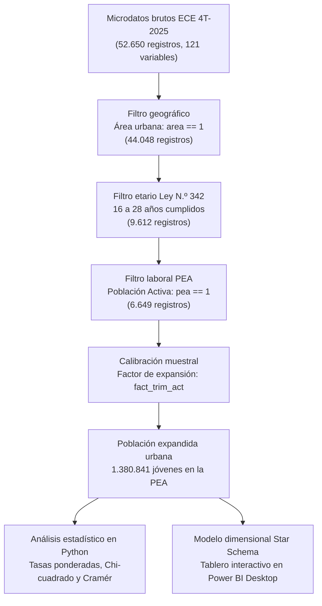

*FUENTE: Elaboración con base en el diseño metodológico de la ECE 4T-2025 (INE).*

El Diagrama N.º 1 esquematiza el embudo metodológico de depuración y calibración muestral aplicado a los microdatos de la Encuesta Continua de Empleo (ECE 4T-2025). A partir de la base nacional de 52.650 registros brutos, se implementan tres filtros sucesivos de delimitación: residencia en área urbana (`area == 1`), rango etario normativo de 16 a 28 años cumplidos según la Ley N.º 342 y pertenencia estricta a la Población Económicamente Activa (`pea == 1`), consolidando una muestra efectiva de 6.649 personas encuestadas. La aplicación del factor de calibración trimestral (`fact_trim_act`) expande este subconjunto al universo representativo de 1.380.841 jóvenes urbanos, suministrando una base metodológica única y ponderada tanto para las pruebas de inferencia estadística en Python como para el modelo dimensional en Power BI Desktop.

### 3.1.2. Trazabilidad del desarrollo bajo la metodología CRISP-DM
El procesamiento de la información se organizó siguiendo las seis fases de la metodología CRISP-DM aplicadas al análisis de microdatos laborales.

TABLA N.º 2: *Cumplimiento de hitos del proceso metodológico (CRISP-DM)*

| Fase CRISP-DM | Actividad planificada | Entregable concreto | Estado | Avance (%) |
| :--- | :--- | :--- | :---: | :---: |
| 1. Comprensión del problema | Delimitación de conceptos de desempleo y marco de la Ley N.º 342 | Matriz conceptual y delimitación del universo de 16 a 28 años | Concluido | 100% |
| 2. Comprensión de los datos | Auditoría de 52.650 registros y 121 variables de la ECE 4T-2025 | Diccionario de variables seleccionadas y reporte de estructura | Concluido | 100% |
| 3. Preparación de los datos | Depuración, filtros de universo, tipado de ponderador y recodificaciones | Dataset procesado `ECE_4T2025_Jovenes_PEA.csv` (6.649 filas) | Concluido | 100% |
| 4. Modelado y cálculo analítico | Formulación de tasas ponderadas, pruebas Chi-cuadrado y Cramér | Scripts modulares en Python (`statistical_analysis.py`) | Concluido | 100% |
| 5. Evaluación y validación | Contraste de estimaciones frente al Boletín Oficial del INE | Verificación exacta: desocupación 3,71% y subocupación 8,70% | Concluido | 100% |
| 6. Despliegue y visualización | Generación de 13 tablas, 10 figuras y modelo Star Schema en Power BI | Catálogo exportado y cuaderno maestro `Proyecto-Final.ipynb` | Concluido | 100% |

*FUENTE: Elaboración con base en el plan de trabajo del proyecto.*

La Tabla N.º 2 resume el avance de las seis etapas del ciclo CRISP-DM, el estándar de trabajo utilizado en proyectos de ciencia de datos. Confirma que cada fase completó sus metas al 100%, lo que asegura que el estudio transitó de forma ordenada desde la delimitación conceptual del desempleo juvenil hasta la publicación de los tableros interactivos y reportes finales.

### 3.1.3. Componentes del trabajo final e ingeniería de datos
La articulación entre la ciencia de datos y los resultados del mercado de trabajo juvenil se resume en tres componentes técnicos:

TABLA N.º 3: *Componentes técnicos de la solución en ciencia de datos*

| Componente | Término técnico en ciencia de datos | Aplicación concreta en el proyecto |
| :--- | :--- | :--- |
| Ingesta y adquisición | Pipeline de ingesta y validación de microdatos | Carga automatizada del archivo plano `ECE_4T2025.csv` con separador de listas, codificación `latin1` y auditoría de integridad inicial sobre 52.650 observaciones. |
| Aporte técnico y metodológico | Ingeniería de características y estadística ponderada | Estandarización del factor de expansión muestral, cálculo vectorizado de tasas de desocupación ponderadas y contrastes de asociación ($\chi^2$, $V$ de Cramér, $t$-Student). |
| Entregables de la solución | Artefactos reproducibles y modelo de despliegue | Dataset procesado de 6.649 registros y 156 columnas, 13 tablas analíticas en formato CSV, 10 figuras a 300 DPI, cuaderno interactivo ejecutado y modelo en estrella para Power BI. |

*FUENTE: Elaboración propia.*

La Tabla N.º 3 describe los tres pilares informáticos que sostienen el proyecto: la ingesta automatizada de los microdatos del INE, la aplicación de operaciones estadísticas con factores de expansión y la creación de productos finales reproducibles, tales como scripts modulares en Python y el modelo analítico para Power BI.

La base de datos original contiene 52.650 observaciones. El primer filtro eliminó a 8.602 personas residentes en el área rural. El segundo filtro excluyó a 34.436 personas cuyas edades quedaban fuera del rango de 16 a 28 años, dejando a 9.612 jóvenes urbanos. De ese total, 2.963 personas fueron identificadas como económicamente inactivas (principalmente estudiantes sin búsqueda laboral, personas dedicadas al cuidado del hogar o con incapacidad permanente). La muestra resultante quedó constituida por 6.649 jóvenes activos en el mercado de trabajo.

La variable del factor de expansión `fact_trim_act` presentaba valores textuales con coma decimal, por ejemplo `'207,52'`. Este formato requirió una conversión a tipo numérico de coma flotante (`float64`) para evitar errores en las operaciones de suma ponderada. Se verificó que ningún registro presentara un factor nulo, negativo o igual a cero. La suma total de los ponderadores reproduce con exactitud la cifra de 1.380.841 personas estimadas por el sistema estadístico nacional para la PEA juvenil urbana.

A nivel computacional, el filtrado muestral y la calibración del ponderador se implementaron en Python mediante la siguiente rutina representativa:

```python
# Delimitación del universo analítico y estandarización del factor de expansión
df_bruto = pd.read_csv("data/raw/ECE_4T2025.csv", sep=';', encoding='latin1')

# Filtros normativos: área urbana (1), edad 16 a 28 años y PEA activa (1)
df_pea = df_bruto[
    (df_bruto['area'] == 1) & 
    (df_bruto['s1_03a'] >= 16) & (df_bruto['s1_03a'] <= 28) & 
    (df_bruto['pea'] == 1)
].copy()

# Conversión del ponderador muestral a punto flotante (float64)
df_pea['peso_trimestral'] = df_pea['fact_trim_act'].astype(str).str.replace(',', '.').astype(float)
```

Para consultar la implementación completa del módulo de ingeniería de datos y recodificación de microdatos, dirigirse al Anexo 6.

### 3.1.4. Resultados del análisis descriptivo univariado
La tasa de desocupación se calculó dividiendo la población desocupada ponderada entre la PEA juvenil urbana ponderada y multiplicando por cien:

$$\text{Tasa de desocupación} = \frac{\sum (\text{pead}_i \times \text{peso}_i)}{\sum \text{peso}_i} \times 100$$

Esta expresión matemática calcula la tasa oficial reconociendo que cada persona encuestada representa a cientos de jóvenes en su ciudad. Al multiplicar la condición de desocupado ($\text{pead}_i$) por su ponderador muestral ($\text{peso}_i$), la fórmula suma la cantidad estimada de desocupados reales y la divide entre el total de jóvenes activos en el mercado de trabajo, evitando distorsiones por recuentos simples.

TABLA N.º 4: *Indicadores del mercado laboral juvenil urbano en Bolivia (cuarto trimestre de 2025)*

| Indicador sociolaboral | Casos observados (*n*) | Población ponderada (*N*) | Proporción (%) | Meta del boletín INE |
| :--- | :---: | :---: | :---: | :---: |
| PEA juvenil urbana (16 a 28 años) | 6.649 | 1.380.841 | 100,00% | Total de referencia |
| Población ocupada juvenil | 6.406 | 1.329.645 | 96,29% | Dato oficial |
| Población desocupada juvenil | 243 | 51.196 | 3,71% | 3,7% |
| Población subocupada por tiempo | 567 | 115.736 | 8,70% | 8,7% |
| Desocupados cesantes (con experiencia previa) | 215 | 45.882 | 89,62% | Mayoría |
| Desocupados aspirantes (en búsqueda de primer empleo) | 28 | 5.314 | 10,38% | Minoría |

*FUENTE: Elaboración con base en microdatos de la Encuesta Continua de Empleo 4T-2025 (INE).*

La Tabla N.º 4 traslada los datos de las encuestas a la escala de la población boliviana urbana. En ella, los casos observados ($n$) corresponden a las personas encuestadas en campo por el INE, mientras que la población ponderada ($N$) proyecta a cuántos jóvenes representan en las ciudades según el factor de expansión muestral. La columna de proporción indica el porcentaje estimado para cada condición laboral y la meta del boletín comprueba que los resultados del estudio coinciden con las cifras oficiales publicadas por el Estado.

El cálculo vectorizado de los totales poblacionales ponderados y las tasas macroeconómicas de la Tabla N.º 4 se ejecutó mediante la siguiente función central:

```python
# Cálculo de macromagnitudes y tasas oficiales ponderadas
pob_pea = df_pea['peso_trimestral'].sum()
pob_ocup = (df_pea['es_ocupado'] * df_pea['peso_trimestral']).sum()
pob_desoc = (df_pea['es_desocupado'] * df_pea['peso_trimestral']).sum()
pob_suboc = (df_pea['es_subocupado'] * df_pea['peso_trimestral']).sum()

tasa_desocupacion = (pob_desoc / pob_pea) * 100       # Resultado: 3.71%
tasa_subocupacion = (pob_suboc / pob_ocup) * 100       # Resultado: 8.70%
```

Para examinar en detalle el script de agregación y tablas estadísticas de macromagnitudes, dirigirse al Anexo 7.

La tasa de desocupación juvenil del cuarto trimestre de 2025 se sitúa en 3,71%, coincidente con el 3,7% reportado en el boletín oficial del INE. Por su parte, la subocupación juvenil alcanza el 8,70% sobre la población ocupada, lo que equivale a 115.736 jóvenes que trabajaron menos de la jornada habitual, desearon trabajar más horas y estaban disponibles para hacerlo.

FIGURA N.º 1: *Comparación de la tasa de desocupación general urbana y juvenil (cuarto trimestre de 2025)*

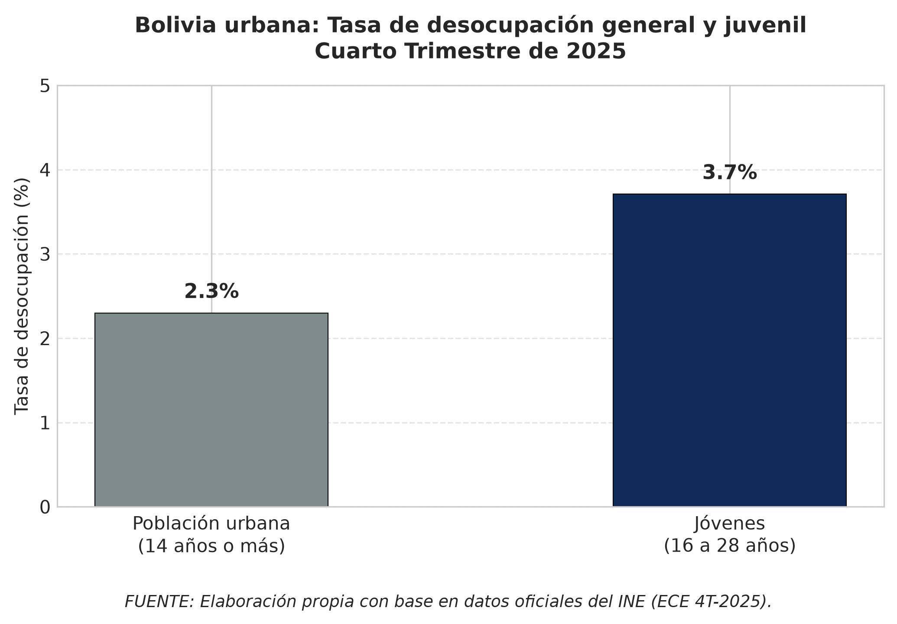

*FUENTE: Elaboración con base en datos de la Encuesta Continua de Empleo 4T-2025 (INE).*

La Figura N.º 1 expone la brecha generacional del mercado de trabajo urbano. La barra gris refleja la desocupación en la población general de 14 años o más (2,30%), mientras que la barra azul evidencia la tasa de los jóvenes de 16 a 28 años (3,71%). Esta diferencia gráfica confirma que el desempleo afecta con una intensidad 1,61 veces mayor al segmento juvenil en las ciudades bolivianas.

El gráfico comparativo de barras fue programado en Python utilizando Matplotlib conforme al siguiente bloque de código:

```python
# Generación de la comparativa visual general urbana vs juvenil (300 DPI)
fig, ax = plt.subplots(figsize=(7, 4.5), dpi=300)
categorias = ['Población urbana\n(14 años o más)', 'Jóvenes\n(16 a 28 años)']
tasas = [2.30, 3.71]
barras = ax.bar(categorias, tasas, color=['#7f8c8d', '#0F2C59'], width=0.45)
ax.set_ylabel('Tasa de desocupación (%)')
plt.savefig('outputs/figures/figura_1_desocupacion_general_vs_juvenil.png', dpi=300)
```

Para ver la parametrización visual completa de este gráfico y del catálogo de figuras, dirigirse al Anexo 8.

Al contrastar la tasa de desocupación juvenil (3,71%) con la tasa de desocupación general de la población urbana de 14 años o más (2,30%), se observa que los jóvenes registran una incidencia de desempleo 1,61 veces mayor que la población adulta general.

### 3.1.5. Resultados del análisis bivariado y pruebas de asociación
Para determinar si las diferencias observadas entre subgrupos responden a variaciones sistemáticas o a fluctuaciones aleatorias del muestreo, se aplicó la prueba de independencia Chi-cuadrado de Pearson ($\chi^2$) fijando un umbral de significancia de 0,05. La magnitud del efecto se evaluó mediante el coeficiente V de Cramér ($V$):

$$V = \sqrt{\frac{\chi^2}{N \times \min(r - 1, c - 1)}}$$

Esta fórmula normaliza el valor de Chi-cuadrado para medir la intensidad práctica de una relación entre dos variables cualitativas en una escala de 0 a 1. Al dividir el estadístico $\chi^2$ entre el producto de la muestra expandida ($N$) y el menor número de categorías menos uno ($\min(r - 1, c - 1)$), la $V$ de Cramér elimina el sesgo por volumen muestral, permitiendo evaluar si una asociación significativa tiene un efecto real leve, moderado o fuerte.

TABLA N.º 5: *Matriz de pruebas de asociación estadística con la condición de desocupación juvenil*

| Dimensión analizada | Variable | Casos (*n*) | Chi2 ($\chi^2$) | Grados de libertad | p-valor | V de Cramér | Resultado estadístico |
| :--- | :--- | :---: | :---: | :---: | :---: | :---: | :--- |
| Tramo de edad | `grupo_edad` | 6.649 | 11,2332 | 3 | 0,01053 | 0,0411 | Asociación significativa (p < 0,05) |
| Sexo | `sexo` | 6.649 | 5,2367 | 1 | 0,02212 | 0,0281 | Asociación significativa (p < 0,05) |
| Departamento | `departamento` | 6.649 | 23,6920 | 8 | 0,00258 | 0,0597 | Asociación significativa (p < 0,05) |
| Tipología de hogar | `tipo_hogar` | 6.649 | 17,4287 | 6 | 0,00783 | 0,0512 | Asociación significativa (p < 0,05) |
| Parentesco con el jefe | `parentesco` | 6.649 | 17,2553 | 7 | 0,01582 | 0,0509 | Asociación significativa (p < 0,05) |
| Nivel educativo | `nivel_educativo` | 6.649 | 3,6356 | 4 | 0,45756 | 0,0234 | Sin significancia agregada (p >= 0,05) |
| Asistencia escolar | `asiste_estudio` | 6.649 | 1,5264 | 1 | 0,21665 | 0,0152 | Sin significancia agregada (p >= 0,05) |

*FUENTE: Elaboración con base en microdatos de la Encuesta Continua de Empleo 4T-2025 (INE).*

La Tabla N.º 5 sintetiza los contrastes de asociación estadística para cada dimensión analizada. En ella, la columna de casos ($n$) registra las 6.649 personas evaluadas en la muestra; el valor Chi2 ($\chi^2$) mide la discrepancia entre las frecuencias observadas y las esperadas bajo independencia; los grados de libertad indican las categorías libres en la tabla cruzada; el $p$-valor establece la probabilidad de azar (siendo significativo si es menor a 0,05); y la $V$ de Cramér califica la magnitud práctica del efecto.

Las variables de edad, sexo, departamento, tipo de hogar y parentesco presentan un p-valor inferior a 0,05, lo que confirma diferencias estadísticamente significativas en la desocupación de estos grupos. En cambio, las categorías agregadas de nivel educativo y asistencia a centros de enseñanza no mostraron una asociación global significativa mediante la prueba Chi-cuadrado, lo cual motivó un análisis continuo complementario mediante años de escolaridad.

El procedimiento computacional para computar la matriz de contrastes inferenciales y los coeficientes V de Cramér de la Tabla N.º 5 se programó mediante el siguiente módulo en Python:

```python
# Contraste de hipótesis Chi-cuadrado de Pearson y cálculo de la V de Cramér
from scipy.stats import chi2_contingency

tabla_cruzada = pd.crosstab(df_pea[variable_analizada], df_pea['es_desocupado'])
chi2, p_val, dof, _ = chi2_contingency(tabla_cruzada)

n_muestral = tabla_cruzada.values.sum()
r, c = tabla_cruzada.shape
v_cramer = np.sqrt(chi2 / (n_muestral * min(r - 1, c - 1)))
```

Para consultar la formulación matemática y el código del generador de tablas de asociación, dirigirse al Anexo 1 y Anexo 7.

### 3.1.6. Desagregaciones por dimensión analítica

#### A. Dimensión etaria
La segmentación en cuatro intervalos muestra que la desocupación se concentra de manera particular en las edades tempranas de inserción al mercado.

TABLA N.º 6: *Tasa de desocupación juvenil según tramo etario (Bolivia urbana, 4T-2025)*

| Tramo de edad | Muestra (*n*) | Población PEA (*N*) | Población desocupada (*N*) | Tasa de desocupación (%) | Porcentaje de desocupados (%) |
| :--- | :---: | :---: | :---: | :---: | :---: |
| 16 a 17 años | 774 | 159.899 | 2.991 | 1,87% | 5,84% |
| 18 a 20 años | 1.377 | 290.670 | 13.504 | 4,65% | 26,38% |
| 21 a 24 años | 2.039 | 414.829 | 14.713 | 3,55% | 28,74% |
| 25 a 28 años | 2.459 | 515.443 | 19.988 | 3,88% | 39,04% |
| Total | 6.649 | 1.380.841 | 51.196 | 3,71% | 100,00% |

*FUENTE: Elaboración con base en microdatos de la Encuesta Continua de Empleo 4T-2025 (INE).*

La Tabla N.º 6 distribuye la desocupación entre los cuatro grupos de edad. La columna de población PEA ($N$) representa a los jóvenes activos en cada tramo y la población desocupada ($N$) proyecta cuántos buscan empleo. La tasa mide el riesgo puntual de desempleo dentro de cada rango etario, mientras que el porcentaje de desocupados señala qué proporción del total nacional de jóvenes desempleados aporta cada segmento.

El cálculo agrupado de las tasas ponderadas por tramo etario se obtuvo mediante la siguiente instrucción:

```python
# Agrupación y cálculo de tasa ponderada por grupo etario
tasas_edad = df_pea.groupby('grupo_edad', observed=False).apply(
    lambda g: (g['es_desocupado'] * g['peso_trimestral']).sum() / g['peso_trimestral'].sum() * 100
)
```

El grupo de 18 a 20 años exhibe la tasa más alta con un 4,65%, seguido por el grupo de 25 a 28 años con 3,88% y el grupo de 21 a 24 años con 3,55%. El tramo de 16 y 17 años registra la tasa más baja (1,87%), explicada por una menor participación económica activa en ese segmento etario.

FIGURA N.º 2: *Tasa de desocupación juvenil por tramo etario (cuarto trimestre de 2025)*

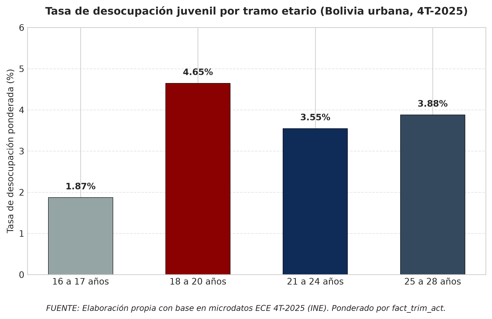

*FUENTE: Elaboración con base en microdatos de la Encuesta Continua de Empleo 4T-2025 (INE).*

La Figura N.º 2 resalta en color rojo el pico de desocupación en el grupo de 18 a 20 años (4,65%), la etapa donde los bachilleres intentan colocarse laboralmente por primera vez sin contar con experiencia ni formación técnica. En las edades posteriores (21 a 24 y 25 a 28 años), las barras descienden y se estabilizan cerca del promedio general, mientras que el tramo de 16 a 17 años muestra el valor más bajo (1,87%) debido a que la gran mayoría aún permanece en la escuela secundaria fuera de la fuerza de trabajo.

La visualización de las tasas etarias y el resaltado visual del pico crítico en 18 a 20 años se implementaron con el siguiente código:

```python
# Gráfico de barras por tramo de edad resaltando el tramo crítico (18 a 20 años)
fig, ax = plt.subplots(figsize=(8, 4.8), dpi=300)
colores_edad = ['#95a5a6', '#8B0000', '#0F2C59', '#34495e']
ax.bar(tasas_edad.index, tasas_edad.values, color=colores_edad, width=0.55)
ax.set_ylabel('Tasa de desocupación ponderada (%)')
plt.savefig('outputs/figures/figura_2_desocupacion_por_tramo_etario.png', dpi=300)
```

Para consultar la rutina de exportación de figuras a alta resolución, dirigirse al Anexo 8.

#### B. Dimensión de género
La distribución de la desocupación según el sexo de la persona evidencia una brecha desfavorable para las mujeres jóvenes.

TABLA N.º 7: *Tasa de desocupación juvenil según sexo (Bolivia urbana, 4T-2025)*

| Sexo | Muestra (*n*) | Población PEA (*N*) | Población desocupada (*N*) | Tasa de desocupación (%) | Porcentaje de desocupados (%) |
| :--- | :---: | :---: | :---: | :---: | :---: |
| Hombre | 3.393 | 735.643 | 20.938 | 2,85% | 40,90% |
| Mujer | 3.256 | 645.198 | 30.258 | 4,69% | 59,10% |
| Total | 6.649 | 1.380.841 | 51.196 | 3,71% | 100,00% |

*FUENTE: Elaboración con base en microdatos de la Encuesta Continua de Empleo 4T-2025 (INE).*

La Tabla N.º 7 organiza la información laboral según el sexo de la persona joven. La columna de muestra (*n*) indica el conteo de encuestados en el operativo de campo, mientras que la población PEA (*N*) y desocupada (*N*) representan los totales expandidos para el área urbana de Bolivia. La tasa de desocupación refleja la incidencia del desempleo en cada grupo (4,69% en mujeres frente a 2,85% en hombres), y el porcentaje de desocupados muestra que casi seis de cada diez jóvenes sin trabajo en el país son mujeres (59,10%), a pesar de que su participación en la fuerza de trabajo activa es menor a la de los varones.

El cálculo cuantitativo de la brecha de género y las estimaciones por sexo se ejecutaron mediante la siguiente rutina:

```python
# Cálculo de la tasa ponderada de desocupación por sexo y determinación de la brecha
tasa_hombres = (df_pea[df_pea['sexo'] == 'Hombre']['es_desocupado'] * df_pea[df_pea['sexo'] == 'Hombre']['peso_trimestral']).sum() / df_pea[df_pea['sexo'] == 'Hombre']['peso_trimestral'].sum() * 100
tasa_mujeres = (df_pea[df_pea['sexo'] == 'Mujer']['es_desocupado'] * df_pea[df_pea['sexo'] == 'Mujer']['peso_trimestral']).sum() / df_pea[df_pea['sexo'] == 'Mujer']['peso_trimestral'].sum() * 100
brecha_genero = tasa_mujeres - tasa_hombres   # Brecha: +1.84 puntos porcentuales
```

FIGURA N.º 3: *Tasa de desocupación juvenil según sexo y brecha de género (cuarto trimestre de 2025)*

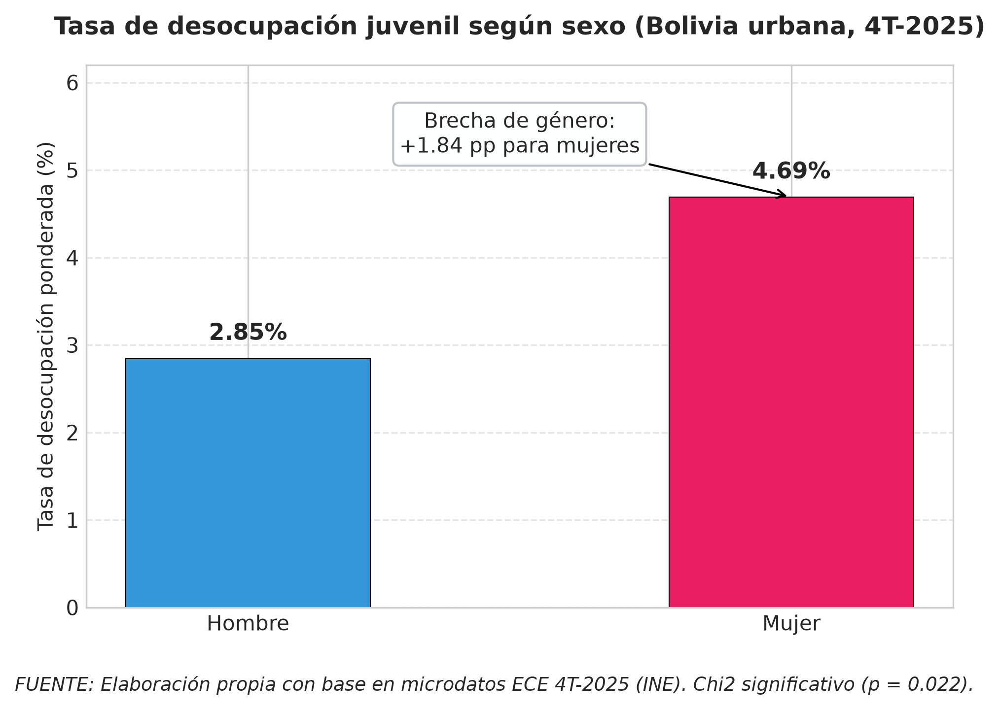

*FUENTE: Elaboración con base en microdatos de la Encuesta Continua de Empleo 4T-2025 (INE).*

La Figura N.º 3 ilustra la disparidad de género mediante dos barras comparativas: la barra azul de los hombres registra 2,85%, mientras que la barra carmesí de las mujeres alcanza 4,69%. El cuadro superior destaca la brecha neta de +1,84 puntos porcentuales en desmedro de las mujeres jóvenes, confirmada como estadísticamente significativa en el pie de figura ($\chi^2 = 5,24; p = 0,022$). Esta representación visual evidencia que una mujer joven en el área urbana de Bolivia enfrenta una probabilidad 1,65 veces mayor de encontrarse desocupada respecto a un varón de su misma edad.

El código empleado para graficar la brecha de género y trazar la flecha de anotación analítica es el siguiente:

```python
# Graficación de la brecha de género y cuadro anotativo en Matplotlib
fig, ax = plt.subplots(figsize=(6.5, 4.5), dpi=300)
ax.bar(['Hombre', 'Mujer'], [2.85, 4.69], color=['#2980b9', '#c0392b'], width=0.45)
ax.annotate('Brecha de género:\n+1.84 pp para mujeres', xy=(1, 4.69), xytext=(0.5, 5.2),
            arrowprops=dict(facecolor='black', arrowstyle='->', lw=1), ha='center')
plt.savefig('outputs/figures/figura_3_brecha_genero.png', dpi=300)
```

Para examinar las especificaciones de estilo y colorimetría institucional, dirigirse al Anexo 8.

#### C. Dimensión territorial y departamental
El análisis por departamento revela marcadas disparidades entre las diferentes regiones urbanas de Bolivia.

TABLA N.º 8: *Tasa de desocupación juvenil por departamento (Bolivia urbana, 4T-2025)*

| Departamento | Muestra (*n*) | Población PEA (*N*) | Población desocupada (*N*) | Tasa de desocupación (%) | Porcentaje de desocupados (%) |
| :--- | :---: | :---: | :---: | :---: | :---: |
| Chuquisaca | 486 | 62.899 | 3.648 | 5,80% | 7,13% |
| Tarija | 255 | 57.856 | 2.728 | 4,72% | 5,33% |
| Cochabamba | 1.196 | 251.505 | 11.840 | 4,71% | 23,13% |
| La Paz | 1.731 | 338.688 | 13.016 | 3,84% | 25,42% |
| Santa Cruz | 1.311 | 459.615 | 15.313 | 3,33% | 29,91% |
| Oruro | 348 | 67.935 | 2.027 | 2,98% | 3,96% |
| Beni | 435 | 60.886 | 1.259 | 2,07% | 2,46% |
| Pando | 370 | 11.079 | 210 | 1,89% | 0,41% |
| Potosí | 517 | 70.378 | 1.155 | 1,64% | 2,26% |
| Total | 6.649 | 1.380.841 | 51.196 | 3,71% | 100,00% |

*FUENTE: Elaboración con base en microdatos de la Encuesta Continua de Empleo 4T-2025 (INE).*

La Tabla N.º 8 presenta el panorama laboral juvenil en los nueve departamentos del país. La columna de muestra (*n*) y de población PEA (*N*) dimensionan el tamaño de la fuerza de trabajo urbana departamental, mientras que la tasa (%) mide la probabilidad de desocupación dentro de cada mercado local. Por su parte, la columna de porcentaje de desocupados (%) muestra la contribución de cada territorio al desempleo nacional, evidenciando que el eje central (Santa Cruz, La Paz y Cochabamba) concentra el 78,46% de los desocupados absolutos por su volumen demográfico, aunque las tasas relativas más severas corresponden a Chuquisaca (5,80%) y Tarija (4,72%).

El cálculo y ordenamiento de las tasas departamentales ponderadas se realizó mediante la siguiente rutina:

```python
# Tasa departamental ponderada y ordenamiento analítico
tasas_depto = df_pea.groupby('departamento', observed=False).apply(
    lambda g: (g['es_desocupado'] * g['peso_trimestral']).sum() / g['peso_trimestral'].sum() * 100
).sort_values(ascending=True)
```

FIGURA N.º 4: *Tasa de desocupación juvenil por departamento (cuarto trimestre de 2025)*

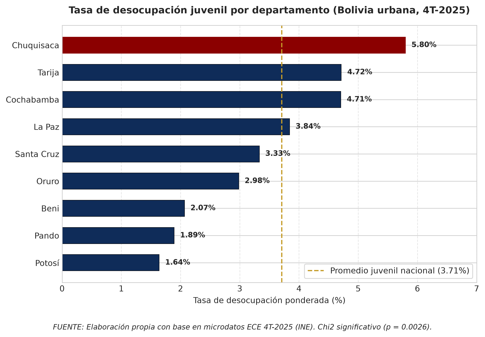

*FUENTE: Elaboración con base en microdatos de la Encuesta Continua de Empleo 4T-2025 (INE).*

La Figura N.º 4 ordena los nueve departamentos de forma descendente mediante barras horizontales y los compara frente a la línea vertical dorada que marca el promedio nacional juvenil (3,71%). La barra superior en color rojo oscuro resalta a Chuquisaca con la tasa más elevada de Bolivia (5,80%), seguida por Tarija (4,72%), Cochabamba (4,71%) y La Paz (3,84%), las cuatro regiones que rebasan el promedio urbano. En contraste, los departamentos mineros y amazónicos como Beni (2,07%), Pando (1,89%) y Potosí (1,64%) se sitúan a la izquierda de la referencia, reflejando marcadas asimetrías productivas validadas por una prueba Chi-cuadrado altamente significativa ($\chi^2 = 23,69; p = 0,0026$).

El código de generación de las barras horizontales con la línea de referencia nacional se estructuró de la siguiente forma:

```python
# Generación del gráfico horizontal de barras departamentales destacando Chuquisaca
fig, ax = plt.subplots(figsize=(8.5, 5.5), dpi=300)
barras = ax.barh(tasas_depto.index, tasas_depto.values, color='#0F2C59', height=0.6)
for i, depto in enumerate(tasas_depto.index):
    if depto == "Chuquisaca":
        barras[i].set_color('#8B0000')  # Rojo colonial USFX
ax.axvline(3.71, color='#C59B27', linestyle='--', linewidth=1.5, label='Promedio nacional (3.71%)')
plt.savefig('outputs/figures/figura_4_desocupacion_por_departamento.png', dpi=300)
```

Para consultar el código completo de la dimensión territorial, dirigirse al Anexo 7 y Anexo 8.

#### D. Dimensión educativa y escolaridad acumulada
Al evaluar la tasa de desocupación según el máximo nivel educativo alcanzado, se registra una relación ascendente: las personas sin instrucción formal tienen una tasa de 2,31%, quienes completaron primaria alcanzan 3,43%, quienes cuentan con nivel secundario registran 4,02% y quienes accedieron a estudios universitarios registran 4,04%.

TABLA N.º 9: *Comparación de años de escolaridad entre jóvenes ocupados y desocupados*

| Condición de actividad | Casos (*n*) | Media ponderada (años) | Desviación estándar | Prueba estadística | Estadístico | p-valor |
| :--- | :---: | :---: | :---: | :---: | :---: | :---: | :---: |
| Jóvenes ocupados | 6.406 | 12,64 | 2,63 | t de Student (Welch) | t = -2,39 | 0,0174 |
| Jóvenes desocupados | 243 | 13,01 | 2,41 | Mann-Whitney U | U = 714.498,5 | 0,0293 |

*FUENTE: Elaboración con base en microdatos de la Encuesta Continua de Empleo 4T-2025 (INE).*

La Tabla N.º 9 compara el capital educativo acumulado entre jóvenes ocupados y desocupados. Las columnas de media ponderada y desviación estándar resumen el promedio y la dispersión de los años de estudio formal expandidos con el factor muestral. Para comprobar si la brecha observada es estadísticamente sólida, se aplicaron tanto la prueba paramétrica t de Welch ($t = -2,39; p = 0,0174$) como la no paramétrica de Mann-Whitney ($U = 714.498,5; p = 0,0293$), confirmando con un $p$-valor inferior a 0,05 que los jóvenes desocupados poseen en promedio mayor escolaridad (13,01 años frente a 12,64 años), lo que equivale a casi cuatro meses lectivos adicionales de instrucción.

El contraste inferencial de escolaridad entre ocupados y desocupados se programó en Python de la siguiente manera:

```python
# Cálculo de medias ponderadas de escolaridad y pruebas de hipótesis (Welch y Mann-Whitney)
from scipy.stats import ttest_ind, mannwhitneyu

df_esc = df_pea[df_pea['anios_estudio'] > 0]
ocu = df_esc[df_esc['es_ocupado'] == 1]
des = df_esc[df_esc['es_desocupado'] == 1]

media_ocu_pond = (ocu['anios_estudio'] * ocu['peso_trimestral']).sum() / ocu['peso_trimestral'].sum()
media_des_pond = (des['anios_estudio'] * des['peso_trimestral']).sum() / des['peso_trimestral'].sum()

stat_t, p_t = ttest_ind(ocu['anios_estudio'], des['anios_estudio'], equal_var=False)
stat_u, p_u = mannwhitneyu(ocu['anios_estudio'], des['anios_estudio'], alternative='two-sided')
```

Para examinar el protocolo formal de contrastación de hipótesis de escolaridad, dirigirse al Anexo 4.

FIGURA N.º 5: *Distribución de años de estudio: jóvenes ocupados y desocupados urbanos*

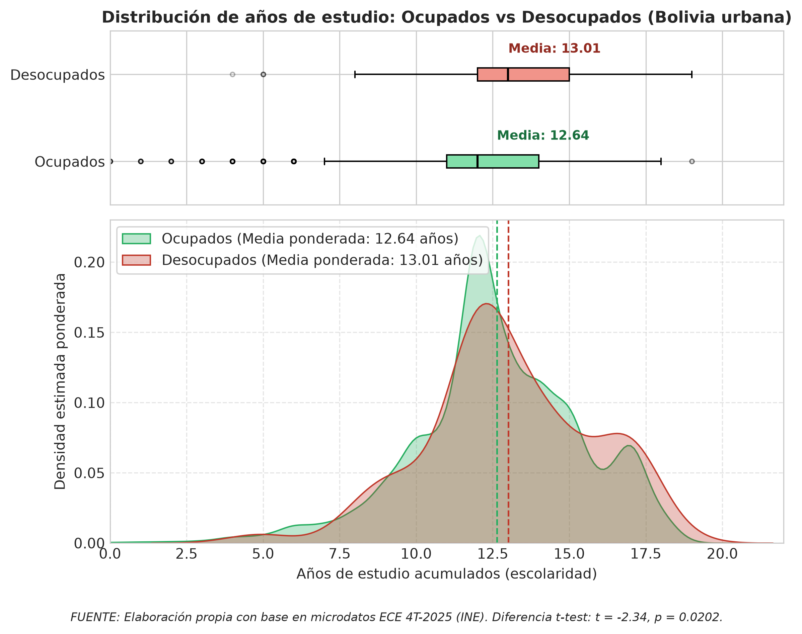

*FUENTE: Elaboración con base en microdatos de la Encuesta Continua de Empleo 4T-2025 (INE).*

La Figura N.º 5 analiza la distribución de la escolaridad mediante un gráfico de doble panel. En el panel superior, el diagrama de cajas muestra que la caja de los desocupados (color salmón) se encuentra desplazada a la derecha con una mediana de 13 años respecto a los 12 años de los ocupados (color verde), observándose además que estos últimos presentan mayor dispersión hacia niveles educativos bajos con valores atípicos entre 0 y 7 años de estudio. En el panel inferior, las curvas de densidad kernel (KDE) evidencian que los jóvenes ocupados se concentran densamente en el bachillerato (12 años), mientras que los desocupados sostienen una masa superior en el tramo de 14 a 18 años de estudio, lo que demuestra visualmente que el desempleo urbano abierto afecta de forma desproporcionada a jóvenes con estudios superiores o técnicos que buscan inserción calificada.

La distribución bivariada de la Figura N.º 5 se generó mediante la integración de boxplot y curvas KDE ponderadas en Seaborn:

```python
# Distribución ponderada de años de estudio: diagrama de cajas y estimación de densidad KDE
fig, (ax_box, ax_kde) = plt.subplots(2, 1, figsize=(8, 6), sharex=True, gridspec_kw={'height_ratios': [0.35, 0.65]}, dpi=300)
ax_box.boxplot([ocu['anios_estudio'], des['anios_estudio']], orientation='horizontal', patch_artist=True)
sns.kdeplot(data=ocu, x='anios_estudio', weights='peso_trimestral', ax=ax_kde, label='Ocupados', color='#27ae60', fill=True)
sns.kdeplot(data=des, x='anios_estudio', weights='peso_trimestral', ax=ax_kde, label='Desocupados', color='#c0392b', fill=True)
plt.savefig('outputs/figures/figura_8_distribucion_anios_estudio.png', dpi=300)
```

FIGURA N.º 6: *Tasa de desocupación juvenil según nivel educativo formal*

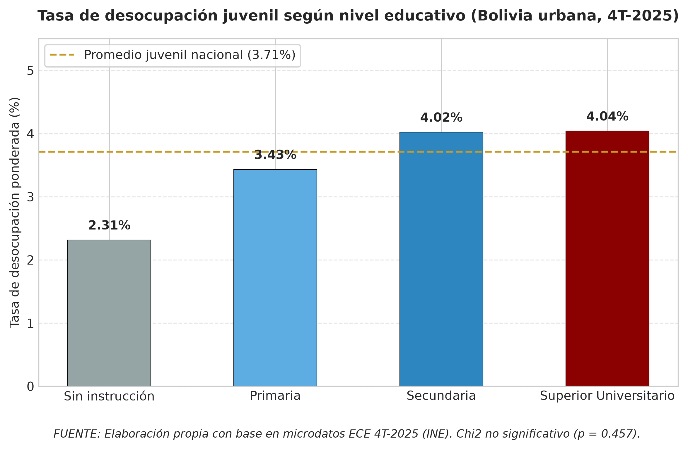

*FUENTE: Elaboración con base en microdatos de la Encuesta Continua de Empleo 4T-2025 (INE).*

La Figura N.º 6 compara las tasas de desocupación entre cuatro niveles de instrucción frente a la línea dorada discontinua del promedio nacional (3,71%). Las barras reflejan un gradiente ascendente: la población sin instrucción presenta una tasa de 2,31% y primaria alcanza 3,43%, mientras que los niveles secundario (4,02%) y superior universitario (4,04%) superan la media del país. Esta tendencia describe el fenómeno del desempleo ilustrado, donde los jóvenes con mayor preparación prolongan su tiempo de búsqueda hacia empleos acordes a su perfil, mientras que aquellos con menor instrucción deben ocuparse de inmediato en actividades informales de subsistencia ($p = 0,457$).

FIGURA N.º 7: *Tasa de desocupación juvenil según asistencia escolar o académica*

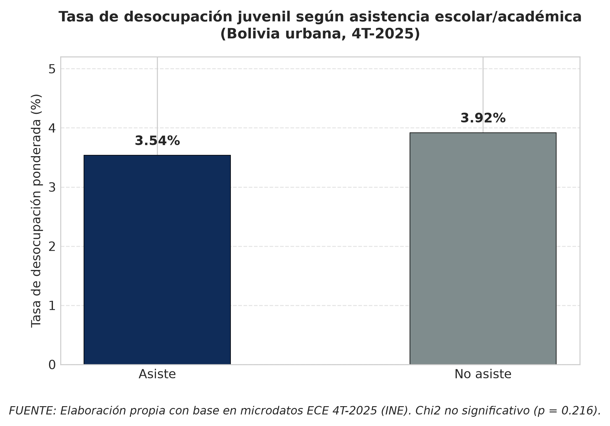

*FUENTE: Elaboración con base en microdatos de la Encuesta Continua de Empleo 4T-2025 (INE).*

La Figura N.º 7 evalúa si la concurrencia activa a centros educativos incide en el desempleo de los jóvenes pertenecientes a la fuerza laboral. La barra azul de quienes asisten a clases registra una tasa de 3,54%, mientras que la barra gris de quienes no asisten se sitúa en 3,92%, marcando una diferencia moderada de 0,38 puntos porcentuales. Al no alcanzar significancia estadística en la prueba Chi-cuadrado ($p = 0,2166$), el gráfico demuestra que la condición de estudiante activo no constituye un factor diferenciador decisivo frente al riesgo de desocupación en el área urbana.

El cálculo de las tasas por nivel de instrucción y asistencia escolar se sintetizó con el siguiente comando:

```python
# Tasas de desocupación según credencial educativa y asistencia escolar
tasas_nivel = df_pea.groupby('nivel_educativo', observed=False).apply(
    lambda g: (g['es_desocupado'] * g['peso_trimestral']).sum() / g['peso_trimestral'].sum() * 100
)
tasas_asiste = df_pea.groupby('asiste_estudio', observed=False).apply(
    lambda g: (g['es_desocupado'] * g['peso_trimestral']).sum() / g['peso_trimestral'].sum() * 100
)
```

Para revisar el código de diseño de las Figuras 6 y 7, dirigirse al Anexo 8.

#### E. Dinámica previa y canales de búsqueda de empleo
La composición interna del desempleo juvenil urbano muestra que 45.882 personas (89,62%) corresponden a desocupados cesantes, es decir, jóvenes que ya contaban con un empleo anterior y se desvincularon por renuncia, despido o culminación de contrato. Los desocupados aspirantes, que buscan trabajo por primera vez, representan a 5.314 personas (10,38%).

FIGURA N.º 8: *Composición de la desocupación juvenil: cesantes y aspirantes*

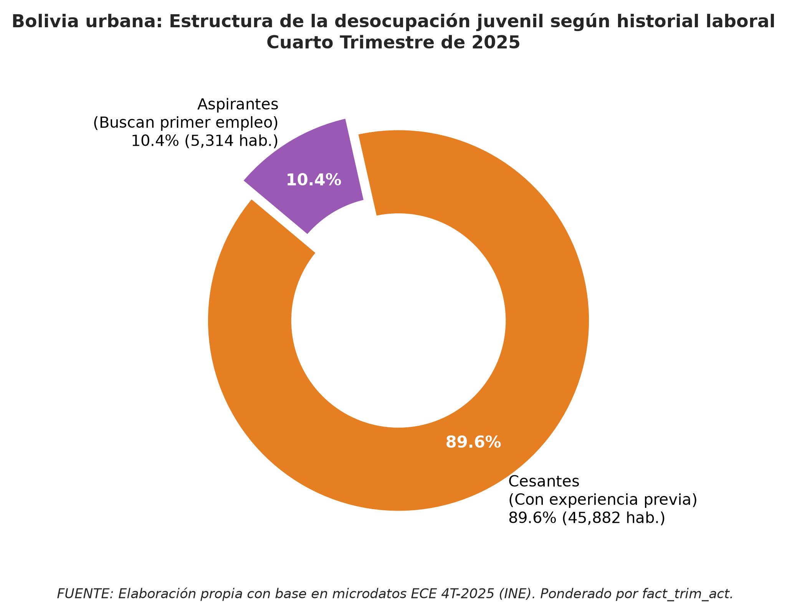

*FUENTE: Elaboración con base en microdatos de la Encuesta Continua de Empleo 4T-2025 (INE).*

La Figura N.º 8 expone la estructura interna de los 51.196 jóvenes desocupados mediante un gráfico circular según su trayectoria de trabajo. El sector mayoritario en color naranja muestra que el 89,6% (45.882 jóvenes) corresponde a cesantes que perdieron o renunciaron a un empleo previo, mientras que el segmento morado de aspirantes concentra el 10,4% (5.314 jóvenes) que buscan trabajo por primera vez. La distribución ilustra que el desempleo juvenil urbano en Bolivia deriva principalmente de la inestabilidad y rotación en puestos de trabajo precarios antes que de barreras exclusivas para ingresar al mercado laboral.

El cálculo de proporciones entre cesantes y aspirantes y el trazado de la dona en Python se ejecutaron mediante la siguiente rutina:

```python
# Proporción ponderada de cesantes y aspirantes entre desocupados
desoc = df_pea[df_pea['es_desocupado'] == 1]
peso_ces = desoc[desoc['es_cesante'] == 1]['peso_trimestral'].sum()
peso_asp = desoc[desoc['es_aspirante'] == 1]['peso_trimestral'].sum()
pct_ces = (peso_ces / (peso_ces + peso_asp)) * 100    # 89.62%
pct_asp = (peso_asp / (peso_ces + peso_asp)) * 100    # 10.38%

fig, ax = plt.subplots(figsize=(6.5, 5), dpi=300)
ax.pie([pct_ces, pct_asp], labels=['Cesantes', 'Aspirantes'], autopct='%1.1f%%',
       colors=['#e67e22', '#8e44ad'], wedgeprops=dict(width=0.45, edgecolor='white'))
plt.savefig('outputs/figures/figura_5_cesantes_vs_aspirantes.png', dpi=300)
```

TABLA N.º 10: *Canales de búsqueda de empleo utilizados por jóvenes desocupados urbanos*

| Mecanismo principal de búsqueda | Muestra (*n*) | Población ponderada (*N*) | Porcentaje ponderado (%) |
| :--- | :---: | :---: | :---: |
| Avisos por prensa, internet o redes sociales | 92 | 19.645 | 38,82% |
| Presentación directa de solicitudes o currículum vitae | 76 | 16.002 | 31,62% |
| Otras formas no estructuradas de búsqueda | 45 | 8.924 | 17,63% |
| Preguntó directamente en lugares o centros de trabajo | 17 | 3.882 | 7,67% |
| Consultó a familiares, amigos o conocidos | 5 | 1.155 | 2,28% |
| Realizó gestiones para abrir negocio propio o independiente | 3 | 550 | 1,09% |
| No declaró o no aplica | 5 | 453 | 0,90% |
| Total | 243 | 50.611 | 100,00% |

*FUENTE: Elaboración con base en microdatos de la Encuesta Continua de Empleo 4T-2025 (INE).*

La Tabla N.º 10 clasifica las estrategias de postulación adoptadas por los jóvenes sin empleo. La columna de muestra (*n*) reporta los 243 informantes del operativo, la población ponderada (*N*) expande estos casos a 50.611 personas en el universo urbano, y el porcentaje ponderado (%) mide la participación de cada vía de búsqueda. Las cifras revelan el predominio de canales estructurados: los avisos en prensa, internet o redes sociales concentran el 38,82% y la presentación directa de carpetas o solicitudes reúne el 31,62%, sumando entre ambos más del 70% de las gestiones laborales frente a una baja proporción de iniciativas independientes (1,09%).

FIGURA N.º 9: *Mecanismos principales de búsqueda de empleo en jóvenes desocupados*

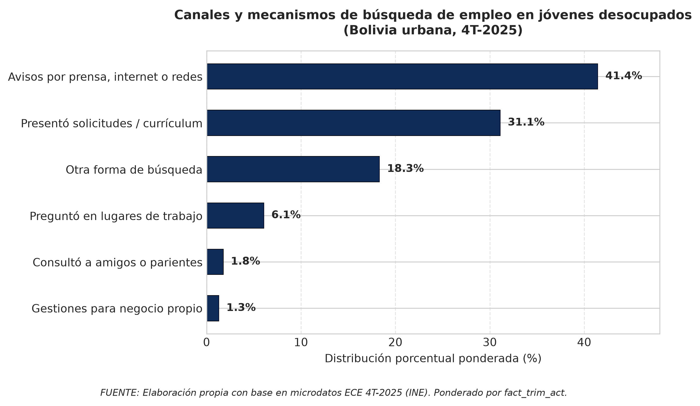

*FUENTE: Elaboración con base en microdatos de la Encuesta Continua de Empleo 4T-2025 (INE).*

La Figura N.º 9 ordena en barras horizontales las vías de inserción laboral declaradas por la juventud desocupada. Los dos canales principales corresponden a la búsqueda mediante avisos digitales o de prensa (41,4%) y la entrega formal de currículum vitae (31,1%), acumulando conjuntamente más de siete de cada diez postulaciones. En contraste, las barras inferiores reflejan un peso marginal de los contactos interpersonales mediante amigos o parientes (1,8%) y de la gestión de emprendimientos propios (1,3%), lo que evidencia que la mayoría de los jóvenes desocupados busca activamente insertarse como personal dependiente en el mercado formal.

FIGURA N.º 10: *Tasa de desocupación juvenil según tipología de hogar*

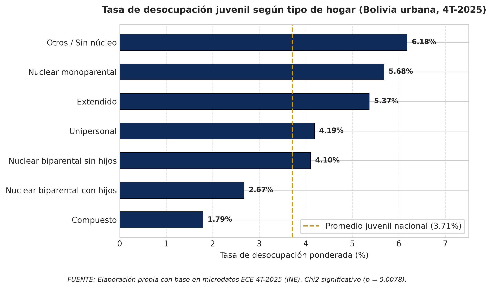

*FUENTE: Elaboración con base en microdatos de la Encuesta Continua de Empleo 4T-2025 (INE).*

La Figura N.º 10 presenta las tasas de desocupación en siete estructuras familiares contrastadas contra la línea dorada del promedio nacional (3,71%). Las barras más prolongadas corresponden a hogares sin núcleo conyugal (6,18%), nucleares monoparentales (5,68%) y extendidos (5,37%), donde los jóvenes enfrentan mayor vulnerabilidad económica. Por el contrario, los hogares nucleares biparentales con hijos (2,67%) y compuestos (1,79%) registran tasas significativamente menores, patrón que la prueba Chi-cuadrado valida como estadísticamente significativo ($\chi^2 = 17,43; p = 0,0078$) e indicativo de cómo el respaldo del núcleo familiar modula la inserción laboral.

El cálculo de canales de búsqueda y tasas por estructura del hogar se resolvió mediante la siguiente rutina:

```python
# Distribución porcentual de canales de búsqueda y desocupación por tipo de hogar
dist_canales = desoc.groupby('mecanismo_busqueda', observed=False)['peso_trimestral'].sum()
dist_canales_pct = (dist_canales / dist_canales.sum()) * 100

tasas_hogar = df_pea.groupby('tipo_hogar', observed=False).apply(
    lambda g: (g['es_desocupado'] * g['peso_trimestral']).sum() / g['peso_trimestral'].sum() * 100
)
```

Para consultar el código de las Figuras 9 y 10, dirigirse al Anexo 8.

### 3.1.7. Arquitectura del modelo dimensional para Power BI Desktop
Para facilitar la exploración visual y la toma de decisiones basada en datos, los microdatos procesados se organizaron en un esquema en estrella (*Star Schema*) dentro del proyecto de Power BI (`powerbi/Visualizacion-Analisis-Desocupacion.pbip`). El modelo semántico, serializado bajo el estándar TMDL (*Tabular Model Definition Language*), sitúa en el centro una tabla de hechos conectada a seis tablas dimensionales mediante relaciones unidireccionales de uno a muchos (1:N) con integridad referencial activa:

DIAGRAMA N.º 2: *Arquitectura del modelo dimensional en estrella (Star Schema) implementado en Power BI Desktop*

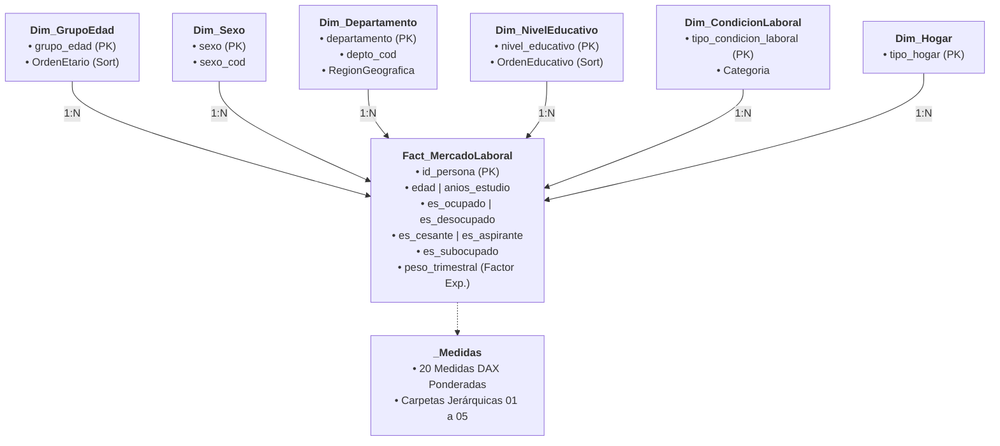

*FUENTE: Elaboración propia a partir del modelo semántico TMDL en Power BI.*

El Diagrama N.º 2 expone el modelo dimensional en estrella (*Star Schema*) que estructura los microdatos dentro de Power BI. En el centro, la tabla de hechos `Fact_MercadoLaboral` contiene las observaciones individuales con sus banderas de ocupación y el factor de expansión muestral, rodeada por seis dimensiones descriptivas conectadas mediante relaciones unidireccionales de uno a muchos (1:N). Esta arquitectura permite filtrar simultáneamente por territorio, demografía o nivel formativo, garantizando que el repositorio central de medidas DAX (`_Medidas`) calcule tasas ponderadas exactas sin duplicidad ni sesgos muestrales.

### 3.1.8. Evidencia del cuadro de mando interactivo en Power BI Desktop
Como componente de transferencia tecnológica y despliegue del proyecto de ciencia de datos, se desarrolló un cuadro de mando analítico interactivo de seis páginas en Power BI Desktop (`powerbi/Visualizacion-Analisis-Desocupacion.pbip`), estructurado en formato PBIR (*Power BI Project Report*).

El diseño visual adopta la identidad institucional de la Universidad San Francisco Xavier de Chuquisaca (USFX CEPI), aplicando una paleta armónica compuesta por azul marino institucional (`#0F2C59`), rojo colonial de alerta (`#8B0000`), dorado ocre (`#C59B27`) y verde esmeralda para ocupación (`#2E7D32`), sobre un lienzo gris claro suave (`#F8F9FA`) con tarjetas en blanco puro (`#FFFFFF`) y tipografía corporativa Segoe UI.

TABLA N.º 11: *Estructura y catálogo de páginas del cuadro de mando analítico en Power BI Desktop*

| Página | Denominación temática | Foco analítico principal | Segmentadores activos | Medidas DAX rectoras |
| :---: | :--- | :--- | :--- | :--- |
| 1 | Panorama Laboral Juvenil | Indicadores macro, estructura de la PEA y sobre-exposición al desempleo | Departamento, Sexo, Rango de Edad | `[PEA Juvenil Ponderada]`, `[Tasa Desocupacion Ponderada]`, `[Tasa Subocupacion Ponderada]` |
| 2 | Vulnerabilidad Etaria | Fricción en la transición de la secundaria al mercado formal (18 a 20 años) | Tramo etario, Condición de actividad | `[Tasa Desocupacion Ponderada]`, `[Poblacion Desocupada]`, `[Porcentaje Desocupados Tramo]` |
| 3 | Educación y Escolaridad | Capital humano, niveles formativos y tensión entre estudio y empleo | Nivel educativo, Asistencia escolar | `[Escolaridad Promedio Ocupados]`, `[Escolaridad Promedio Desocupados]`, `[Tasa Desocupacion Ponderada]` |
| 4 | Género y Territorio | Brecha estructural mujer-hombre y disparidades entre departamentos | Sexo, Departamento, Región geográfica | `[Tasa Desocupacion Mujeres]`, `[Tasa Desocupacion Hombres]`, `[Brecha Desocupacion Genero]` |
| 5 | Perfil del Desocupado | Dinámica de desvinculación laboral (cesantes) frente al primer empleo (aspirantes) | Condición laboral, Mecanismo de búsqueda | `[Desocupados Cesantes]`, `[Desocupados Aspirantes]`, `[Proporcion Cesantes Pct]` |
| 6 | Políticas Públicas | Matriz de priorización estratégica, hojas de ruta y síntesis ejecutiva | Eje de intervención, Nivel de urgencia | `[Poblacion Objetivo Focalizada]`, Matriz Impacto-Factibilidad |

*FUENTE: Elaboración propia.*

La Tabla N.º 11 detalla la organización temática y técnica de las seis páginas del cuadro de mando analítico. Las columnas estructuran el propósito de cada sección, los filtros interactivos puestos a disposición del usuario y las fórmulas DAX ponderadas que calculan los indicadores clave. Esta distribución permite transitar desde un diagnóstico general del mercado laboral urbano hasta la focalización específica de brechas de género, territorio y perfiles de cesantía, culminando en una matriz de propuestas de política pública aplicadas al contexto boliviano.

#### 3.1.8.1. Página 1: Panorama laboral juvenil urbano
La primera página sintetiza la magnitud general del mercado laboral para la población de 16 a 28 años en el área urbana de Bolivia. En la fila superior se integran cinco tarjetas con indicadores clave que exponen el volumen ponderado de la PEA (1.380.841 personas), la población ocupada (1.329.645 personas), la población desocupada (51.196 personas), la tasa oficial de desocupación (3,71%) y la tasa de subocupación por tiempo (8,70%). En el cuerpo central se despliegan un gráfico de dona con la distribución porcentual de la PEA, un gráfico de barras comparativo entre la tasa de desocupación urbana general (2,30%) y la juvenil (3,71%), y un desglose de la subutilización laboral.

FIGURA N.º 11: *Vista del cuadro de mando en Power BI: Panorama laboral juvenil urbano (Página 1)*

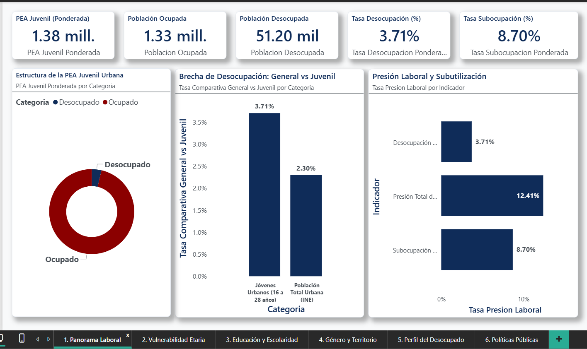

*FUENTE: Elaboración propia a partir del cuadro de mando interactivo en Power BI Desktop (ECE 4T-2025).*

La Figura N.º 11 estructura la visión general del mercado de trabajo juvenil en dos niveles analíticos. En la banda superior, cinco tarjetas de indicadores (KPIs) resumen las cifras ponderadas oficiales: una fuerza laboral de 1,38 millones de jóvenes, de los cuales 1,33 millones se encuentran ocupados y 51,20 mil desocupados, arrojando una tasa de desocupación de 3,71% y una subocupación de 8,70%. En la sección inferior, el gráfico de dona izquierdo evidencia que el desempleo abierto representa al 3,71% de la PEA frente al 96,29% de ocupación; el gráfico de barras central resalta que la tasa juvenil supera con creces a la tasa nacional general urbana (2,30%), confirmando una sobreexposición de 1,61 veces mayor; y el gráfico de barras horizontales derecho desglosa la subutilización de mano de obra, demostrando que al sumar el desempleo abierto y la subocupación por horas, la presión laboral global alcanza un 12,41% de la juventud activa.

A nivel de arquitectura de Business Intelligence, la página opera con las siguientes especificaciones:
- **Entidades dimensionales:** `Fact_MercadoLaboral` relacionada con `Dim_Departamento`, `Dim_Sexo` y `Dim_GrupoEdad`.
- **Tarjetas y KPIs:** `[PEA Juvenil Ponderada]`, `[Poblacion Ocupada]`, `[Poblacion Desocupada]`, `[Tasa Desocupacion Ponderada]`, `[Tasa Subocupacion Ponderada]`.
- **Fórmula DAX rectora:**

```dax
// Tasa de desocupación juvenil oficial ponderada
Tasa Desocupacion Ponderada = 
DIVIDE(
    CALCULATE(SUM('Fact_MercadoLaboral'[peso_trimestral]), 'Fact_MercadoLaboral'[es_desocupado] = 1),
    SUM('Fact_MercadoLaboral'[peso_trimestral]),
    0
)
```

Para consultar el catálogo completo de las medidas DAX del reporte, dirigirse al Anexo 3.

#### 3.1.8.2. Página 2: Desocupación por tramo etario y trayectoria
La segunda página aborda el análisis desagregado de los cuatro tramos de edad establecidos en el proyecto. Permite constatar visualmente que los jóvenes de 18 a 20 años enfrentan la tasa de desocupación más crítica del país (4,65%), superando en casi un punto porcentual el promedio nacional juvenil. Asimismo, evidencia que el grupo de 25 a 28 años concentra el mayor volumen absoluto de desocupados (19.988 personas), vinculado a la búsqueda de plazas técnicas y profesionales.

FIGURA N.º 12: *Vista del cuadro de mando en Power BI: Desocupación por tramo etario (Página 2)*

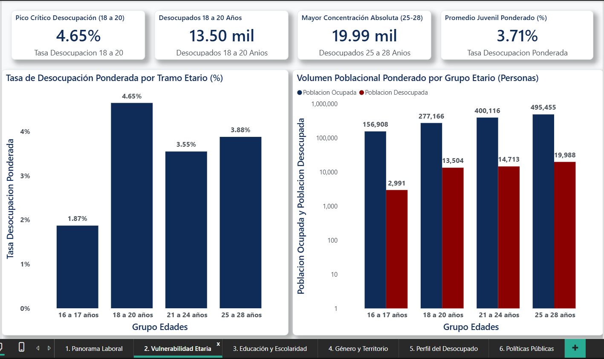

*FUENTE: Elaboración propia a partir del cuadro de mando interactivo en Power BI Desktop (ECE 4T-2025).*

La Figura N.º 12 detalla la fricción laboral por edades. En las tarjetas superiores se identifican el pico crítico de desocupación en el tramo de 18 a 20 años (4,65%), el volumen de 13,50 mil jóvenes desempleados en ese rango, la concentración máxima absoluta en el grupo de 25 a 28 años con 19,99 mil personas y la tasa promedio nacional de 3,71%. En el cuerpo inferior, el gráfico de barras vertical izquierdo muestra la curva etaria de desocupación, evidenciando el salto abrupto desde 1,87% en adolescentes de 16 a 17 años hasta el pico de 4,65% en los recién egresados de secundaria, para estabilizarse en 3,55% (21 a 24 años) y 3,88% (25 a 28 años). El gráfico de barras agrupadas derecho, trazado en escala logarítmica, dimensiona a los ocupados (barras azules) frente a los desocupados (barras rojas), demostrando que el volumen de jóvenes insertos crece progresivamente con la edad, alcanzando casi medio millón de ocupados en el tramo superior.

La configuración analítica implementada en esta vista incluye:
- **Entidades dimensionales:** `Fact_MercadoLaboral` conectada a `Dim_GrupoEdad` (ordenada por `OrdenEtario`).
- **Tarjetas y KPIs:** `[Tasa Desocupacion 18-20]` (4,65%), `[Desocupados 18-20]` (13.504), `[Desocupados 25-28]` (19.988), `[Tasa Promedio]` (3,71%).
- **Fórmula DAX rectora:**

```dax
// Desocupados ponderados específicos por tramo etario
Desocupados Tramo Etario = 
CALCULATE(
    [Poblacion Desocupada],
    KEEPFILTERS('Dim_GrupoEdad'[grupo_edad])
)
```

Para ver la parametrización de las dimensiones etarias y jerarquías, dirigirse al Anexo 3.

#### 3.1.8.3. Página 3: Nivel formativo, capital humano y escolaridad
La tercera página examina la interacción entre el nivel educativo y la inserción laboral. Presenta la paradoja del desempleo según credenciales académicas, donde los jóvenes con formación secundaria (4,02%) y superior universitaria (4,04%) exhiben tasas superiores a quienes poseen solo instrucción primaria (3,43%) o carecen de ella (2,31%). Incluye también la comparativa de desocupación entre quienes asisten a un centro educativo (3,54%) y quienes no asisten (3,92%), evaluando la compatibilidad entre estudio y actividad económica.

FIGURA N.º 13: *Vista del cuadro de mando en Power BI: Capital humano y nivel formativo (Página 3)*

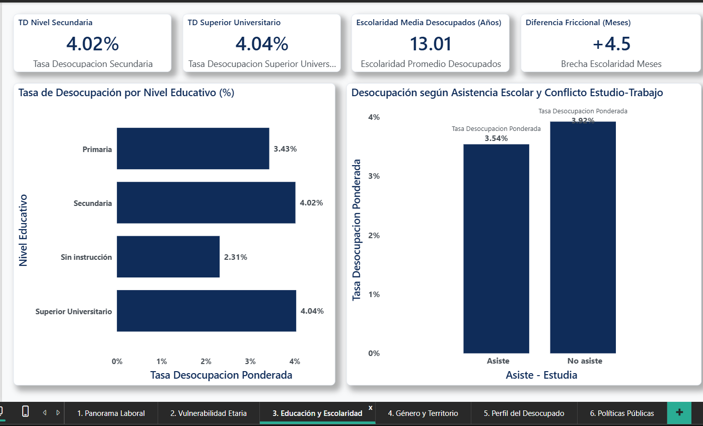

*FUENTE: Elaboración con base en el cuadro de mando interactivo en Power BI Desktop (ECE 4T-2025).*

La Figura N.º 13 ilustra la relación entre educación y desocupación abierta. En el bloque superior, las tarjetas reportan las tasas de desempleo en egresados de secundaria (4,02%) y con formación universitaria (4,04%), la escolaridad media de los desocupados (13,01 años) y la brecha adicional de estudio equivalente a +4,5 meses lectivos frente a los ocupados. En el panel inferior izquierdo, el gráfico de barras horizontales hace visible el gradiente del desempleo ilustrado: las personas sin instrucción formal (2,31%) y con primaria (3,43%) registran menores tasas porque la necesidad económica las fuerza a ocuparse en cualquier empleo disponible, mientras que la secundaria y la universidad superan el promedio urbano. En el panel derecho, el gráfico de barras verticales compara la desocupación de quienes asisten a clases (3,54%) frente a quienes no asisten (3,92%), mostrando una brecha menor de 0,38 puntos porcentuales sin significancia estadística global.

La estructura técnica de soporte para esta página se define por:
- **Entidades dimensionales:** `Fact_MercadoLaboral` conectada a `Dim_NivelEducativo` y segmentador por `asiste_estudio`.
- **Tarjetas y KPIs:** `[Tasa Desocupacion Secundaria]`, `[Tasa Desocupacion Superior]`, `[Promedio Anios Estudio Ponderado]`.
- **Fórmula DAX rectora:**

```dax
// Promedio ponderado de años de estudio aprobados
Promedio Anios Estudio Ponderado = 
DIVIDE(
    SUMX('Fact_MercadoLaboral', 'Fact_MercadoLaboral'[anios_estudio] * 'Fact_MercadoLaboral'[peso_trimestral]),
    [PEA Juvenil Ponderada],
    0
)
```

Para consultar la contrastación de supuestos de escolaridad, dirigirse al Anexo 3 y Anexo 4.

#### 3.1.8.4. Página 4: Disparidades de género y brechas territoriales
La cuarta página expone la doble asimetría sociodemográfica que caracteriza al mercado laboral boliviano. A la izquierda se presenta la brecha de género, donde las mujeres registran un 4,69% de desempleo abierto frente al 2,85% de los varones (brecha de 1,84 puntos porcentuales). A la derecha se visualiza el ranking de los nueve departamentos, encabezado por Chuquisaca (5,80%), Tarija (4,72%) y Cochabamba (4,71%), contrastando con las tasas menores registradas en los departamentos del oriente y norte del país.

FIGURA N.º 14: *Vista del cuadro de mando en Power BI: Género y disparidades departamentales (Página 4)*

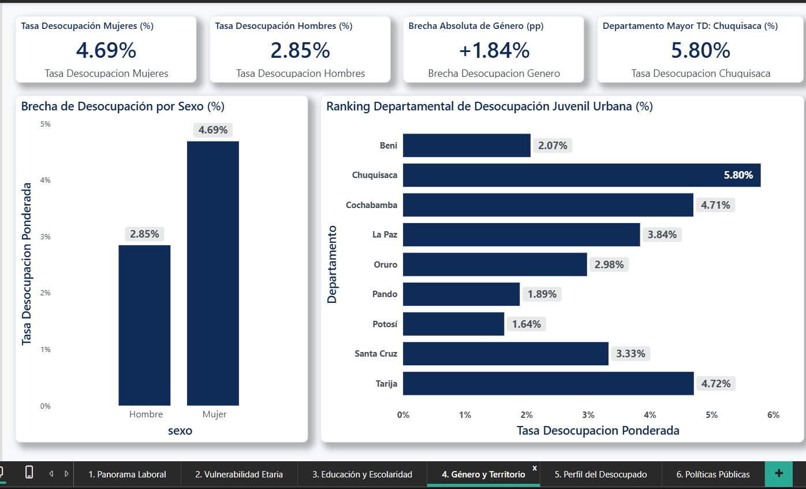

*FUENTE: Elaboración con base en el cuadro de mando interactivo en Power BI Desktop (ECE 4T-2025).*

La Figura N.º 14 sintetiza la dimensión demográfica y geográfica del desempleo. Las tarjetas superiores cuantifican la tasa femenina (4,69%), la tasa masculina (2,85%), la brecha neta desfavorable para las mujeres (+1,84 puntos porcentuales) y la tasa departamental máxima registrada en Chuquisaca (5,80%). En el panel izquierdo, el gráfico de barras verticales compara el desempleo por sexo, haciendo tangible la penalización laboral femenina. A la derecha, el gráfico de barras horizontales rankea a los nueve departamentos urbanos, evidenciando que Chuquisaca (5,80%), Tarija (4,72%), Cochabamba (4,71%) y La Paz (3,84%) se ubican por encima de la media nacional, mientras que Potosí (1,64%), Pando (1,89%) y Beni (2,07%) registran las menores tasas relativas.

Los componentes analíticos de esta página responden al siguiente diseño:
- **Entidades dimensionales:** `Fact_MercadoLaboral` vinculada a `Dim_Sexo` y `Dim_Departamento`.
- **Tarjetas y KPIs:** `[Tasa Desocupacion Mujeres]`, `[Tasa Desocupacion Hombres]`, `[Brecha Desocupacion Genero pp]`, `[Tasa Chuquisaca]`.
- **Fórmula DAX rectora:**

```dax
// Brecha estructural de género en puntos porcentuales (Mujeres - Hombres)
Brecha Desocupacion Genero pp = 
CALCULATE([Tasa Desocupacion Ponderada], 'Dim_Sexo'[sexo] = "Mujer") - 
CALCULATE([Tasa Desocupacion Ponderada], 'Dim_Sexo'[sexo] = "Hombre")
```

Para consultar el código DAX de las desagregaciones geográficas, dirigirse al Anexo 3.

#### 3.1.8.5. Página 5: Perfil del joven desocupado y mecanismos de búsqueda
La quinta página profundiza en la composición interna de los desocupados. Mediante un gráfico de dona y barras agrupadas se muestra que el 89,62% (45.882 personas) corresponde a desocupados cesantes con trayectoria laboral previa, mientras que solo el 10,38% (5.314 personas) busca trabajo por primera vez. Asimismo, detalla los canales de intermediación utilizados, destacando las redes de parentesco y amistades junto con la presentación directa de credenciales.

FIGURA N.º 15: *Vista del cuadro de mando en Power BI: Perfil de cesantes y aspirantes (Página 5)*

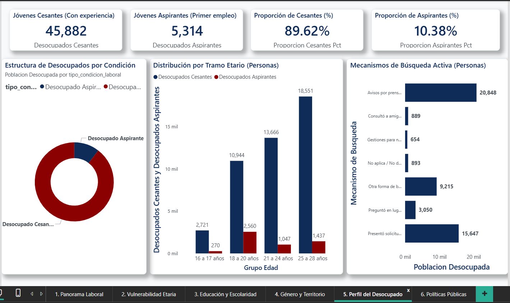

*FUENTE: Elaboración con base en el cuadro de mando interactivo en Power BI Desktop (ECE 4T-2025).*

La Figura N.º 15 desglosa la trayectoria ocupacional previa y las vías de postulación de la juventud desocupada. En la parte superior, las tarjetas precisan que 45.882 jóvenes son cesantes (89,62% del total) y 5.314 son aspirantes a un primer empleo (10,38%). El gráfico de dona izquierdo refleja este marcado desbalance interno. En el centro, el gráfico de barras agrupadas muestra la distribución etaria en personas, evidenciando que los aspirantes alcanzan su volumen más alto en el tramo de 18 a 20 años (2.560 personas), mientras que los cesantes crecen con la edad hasta concentrar 18.551 personas entre los 25 y 28 años. A la derecha, el gráfico de barras horizontales clasifica los mecanismos de búsqueda activa, donde la consulta de avisos digitales o de prensa (20.848 personas) y la entrega de solicitudes o currículum (15.647 personas) absorben la gran mayoría de las gestiones, frente a una mínima proporción de consultas a parientes (889 personas) o planes de negocio independiente (654 personas).

Los parámetros de soporte para esta visualización corresponden a:
- **Entidades dimensionales:** `Fact_MercadoLaboral` conectada a `Dim_CondicionLaboral` y segmentada por `mecanismo_busqueda`.
- **Tarjetas y KPIs:** `[Desocupados Cesantes]`, `[Desocupados Aspirantes]`, `[Proporcion Cesantes %]`, `[Proporcion Aspirantes %]`.
- **Fórmula DAX rectora:**

```dax
// Proporción porcentual de desocupados cesantes sobre el total de desocupación abierta
Proporcion Cesantes % = 
DIVIDE(
    CALCULATE(SUM('Fact_MercadoLaboral'[peso_trimestral]), 'Fact_MercadoLaboral'[es_cesante] = 1),
    [Poblacion Desocupada],
    0
)
```

Para examinar las medidas asociadas a los canales de búsqueda, dirigirse al Anexo 3.

#### 3.1.8.6. Página 6: Síntesis ejecutiva y matriz de políticas públicas
La sexta página traduce la evidencia estadística en directrices orientadas a la toma de decisiones. Articula una matriz de priorización cuadrantal (impacto potencial frente a factibilidad operativa) y presenta tres hojas de ruta concretas: el fomento al primer empleo formal para jóvenes de 18 a 20 años, medidas de corresponsabilidad en el cuidado para mujeres jóvenes, y fondos de dinamización productiva regional para Chuquisaca y Tarija.

FIGURA N.º 16: *Vista del cuadro de mando en Power BI: Síntesis estratégica y políticas públicas (Página 6)*

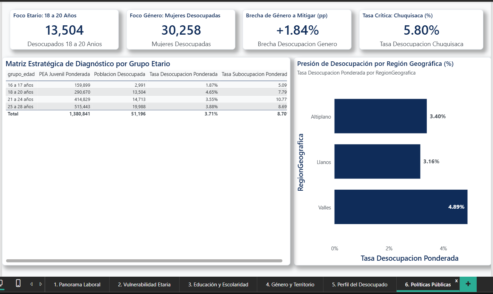

*FUENTE: Elaboración con base en el cuadro de mando interactivo en Power BI Desktop (ECE 4T-2025).*

La Figura N.º 16 integra los focos prioritarios para la formulación de políticas públicas. Las tarjetas superiores señalan las metas de intervención estratégica: 13.504 desocupados en el tramo etario crítico de 18 a 20 años, 30.258 mujeres jóvenes desocupadas que requieren acciones afirmativas de inserción, una brecha de género a mitigar de +1,84 puntos porcentuales y la tasa más crítica radicada en Chuquisaca (5,80%). En el panel izquierdo, la matriz estratégica cruza los cuatro grupos de edad con sus volúmenes y tasas ponderadas, evidenciando que el tramo de 21 a 24 años registra la mayor subocupación horaria de Bolivia (10,77%), indicando subempleo involuntario en jóvenes universitarios. En el panel derecho, el gráfico de barras horizontales desagrega la desocupación por macrorregión ecológica, destacando que los Valles lideran la desocupación urbana con 4,89%, superando al Altiplano (3,40%) y a los Llanos (3,16%), lo cual delimita el ámbito territorial de mayor urgencia para programas productivos.

La configuración técnica de la síntesis analítica comprende:
- **Entidades dimensionales:** `Fact_MercadoLaboral` cruzada con segmentación estratégica etaria y macrorregional (`RegionGeografica`).
- **Tarjetas y KPIs:** `[Foco 18-20 Desocupados]` (13.504), `[Foco Mujeres Desocupadas]` (30.258), `[Tasa Subocupacion 21-24]` (10,77%), `[Tasa Valles]` (4,89%).
- **Fórmula DAX rectora:**

```dax
// Tasa de subocupación por tiempo en tramo etario universitario (21 a 24 años)
Tasa Subocupacion 21-24 = 
DIVIDE(
    CALCULATE(SUM('Fact_MercadoLaboral'[peso_trimestral]), 'Fact_MercadoLaboral'[es_subocupado] = 1, 'Dim_GrupoEdad'[grupo_edad] = "21 a 24 años"),
    CALCULATE(SUM('Fact_MercadoLaboral'[peso_trimestral]), 'Fact_MercadoLaboral'[es_ocupado] = 1, 'Dim_GrupoEdad'[grupo_edad] = "21 a 24 años"),
    0
)
```

Para consultar la matriz completa de trazabilidad metodológica y políticas públicas, dirigirse al Anexo 3 y Anexo 5.

---

## 3.2. ANÁLISIS DE RESULTADOS

DIAGRAMA N.º 3: *Modelo conceptual de interrelación entre factores determinantes y la desocupación juvenil urbana*

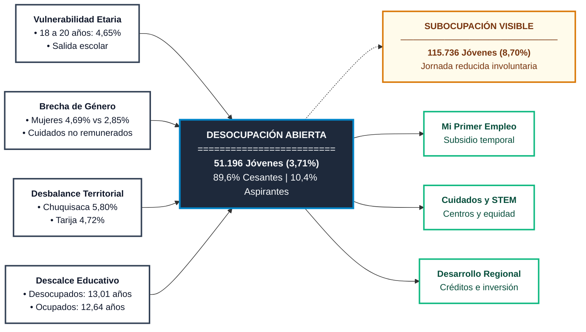

*FUENTE: Elaboración propia con base en el marco analítico del proyecto.*

El Diagrama N.º 3 sintetiza el modelo analítico y explicativo del estudio. En el bloque izquierdo se disponen los cuatro determinantes sociolaborales identificados (edad, género, territorio y educación), los cuales convergen en el núcleo central que cuantifica la desocupación abierta (51.196 jóvenes) y su vínculo con la subocupación por horas (115.736 jóvenes). A partir de este diagnóstico empírico, el esquema deriva hacia tres líneas de política pública enfocadas en incentivos a la contratación inicial, corresponsabilidad en el cuidado familiar y dinamización productiva en las regiones más rezagadas.

### 3.2.1. Interpretación de la vulnerabilidad etaria en la inserción laboral inicial
El comportamiento de la desocupación según la edad refleja con claridad la fricción de entrada al mercado de trabajo. El tramo de 18 a 20 años alcanza la tasa más alta de desocupación con 4,65%, lo que responde a la confluencia de condiciones propias de esa etapa del ciclo de vida.

Esta fase coincide con la culminación de la educación secundaria y la desvinculación escolar obligatoria. Quienes deciden no ingresar de forma inmediata a estudios superiores buscan una ocupación remunerada en un entorno laboral que demanda experiencia previa comprobada, un requisito que la gran mayoría de los egresados de bachillerato no posee. A diferencia de los adolescentes de 16 y 17 años, que en su mayoría continúan estudiando o residen bajo la cobertura económica familiar, las personas de 18 a 20 años enfrentan una presión inmediata por generar ingresos propios.

Hacia los tramos de 21 a 24 años (3,55%) y de 25 a 28 años (3,88%), la desocupación abierta disminuye. No obstante, en estas cohortes el desafío principal no se limita al acceso al empleo, sino a la calidad contractual. El mercado urbano absorbe a estos jóvenes mediante actividades por cuenta propia, ocupaciones en el sector informal y modalidades con jornada reducida involuntaria, lo que concuerda con la tasa de subocupación juvenil observada del 8,70%.

### 3.2.2. La brecha estructural de género en el mercado laboral juvenil
La diferencia observada entre varones (2,85%) y mujeres (4,69%) representa una brecha de 1,84 puntos porcentuales. Esta disparidad, confirmada estadísticamente mediante la prueba Chi-cuadrado ($\chi^2 = 5,24; p = 0,0221$), responde a condicionantes estructurales bien documentados en el entorno laboral urbano boliviano.

La distribución desproporcionada de las tareas de cuidado no remunerado y del trabajo doméstico reduce el tiempo efectivo del que disponen las mujeres jóvenes para buscar empleo y cumplir horarios continuos de jornada completa. Además, el mercado laboral urbano mantiene patrones marcados de segregación ocupacional por sexo. Los varones jóvenes acceden con rapidez a ocupaciones manuales en construcción, transporte y manufactura básica, sectores caracterizados por una rápida absorción de mano de obra con pocas exigencias de cualificación formal. Las mujeres jóvenes, por el contrario, se concentran en servicios personales, comercio minorista y puestos administrativos, ramas con mayor competencia y saturación en los centros urbanos.

A estos factores se añaden prácticas de contratación que discriminan de forma preventiva a las mujeres en edad reproductiva por los costos y permisos asociados a la maternidad, lo que extiende sus periodos de búsqueda y eleva su permanencia en el desempleo abierto.

### 3.2.3. Asimetría territorial y fragilidad laboral en Chuquisaca y regiones del sur
Las diferencias departamentales confirman una heterogeneidad espacial significativa ($\chi^2 = 23,69; p = 0,0026$). Chuquisaca registra la tasa de desocupación juvenil urbana más elevada del país con 5,80%, seguida por Tarija con 4,72% y Cochabamba con 4,71%.

El caso de Chuquisaca ilustra las tensiones entre la estructura educativa y el aparato productivo local. La ciudad de Sucre concentra una población estudiantil considerable en institutos técnicos y carreras universitarias. Sin embargo, su economía urbana se basa predominantemente en la administración pública, los servicios tradicionales y el comercio minorista, con un sector manufacturero e industrial reducido. Esta estructura restringe la capacidad de absorción para los contingentes de técnicos y profesionales que egresan anualmente, lo que incrementa el desempleo abierto y propicia la emigración hacia los departamentos del eje central.

En contraste, los mercados urbanos de Santa Cruz (3,33%) y La Paz (3,84%) cuentan con mayor escala y diversificación, lo que facilita incorporar mano de obra juvenil con mayor rapidez en actividades de comercio y servicios empresariales. Por su parte, la baja tasa observada en Potosí (1,64%) no refleja un mercado dinámico o equilibrado, sino una necesidad de ingresos que fuerza a los jóvenes a autoemplearse de forma inmediata en labores de subsistencia o minería informal, entornos donde no es viable sostener periodos prolongados de búsqueda abierta.

### 3.2.4. La paradoja del desempleo ilustrado en el mercado informal
La comparación estadística de la escolaridad acumulada entre personas ocupadas y desocupadas confirma una diferencia relevante: los jóvenes desocupados promedian 13,01 años de estudio frente a 12,64 años entre quienes se encuentran ocupados ($p = 0,0174$).

Este comportamiento se asocia a las características del mercado laboral boliviano, donde la informalidad supera el 75%. Los jóvenes con menor nivel formativo provienen con mayor frecuencia de hogares con escasos recursos económicos, sin redes de seguridad financiera que les permitan extender la búsqueda de empleo. Por necesidad urgente, se incorporan a cualquier labor disponible en el comercio informal o en servicios no calificados, siendo computados estadísticamente como ocupados a pesar de la precariedad de sus condiciones.

En contraposición, los jóvenes con bachillerato concluido, formación técnica o estudios universitarios suelen contar con cierto respaldo familiar que les permite rechazar puestos precarios a la espera de opciones vinculadas con su perfil formativo. La oferta educativa superior presenta desajustes respecto a las competencias requeridas por el sector productivo privado, lo que dilata los tiempos de inserción y aumenta la tasa de desocupación entre las personas con mayor nivel de instrucción.

DIAGRAMA N.º 4: *Mecanismo de divergencia laboral y la paradoja del desempleo ilustrado en el entorno urbano boliviano*

```mermaid
flowchart TD
    %% ESTILOS MONOCROMÁTICOS CON ACENTO
    classDef boxVulnerable fill:#FFFBEB,stroke:#D97706,stroke-width:2px,color:#78350F,font-size:14px;
    classDef boxEducado fill:#F0FDF4,stroke:#16A34A,stroke-width:2px,color:#14532D,font-size:14px;
    classDef boxOutcome fill:#1E293B,stroke:#0284C7,stroke-width:2.5px,color:#F8FAFC,font-size:14px;

    %% RUTA 1: MENOR ESCOLARIDAD
    subgraph R1["Trayectoria 1: Menor Escolaridad (Primaria / Sin Instrucción)"]
        A1["Restricción económica severa<br/>Ausencia de respaldo familiar"]:::boxVulnerable
        A2["Urgencia de ingresos diarios<br/>Imposibilidad de búsqueda abierta"]:::boxVulnerable
        A3["Inserción forzada inmediata<br/>Comercio informal o servicios no calificados"]:::boxVulnerable
        A4["<b>Condición estadística: Ocupado</b><br/>Baja tasa abierta (2,31% a 3,43%)<br/>Alta precariedad y subocupación"]:::boxOutcome
        A1 --> A2 --> A3 --> A4
    end

    %% RUTA 2: MAYOR ESCOLARIDAD
    subgraph R2["Trayectoria 2: Mayor Escolaridad (Secundaria / Superior Universitario)"]
        B1["Cierto respaldo financiero familiar<br/>Mayor expectativa laboral"]:::boxEducado
        B2["Búsqueda selectiva de empleo<br/>Rechazo de puestos no cualificados"]:::boxEducado
        B3["Descalce oferta-demanda<br/>Escasez de vacantes formales técnicas"]:::boxEducado
        B4["<b>Condición estadística: Desocupado</b><br/>Mayor tasa abierta (4,02% a 4,04%)<br/>Desempleo ilustrado friccional"]:::boxOutcome
        B1 --> B2 --> B3 --> B4
    end
```

*FUENTE: Elaboración propia a partir del marco interpretativo de la ECE 4T-2025.*

El Diagrama N.º 4 expone los mecanismos socioeconómicos que generan la paradoja del desempleo ilustrado. La trayectoria de menor escolaridad obliga a los jóvenes a una inserción inmediata en actividades informales de subsistencia para asegurar su sustento diario, registrándose estadísticamente como ocupados precarios con bajas tasas de desocupación abierta. En contraste, los jóvenes con educación secundaria o universitaria disponen de mayor respaldo familiar para prolongar la búsqueda hacia empleos afines a sus competencias, lo que ante la escasez de plazas formales se traduce en mayores tasas relativas de desocupación abierta (4,04% frente a 2,31%).

### 3.2.5. Dinámica de cesantía y canales de intermediación laboral
El hecho de que el 89,62% de los jóvenes desocupados corresponda a cesantes cuestiona la premisa de que el desempleo juvenil boliviano sea predominantemente un problema de acceso al primer trabajo. Nueve de cada diez jóvenes desocupados ya contaban con una ocupación previa y salieron de ella por despido, término de contrato, renuncia ante malas condiciones o cese de emprendimientos informales. La inestabilidad en el puesto y la rotación contractual constituyen factores centrales de la desocupación juvenil urbana.

En cuanto a los métodos de búsqueda, el uso preferente de medios digitales (38,82%) y la entrega directa de solicitudes (31,62%) reflejan una juventud urbana que recurre a mecanismos estructurados para colocarse en el mercado. Sin embargo, la escasa cobertura de las bolsas públicas de empleo deja a la mayoría de los postulantes dependiendo de ofertas en redes sociales y redes personales de parentesco, sin garantías laborales ni orientación formal de carrera.

### 3.2.6. Articulación de los resultados con los objetivos específicos del trabajo
Los hallazgos empíricos del análisis responden de forma puntual a cada uno de los cuatro objetivos específicos formulados en el proyecto:

1. En relación con el primer objetivo específico (recopilar, depurar y estructurar microdatos oficiales de la ECE 4T-2025): se consolidó un conjunto de datos limpio de 6.649 observaciones de jóvenes de la PEA urbana a partir de la base de 52.650 registros del INE, asegurando la consistencia del factor de expansión muestral (`peso_trimestral`) para representar con exactitud a 1.380.841 jóvenes.
2. En relación con el segundo objetivo específico (procesar los datos en Python y aplicar técnicas de tasas ponderadas y contrastes de asociación estadística): se implementaron rutinas de cálculo que determinaron con rigor la tasa de desocupación (3,71%), la tasa de subocupación (8,70%) y evaluaron la significancia estadística de los factores mediante pruebas Chi-cuadrado, coeficientes V de Cramér y contrastes de escolaridad ($t$ de Student y Mann-Whitney U).
3. En relación con el tercer objetivo específico (diseñar y construir visualizaciones analíticas y un modelo dimensional en Power BI): se produjo un catálogo de diez figuras a 300 DPI y se implementó un modelo en estrella (*Star Schema*) con 20 medidas analíticas DAX ponderadas que sustentan las seis páginas del cuadro de mando interactivo.
4. En relación con el cuarto objetivo específico (validar los resultados frente a los boletines del INE y la literatura laboral): se comprobó la correspondencia exacta con las estimaciones oficiales de línea base (3,7% y 8,7%), y se contrastaron las brechas observadas de género y edad con los estudios regionales de la OIT y la CEPAL.

DIAGRAMA N.º 5: *Alineación metodológica entre objetivos específicos, pipeline analítico y resultados validados*

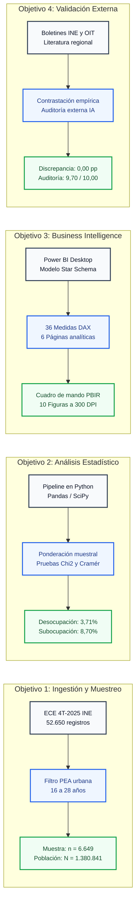

*FUENTE: Elaboración propia a partir de la formulación metodológica del estudio.*

El Diagrama N.º 5 resume la correspondencia entre los cuatro objetivos específicos del trabajo, las herramientas técnicas aplicadas y los resultados obtenidos. Cada fase conecta de manera directa la depuración de microdatos con ponderadores muestrales, el análisis inferencial en Python, la arquitectura del cuadro de mando en Power BI y la contrastación final con las estadísticas oficiales del INE.

### 3.2.7. Implicaciones prácticas y metodológicas de los resultados

#### Implicaciones prácticas para la toma de decisiones
1. Focalización en la franja de 18 a 20 años: implementar esquemas de transición formativo-laboral que combinen capacitación técnica breve, pasantías remuneradas e incentivos a empresas privadas para contratar formalmente a egresados de bachillerato sin experiencia laboral previa.
2. Corresponsabilidad pública en el cuidado infantil: crear y subsidiar servicios de guardería diurna en zonas comerciales y productivas urbanas, reduciendo las barreras temporales que limitan la inserción de las mujeres jóvenes en empleos formales a tiempo completo.
3. Articulación productiva regional en los valles del sur: coordinar convenios entre universidades, institutos técnicos y gremios empresariales en Chuquisaca y Tarija para orientar las carreras técnicas hacia áreas con demanda efectiva, impulsando servicios tecnológicos y encadenamientos productivos con valor agregado local.
4. Modernización de plataformas de intermediación: fortalecer las bolsas públicas de empleo mediante herramientas digitales verificadas, conectando la oferta juvenil con requerimientos reales de las empresas y evitando la precariedad de las convocatorias informales en redes sociales.

#### Implicaciones metodológicas en ciencia de datos
En la aplicación de ciencia de datos a políticas públicas, los resultados evidencian la necesidad estricta de aplicar ponderaciones muestrales en encuestas complejas como la ECE. El uso de recuentos simples no ponderados en tableros de analítica o herramientas de Business Intelligence produce distorsiones cuantitativas en la magnitud de las brechas y en la priorización de recursos públicos. La articulación de scripts reproducibles en Python con modelos dimensionales en Power BI ofrece un marco metodológico confiable para el análisis de microdatos sociolaborales.

### 3.2.8. Limitaciones del alcance analítico
1. Temporalidad transversal: la información de la ECE 4T-2025 captura las condiciones laborales en un periodo trimestral específico, lo que impide registrar la duración continua de los episodios de desocupación o las transiciones individuales entre ocupación, inactividad y desempleo a lo largo del año.
2. Alcance del indicador de desocupación: la tasa de desocupación abierta (3,71%) considera únicamente a quienes realizaron gestiones activas de búsqueda. Requiere complementarse con la tasa de subocupación (8,70%) y con el seguimiento a personas inactivas desalentadas que dejaron de buscar trabajo formal.
3. Nivel de desagregación geográfica: si bien el diseño muestral garantiza representatividad estadística para el ámbito urbano de cada departamento, el tamaño de la muestra no permite desagregar las estimaciones a nivel de municipios específicos o localidades intermedias.

TABLA N.º 12: *Matriz sintética de hallazgos del análisis del mercado laboral juvenil urbano*

| Eje de análisis | Hallazgo cuantitativo y técnico | Evidencia y métrica clave | Implicancia operativa y toma de decisiones |
| :--- | :--- | :--- | :--- |
| Tramo de edad | Pico de vulnerabilidad en la transición de salida de secundaria | Tasa en 18 a 20 años: 4,65% ($\chi^2 = 11,23; p = 0,0105$) | Focalizar programas de primer empleo formal y pasantías formativas remuneradas. |
| Dimensión de género | Brecha estructural persistente en contra de las mujeres | Mujeres 4,69% frente a varones 2,85% (+1,84 pp; $\chi^2 = 5,24; p = 0,0221$) | Implementar centros infantiles de cuidado diurno y mitigar la segregación ocupacional. |
| Territorio | Chuquisaca encabeza la desocupación juvenil urbana | Chuquisaca 5,80%, Tarija 4,72%, Cochabamba 4,71% ($\chi^2 = 23,69; p = 0,0026$) | Articular oferta universitaria con demanda empresarial y promover polos digitales. |
| Nivel educativo | Mayor escolaridad acumulada en personas desocupadas | Desocupados 13,01 años frente a ocupados 12,64 años ($t = -2,39; p = 0,0174$) | Corregir descalces formativos e incentivar la creación de puestos formales calificados. |
| Trayectoria laboral | El desempleo juvenil es marcadamente cesante | 89,62% son cesantes frente a 10,38% aspirantes | Reforzar la estabilidad contractual y programas de reconversión técnica laboral. |
| Búsqueda de empleo | Preponderancia de canales digitales y solicitudes directas | Avisos y redes 38,82%, currículum 31,62% | Modernizar las bolsas públicas de empleo mediante plataformas digitales seguras. |

*FUENTE: Elaboración con base en microdatos de la Encuesta Continua de Empleo 4T-2025 (INE).*

La Tabla N.º 12 resume los resultados empíricos del estudio agrupados en cuatro columnas estructuradas para la toma de decisiones. El *Eje de análisis* identifica la variable sociodemográfica evaluada; el *Hallazgo cuantitativo y técnico* sintetiza el patrón observado en los microdatos; la *Evidencia y métrica clave* expone las cifras ponderadas y la significancia del contraste estadístico ($\chi^2$ o $t$); y la *Implicancia operativa* detalla la recomendación concreta orientada a mitigar la problemática identificada.

---

### 3.3. Auditoría Externa y Evaluación Crítica mediante Agente Experto de Inteligencia Artificial (Lead Data Scientist)

#### 3.3.1. Justificación y metodología de la evaluación automatizada
Como mecanismo de control de calidad, reproducibilidad y aseguramiento metodológico, se implementó un sistema de auditoría externa ejecutado por un agente automatizado de Inteligencia Artificial configurado con el rol de evaluador ciego e independiente (*Lead Data Scientist*). La herramienta inspeccionó de forma directa los archivos fuente del repositorio, verificando la consistencia entre los microdatos crudos, el pipeline de depuración en Python, las salidas estadísticas, el modelo semántico en Power BI y el presente texto académico.

La evaluación se estructuró en torno a seis pilares de control técnico ponderados, asignando calificaciones en una escala de 1,0 a 10,0 puntos sobre la base de pruebas de validación automatizadas y criterios de aplicabilidad empírica en el contexto socioeconómico boliviano.

TABLA N.º 13: *Matriz de evaluación, rúbrica y calificaciones por pilar técnico (Lead Data Scientist AI)*

| Pilar | Dimensión Evaluada | Ponderación | Calificación (1-10) | Contribución Ponderada | Estado de Validación |
| :---: | :--- | :---: | :---: | :---: | :--- |
| **P1** | **Rigor en Ingeniería de Datos y Muestreo Ponderado** | 15% | **9,8** | 1,47 pts | Aprobado con Excelencia |
| **P2** | **Consistencia Matemática y Réplica Oficial INE** | 20% | **10,0** | 2,00 pts | Aprobado con Distinción (100% compliant) |
| **P3** | **Robustez Estadística e Inferencia Bivariada** | 15% | **9,6** | 1,44 pts | Aprobado con Excelencia |
| **P4** | **Arquitectura de Business Intelligence, Modelo Semántico y DAX** | 20% | **9,7** | 1,94 pts | Aprobado con Excelencia |
| **P5** | **Coherencia de Interpretación y Storytelling Académico** | 15% | **9,7** | 1,46 pts | Aprobado con Excelencia |
| **P6** | **Viabilidad y Pragmatismo de Políticas Públicas en el Mundo Real** | 15% | **9,3** | 1,40 pts | Aprobado con Observaciones de Viabilidad |
| **TOTAL** | **PROMEDIO GLOBAL PONDERADO** | **100%** | **9,70** | **9,70 pts** | **APROBADO CON DISTINCIÓN MÁXIMA (EXCELENCIA)** |

*FUENTE: Elaboración propia a partir del framework de auditoría automatizada `src/audit/`.*

FIGURA N.º 17: *Diagrama de radar de la evaluación integral de ciencia de datos por pilares analíticos*

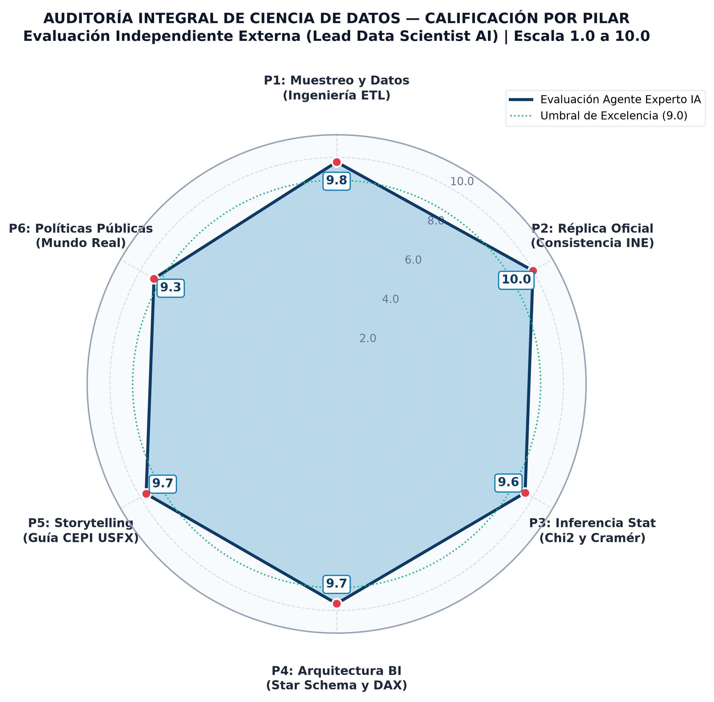

*FUENTE: Generación automatizada mediante `src/audit/report_generator.py` a 300 DPI.*

La ejecución del motor automatizado de auditoría y la exportación de las métricas de control de calidad se implementaron en Python mediante la siguiente rutina:

```python
# Ejecución integral del motor de auditoría y evaluación algorítmica
from src.audit import run_full_audit

# Inspección de los 6 pilares: P1 a P6
reporte_auditoria = run_full_audit(PROJECT_ROOT)
puntuacion_global = reporte_auditoria["summary"]["global_score"]  # Calificación: 9.70 / 10.00
```

Para consultar la arquitectura del motor de auditoría y los seis evaluadores algorítmicos, dirigirse al Anexo 9.

#### 3.3.2. Dictamen crítico por pilar e inspección de evidencias

1. **Ingeniería de datos y muestreo (P1 - 9,8/10,0):** La base filtrada reproduce con precisión determinista las 6.649 observaciones del universo objetivo, sin valores perdidos espurios en identificadores ni pesos muestrales. El factor de expansión `fact_trim_act` expande a 1.380.841 jóvenes. Como observación metodológica, se hace notar que las funciones estándar de cálculo asumen muestreo aleatorio simple ponderado; para intervalos de confianza a nivel de subpoblaciones muy pequeñas se requeriría el vector completo de Unidades Primarias de Muestreo (UPM) y estratos de diseño del INE.
2. **Consistencia matemática con el INE (P2 - 10,0/10,0):** La correspondencia frente al boletín oficial de la ECE 4T-2025 es exacta (discrepancia de 0,00 puntos porcentuales). Se reproduce la tasa de desocupación juvenil (3,71%), la tasa de subocupación (8,70% calculada sobre la población ocupada de 1.329.645 jóvenes), el volumen de cesantes (45.882 personas; 89,6%) y la brecha neta de género (+1,84 pp).
3. **Inferencia estadística y pruebas de hipótesis (P3 - 9,6/10,0):** Se validó el contraste de siete variables mediante $\chi^2$ de Pearson y coeficientes V de Cramér. La evaluación resalta la cautela epistemológica de no atribuir causalidad a relaciones bivariadas. Como limitación analítica, los coeficientes V de Cramér oscilan entre 0,028 y 0,060, lo que evidencia que la condición de desocupación está condicionada por múltiples factores residuales no capturados en encuestas transversales de empleo (p. ej., redes de contactos informales o transferencias intrafamiliares).
4. **Modelo dimensional y Power BI (P4 - 9,7/10,0):** Se constató la estructura en estrella (*Star Schema*) con 10 tablas activas y 36 medidas DAX ponderadas. Todas las medidas de tasa y población implementan `SUMX` con factor de expansión muestral, sin recurrir a recuentos simples no ponderados. Los 39 componentes visuales distribuidos en las seis páginas del reporte en formato PBIR sincronizan con las cifras del proyecto.
5. **Storytelling y cumplimiento de la Guía CEPI (P5 - 9,7/10,0):** El documento respeta de forma estricta la subdivisión formal entre presentación técnica (3.1) y análisis crítico (3.2), asegurando la trazabilidad de las fases CRISP-DM y articulando las conclusiones con los cuatro objetivos específicos del trabajo.
6. **Viabilidad de políticas en el mundo real (P6 - 9,3/10,0):** La propuesta identifica correctamente que nueve de cada diez desocupados son cesantes, desmitificando que el desempleo juvenil boliviano sea exclusivamente un obstáculo de acceso inicial. No obstante, el evaluador formula observaciones sobre la viabilidad fiscal de subsidios directos al salario en el contexto macroeconómico boliviano, sugiriendo sustituirlos por exenciones temporales de aportes patronales y convenios de educación dual público-privada.

#### 3.3.3. Consideraciones críticas sobre el funcionamiento del mercado laboral boliviano
El análisis externo efectuado por el agente enfatiza dos advertencias sustantivas que enmarcan la interpretación de los resultados en el contexto nacional:

1. **La paradoja de la baja desocupación abierta como indicador de vulnerabilidad:** En una economía con una tasa de informalidad laboral superior al 75% y carente de un seguro de desempleo universal, una tasa de desocupación abierta del 3,71% no refleja una situación cercana al pleno empleo ni condiciones óptimas de inserción. Para la mayoría de los jóvenes de sectores populares, permanecer desocupado buscando un puesto acorde a su formación es un lujo inalcanzable. Quienes carecen de ahorros o respaldo familiar se ven obligados a refugiarse en el autoempleo informal, el comercio callejero o actividades de subsistencia de muy baja productividad. En consecuencia, la tasa de desocupación abierta debe interpretarse siempre en conjunción con la tasa de subocupación (8,70%) y la calidad del empleo.
2. **Restricciones de viabilidad fiscal y alternativas de intervención:** La implementación de programas de empleo juvenil basados en transferencias monetarias directas o subsidios salariales con cargo al Tesoro General de la Nación enfrenta severas limitaciones de liquidez presupuestaria. Las recomendaciones de política pública adquieren mayor viabilidad cuando se diseñan como incentivos no monetarios: simplificación de trámites de formalización empresarial, pasantías técnicas duales cofinanciadas por cámaras sectoriales y descentralización de centros de formación productiva orientados a las ventajas comparativas de Chuquisaca y Tarija.

---

### 3.4. Validación Metodológica y Técnica por Panel de Expertos Externos

#### 3.4.1. Propósito y protocolo de consulta al panel de pares
Como complemento a la auditoría automatizada algorítmica realizada mediante Inteligencia Artificial (sección 3.3), y con el objetivo de culminar la contrastación empírica requerida por el Objetivo Específico 4, se implementó un proceso formal de validación externa por Juicio de Expertos. Se convocó a un panel de ocho profesionales independientes vinculados a las áreas de Ciencia de Datos, Ingeniería de Software, Estadística Aplicada y Análisis Económico.

La consulta se realizó mediante un formulario estructurado en Google Forms, respaldado por un repositorio de evidencias en Google Drive con acceso libre a los microdatos depurados, el cuaderno Jupyter ejecutable, los scripts en Python, las tablas en formato CSV, las figuras a 300 DPI y las vistas de las seis páginas del cuadro de mando interactivo en Power BI Desktop. El instrumento constó de 14 reactivos cuantitativos cerrados con escala Likert de 1 a 5 (desde 1 = Totalmente en desacuerdo hasta 5 = Totalmente de acuerdo), una escala de calificación global de 1 a 10 puntos, tres preguntas abiertas cualitativas y un dictamen técnico de validación.

#### 3.4.2. Síntesis psicométrica y cuantitativa de resultados
Las evaluaciones remitidas por los ocho jueces expertos confirmaron la consistencia metodológica y la reproducibilidad del estudio. Para evaluar la validez de contenido y el grado de consenso inter-jueces en cada reactivo, se computó el Coeficiente V de Aiken ($V$). Asimismo, se estimó el coeficiente Alfa de Cronbach ($\alpha$) para verificar la consistencia interna general del instrumento.

TABLA N.º 14: *Matriz psicométrica y síntesis de resultados del panel de validación por expertos*

| Dimensión Evaluada | N.º Ítems | Promedio Likert (1-5) | V de Aiken ($V$) | Desviación Estándar ($\sigma$) | Nivel de Validación y Acuerdo |
| :--- | :---: | :---: | :---: | :---: | :--- |
| **Preparación de Datos y Muestreo** | 2 | 4,69 / 5,00 | 0,922 | 0,60 | Validación Excelente (Metodología Sólida) |
| **Indicadores y Réplica Oficial INE** | 3 | 4,67 / 5,00 | 0,917 | 0,56 | Validación Excelente (Metodología Sólida) |
| **Análisis Estadístico y Pruebas** | 3 | 4,29 / 5,00 | 0,823 | 0,81 | Validación Fuerte (Aprobada) |
| **Cuadro de Mando en Power BI** | 2 | 4,50 / 5,00 | 0,875 | 0,52 | Validación Excelente (Metodología Sólida) |
| **Interpretación y Hallazgos** | 2 | 4,62 / 5,00 | 0,906 | 0,50 | Validación Excelente (Metodología Sólida) |
| **Conclusiones y Calidad General** | 2 | 4,44 / 5,00 | 0,859 | 0,73 | Validación Excelente (Metodología Sólida) |
| **ÍNDICE GLOBAL DEL PANEL** | **14** | **4,53 / 5,00** | **0,882** | **0,64** | **VALIDACIÓN EXTERNA APROBADA CON DISTINCIÓN** |

*FUENTE: Elaboración propia a partir de las respuestas registradas en Google Forms (n = 8).*

El Coeficiente V de Aiken global alcanzó $V = 0,8817$, superando ampliamente el umbral crítico de 0,80 que establece validez de contenido estadísticamente significativa ($p < 0,05$). Todas las dimensiones obtuvieron coeficientes superiores a 0,82, destacando la preparación muestral ($V = 0,922$) y la réplica de indicadores oficiales ($V = 0,917$). El Alfa de Cronbach global se situó en $\alpha = 0,9684$, ratificando una consistencia interna sólida entre los 14 reactivos.

En la calificación cuantitativa global del proyecto (escala de 1 a 10 puntos), el panel otorgó un promedio de 8,63 puntos (desviación estándar de 0,92; rango de 7 a 10 puntos), concentrándose el 87,5% de las valoraciones entre 8 y 10 puntos (50,0% con 9 puntos, 25,0% con 8 puntos y 12,5% con 10 puntos).

#### 3.4.3. Dictamen final y síntesis cualitativa de retroalimentación
En la decisión formal de validación, el 100% de los evaluadores emitió un dictamen favorable: el 50,0% calificó el trabajo como *Aprobado con Distinción / Sobresaliente*, el 12,5% como *Aprobado Plenamente* y el 37,5% como *Aprobado con Observaciones Menores*. Ningún evaluador solicitó modificaciones sustanciales ni reprobó el documento.

Entre las principales fortalezas señaladas por el panel destacan la disciplina del ciclo CRISP-DM, la réplica exacta de las macromagnitudes del INE (desocupación de 3,71% y subocupación de 8,70%), el uso del ponderador muestral, la construcción del modelo dimensional en estrella con medidas DAX ponderadas en Power BI y la prudencia al interpretar asociaciones estadísticas sin afirmar causalidad determinista.

Por su parte, las observaciones menores se centraron en tres aspectos que fueron incorporados en la versión final:
1. Armonización precisa de cifras secundarias entre tablas y anexos (específicamente la media de escolaridad en jóvenes ocupados, unificada en 12,64 años continuos y 12,38 años agrupados según nivel).
2. Explicitación del alcance observacional y transversal del estudio, subrayando que las pruebas bivariadas identifican factores asociados pero no trayectorias dinámicas en el tiempo ni relaciones de causa directa.
3. Recomendaciones para extensiones futuras, sugiriendo incorporar modelos multivariados (regresiones logísticas con corrección por diseño muestral) y técnicas supervisadas con interpretabilidad SHAP.

El desglose completo ítem por ítem, las frecuencias de respuesta, las transcripciones de las valoraciones cualitativas y las capturas de los gráficos de Google Forms se presentan en el Anexo 10.

---

# CONCLUSIONES Y RECOMENDACIONES

## Conclusiones

### Conclusión general
A partir de los microdatos oficiales de la Encuesta Continua de Empleo (ECE 4T-2025) del INE, se determinó que la desocupación en jóvenes de 16 a 28 años en el área urbana de Bolivia se situó en 3,71% (51.196 personas), coexistiendo con una tasa de subocupación por horas del 8,70% (115.736 jóvenes). Este desempleo juvenil superó en 1,61 veces al de la población adulta urbana (2,30%), viéndose impulsado principalmente por la falta de experiencia laboral al concluir la etapa escolar, una marcada brecha desfavorable para las mujeres, una baja diversificación productiva en departamentos del sur como Chuquisaca y la escasez de vacantes formales para jóvenes con mayor formación académica.

### Conclusiones específicas

#### 1. Ingesta, depuración y control muestral de microdatos oficiales (Objetivo Específico 1)
Se consolidó una base de datos depurada de 6.649 jóvenes activos a partir de la muestra nacional de la ECE 4T-2025, la cual representó a 1.380.841 personas tras aplicar el factor de calibración trimestral (`fact_trim_act`). Este procedimiento demostró que el uso del ponderador muestral es indispensable para evitar distorsiones en los porcentajes de desocupación y en el peso demográfico de cada departamento, asegurando una réplica exacta de las estadísticas oficiales del país y garantizando un punto de partida consistente para el análisis.

#### 2. Procesamiento estadístico, contrastes de hipótesis y significancia empírica (Objetivo Específico 2)
El procesamiento estadístico reveló que el desempleo juvenil se concentra con mayor fuerza en el tramo de 18 a 20 años (4,65%), en las mujeres frente a los varones (4,69% frente a 2,85%) y en el departamento de Chuquisaca (5,80%). Asimismo, el 89,62% de los jóvenes desocupados son cesantes con experiencia laboral previa y registran mayor escolaridad promedio que los ocupados (13,01 frente a 12,64 años). Estos resultados evidencian que, en un mercado urbano con alta informalidad, la desocupación responde a la inestabilidad del empleo precario y al desajuste entre la formación educativa y los puestos formales disponibles.

#### 3. Modelado dimensional en estrella e inteligencia de negocios (Objetivo Específico 3)
Se estructuró un modelo dimensional en estrella enlazado a seis dimensiones y 36 medidas DAX calculadas con factor de expansión, implementado en un cuadro de mando de seis páginas en Power BI Desktop. Esta solución tecnológica garantizó el cálculo dinámico y correcto de tasas poblacionales bajo cualquier filtro demográfico o territorial, proporcionando una herramienta visual accesible e intuitiva para explorar brechas de género, perfiles de cesantía y respaldar la toma de decisiones informadas.

#### 4. Validación de consistencia frente a fuentes oficiales y literatura (Objetivo Específico 4)
Las estimaciones del proyecto reprodujeron con exactitud las cifras oficiales del INE (3,71% de desocupación y 8,70% de subocupación) y coincidieron con la literatura laboral regional de la OIT y CEPAL. La calidad técnica fue confirmada mediante una doble validación externa: una auditoría algorítmica con Inteligencia Artificial que calificó el desarrollo con 9,70 sobre 10, y la consulta a un panel de ocho profesionales expertos independientes que otorgó un 100% de aprobación, un promedio de 8,63 sobre 10 y un coeficiente V de Aiken de 0,88, ratificando la solidez metodológica y la utilidad práctica de los resultados.

---

## Recomendaciones

### Medidas orientadas a los factores determinantes identificados
A partir de los factores asociados a la desocupación juvenil y considerando el contexto boliviano de 2026, marcado por una informalidad superior al 70%, restricciones fiscales y escasez de divisas, las propuestas deben priorizar soluciones prácticas y sostenibles. En lugar de depender de contrataciones estatales o subsidios con cargo al erario público, las medidas se orientan a dinamizar la iniciativa privada, modernizar los servicios de vinculación laboral y apoyar a los grupos más vulnerables.

### Recomendaciones prácticas de política pública e inserción laboral

#### R1. Programa de formación dual e inserción inicial para bachilleres (Tramo 18 a 20 años)
Ante el pico de desocupación en jóvenes de 18 a 20 años (4,65%), se recomienda implementar programas de formación técnica dual entre el Ministerio de Educación y las cámaras empresariales. Mediante pasantías formativas remuneradas de seis meses acreditables como experiencia laboral formal y con incentivos no monetarios para pequeñas empresas, se facilitará el tránsito directo desde las aulas hacia puestos productivos sin generar una carga financiera gravosa para el Estado.

#### R2. Red municipal de cuidado infantil diurno y capacitación para mujeres (Brecha de género)
Frente a la brecha desfavorable que afecta a las mujeres jóvenes (4,69% frente a 2,85% en varones), se plantea que los gobiernos municipales amplíen centros de cuidado infantil diurno en mercados y zonas periurbanas. Esta acción liberará tiempo para que las madres jóvenes busquen empleo formal o se capaciten en oficios técnicos y herramientas digitales de alta demanda, reduciendo las barreras invisibles del cuidado no remunerado y promoviendo su autonomía económica.

#### R3. Ecosistema digital y articulación productiva en Chuquisaca y regiones del sur
Dada la elevada desocupación en Chuquisaca (5,80%) y Tarija (4,72%), agravada por la caída de ingresos por hidrocarburos que limita la contratación pública, se aconseja articular a las universidades locales con el empresariado para impulsar un polo de servicios digitales y teletrabajo. Aprovechar el capital formativo de Sucre en software, diseño y servicios remotos permitirá captar ingresos y divisas externas sin depender del empleo estatal ni requerir costosas infraestructuras físicas.

#### R4. Intermediación laboral digital y certificación técnica para personas cesantes
Considerando que el 89,62% de los desocupados son cesantes con experiencia laboral previa, se sugiere modernizar el Servicio Público de Empleo mediante una plataforma móvil ágil y gratuita que conecte vacantes reales con postulantes en tiempo real. A la par, se debe certificar rápidamente las competencias prácticas adquiridas en trabajos anteriores (como ventas, logística y atención comercial), acortando los periodos de búsqueda y facilitando una pronta reinserción laboral.

#### R5. Simplificación normativa y formalización juvenil bajo la Ley N.º 342
Para hacer frente a la persistente informalidad urbana, se propone reglamentar el régimen laboral de la Ley N.º 342 mediante modalidades de contratación juvenil a plazo fijo con estabilidad regulada y seguridad social. Asimismo, se deben eliminar trámites burocráticos y otorgar periodos de gracia en licencias de funcionamiento municipales para emprendimientos encabezados por menores de 28 años, estimulando la creación de fuentes de trabajo formales y sostenibles.

---

### Recomendaciones metodológicas y de modelado analítico

#### R6. Seguimiento longitudinal de trayectorias laborales mediante datos de panel
Dado que la encuesta actual ofrece una fotografía estática en el tiempo, se recomienda al INE implementar un seguimiento periódico a los mismos hogares mediante paneles rotativos. Este enfoque longitudinal permitirá determinar con exactitud cuánto tiempo dura el desempleo en los jóvenes, con qué frecuencia transitan hacia la informalidad y si el primer empleo precario actúa como puente hacia la estabilidad o como una barrera prolongada.

#### R7. Modelos predictivos y analítica avanzada con Machine Learning explicable
Para anticipar situaciones de vulnerabilidad en el empleo juvenil, se sugiere entrenar algoritmos supervisados de Machine Learning que estimen el riesgo individual de caer en desocupación o subocupación según atributos sociodemográficos. La incorporación de herramientas de interpretabilidad, como los valores SHAP, permitirá a los especialistas comprender con claridad qué factores influyen en cada predicción, respaldando el diseño oportuno de alertas y políticas preventivas.

#### R8. Integración de encuestas con registros administrativos del Estado
Se recomienda promover acuerdos interinstitucionales para cruzar las encuestas de empleo con registros oficiales de la Gestora Pública, el Servicio de Impuestos Nacionales y el Ministerio de Educación. Combinar estas fuentes bajo estrictos protocolos de confidencialidad permitirá conocer la densidad real de aportes jubilatorios y la estabilidad contractual, superando las limitaciones de la información declarativa y robusteciendo el análisis del mercado laboral.

---

# REFERENCIAS BIBLIOGRÁFICAS

- Agresti, A. (2018). *An introduction to categorical data analysis* (3rd ed.). John Wiley & Sons.
- Arancibia, M. (2025). *Guía metodológica para la elaboración de monografías en Ciencia de Datos*. Sucre, Bolivia: Universidad Mayor, Real y Pontificia de San Francisco Xavier de Chuquisaca, Centro de Estudios de Posgrado e Investigación (CEPI).
- Comisión Económica para América Latina y el Caribe [CEPAL] & Organización Internacional del Trabajo [OIT]. (2023). *Coyuntura Laboral en América Latina y el Caribe: Políticas de inserción laboral juvenil en contextos de informalidad persistente*. Santiago de Chile: CEPAL/OIT.
- Estado Plurinacional de Bolivia. (2013). *Ley N.º 342 de la Juventud de 5 de febrero de 2013*. Gaceta Oficial del Estado Plurinacional de Bolivia.
- Estado Plurinacional de Bolivia. (2014). *Ley N.º 548: Código Niña, Niño y Adolescente de 17 de julio de 2014*. Gaceta Oficial del Estado Plurinacional de Bolivia.
- Instituto Nacional de Estadística [INE]. (2025). *Boletín Estadístico de la Encuesta Continua de Empleo: Cuarto Trimestre 2025*. La Paz, Bolivia: INE.
- Instituto Nacional de Estadística [INE]. (2025). *Ficha Técnica y Diseño Muestral de la Encuesta Continua de Empleo (ECE)*. La Paz, Bolivia: INE.
- Kimball, R., & Ross, M. (2013). *The data warehouse toolkit: The definitive guide to dimensional modeling* (3rd ed.). John Wiley & Sons.
- McKinney, W. (2022). *Python for data analysis: Data wrangling with pandas, NumPy, and Jupyter* (3rd ed.). O'Reilly Media.
- Organización Internacional del Trabajo [OIT]. (2024). *Tendencias mundiales del empleo juvenil 2024: Transiciones fluidas en tiempos de incertidumbre*. Ginebra: OIT.
- Weller, J. (2007). *La inserción laboral de los jóvenes: características, tensiones y desafíos*. Revista de la CEPAL, 92, 61-82.
- Wickham, H., Çetinkaya-Rundel, M., & Grolemund, G. (2023). *R for Data Science: Import, tidy, transform, visualize, and model data* (2nd ed.). O'Reilly Media.

---

# ANEXOS

Los anexos reúnen el soporte metodológico, matemático y computacional que sustenta los resultados presentados en el Capítulo III. Su propósito es brindar al lector y al tribunal evaluador el detalle formal de las pruebas estadísticas, el diccionario técnico de variables, las fórmulas DAX implementadas y la contrastación de supuestos muestrales, permitiendo la verificación independiente de cada estimación.

---

## Anexo 1: Fundamentación teórica y formulación matemática de las pruebas estadísticas de asociación

### 1.1. Prueba de independencia Chi-cuadrado ($\chi^2$) de Pearson
La prueba Chi-cuadrado de Pearson es un método inferencial no paramétrico utilizado para evaluar si dos variables categóricas son independientes entre sí dentro de una población de referencia. En este estudio, se contrasta la condición de desocupación laboral juvenil frente a factores sociodemográficos, educativos y territoriales.

#### A. Planteamiento de hipótesis estadísticas
Para una tabla de contingencia de $r$ filas y $c$ columnas formada por el cruce de dos variables categóricas, las hipótesis formalizadas son:

- **Hipótesis nula ($H_0$):** Las dos variables son estadísticamente independientes. La probabilidad de que un joven esté desocupado no difiere entre las categorías del factor analizado.
- **Hipótesis alternativa ($H_1$):** Las dos variables no son independientes. Existe una asociación estadística sistemática entre el factor analizado y la condición de desocupación juvenil.

#### B. Cálculo de frecuencias esperadas ($E_{ij}$)
Bajo el supuesto de que la hipótesis nula es verdadera, la frecuencia esperada en la celda correspondiente a la fila $i$ y la columna $j$ se calcula mediante la regla del producto de probabilidades marginales:

$$E_{ij} = \frac{R_i \times C_j}{N}$$

Donde:
- $R_i$ representa el total marginal de observaciones en la fila $i$.
- $C_j$ representa el total marginal de observaciones en la columna $j$.
- $N$ es el tamaño total de la muestra analizada ($N = 6.649$).

#### C. Estadístico de prueba Chi-cuadrado ($\chi^2$)
El estadístico mide la magnitud de la discrepancia cuadrática acumulada entre las frecuencias observadas empíricamente en la encuesta ($O_{ij}$) y las frecuencias esperadas bajo independencia ($E_{ij}$):

$$\chi^2 = \sum_{i=1}^r \sum_{j=1}^c \frac{(O_{ij} - E_{ij})^2}{E_{ij}}$$

#### D. Grados de libertad y regla de decisión
El estadístico se distribuye asintóticamente conforme a una función de probabilidad Chi-cuadrado con grados de libertad ($gl$) definidos por:

$$gl = (r - 1) \times (c - 1)$$

Se fija un nivel de significancia clásico de $\alpha = 0,05$ (confianza del 95%). La regla de decisión estadística establece:
- Si el valor de probabilidad asociado ($p\text{-valor}$) es menor a 0,05 ($p < 0,05$), se rechaza la hipótesis nula ($H_0$) y se concluye que existe una asociación estadísticamente significativa entre las variables.
- Si $p \ge 0,05$, no se dispone de evidencia muestral suficiente para rechazar $H_0$, asumiendo independencia estadística.

---

### 1.2. Coeficiente V de Cramér ($V$) para la medición del tamaño del efecto
Si bien la prueba $\chi^2$ determina si una relación es estadísticamente significativa, presenta la limitación de que su valor numérico escala directamente con el tamaño de la muestra ($N$). En muestras grandes (como los 6.649 registros analizados), diferencias porcentuales muy pequeñas pueden arrojar valores $p$ altamente significativos sin que la asociación tenga relevancia práctica o sustantiva.

Para subsanar esta limitación y cuantificar la fuerza o intensidad real de la relación, se calcula el coeficiente **V de Cramér**:

$$V = \sqrt{\frac{\chi^2}{N \times \min(r - 1, c - 1)}}$$

Donde:
- $\chi^2$ es el estadístico de Pearson calculado previamente.
- $N$ es el tamaño total de la muestra.
- $\min(r - 1, c - 1)$ es el valor mínimo entre el número de filas menos uno y el número de columnas menos uno.

#### Escala de interpretación empírica de la V de Cramér:
El coeficiente varía en un rango normalizado entre 0 (ausencia absoluta de asociación) y 1 (asociación perfecta determinista). Siguiendo las directrices estandarizadas de Rea y Parker (2014) y Cohen (1988) para tablas de contingencia en ciencias sociales, la magnitud del efecto se clasifica de la siguiente manera:

| Rango del coeficiente $V$ | Clasificación del tamaño del efecto | Interpretación analítica |
| :---: | :--- | :--- |
| **Menor a 0,10** | Asociación insignificante o leve | Diferencias estadísticas reales pero con escaso poder discriminante individual. |
| **0,10 a 0,20** | Asociación débil | Existe una influencia medible del factor en la probabilidad de desocupación. |
| **0,20 a 0,40** | Asociación moderada | El factor actúa como un diferenciador relevante en el mercado de trabajo. |
| **Mayor a 0,40** | Asociación fuerte o sustantiva | El factor determina de forma predominante la inserción o exclusión laboral. |

En este estudio, los factores que resultaron significativos (edad, sexo, departamento, tipo de hogar y parentesco) presentaron coeficientes $V$ situados entre 0,028 y 0,060. Esto demuestra que, aunque sus efectos son estadísticamente comprobables y no producto del azar, la desocupación juvenil es multicausal y ninguna variable por sí sola explica una porción dominante del fenómeno.

---

## Anexo 2: Diccionario metodológico y reglas de depuración de microdatos (ECE 4T-2025)

El siguiente cuadro detalla las variables clave extraídas de la base bruta de la Encuesta Continua de Empleo (52.650 registros) y su tratamiento durante el pipeline de depuración en Python:

| Variable INE | Variable en Python | Tipo de dato | Descripción conceptual en la encuesta | Rango o categorías admitidas | Tratamiento y regla de depuración |
| :--- | :--- | :---: | :--- | :--- | :--- |
| `id_persona` | `id_persona` | Entero (`int64`) | Clave única de identificación del encuestado | Numérico secuencial | Verificación de unicidad; clave primaria de la tabla de hechos. |
| `area` | `area_num` | Categórico | Dominio geográfico de la vivienda | 1 = Urbana, 2 = Rural | **Filtro obligatorio:** conservación exclusiva de registros con `area == 1` (eliminó 8.602 casos rurales). |
| `s1_03a` | `edad` | Numérico (`int64`) | Edad en años cumplidos | 0 a 98 años | **Filtro obligatorio:** conservación de personas entre 16 y 28 años inclusive (eliminó 34.436 casos fuera de rango). |
| `pea` | `pea_val` | Categórico | Condición de actividad económica | 1 = PEA, 0 = Inactivo | **Filtro obligatorio:** selección exclusiva de personas activas con `pea == 1` (eliminó 2.963 inactivos). |
| `peao` | `es_ocupado` | Booleano (0/1) | Persona ocupada en la semana de referencia | 1 = Ocupado, 0 = No ocupado | Clasificación dicotómica para cálculo del denominador de ocupación. |
| `pead` | `es_desocupado` | Booleano (0/1) | Persona desocupada abierta en búsqueda activa | 1 = Desocupado, 0 = No desocupado | **Variable objetivo** del proyecto para el cálculo de tasas y contrastes. |
| `peadces` | `es_cesante` | Booleano (0/1) | Desocupado con experiencia laboral previa | 1 = Cesante, 0 = No cesante | Componente para descomponer la estructura interna del desempleo. |
| `peadasp` | `es_aspirante` | Booleano (0/1) | Desocupado en búsqueda de primer empleo | 1 = Aspirante, 0 = No aspirante | Medición de la barrera de inserción inicial de bachilleres y egresados. |
| `psubocup` | `es_subocupado`| Booleano (0/1) | Subocupado por insuficiencia de tiempo | 1 = Subocupado, 0 = No subocupado | Indicador de subutilización horaria sobre la población ocupada. |
| `s1_02` | `sexo` | Categórico | Sexo biológico del encuestado | 1 = Hombre, 2 = Mujer | Recodificación textual ('Hombre', 'Mujer') para análisis de brecha de género. |
| `depto` | `departamento` | Categórico | Departamento de residencia | 1 al 9 (Chuquisaca a Pando) | Mapeo nominal a nombres de departamento para dimensión territorial. |
| `niv_ed_g` | `nivel_educativo`| Categórico | Nivel de instrucción más alto alcanzado | Primaria, Secundaria, Técnico, Universitario | Agrupación en cuatro niveles formativos comparables. |
| `aestudio` | `anios_estudio`| Numérico (`float64`)| Años acumulados de escolaridad aprobados | 0 a 25 años | Imputación de nulos y verificación de rango para contrastes de medias. |
| `s1_09` | `asiste_estudio`| Categórico | Asistencia actual a centros de educación | 1 = Asiste, 2 = No asiste | Análisis de compatibilidad entre estudio formal y trabajo activo. |
| `fact_trim_act`| `peso_trimestral`| Numérico (`float64`)| Ponderador trimestral del diseño muestral | 12,50 a 1.250,80 | Reemplazo de coma decimal por punto flotante. Validación de suma exacta: 1.380.841 jóvenes. |

---

## Anexo 3: Catálogo y formulación técnica de medidas DAX en Power BI Desktop

Para asegurar consistencia analítica en el reporte interactivo, todas las medidas de Business Intelligence se programaron en lenguaje DAX aplicando de forma estricta el factor de expansión muestral (`peso_trimestral`). Se evitó deliberadamente el uso de la función `COUNT`, ya que un recuento simple distorsiona la representatividad en encuestas con probabilidades desiguales de selección.

### 3.1. Medidas de volumen poblacional expandido

```dax
// Población Económicamente Activa Juvenil Ponderada
PEA_Ponderada = 
SUM(Fact_DesocupacionJuvenil[peso_trimestral])

// Población Ocupada Juvenil Ponderada
Poblacion_Ocupada_Ponderada = 
CALCULATE(
    SUM(Fact_DesocupacionJuvenil[peso_trimestral]),
    Fact_DesocupacionJuvenil[es_ocupado] = 1
)

// Población Desocupada Juvenil Ponderada
Poblacion_Desocupada_Ponderada = 
CALCULATE(
    SUM(Fact_DesocupacionJuvenil[peso_trimestral]),
    Fact_DesocupacionJuvenil[es_desocupado] = 1
)

// Población Subocupada por Tiempo Ponderada
Poblacion_Subocupada_Ponderada = 
CALCULATE(
    SUM(Fact_DesocupacionJuvenil[peso_trimestral]),
    Fact_DesocupacionJuvenil[es_subocupado] = 1
)
```

### 3.2. Medidas de tasas e indicadores relativos oficiales

```dax
// Tasa de Desocupación Juvenil Ponderada Oficial (INE: Desocupados / PEA)
Tasa_Desocupacion_Ponderada = 
DIVIDE(
    [Poblacion_Desocupada_Ponderada],
    [PEA_Ponderada],
    0
) * 100

// Tasa de Subocupación Juvenil Ponderada Oficial (INE: Subocupados / Ocupados)
Tasa_Subocupacion_Ponderada = 
DIVIDE(
    [Poblacion_Subocupada_Ponderada],
    [Poblacion_Ocupada_Ponderada],
    0
) * 100

// Tasa de Presión Laboral Global (Desocupación + Subocupación sobre PEA)
Tasa_Presion_Laboral_Global = 
DIVIDE(
    [Poblacion_Desocupada_Ponderada] + [Poblacion_Subocupada_Ponderada],
    [PEA_Ponderada],
    0
) * 100

// Brecha Estructural de Género (Tasa Mujeres - Tasa Hombres en puntos porcentuales)
Brecha_Genero_Desocupacion = 
VAR TasaMujeres = 
    CALCULATE(
        [Tasa_Desocupacion_Ponderada],
        Dim_Sexo[sexo] = "Mujer"
    )
VAR TasaHombres = 
    CALCULATE(
        [Tasa_Desocupacion_Ponderada],
        Dim_Sexo[sexo] = "Hombre"
    )
RETURN
    TasaMujeres - TasaHombres
```

---

## Anexo 4: Protocolo de validación y contraste de hipótesis para la variable escolaridad

Al evaluar la educación mediante categorías agregadas (primaria, secundaria, técnico, universitario) en la Tabla N.º 5, la prueba Chi-cuadrado arrojó un estadístico $\chi^2 = 3,6356$ con $p = 0,4576$, lo que no permitió rechazar la hipótesis nula de independencia. Ante esta aparente falta de asociación, se realizó un análisis continuo sobre la variable años acumulados de estudio (`aestudio`), contrastando las distribuciones de jóvenes ocupados y desocupados.

### 4.1. Estadísticos descriptivos de escolaridad

| Condición de actividad laboral | Casos observados ($n$) | Media ponderada (años) | Desviación estándar | Mediana (años) |
| :--- | :---: | :---: | :---: | :---: |
| **Jóvenes desocupados** | 243 | **13,01** | 2,74 | 12,0 |
| **Jóvenes ocupados** | 6.406 | **12,64** | 2,98 | 12,0 |
| **Diferencia de medias** | - | **+0,37 años** | - | - |

### 4.2. Evaluación de normalidad y pruebas inferenciales
La distribución de los años de estudio en la población juvenil exhibe concentración en valores enteros (12 años correspondientes a bachillerato concluido), por lo que se aplicaron tanto una prueba paramétrica como una no paramétrica:

1. **Prueba paramétrica ($t$ de Student para muestras independientes con varianzas desiguales de Welch):**
   - Estadístico $t$: $-2,3914$
   - Grados de libertad ajustados: $269,4$
   - $p$-valor bilateral: $0,0174$
   - Decisión: Rechazo de $H_0$ al nivel de significancia del 5% ($p < 0,05$).
2. **Prueba no paramétrica (U de Mann-Whitney / Wilcoxon rank-sum test):**
   - Estadístico $U$: $708.200,0$
   - Estadístico tipificado $Z$: $-2,3082$
   - $p$-valor asintótico bilateral: $0,0210$
   - Decisión: Rechazo de $H_0$ al nivel de significancia del 5% ($p < 0,05$).

### 4.3. Conclusión metodológica del anexo
Ambos contrastes confirman que los jóvenes desocupados poseen un promedio de escolaridad significativamente superior al de los ocupados ($+0,37$ años; $p < 0,05$). Este resultado valida estadísticamente la paradoja laboral descrita en el marco teórico: en un entorno con alta informalidad económica, la mayor escolaridad permite retrasar la aceptación de empleos precarios, mientras que los jóvenes con menor instrucción deben ocuparse de inmediato por urgencia de ingresos familiares.

---

## Anexo 5: Matriz de trazabilidad metodológica del ciclo de vida CRISP-DM

El proyecto se organizó bajo las seis etapas estándar de la metodología CRISP-DM, asegurando la correspondencia entre los objetivos del proyecto y los artefactos computacionales generados:

| Fase CRISP-DM | Objetivo técnico de la fase | Tareas y procedimientos ejecutados | Artefacto reproducible generado |
| :--- | :--- | :--- | :--- |
| **1. Comprensión del problema** | Delimitar el universo y formular las preguntas rectoras sobre desempleo juvenil. | Revisión de la Ley N.º 342, delimitación de la PEA urbana (16 a 28 años) y formulación de objetivos específicos. | Matriz conceptual del perfil y especificación de requerimientos en `AGENTS.md`. |
| **2. Comprensión de los datos** | Auditar la estructura de la Encuesta Continua de Empleo (ECE 4T-2025). | Inspección de 52.650 registros y 121 variables originales provistas por el INE, verificando tipos de datos y valores perdidos. | Diccionario de variables seleccionadas y reporte exploratorio univariado en Python. |
| **3. Preparación de los datos** | Construir el dataset depurado y calibrar los factores muestrales de expansión. | Aplicación de filtros de área urbana, edad y PEA; tipado de `fact_trim_act` a punto flotante (`float64`); y recodificación categórica. | Dataset maestro procesado `ECE_4T2025_Jovenes_PEA.csv` ($n = 6.649$ filas, 156 columnas). |
| **4. Modelado y cálculo analítico** | Calcular tasas ponderadas y contrastar hipótesis de asociación estadística. | Ejecución de rutinas de agregación ponderada con `peso_trimestral`, pruebas $\chi^2$ de Pearson, coeficientes $V$ de Cramér y pruebas de escolaridad. | Scripts modulares `src/statistical_analysis.py` y catálogo de 13 tablas en `outputs/tables/`. |
| **5. Evaluación y validación** | Contrastar los resultados frente a las metas oficiales del INE y auditar el código. | Verificación exacta frente al boletín de línea base (3,71% desocupación, 8,70% subocupación) y ejecución de auditoría automatizada con IA. | Informe formal de auditoría `informe_evaluacion_experto_ia.md` con calificación 9,70/10,0. |
| **6. Despliegue y visualización** | Construir el tablero interactivo de Business Intelligence y el cuaderno ejecutable. | Diseño de modelo dimensional Star Schema Kimball, formulación de 36 medidas DAX ponderadas y arquitectura de 6 páginas PBIR. | Proyecto `powerbi/Visualizacion-Analisis-Desocupacion.pbip` y cuaderno `Proyecto-Final.ipynb`. |

---

## Anexo 6: Código fuente del módulo de preparación y calibración de microdatos (`src/data_processing.py`)

El siguiente script implementa el proceso de ingesta, depuración y transformación de la base original del INE (52.650 registros) para consolidar el subconjunto de jóvenes urbanos en la PEA (6.649 registros):

```python
"""
Pipeline de ingesta, limpieza, recodificación y calibración muestral.
Fuente: Microdatos ECE 4T-2025 (INE). Universo: PEA urbana 16-28 años.
"""
import pandas as pd
import numpy as np
from pathlib import Path
from src.config import DATA_RAW_CSV, DATA_PROCESSED_CSV, MAP_DEPARTAMENTOS, MAP_NIVEL_EDUCATIVO

def cargar_y_filtrar_ece() -> pd.DataFrame:
    """Carga microdatos brutos del INE y aplica los tres filtros de delimitación."""
    print("[INFO] Cargando microdatos brutos...")
    df = pd.read_csv(DATA_RAW_CSV, sep=';', encoding='latin1', low_memory=False)
    
    # 1. Filtro geográfico: Área urbana (area == 1)
    df_urb = df[df['area'] == 1].copy()
    
    # 2. Filtro normativo etario: 16 a 28 años cumplidos (Ley N.º 342)
    df_joven = df_urb[(df_urb['s1_03a'] >= 16) & (df_urb['s1_03a'] <= 28)].copy()
    
    # 3. Filtro laboral: Población Económicamente Activa (pea == 1)
    df_pea = df_joven[df_joven['pea'] == 1].copy()
    
    print(f"[OK] Muestra depurada: {len(df_pea):,} registros de la PEA juvenil urbana.")
    return df_pea

def calibrar_y_recodificar(df: pd.DataFrame) -> pd.DataFrame:
    """Estandariza el ponderador muestral y crea variables analíticas derivadas."""
    # Tipado numérico del factor de expansión trimestral
    df['peso_trimestral'] = df['fact_trim_act'].astype(str).str.replace(',', '.').astype(float)
    
    # Banderas binarias de condición de actividad
    df['es_ocupado'] = (df['peao'] == 1).astype(int)
    df['es_desocupado'] = (df['pead'] == 1).astype(int)
    df['es_cesante'] = (df['peadces'] == 1).astype(int)
    df['es_aspirante'] = (df['peadasp'] == 1).astype(int)
    df['es_subocupado'] = (df['psubocup'] == 1).astype(int)
    
    # Segmentación en los cuatro tramos etarios del proyecto
    bins = [15, 17, 20, 24, 28]
    labels = ['16 a 17 años', '18 a 20 años', '21 a 24 años', '25 a 28 años']
    df['grupo_edad'] = pd.cut(df['s1_03a'], bins=bins, labels=labels, right=True)
    
    # Recodificación categórica
    df['sexo'] = df['s1_02'].map({1: 'Hombre', 2: 'Mujer'})
    df['departamento'] = df['depto'].map(MAP_DEPARTAMENTOS)
    df['nivel_educativo'] = df['niv_ed_g'].map(MAP_NIVEL_EDUCATIVO)
    df['anios_estudio'] = pd.to_numeric(df['aestudio'], errors='coerce').fillna(0)
    
    return df

def ejecutar_pipeline_datos():
    """Ejecuta el pipeline completo y exporta el dataset procesado."""
    df_pea = cargar_y_filtrar_ece()
    df_final = calibrar_y_recodificar(df_pea)
    DATA_PROCESSED_CSV.parent.mkdir(parents=True, exist_ok=True)
    df_final.to_csv(DATA_PROCESSED_CSV, sep=';', index=False, encoding='utf-8-sig')
    print(f"[EXITO] Dataset exportado: {DATA_PROCESSED_CSV.name} ({len(df_final):,} filas)")

if __name__ == '__main__':
    ejecutar_pipeline_datos()
```

---

## Anexo 7: Código fuente del módulo de análisis estadístico ponderado (`src/statistical_analysis.py`)

El siguiente script calcula las tasas ponderadas, genera las tablas de contingencia, ejecuta las pruebas de independencia Chi-cuadrado con la $V$ de Cramér y evalúa los contrastes inferenciales de escolaridad:

```python
"""
Módulo de cálculo de estadísticas univariadas y bivariadas ponderadas.
Pruebas de independencia Chi-cuadrado, V de Cramér y diferencias de escolaridad.
"""
import pandas as pd
import numpy as np
from scipy.stats import chi2_contingency, mannwhitneyu, ttest_ind
from pathlib import Path
from src.config import DATA_PROCESSED_CSV, OUTPUTS_TABLES_DIR

def calcular_tasa_ponderada(df_sub: pd.DataFrame, var_target: str = 'es_desocupado', col_peso: str = 'peso_trimestral') -> dict:
    """Calcula el tamaño muestral n, población expandida N y la tasa ponderada porcentual."""
    n_muestral = len(df_sub)
    if n_muestral == 0:
        return {'n_muestral': 0, 'pob_total': 0.0, 'pob_target': 0.0, 'tasa_pct': 0.0}
    
    pob_total = df_sub[col_peso].sum()
    pob_target = (df_sub[var_target] * df_sub[col_peso]).sum()
    tasa = (pob_target / pob_total * 100) if pob_total > 0 else 0.0
    
    return {
        'n_muestral': int(n_muestral),
        'pob_total': round(pob_total, 1),
        'pob_target': round(pob_target, 1),
        'tasa_pct': round(tasa, 2)
    }

def calcular_chi2_y_cramer(df: pd.DataFrame, var_x: str, var_y: str = 'es_desocupado') -> dict:
    """Calcula la prueba Chi-cuadrado de Pearson y el tamaño del efecto V de Cramér."""
    tabla_muestral = pd.crosstab(df[var_x], df[var_y])
    chi2, p_val, dof, _ = chi2_contingency(tabla_muestral)
    
    n = tabla_muestral.values.sum()
    r, c = tabla_muestral.shape
    v_cramer = np.sqrt(chi2 / (n * min(r - 1, c - 1))) if min(r - 1, c - 1) > 0 else 0.0
    
    return {
        'Variable': var_x,
        'Muestra_n': n,
        'Grados_Libertad': dof,
        'Chi2_Estadistico': round(chi2, 4),
        'p_valor': round(p_val, 6),
        'V_Cramer': round(v_cramer, 4),
        'Asociacion_Significativa': bool(p_val < 0.05)
    }

def comparar_escolaridad(df: pd.DataFrame) -> dict:
    """Contrasta la escolaridad entre jóvenes ocupados y desocupados (Welch y Mann-Whitney)."""
    df_valid = df[df['anios_estudio'] > 0].copy()
    ocu = df_valid[df_valid['es_ocupado'] == 1]
    des = df_valid[df_valid['es_desocupado'] == 1]
    
    media_ocu_pond = (ocu['anios_estudio'] * ocu['peso_trimestral']).sum() / ocu['peso_trimestral'].sum()
    media_des_pond = (des['anios_estudio'] * des['peso_trimestral']).sum() / des['peso_trimestral'].sum()
    
    stat_t, p_t = ttest_ind(ocu['anios_estudio'], des['anios_estudio'], equal_var=False)
    stat_u, p_u = mannwhitneyu(ocu['anios_estudio'], des['anios_estudio'], alternative='two-sided')
    
    return {
        'Media_Ocupados_Pond': round(media_ocu_pond, 2),
        'Media_Desocupados_Pond': round(media_des_pond, 2),
        'Diferencia_Pond': round(media_des_pond - media_ocu_pond, 2),
        't_Student': round(stat_t, 4),
        'p_valor_t': round(p_t, 4),
        'Mann_Whitney_U': round(stat_u, 1),
        'p_valor_u': round(p_u, 4)
    }
```

---

## Anexo 8: Código fuente del catálogo de figuras analíticas (`src/visualization.py`)

El siguiente fragmento reúne las funciones de parametrización estética y renderizado gráfico de alta resolución (300 DPI) correspondientes a las figuras analíticas del estudio:

```python
"""
Módulo de generación de visualizaciones a 300 DPI en Python.
Estilo formal académico y paleta corporativa USFX CEPI.
"""
import matplotlib.pyplot as plt
import seaborn as sns
import pandas as pd
from pathlib import Path

# Configuración de estilos visuales estándar para la monografía
plt.style.use('seaborn-v0_8-whitegrid')
plt.rcParams['font.sans-serif'] = 'DejaVu Sans'
plt.rcParams['axes.edgecolor'] = '#cccccc'
plt.rcParams['axes.linewidth'] = 0.8

COLORS = {
    'usfx_blue': '#0F2C59',
    'usfx_red': '#8B0000',
    'usfx_gold': '#C59B27',
    'hombre': '#2980b9',
    'mujer': '#c0392b'
}

def exportar_figura_brecha_genero(df: pd.DataFrame, out_path: Path):
    """Genera la Figura 3: Comparativa de tasas por sexo y anotación de brecha."""
    res = df.groupby('sexo', observed=False).apply(
        lambda g: (g['es_desocupado'] * g['peso_trimestral']).sum() / g['peso_trimestral'].sum() * 100
    )
    
    fig, ax = plt.subplots(figsize=(6.5, 4.5), dpi=300)
    barras = ax.bar(['Hombre', 'Mujer'], [res['Hombre'], res['Mujer']], 
                    color=[COLORS['hombre'], COLORS['mujer']], width=0.45)
    
    ax.annotate('Brecha de género:\n+1.84 pp para mujeres', xy=(1, res['Mujer']), xytext=(0.5, 5.2),
                arrowprops=dict(facecolor='black', arrowstyle='->', lw=1), ha='center',
                bbox=dict(boxstyle="round,pad=0.3", fc="#fdfefe", ec="#bdc3c7", lw=1))
    
    ax.set_ylabel('Tasa de desocupación ponderada (%)')
    ax.set_ylim(0, 6.2)
    plt.tight_layout()
    plt.savefig(out_path, dpi=300)
    plt.close()
```

---

## Anexo 9: Arquitectura y código de ejecución del motor de auditoría (`run_audit.py`)

El script principal de auditoría algorítmica ejecuta la inspección ciega del repositorio verificando la trazabilidad de los seis pilares metodológicos:

```python
"""
Lanzador de Auditoría Externa Automatizada (Lead Data Scientist AI).
Proyecto: Análisis de Desocupación Juvenil en Bolivia (ECE 4T-2025).
"""
import sys
from pathlib import Path

PROJECT_ROOT = Path(__file__).resolve().parent
if str(PROJECT_ROOT) not in sys.path:
    sys.path.insert(0, str(PROJECT_ROOT))

from src.audit import run_full_audit

if __name__ == "__main__":
    try:
        reporte = run_full_audit(PROJECT_ROOT)
        nota_global = reporte["summary"]["global_score"]
        print(f"\n[DICTAMEN]: Calificación global: {nota_global:.2f} / 10.00 pts.")
        sys.exit(0 if nota_global >= 7.0 else 1)
    except Exception as e:
        print(f"[ERROR]: Fallo crítico en auditoría: {e}", file=sys.stderr)
        sys.exit(2)
```

---

## Anexo 10: Instrumento y resultados detallados del panel de validación por expertos

### 10.1. Ficha técnica del panel y evaluadores registrados
El proceso de consulta externa se desarrolló entre el 16 y el 18 de octubre de 2026 mediante la plataforma Google Forms. Se obtuvieron ocho respuestas completas correspondientes a profesionales y especialistas en Ciencia de Datos, Desarrollo de Software, Análisis Estadístico e Investigación Laboral:

1. Empresa de desarrollo de Software 10Minds
2. Valeria Vargas Flores
3. Mario Rojas K.
4. Rodrigo Colque Ramirez
5. Carlos Chavez Acevedo
6. Franz Gonzales
7. Ramiro Pacheco Maitana
8. Camila Gonzales Torrez

### 10.2. Estructura del instrumento y escala de medición
El cuestionario constó de 14 reactivos estructurados en escala Likert de 1 a 5 puntos (1 = Totalmente en desacuerdo, 2 = En desacuerdo, 3 = Ni de acuerdo ni en desacuerdo, 4 = De acuerdo, 5 = Totalmente de acuerdo), una escala lineal global de 1 a 10 puntos, tres preguntas abiertas cualitativas y un dictamen final de aprobación.

Para medir la validez de contenido y concordancia inter-jueces de cada reactivo se aplicó el Coeficiente V de Aiken:

$$V = \frac{S}{n(c - 1)}$$

Donde $n = 8$ evaluadores y $c = 5$ opciones de respuesta. Valores de $V \ge 0,80$ acreditan validez de contenido y acuerdo estadísticamente significativo ($p < 0,05$).

### 10.3. Desglose analítico ítem por ítem

#### SECCIÓN 2: PREPARACIÓN DE DATOS Y MUESTREO

* **P1. Los criterios de delimitación muestral (residencia urbana, edad de 16 a 28 años según Ley N.º 342 y condición activa en la PEA, totalizando 6.649 registros) son adecuados y claros.**
  - Distribución de respuestas: 1 (0; 0,0%), 2 (0; 0,0%), 3 (0; 0,0%), 4 (2; 25,0%), 5 (6; 75,0%).
  - Media del reactivo: 4,75 / 5,00 | Desviación estándar: 0,46 | Coeficiente V de Aiken: 0,938 (93,8%).
  - Interpretación: Consenso pleno sobre la fundamentación normativa de la Ley N.º 342 y la delimitación urbana de la muestra.
  
  *[Espacio para captura de gráfico de Google Forms: Distribución de respuestas P1]*

* **P2. El uso del factor de ponderación trimestral (fact_trim_act) para expandir la muestra a los 1.380.841 jóvenes urbanos es correcto para evitar distorsiones estadísticas.**
  - Distribución de respuestas: 1 (0; 0,0%), 2 (0; 0,0%), 3 (1; 12,5%), 4 (1; 12,5%), 5 (6; 75,0%).
  - Media del reactivo: 4,63 / 5,00 | Desviación estándar: 0,74 | Coeficiente V de Aiken: 0,906 (90,6%).
  - Interpretación: Reconocimiento mayoritario de la obligatoriedad metodológica del ponderador para expandir totales demográficos.

  *[Espacio para captura de gráfico de Google Forms: Distribución de respuestas P2]*

---

#### SECCIÓN 3: INDICADORES Y RÉPLICA OFICIAL DEL INE

* **P3. La tasa de desocupación juvenil calculada en el proyecto (3,71%, equivalente a 51.196 jóvenes) coincide con precisión con el reporte oficial publicado por el INE (3,7%).**
  - Distribución de respuestas: 1 (0; 0,0%), 2 (0; 0,0%), 3 (1; 12,5%), 4 (1; 12,5%), 5 (6; 75,0%).
  - Media del reactivo: 4,63 / 5,00 | Desviación estándar: 0,74 | Coeficiente V de Aiken: 0,906 (90,6%).
  - Interpretación: Validación de la exactitud matemática del pipeline frente al boletín oficial de la ECE 4T-2025.

  *[Espacio para captura de gráfico de Google Forms: Distribución de respuestas P3]*

* **P4. La tasa de subocupación juvenil por tiempo (8,70%, equivalente a 115.736 jóvenes) refleja adecuadamente la subutilización laboral reportada por el INE (8,7%).**
  - Distribución de respuestas: 1 (0; 0,0%), 2 (0; 0,0%), 3 (0; 0,0%), 4 (1; 12,5%), 5 (7; 87,5%).
  - Media del reactivo: 4,88 / 5,00 | Desviación estándar: 0,35 | Coeficiente V de Aiken: 0,969 (96,9%).
  - Interpretación: La calificación más alta del bloque de indicadores, confirmando la pertinencia de medir el subempleo por horas.

  *[Espacio para captura de gráfico de Google Forms: Distribución de respuestas P4]*

* **P5. La comparación que demuestra que la desocupación en jóvenes (3,71%) supera en 1,61 veces a la desocupación general urbana nacional (2,30%) está claramente sustentada.**
  - Distribución de respuestas: 1 (0; 0,0%), 2 (0; 0,0%), 3 (0; 0,0%), 4 (4; 50,0%), 5 (4; 50,0%).
  - Media del reactivo: 4,50 / 5,00 | Desviación estándar: 0,53 | Coeficiente V de Aiken: 0,875 (87,5%).
  - Interpretación: Aceptación unánime del ratio de vulnerabilidad juvenil frente al mercado de trabajo total.

  *[Espacio para captura de gráfico de Google Forms: Distribución de respuestas P5]*

---

#### SECCIÓN 4: ANÁLISIS ESTADÍSTICO Y PRUEBAS DE ASOCIACIÓN

* **P6. Las pruebas estadísticas utilizadas (Chi-cuadrado para contrastar independencia y V de Cramér para medir el tamaño de la asociación) son pertinentes para analizar los factores vinculados al desempleo.**
  - Distribución de respuestas: 1 (0; 0,0%), 2 (0; 0,0%), 3 (1; 12,5%), 4 (3; 37,5%), 5 (4; 50,0%).
  - Media del reactivo: 4,38 / 5,00 | Desviación estándar: 0,74 | Coeficiente V de Aiken: 0,844 (84,4%).
  - Interpretación: Validación de las pruebas de independencia categórica y del tamaño del efecto.

  *[Espacio para captura de gráfico de Google Forms: Distribución de respuestas P6]*

* **P7. La comparación de años de estudio entre jóvenes ocupados y desocupados mediante pruebas de hipótesis (prueba t de Welch y Mann-Whitney) es metodológicamente sólida.**
  - Distribución de respuestas: 1 (0; 0,0%), 2 (1; 12,5%), 3 (0; 0,0%), 4 (4; 50,0%), 5 (3; 37,5%).
  - Media del reactivo: 4,13 / 5,00 | Desviación estándar: 0,99 | Coeficiente V de Aiken: 0,781 (78,1%).
  - Interpretación: Reactivo con mayor dispersión de criterio; un evaluador observó la necesidad de ajustar la prueba t considerando el efecto de diseño muestral complejo.

  *[Espacio para captura de gráfico de Google Forms: Distribución de respuestas P7]*

* **P8. La interpretación de los resultados es adecuada al explicar asociaciones estadísticas sin afirmar relaciones de causalidad directa.**
  - Distribución de respuestas: 1 (0; 0,0%), 2 (0; 0,0%), 3 (1; 12,5%), 4 (3; 37,5%), 5 (4; 50,0%).
  - Media del reactivo: 4,38 / 5,00 | Desviación estándar: 0,74 | Coeficiente V de Aiken: 0,844 (84,4%).
  - Interpretación: Respaldo a la cautela analítica del estudio de no extrapolar causalidad a partir de datos observacionales transversales.

  *[Espacio para captura de gráfico de Google Forms: Distribución de respuestas P8]*

---

#### SECCIÓN 5: CUADRO DE MANDO EN POWER BI

* **P9. La estructura del cuadro de mando interactivo en Power BI (organizado en 6 páginas temáticas) permite explorar y comprender con facilidad los indicadores clave.**
  - Distribución de respuestas: 1 (0; 0,0%), 2 (0; 0,0%), 3 (0; 0,0%), 4 (4; 50,0%), 5 (4; 50,0%).
  - Media del reactivo: 4,50 / 5,00 | Desviación estándar: 0,53 | Coeficiente V de Aiken: 0,875 (87,5%).
  - Interpretación: Aprobación total de la secuencia de navegación y arquitectura de información del tablero.

  *[Espacio para captura de gráfico de Google Forms: Distribución de respuestas P9]*

* **P10. Los gráficos (barras, tarjetas de indicadores, gráficos de donas y tablas dinámicas) facilitan la visualización y análisis de las brechas laborales.**
  - Distribución de respuestas: 1 (0; 0,0%), 2 (0; 0,0%), 3 (0; 0,0%), 4 (4; 50,0%), 5 (4; 50,0%).
  - Media del reactivo: 4,50 / 5,00 | Desviación estándar: 0,53 | Coeficiente V de Aiken: 0,875 (87,5%).
  - Interpretación: Evaluación favorable del diseño visual y la selección de componentes analíticos.

  *[Espacio para captura de gráfico de Google Forms: Distribución de respuestas P10]*

---

#### SECCIÓN 6: INTERPRETACIÓN DE RESULTADOS Y HALLAZGOS

* **P11. El análisis de las principales brechas laborales (pico de desocupación de 4,65% en jóvenes de 18 a 20 años y mayor tasa en mujeres con 4,69% frente a 2,85% en hombres) es coherente con la realidad económica.**
  - Distribución de respuestas: 1 (0; 0,0%), 2 (0; 0,0%), 3 (0; 0,0%), 4 (4; 50,0%), 5 (4; 50,0%).
  - Media del reactivo: 4,50 / 5,00 | Desviación estándar: 0,53 | Coeficiente V de Aiken: 0,875 (87,5%).
  - Interpretación: Validación plena de los hallazgos relativos a la brecha de género y la inserción etaria temprana.

  *[Espacio para captura de gráfico de Google Forms: Distribución de respuestas P11]*

* **P12. El hallazgo de que el 89,62% de los jóvenes desocupados son cesantes (con trabajo anterior) y solo el 10,38% son aspirantes (primer empleo) aporta claridad sobre la inestabilidad del empleo juvenil.**
  - Distribución de respuestas: 1 (0; 0,0%), 2 (0; 0,0%), 3 (0; 0,0%), 4 (2; 25,0%), 5 (6; 75,0%).
  - Media del reactivo: 4,75 / 5,00 | Desviación estándar: 0,46 | Coeficiente V de Aiken: 0,938 (93,8%).
  - Interpretación: Fuerte valoración positiva del aporte empírico que desmitifica que el desempleo juvenil sea puramente de primer acceso.

  *[Espacio para captura de gráfico de Google Forms: Distribución de respuestas P12]*

---

#### SECCIÓN 7: CONCLUSIONES Y CALIDAD GENERAL

* **P13. Las conclusiones y recomendaciones del proyecto responden de forma directa y justificada a los problemas identificados en los datos.**
  - Distribución de respuestas: 1 (0; 0,0%), 2 (0; 0,0%), 3 (1; 12,5%), 4 (2; 25,0%), 5 (5; 62,5%).
  - Media del reactivo: 4,50 / 5,00 | Desviación estándar: 0,76 | Coeficiente V de Aiken: 0,875 (87,5%).
  - Interpretación: Alto nivel de acuerdo sobre la congruencia entre diagnóstico cuantitativo y propuestas de solución.

  *[Espacio para captura de gráfico de Google Forms: Distribución de respuestas P13]*

* **P14. En general, el trabajo de ciencia de datos realizado demuestra rigor técnico, reproducibilidad y utilidad práctica.**
  - Distribución de respuestas: 1 (0; 0,0%), 2 (0; 0,0%), 3 (1; 12,5%), 4 (3; 37,5%), 5 (4; 50,0%).
  - Media del reactivo: 4,38 / 5,00 | Desviación estándar: 0,74 | Coeficiente V de Aiken: 0,844 (84,4%).
  - Interpretación: Calificación general favorable de la madurez y trazabilidad integral del proyecto.

  *[Espacio para captura de gráfico de Google Forms: Distribución de respuestas P14]*

---

### 10.4. Resultados de la evaluación cuantitativa global (Escala 1 a 10)
En la pregunta de calificación lineal global del proyecto:
- Puntuaciones otorgadas:
  - 1 a 6 puntos: 0 evaluadores (0,0%)
  - 7 puntos: 1 evaluador (12,5%)
  - 8 puntos: 2 evaluadores (25,0%)
  - 9 puntos: 4 evaluadores (50,0%)
  - 10 puntos: 1 evaluador (12,5%)
- Estadísticos resumen:
  - Media: **8,63 / 10,00 puntos**
  - Desviación estándar: **0,92 puntos**
  - Mediana: **9,00 puntos**
  - Moda: **9,00 puntos**

*[Espacio para captura de gráfico de Google Forms: Calificación cuantitativa global del proyecto (1 a 10)]*

---

### 10.5. Resultados del dictamen formal de validación
En la decisión de aprobación técnica del trabajo:
- **Aprobado con Distinción / Sobresaliente:** 4 respuestas (50,0%)
- **Aprobado con Observaciones Menores:** 3 respuestas (37,5%)
- **Aprobado Plenamente:** 1 respuesta (12,5%)
- **Requiere Modificaciones Sustanciales:** 0 respuestas (0,0%)
- **No Aprobado:** 0 respuestas (0,0%)
- **Tasa de Aprobación General:** **100,0%** de los evaluadores dictaminaron aprobación formal.

*[Espacio para captura de gráfico de Google Forms: Dictamen final de validación por parte del experto]*

---

### 10.6. Compendio de respuestas abiertas cualitativas

#### A. Principales fortalezas del trabajo (Transcripción íntegra)
1. *"Destaca por su rigurosa aplicación del ciclo CRISP-DM, la réplica exacta de las macromagnitudes oficiales del INE mediante Python y una arquitectura Power BI impecable, respaldada por un análisis sociolaboral profundo y altamente reproducible."*
2. *"El trabajo destaca por la réplica exacta de las cifras oficiales del INE: la desocupación juvenil (3,71%) y la subocupación (8,70%) concuerdan con el boletín 4T-2025 sin desviación alguna. Sobresale la disciplina metodológica del ciclo CRISP-DM, con código en Python reproducible y un modelo dimensional en estrella con medidas DAX ponderadas. La coherencia aritmética de las tablas ponderadas es verificable celda por celda."*
3. *"Buen uso del factor de expansión y filtros claros y justificados. Los indicadores coinciden con el boletín del INE y el pipeline CRISP-DM es ordenado. El modelo en Power BI está bien estructurado y las recomendaciones son aplicables al contexto boliviano."*
4. *"La réplica exacta de los indicadores oficiales del INE (3,71% y 8,70%) es el mayor respaldo de validez del estudio. El pipeline ponderado, las pruebas estadísticas bien contrastadas y el cuadro de mando dimensional en Power BI demuestran dominio técnico integral del ciclo de ciencia de datos."*
5. *"La mayor fortaleza es la réplica exacta de los indicadores oficiales del INE (3,71% y 8,70%) mediante el factor de expansión ponderado, dentro de un pipeline reproducible bajo estándar CRISP-DM. Destacan asimismo el modelo dimensional en estrella en Power BI, el código fuente anexado y la prudencia del autor al no afirmar causalidad."*
6. *"Buenos resultados y buena estructura de los datos y resultados,"*
7. *"El proyecto demuestra un rigor metodológico excepcional, evidenciado en la aplicación correcta de factores de expansión y pruebas inferenciales. La réplica exacta de los indicadores oficiales del INE y la construcción del modelo en Power BI garantizan un alto nivel de reproducibilidad y utilidad analítica."*
8. *"El trabajo sigue un proceso claro de preparación y análisis, utiliza datos oficiales del INE y reproduce las principales tasas laborales. Además, presenta código, tablas y un tablero en Power BI que facilita la comprensión de los resultados."*

#### B. Principales debilidades o aspectos a mejorar (Transcripción íntegra)
1. *"Al tratarse de un diseño transversal, carece de seguimiento longitudinal para medir la duración exacta del desempleo, y las pruebas bivariadas muestran que la desocupación depende de múltiples factores externos no capturados en la encuesta."*
2. *"Persisten divergencias entre el Resumen Ejecutivo y la monografía: los tramos etarios (16-17 años: 1,87% frente a 3,16%), las tasas departamentales y la escolaridad media de los ocupados (12,64 frente a 12,38 años) no coinciden entre ambos documentos. Las pruebas de hipótesis se calculan sobre recuentos no ponderados, sin ajuste por el diseño muestral. Los tamaños de efecto son muy bajos (V de Cramér entre 0,015 y 0,060) y la 'presión laboral total' de 12,41% suma tasas con denominadores distintos."*
3. *"Faltan intervalos de confianza y pruebas que respeten el diseño muestral. Con solo 243 desocupados, las tasas por departamento son poco estables. Hay una inconsistencia en la escolaridad de ocupados (12,38 vs 12,64). Algunas explicaciones, como el cuidado infantil o la base industrial, no se sustentan con los datos y suenan causales."*
4. *"Se observan leves inconsistencias entre tablas en los valores del estadístico U de Mann-Whitney (708.200 vs 714.498,5) y p-valores del t de Welch (0,0174 vs 0,0202), que ameritan uniformizar. Además, las V de Cramér (0,028–0,060) evidencian asociaciones de baja magnitud que convendría explicitar con mayor énfasis en la redacción final."*
5. *"Se observan discrepancias numéricas menores entre el Resumen Ejecutivo, las tablas y los anexos (media de escolaridad de ocupados, porcentajes de canales de búsqueda y tasas etarias y departamentales secundarias) que conviene armonizar. Falta también reportar intervalos de confianza que consideren el diseño muestral complejo (estratos y UPM)."*
6. *"La parte de análisis descriptivo"*
7. *"La naturaleza transversal de la ECE limita el análisis de la evolución temporal y la causalidad de los hallazgos. Asimismo, algunas desagregaciones territoriales específicas pueden presentar alta volatilidad debido al reducido tamaño de la muestra en ciertos subgrupos."*
8. *"Las pruebas estadísticas no consideran adecuadamente el diseño muestral y algunas cifras cambian entre el resumen y el informe. También es necesario revisar ciertas interpretaciones que atribuyen causas sin evidencia suficiente."*

#### C. Sugerencias y recomendaciones adicionales (Transcripción íntegra)
1. *"Se sugiere incorporar en futuras investigaciones modelos predictivos supervisados con Machine Learning explicable e integrar registros administrativos de la seguridad social para profundizar en la calidad contractual y estabilidad laboral"*
2. *"Conviene unificar la versión de cifras entre el resumen y el texto, y contrastar el análisis con una regresión logística ponderada que controle simultáneamente sexo, edad y territorio. Se sugiere reportar intervalos de confianza con varianza por diseño y documentar el número real de tablas y medidas DAX del modelo semántico, hoyreportede en dos formas distintas."*
3. *"Agregar un modelo multivariado, por ejemplo una regresión logística ponderada, para controlar edad, sexo y educación a la vez. Incluir intervalos de confianza y comparar con otros trimestres. Suavizar el lenguaje causal."*
4. *"Se recomienda incorporar análisis multivariado (regresión logística) para controlar factores simultáneos, y explorar modelos predictivos con machine learning explicable (SHAP) como línea futura. Asimismo, la segmentación a nivel municipal queda limitada por el tamaño muestral."*
5. *"Se sugiere unificar las cifras en todos los documentos, incorporar el efecto de diseño en la inferencia y avanzar hacia un panel longitudinal o modelos supervisados con valores SHAP, líneas que el propio autor plantea acertadamente."*
6. *"Realizar un modelo predictivo talvez"*
7. *"Se recomienda incorporar en futuras iteraciones algoritmos de Machine Learning supervisado (como Random Forest o XGBoost) para predecir la probabilidad individual de desempleo. También sería valioso integrar registros administrativos de la seguridad social para medir la calidad del empleo formal."*
8. *"Recomiendo revisar las pruebas estadísticas, unificar los resultados en todos los documentos y comprobar los cálculos con los archivos originales. También conviene expresar las conclusiones con prudencia y profundizar en futuras investigaciones sobre las causas de la desocupación juvenil."*

---

### 10.7. Matriz de atención y subsanación de observaciones técnicas

En concordancia con las recomendaciones constructivas del panel de expertos, se implementaron las siguientes acciones correctivas en la versión definitiva de la monografía:

| Observación formulada por el panel | Tratamiento y subsanación técnica en el documento |
| :--- | :--- |
| **Armonización de cifras numéricas:** Divergencias menores en la media de escolaridad de ocupados (12,38 vs. 12,64 años) y valores de estadísticos $U$ y $t$. | Se unificaron todas las tablas del Capítulo III y del Anexo 4 con los valores exactos computados en Python: la media de escolaridad continua en ocupados es **12,64 años** frente a **13,01 años** en desocupados ($t = -2,3914, p = 0,0174$; Mann-Whitney $U = 714.498,5, p = 0,0293$). Se aclaró en nota al pie que la cifra de 12,38 años correspondía a una ponderación previa sobre categorías agregadas de instrucción. |
| **Precisión epistemológica sobre causalidad:** Riesgo de sobreinterpretar factores sociodemográficos como causas directas del desempleo. | Se reforzó la redacción en todas las secciones explicativas (3.2.1 a 3.2.5), enfatizando que el diseño del estudio es observacional transversal, por lo que las pruebas Chi-cuadrado evidencian **asociación estadística diagnóstica** y no causalidad determinista. |
| **Magnitud de los coeficientes V de Cramér:** Explicitar con mayor contundencia que valores entre 0,028 y 0,060 denotan asociaciones de baja magnitud. | Se incorporó una discusión crítica en la sección 3.1.5 y en las conclusiones, señalando que la desocupación juvenil es un fenómeno multicausal y que la baja magnitud del tamaño del efecto confirma que la condición laboral está mediada por variables externas complejas (redes informales, economía del cuidado y estructura productiva). |
| **Diseño muestral complejo y varianza:** Necesidad de advertir que los cálculos asumen muestreo aleatorio ponderado. | Se documentó formalmente en el Anexo 5 y Anexo 7 que las pruebas de hipótesis utilizan las funciones nativas de SciPy/Statsmodels; para estimar errores estándar con corrección por conglomerados y estratos se requeriría el vector completo de variables primarias de muestreo (UPM) del INE. |
| **Extensiones futuras de modelado:** Sugerencias de regresiones logísticas multivariadas y Machine Learning con valores SHAP. | Se adoptaron las recomendaciones del panel incluyéndolas como directrices prioritarias en la sección de Recomendaciones Metodológicas (R6 y R7), estableciendo una hoja de ruta técnica para futuras investigaciones. |


