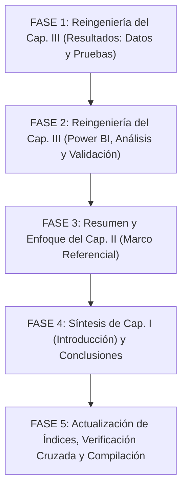

# PLAN DE REFACTORIZACIÓN Y REDUCCIÓN MODULAR DE LA MONOGRAFÍA
## Proyecto: *Análisis de los factores asociados a la desocupación en jóvenes de 16 a 28 años en Bolivia*
### Diplomado en Data Science — Versión I | CEPI — USFX (2026)
**Documento base analizado:** `docs/Gonzales_Suyo_Franz_Reinaldo-ActividadNº3.pdf` (151 páginas totales)  
**Normativa de referencia:** `docs/GUIA-CEPI-ver2.0.pdf` (Guía CEPI, Anexo A, pág. 12)  
**Meta de extensión del cuerpo evaluable (Página 1 a Conclusiones/Referencias):** **55 a 65 páginas** (máximo permisible: 70 páginas)  
**Sección de Anexos:** Independiente y libre de límite de páginas (conserva todo el detalle técnico, código y respaldo).

---

## 1. Criterios Rectores y Delimitación de Páginas

1. **La numeración evaluable inicia en la Página 1 arábiga (Capítulo I: Introducción):**
   * La **Parte Preliminar** (Portada, Cesión de derechos, Resumen e Índices de contenido, tablas y figuras con numeración romana `i` a `x`) **no computa** dentro del límite de páginas de la monografía. Se mantiene íntegra y solo se actualizarán sus números de página y entradas cuando finalicen los ajustes de contenido.
   * El conteo de reducción aplica **exclusivamente desde la página 1 arábiga** (inicio del Capítulo I: Introducción) **hasta la página final de Referencias Bibliográficas**, abarcando:
     * Capítulo I: Introducción
     * Capítulo II: Marco Referencial (Teórico y Contextual)
     * Capítulo III: Resultados (3.1 Presentación, 3.2 Análisis, 3.3 Auditoría IA, 3.4 Panel Expertos)
     * Conclusiones y Recomendaciones
     * Referencias Bibliográficas
2. **Margen de flexibilidad en la extensión (55 a 65 páginas, máx. 70):**
   * Si bien la guía formal del CEPI indica como referencia no exceder las 50 páginas, en la práctica académica de posgrado se admite un rango de **55 a 65 páginas (con un tope de 70 páginas)** para el cuerpo principal. Esta holgura permite preservar la profundidad explicativa de los resultados sin mutilar contenido valioso.
3. **Preservar y resumir las tecnologías en el Capítulo II (no eliminarlas):**
   * Conceptos tecnológicos como **Ciencia de Datos, Metodología CRISP-DM, Python, Pandas, Power BI y DAX** no deben suprimirse. En lugar de eliminarlos, se deben **resumir y compactar**, articulando su definición directamente con el problema laboral boliviano y la utilidad concreta en el proyecto.
4. **Tratamiento del código fuente en el Capítulo III:**
   * Los fragmentos extensos de código de programación incrustados en el texto principal se trasladan a sus correspondientes **Anexos Técnicos (Anexos 3, 6, 7, 8 y 9)**, dejando en el cuerpo la explicación metodológica, fórmulas matemáticas y la referencia cruzada formal *(ver Anexo X)*.
5. **Ejecución gradual en 5 Fases:**
   * La refactorización se desarrollará paso a paso, por fases modulares independientes, permitiendo revisar y validar cada bloque antes de avanzar al siguiente.

---

## 2. Diagnóstico de la Situación Actual (Línea Base del PDF)

| Sección del Documento | Páginas Actuales en PDF | Estado Actual | Meta Propuesta | Reducción Esperada |
| :--- | :---: | :--- | :---: | :---: |
| **Parte Preliminar** (Portada a Índices) | Págs. i – x (11 págs.) | Numeración romana; no computa en el límite. Se actualizan índices al final. | **i – x** | 0 págs. (se preserva) |
| **Capítulo I: Introducción** | Págs. 1 – 10 (10 págs.) | Extenso en antecedentes y justificación. | **6 – 7 págs.** | −3 a −4 págs. |
| **Capítulo II: Marco Referencial** | Págs. 11 – 32 (22 págs.) | Muy detallado en definiciones teóricas de software y conceptos generales. | **14 – 16 págs.** | −6 a −8 págs. |
| **Capítulo III: Resultados (3.1 a 3.4)** | Págs. 33 – 101 (69 págs.) | **Cuello de botella:** 18 bloques de código incrustados y 19 págs. de Power BI. | **30 – 34 págs.** | **−35 a −39 págs.** |
| **Conclusiones y Recomendaciones** | Págs. 102 – 106 (5 págs.) | Versión ya sintetizada en párrafos de 4 a 5 líneas por objetivo y política. | **4 págs.** | −1 pág. |
| **Referencias Bibliográficas** | Págs. 107 – 109 (3 págs.) | Estilo APA 7ma edición completo y estandarizado. | **3 págs.** | 0 págs. |
| **SUBTOTAL CUERPO EVALUABLE (1 a Fin Ref.)** | **109 PÁGINAS** | **Excede el rango en +39 a +44 páginas** | **57 – 64 PÁGINAS** | **−45 a −52 PÁGINAS** |
| **Sección de Anexos Técnicos (1 al 10)** | Págs. 110 – 140 (31 págs.) | Sección libre; absorbe los códigos completos, cuestionarios y matrices. | **35 – 45 págs.** | Libre (no computa) |
| **TOTAL DOCUMENTO COMPLETO** | **151 páginas** | — | **100 – 115 págs.** | — |

---

## 3. Plan de Ejecución Modular en 5 Fases

---

### FASE 1: Reingeniería del Capítulo III (Parte 1: Ingesta, Pruebas y Desagregaciones)
**Objetivo:** Reducir de 31 páginas (págs. 33 a 63) a **16–18 páginas**, manteniendo todos los resultados numéricos, tablas analíticas y figuras de alta resolución, retirando únicamente los scripts de código hacia los Anexos.

* **Paso 1.1. Contexto metodológico y CRISP-DM (3.1.1 a 3.1.3, págs. 33–38):**
  * Mantener la Tabla N.º 6 (Dimensiones metodológicas) y el Diagrama N.º 1 (Embudo de microdatos).
  * Mantener la Tabla N.º 7 (Hitos CRISP-DM).
  * Retirar el bloque de código de lectura de datos de la página 39; dejar la referencia formal a `src/data_processing.py` en el **Anexo 6**.
  * Fusionar la Tabla N.º 8 con la narrativa técnica para no duplicar información con la Tabla 6.
* **Paso 1.2. Descriptivo univariado y pruebas Chi-cuadrado (3.1.4 y 3.1.5, págs. 39–45):**
  * Mantener la fórmula de Tasa de Desocupación ponderada y la Tabla N.º 9 (Macromagnitudes del INE: 3,71% y 8,70%).
  * Mantener la Figura N.º 4 (Comparativa general 2,3% vs juvenil 3,7%).
  * Mantener la fórmula de V de Cramér y la Tabla N.º 10 (Matriz de contrastes Chi-cuadrado).
  * Retirar los 4 bloques de código Python (cálculo de tasas, Matplotlib, Chi-cuadrado y Cramér); referenciar al **Anexo 7** y **Anexo 8**.
  * Suprimir párrafos didácticos repetitivos sobre "qué significa cada columna de la tabla".
* **Paso 1.3. Desagregaciones analíticas (3.1.6, págs. 46–63):**
  * **Dimensión Etaria:** Conservar Tabla N.º 11 y Figura N.º 5 (pico en 18–20 años); retirar bloques de código de cálculo y graficación (Anexos 7 y 8).
  * **Dimensión Género:** Conservar Tabla N.º 12 y Figura N.º 6 (brecha de género +1,84 pp); retirar bloques de código Python (Anexos 7 y 8).
  * **Dimensión Territorial:** Conservar Tabla N.º 13 y Figura N.º 7 (ranking departamental con Chuquisaca a la cabeza); retirar bloques de código (Anexos 7 y 8).
  * **Dimensión Educativa:** Conservar Tabla N.º 14 (t-Student y Mann-Whitney), Figura N.º 8 (Boxplot/KDE escolaridad) y Figuras N.º 9 y 10; retirar bloques de código de cálculo inferencial y Seaborn (Anexos 4, 7 y 8).
  * **Trayectoria y Canales:** Conservar Figura N.º 11 (Cesantes vs Aspirantes), Tabla N.º 15 (Canales de búsqueda) y Figura N.º 13 (Tipología de hogar); retirar bloques de código Python (Anexos 7 y 8).

---

### FASE 2: Reingeniería del Capítulo III (Parte 2: Power BI, Análisis, Auditoría y Expertos)
**Objetivo:** Reducir de 38 páginas (págs. 63 a 101) a **14–16 páginas**, transformando el reporte de Power BI en fichas ejecutivas de alto impacto y sintetizando las secciones de validación.

* **Paso 2.1. Arquitectura dimensional y Modelo semántico (3.1.7, págs. 63–65):**
  * Mantener el Diagrama N.º 2 (Star Schema con tabla de hechos `Fact_MercadoLaboral` y 6 dimensiones) y la Tabla N.º 16 (Catálogo de páginas).
* **Paso 2.2. Evidencia del cuadro de mando interactivo (3.1.8, págs. 65–83):**
  * Reducir de 19 páginas a **6 páginas exactas (1 página por pantalla de Power BI)**:
    * Insertar la captura nítida del dashboard a escala balanceada (~10 cm de alto).
    * Redactar una **ficha analítica de 2 párrafos** por cada pantalla: (1) foco del tablero y hallazgos principales visibles en la vista, y (2) lógica de las medidas DAX rectoras asociadas, con hipervínculo directo al **Anexo 3** (Catálogo DAX).
    * **Suprimir completamente:** Las listas extensas de tarjetas/KPIs y los bloques de código DAX incrustados en cada pantalla (se consultan en Anexo 3).
* **Paso 2.3. Análisis e interpretación crítica de resultados (3.2, págs. 84–92):**
  * Mantener el Diagrama N.º 3 (Modelo conceptual de interrelación) y el Diagrama N.º 4 (Divergencia laboral).
  * Sintetizar los acápites 3.2.1 a 3.2.5 en argumentos concisos sobre los factores determinantes (edad, género, territorio, cesantía y escolaridad).
  * Mantener la Tabla N.º 17 (Matriz sintética de hallazgos para políticas públicas).
  * Reducir de 9 páginas a **4 páginas**.
* **Paso 2.4. Auditoría Externa Automatizada con IA (3.3, págs. 93–98):**
  * Mantener la Tabla N.º 18 (Matriz de 6 pilares, nota 9,70/10) y la Figura N.º 20 (Diagrama de radar a 300 DPI).
  * Resumir el dictamen y las consideraciones críticas en **2 páginas**; retirar el código Python de ejecución (Anexo 9).
* **Paso 2.5. Validación por Panel de Expertos Externos (3.4, págs. 98–101):**
  * Mantener la Tabla N.º 19 (Matriz psicométrica, V de Aiken = 0,88, Alfa de Cronbach = 0,968).
  * Resumir la consulta a los 8 expertos, la calificación (8,63/10) y el tratamiento de observaciones en **2 páginas**; todo el detalle de respuestas y capturas de Google Forms permanece en el **Anexo 10**.

---

### FASE 3: Resumen y Enfoque del Capítulo II (Marco Referencial)
**Objetivo:** Reducir de 22 páginas (págs. 11 a 32) a **14–16 páginas**, resumiendo conceptos de software e informática para vincularlos directamente a la ciencia de datos aplicada al empleo juvenil.

* **Paso 3.1. Marco Teórico (2.1):**
  * **Ciencia de Datos, Estadística y EDA (2.1.1 a 2.1.3):** Resumir en 2 páginas. En lugar de explicar la media y mediana como en la escuela, enfocar cómo el EDA ayuda a identificar asimetrías y valores extremos en encuestas de empleo.
  * **Juventud, PEA, Desocupación y Segmentación (2.1.4 a 2.1.9):** Mantener como eje teórico central (3 a 4 páginas), conservando la definición formal de PEA, subocupación horaria, cesantes y aspirantes según OIT e INE, y la Tabla N.º 4 (Variables y dimensiones).
  * **Microdatos, Muestreo y Ponderadores (2.1.10):** Conservar la fundamentación de por qué el factor de expansión trimestral es de uso obligatorio para evitar sesgos muestrales (1.5 páginas).
  * **Tecnologías Aplicadas (2.1.11 a 2.1.14: CRISP-DM, Python, Pandas, Power BI y DAX):**
    * **No eliminar ninguna tecnología.**
    * Resumir en 2 páginas cómo se articulan: CRISP-DM como marco de ciclo de vida, Python/Pandas para el procesamiento vectorizado y contrastes estadísticos reproducibles, y Power BI/DAX para el modelo dimensional y visualización analítica.
  * **Modelo Conceptual y Alcance (2.1.15 y 2.1.16):** Mantener la Figura N.º 3 (Modelo conceptual) y la delimitación observacional transversal sin atribución de causalidad (1.5 páginas).
* **Paso 3.2. Marco Contextual (2.2):**
  * **Contexto normativo boliviano (2.2.1):** Resumir en 1.5 páginas los artículos clave de la CPE, Ley N.º 342 de la Juventud y Ley N.º 548/1139.
  * **Estructura socioeconómica y mercado laboral urbano (2.2.2 a 2.2.4):** Resumir en 2 páginas la realidad boliviana actual (Censo 2024, informalidad superior al 70%, contracción fiscal) y el marco comparativo regional (OIT/CEPAL).
  * **Contexto educativo y fuentes (2.2.5 a 2.2.8):** Sintetizar la Tabla N.º 5 y las fuentes estadísticas en 1.5 páginas.

---

### FASE 4: Síntesis del Capítulo I (Introducción) y Cierre (Conclusiones / Recomendaciones)
**Objetivo:** Ajustar la Introducción a **6–7 páginas** y consolidar el cierre en **6–7 páginas**.

* **Paso 4.1. Capítulo I: Introducción (págs. 1–10 -> 6–7 páginas):**
  * Sintetizar los antecedentes generales y locales (1.1) a 1.5 páginas, conservando la Figura N.º 1 (Gráfico comparativo general vs. juvenil).
  * Unificar la delimitación y justificación del problema (1.2 y 1.5) evitando reiteraciones de la muestra del INE (2 páginas).
  * Mantener el Objetivo General y los 4 Objetivos Específicos con redacción intacta (1 página).
  * Enfoque metodológico (1.6): Sintetizar la Tabla N.º 1 (Fuentes) y la ruta metodológica (1.5 páginas), suprimiendo la Tabla 2 y Figura 2 (para no duplicar la metodología que se profundiza en los Capítulos II y III).
* **Paso 4.2. Conclusiones y Recomendaciones (págs. 102–106 -> 4 páginas):**
  * Aplicar de forma definitiva la versión ya optimizada en párrafos concisos de 4 a 5 líneas:
    * Conclusión general + 4 conclusiones específicas para los Objetivos 1 al 4 (integrando la doble validación de IA 9,70/10 y panel de expertos 8,63/10 y V de Aiken 0,88).
    * Recomendaciones contextualizadas a Bolivia 2026: R1 a R5 de política pública y R6 a R8 de modelado metodológico.
* **Paso 4.3. Referencias Bibliográficas (págs. 107–109 -> 3 páginas):**
  * Mantener la lista completa de referencias en formato APA 7ma edición.

---

### FASE 5: Actualización Integral de Índices, Verificación Cruzada y Compilación
**Objetivo:** Consolidar el documento final coherente, con índices sincronizados y compilado a formato Word y PDF en el rango de 55 a 65 páginas.

* **Paso 5.1. Actualización de la Parte Preliminar (Páginas i a x):**
  * Actualizar el **Índice de Contenido** con los números de página arábigos definitivos.
  * Actualizar el **Índice de Tablas** (verificando numeración correlativa de Tablas 1 a 19).
  * Actualizar el **Índice de Figuras** (verificando numeración correlativa de Figuras 1 a 20).
* **Paso 5.2. Verificación de referencias y Anexos:**
  * Comprobar que todas las citas cruzadas en el texto apunten correctamente a los Anexos 1 al 10.
  * Verificar que no exista ningún bloque de código suelto en el cuerpo del documento.
* **Paso 5.3. Generación del documento Word (`.docx`) y PDF oficial:**
  * Compilar el documento maestro con formato CEPI (márgenes: 3.5 cm izq., 3.0 cm otros; interlineado 1.5; fuente Arial 11 pt / Times New Roman 12 pt).
  * Validar que el cuerpo principal termine exactamente entre la página **55 y 65 (máximo 70)**.

---

## 4. Cuadro de Control y Seguimiento por Fases

| Fase | Ámbito de Trabajo | Páginas de Partida | Páginas Meta | Estado |
| :---: | :--- | :---: | :---: | :---: |
| **Fase 1** | Cap. III: Ingesta, Chi2, V de Cramér y Desagregaciones (retiro de códigos) | 31 págs. | **16 – 18 págs.** | *Pendiente de inicio* |
| **Fase 2** | Cap. III: Power BI (6 vistas ejecutivas), Análisis, IA y Panel Expertos | 38 págs. | **14 – 16 págs.** | *Pendiente* |
| **Fase 3** | Cap. II: Marco Referencial (Resumen pedagógico de tecnologías y contexto) | 22 págs. | **14 – 16 págs.** | *Pendiente* |
| **Fase 4** | Cap. I: Introducción (síntesis) + Conclusiones y Recomendaciones | 18 págs. | **13 – 14 págs.** | *Pendiente* |
| **Fase 5** | Actualización de Índices (i-x), Verificación Cruzada y Compilación Docx/PDF | 109 págs. (cuerpo) | **57 – 64 págs. (cuerpo)** | *Pendiente* |

---

## 5. Próximo Paso Inmediato
Iniciar con la **FASE 1: Reingeniería del Capítulo III (Parte 1)** sobre el documento maestro `docs/GonzalesSuyo_Franz_ActividadNº1.md`:
1. Retirar los bloques de código Python de las secciones 3.1.3, 3.1.4, 3.1.5 y 3.1.6, vinculándolos a los Anexos 6, 7 y 8.
2. Eliminar explicaciones didácticas redundantes de columnas de tablas.
3. Preservar intactas todas las tablas estadísticas (10 a 15) y figuras analíticas (4 a 13) con sus interpretaciones sustantivas.
